<!-- suite-report/1 inputs sha256 c7b9e4d597bf6a69f0594337971f50a3cef75cdbb26b28cb544825479566e7a4 -->
# Campaign report 20261117-c7b9e4d

- Report id: `20261117-c7b9e4d`
- Inputs: sha256 `c7b9e4d597bf6a69f0594337971f50a3cef75cdbb26b28cb544825479566e7a4` (`inputs.sha256`)
- Campaign `20261117-4d64c1c-release-gfem` (release-gfem)
  - gfem `4d64c1c3ed92` (2026-11-17T21:27:19Z), harness `4d64c1c3ed92`
  - Solvers: —
  - Stack wheels: description_sha256 `f8638f63c753`, env_manifest_sha256 `3636a79428c8`, fingerprint `63af6b406682`, palace_manifest_sha256 `None`
  - Machine mn5-gpp, node classes standard, core budget 16, billed 19.72 core-h
- Reference bragg: `bragg-20261117-058b2f5` computed 2026-11-17T18:55:08Z, closed_form
- Reference lcavity: `lcavity-20261117-058b2f5` computed 2026-11-17T18:55:07Z, closed_form
- Reference microstrip: none named
- Figures: matplotlib 3.11.2
- Anchor tolerance: 1e-08
- Regenerate: `python -m benchmarks report 20261117-4d64c1c-release-gfem --rescore microstrip=microstrip-20261118-1a0108b --out DIR`

## Nodes

Machine benchmark per job (`jobs/<job>/machine.json`).

| campaign | job | host | threads | dgemm GF/s | zgemm GF/s | triad GB/s |  |
|---|---|---|---|---|---|---|---|
| 20261117-4d64c1c-release-gfem | 49175437 | gs03r2b69 | 16 | 1.07e+03 | 1.06e+03 | 137 |  |

A job whose triad is more than 10 % below the median is a slow node.

## Gates

| campaign | complete | provenance | dof_equal | harness failures |
|---|---|---|---|---|
| 20261117-4d64c1c-release-gfem | pass | pass | skipped | 0 |

### Failures (6 records, excluded from every view)

| record | status | class | reason | failing checks |
|---|---|---|---|---|
| bragg/gfem-bddc__wheels__default__rep1 | failed | solver | solve: ValueError: Eigenmode.wave_vector sets a Bloch phase, so the operator is not symmetric, and linear_solver='bddc_gmres' cannot solve the transposed system that two-sided refinement solves on the shift's factors: use linear_solver='direct'. | complete |
| bragg/gfem-bddc__wheels__default__rep2 | failed | solver | solve: ValueError: Eigenmode.wave_vector sets a Bloch phase, so the operator is not symmetric, and linear_solver='bddc_gmres' cannot solve the transposed system that two-sided refinement solves on the shift's factors: use linear_solver='direct'. | complete |
| bragg/gfem-bddc__wheels__default__rep3 | failed | solver | solve: ValueError: Eigenmode.wave_vector sets a Bloch phase, so the operator is not symmetric, and linear_solver='bddc_gmres' cannot solve the transposed system that two-sided refinement solves on the shift's factors: use linear_solver='direct'. | complete |
| bragg/gfem-petsc-mumps__wheels__default__rep1 | failed | solver | solve: ValueError: Eigenmode.wave_vector sets a Bloch phase, so the operator is not symmetric, and linear_solver='petsc' cannot solve the transposed system that two-sided refinement solves on the shift's factors: use linear_solver='direct'. | complete |
| bragg/gfem-petsc-mumps__wheels__default__rep2 | failed | solver | solve: ValueError: Eigenmode.wave_vector sets a Bloch phase, so the operator is not symmetric, and linear_solver='petsc' cannot solve the transposed system that two-sided refinement solves on the shift's factors: use linear_solver='direct'. | complete |
| bragg/gfem-petsc-mumps__wheels__default__rep3 | failed | solver | solve: ValueError: Eigenmode.wave_vector sets a Bloch phase, so the operator is not symmetric, and linear_solver='petsc' cannot solve the transposed system that two-sided refinement solves on the shift's factors: use linear_solver='direct'. | complete |

## bragg

Campaigns: `20261117-4d64c1c-release-gfem`

### Error against cost

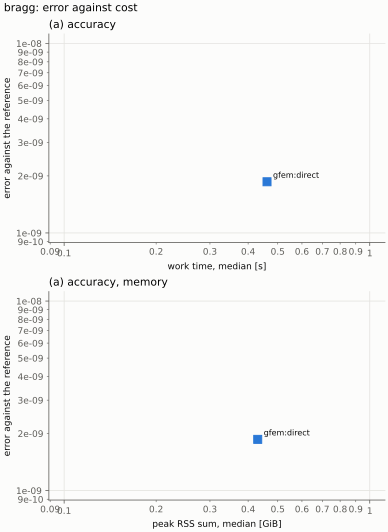

(a) Error against the converged reference, at each solver's best layout.

| solver | layout | tol | work s | peak RSS sum GiB | error |
|---|---|---|---|---|---|
| gfem:direct | 1x16 | — | 0.461 | 0.43 | 1.86e-09 |

Below reference resolution: errors under 1.00e-11.

(b) Same-code error (solver error, not accuracy) along the tolerance ladder.

No tolerance ladder in this case.

Direct runs (same-code error 0 by definition): gfem:direct 0.461 s (1x16).

### Time

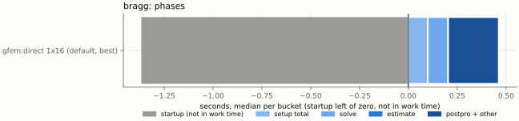

| solver | layout | role | tol | n | work s | spread | startup s | setup total s | solve total s | per sample s | mesh read s | discretize s | assemble s | setup s | solve s | estimate s | postpro s | rom s | other s | iterations | setups/solves | imbalance |
|---|---|---|---|---|---|---|---|---|---|---|---|---|---|---|---|---|---|---|---|---|---|---|
| gfem:direct | 1x16 | default, best | — | 3 | 0.461 | 192.0 % noisy | 1.37 | 0.0986 | 0.104 | — | 0.0438 | 0.0141 | 0.0049 | 0.0363 | 0.104 | — | — | — | 0.259 | 0 | 2/1 | — |

Work time is wall minus startup; startup is not in work time. Rank reduction of the buckets: gfem:direct: max. Max-of-rows is an upper bound on the slowest rank (rows may peak on different ranks); imbalance = headline bucket sum / rank-0 sum.

### Memory

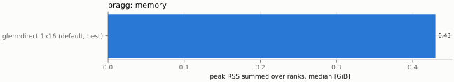

| solver | layout | role | peak RSS sum GiB | rank max GiB | largest node GiB | PSS sum GiB | sacct MaxRSS GiB | self-reports |
|---|---|---|---|---|---|---|---|---|
| gfem:direct | 1x16 | default, best | 0.43 | 0.43 | 0.43 | 0.425 | — | solver_nbytes 7.1e+06 |

The RSS sum counts shared pages once per rank in both codes alike; it is an upper bound on the simultaneous footprint, and PSS corrects it. sacct MaxRSS only for runs over 60 s.

### Accuracy

Reference `bragg-20261117-058b2f5` (2026-11-17T18:55:08Z, closed_form, bound f_hz 1.00e-12, sha256 `3b505fa8d9cb`).
Scored against `bragg-20261117-058b2f5`; a newer reference `bragg-20261117-d2a9be3` (2026-11-17T22:42:49Z) exists. Rescore with: `python -m benchmarks report <ids> --rescore bragg=bragg-20261117-d2a9be3 --out DIR`.

| solver | order | layout | tol | metric | error | bound | resolved | ceiling | plausible | same-code error | δ |
|---|---|---|---|---|---|---|---|---|---|---|---|
| gfem:direct | 3 | 1x16 (default) | — | max_rel_dRe_f | 1.86e-09 | 1.00e-12 | yes | 1.00e-05 | pass | 1.19e-15 | — |

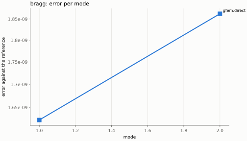

| mode | gfem:direct (1x16) |
|---|---|
| 1 | 1.62e-09 |
| 2 | 1.86e-09 |

### Layouts

| solver | tol | layout | n | median work s | min-max |  |
|---|---|---|---|---|---|---|
| gfem:direct | — | 1x16 | 3 | 0.461 | 0.458-1.34 | default, best |

| solver | default | best | ties | default / best |
|---|---|---|---|---|
| gfem:direct | 1x16 | 1x16 (best of listed) | — | 1 |

### Cross-solver snapshot

DOF: gfem [1560].

Direct kinds:

| solver | role | layout | n | work s | peak RSS sum GiB | error | jobs |
|---|---|---|---|---|---|---|---|
| gfem:direct | default | 1x16 | 3 | 0.461 | 0.43 | 1.86e-09 | 49175437 |
| gfem:direct | best | 1x16 | 3 | 0.461 | 0.43 | 1.86e-09 | 49175437 |

Structural differences (reported, never removed):

- gfem:direct: direct_arm: PARDISO (MKL), one process
- pinned for gfem: linear_solver per kind; the run tolerance; eigen_tolerance 1e-10; no field output

## lcavity

Campaigns: `20261117-4d64c1c-release-gfem`

### Error against cost

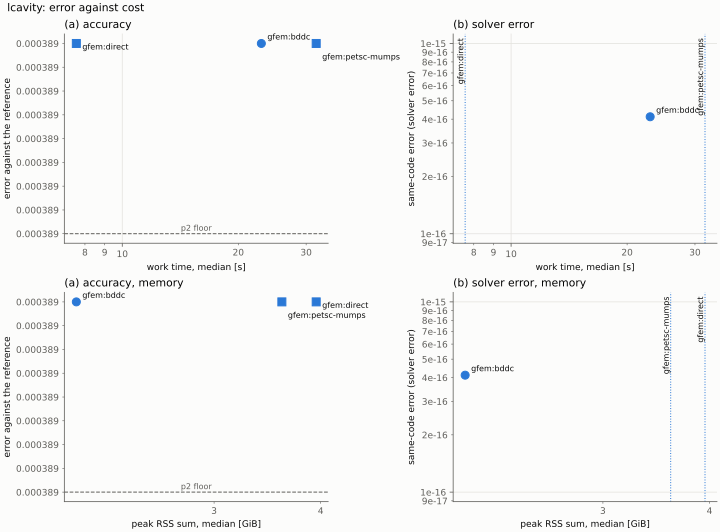

(a) Error against the converged reference, at each solver's best layout.

| solver | layout | tol | work s | peak RSS sum GiB | error |
|---|---|---|---|---|---|
| gfem:bddc | 1x16 | 1e-08 | 23 | 2.07 | 3.89e-04 |
| gfem:direct | 1x16 | — | 7.6 | 3.95 | 3.89e-04 |
| gfem:petsc-mumps | 1x16 | — | 31.9 | 3.6 | 3.89e-04 |

Discretization floor (same-mesh error): p2 3.89e-04.

Below reference resolution: errors under 1.00e-11.

(b) Same-code error (solver error, not accuracy) along the tolerance ladder.

| solver | layout | tol | work s | peak RSS sum GiB | same-code error |
|---|---|---|---|---|---|
| gfem:bddc | 1x16 | 1e-08 | 23 | 2.07 | 4.12e-16 |

Direct runs (same-code error 0 by definition): gfem:direct 7.6 s (1x16), gfem:petsc-mumps 31.9 s (1x16).

### Time

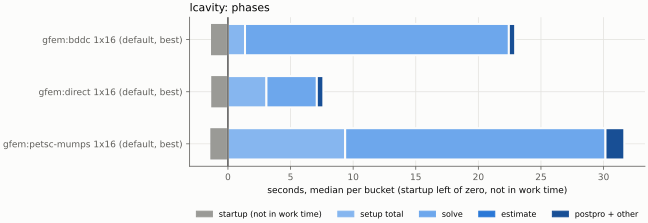

| solver | layout | role | tol | n | work s | spread | startup s | setup total s | solve total s | per sample s | mesh read s | discretize s | assemble s | setup s | solve s | estimate s | postpro s | rom s | other s | iterations | setups/solves | imbalance |
|---|---|---|---|---|---|---|---|---|---|---|---|---|---|---|---|---|---|---|---|---|---|---|
| gfem:bddc | 1x16 | default, best | 1e-08 | 3 | 23 | 1.8 % | 1.35 | 1.36 | 21.1 | — | 0.269 | 0.0687 | 0.763 | 0.262 | 21.1 | — | — | — | 0.503 | 0 | 2/1 | — |
| gfem:direct | 1x16 | default, best | — | 3 | 7.6 | 4.1 % | 1.33 | 3.07 | 4.03 | — | 0.269 | 0.0698 | 0.151 | 2.59 | 4.03 | — | — | — | 0.52 | 0 | 2/1 | — |
| gfem:petsc-mumps | 1x16 | default, best | — | 3 | 31.9 | 2.0 % | 1.41 | 9.37 | 20.8 | — | 0.267 | 0.0809 | 0.166 | 8.85 | 20.8 | — | — | — | 1.5 | 0 | 2/1 | — |

Work time is wall minus startup; startup is not in work time. Rank reduction of the buckets: gfem:bddc: max; gfem:direct: max; gfem:petsc-mumps: max. Max-of-rows is an upper bound on the slowest rank (rows may peak on different ranks); imbalance = headline bucket sum / rank-0 sum.

gfem BDDC: the assemble bucket includes the preconditioner build (NGSolve builds BDDC while it assembles the first matrix of a setup).

### Memory

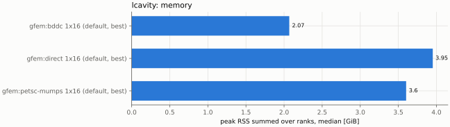

| solver | layout | role | peak RSS sum GiB | rank max GiB | largest node GiB | PSS sum GiB | sacct MaxRSS GiB | self-reports |
|---|---|---|---|---|---|---|---|---|
| gfem:bddc | 1x16 | default, best | 2.07 | 2.07 | 2.07 | 2.06 | — | solver_nbytes 2.17e+08 |
| gfem:direct | 1x16 | default, best | 3.95 | 3.95 | 3.95 | 3.9 | — | solver_nbytes 2.39e+09 |
| gfem:petsc-mumps | 1x16 | default, best | 3.6 | 3.6 | 3.6 | 3.61 | — | solver_nbytes 2.34e+09 |

The RSS sum counts shared pages once per rank in both codes alike; it is an upper bound on the simultaneous footprint, and PSS corrects it. sacct MaxRSS only for runs over 60 s.

### Accuracy

Reference `lcavity-20261117-058b2f5` (2026-11-17T18:55:07Z, closed_form, bound f_hz 1.00e-12, sha256 `b812a4ddaf0e`).

| solver | order | layout | tol | metric | error | bound | resolved | ceiling | plausible | same-code error | δ |
|---|---|---|---|---|---|---|---|---|---|---|---|
| gfem:bddc | 2 | 1x16 (default) | 1e-08 | max_rel_dRe_f | 3.89e-04 | 1.00e-12 | yes | 3.89e-03 | pass | 4.12e-16 | — |
| gfem:direct | 2 | 1x16 (default) | — | max_rel_dRe_f | 3.89e-04 | 1.00e-12 | yes | 3.89e-03 | pass | 0.00e+00 | — |
| gfem:petsc-mumps | 2 | 1x16 (default) | — | max_rel_dRe_f | 3.89e-04 | 1.00e-12 | yes | 3.89e-03 | pass | 4.12e-16 | — |

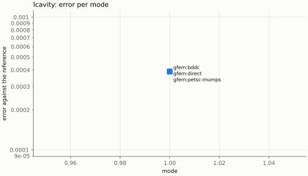

| mode | gfem:bddc (1x16) | gfem:direct (1x16) | gfem:petsc-mumps (1x16) |
|---|---|---|---|
| 1 | 3.89e-04 | 3.89e-04 | 3.89e-04 |

### Layouts

| solver | tol | layout | n | median work s | min-max |  |
|---|---|---|---|---|---|---|
| gfem:bddc | 1e-08 | 1x16 | 3 | 23 | 22.5-23 | default, best |
| gfem:direct | — | 1x16 | 3 | 7.6 | 7.39-7.7 | default, best |
| gfem:petsc-mumps | — | 1x16 | 3 | 31.9 | 31.6-32.2 | default, best |

| solver | default | best | ties | default / best |
|---|---|---|---|---|
| gfem:bddc | 1x16 | 1x16 (best of listed) | — | 1 |
| gfem:direct | 1x16 | 1x16 (best of listed) | — | 1 |
| gfem:petsc-mumps | 1x16 | 1x16 (best of listed) | — | 1 |

### Cross-solver snapshot

DOF: gfem [246416].

Direct kinds:

| solver | role | layout | n | work s | peak RSS sum GiB | error | jobs |
|---|---|---|---|---|---|---|---|
| gfem:direct | default | 1x16 | 3 | 7.6 | 3.95 | 3.89e-04 | 49175437 |
| gfem:direct | best | 1x16 | 3 | 7.6 | 3.95 | 3.89e-04 | 49175437 |
| gfem:petsc-mumps | default | 1x16 | 3 | 31.9 | 3.6 | 3.89e-04 | 49175437 |
| gfem:petsc-mumps | best | 1x16 | 3 | 31.9 | 3.6 | 3.89e-04 | 49175437 |

Iterative kinds:

| solver | role | layout | n | work s | peak RSS sum GiB | error | jobs |
|---|---|---|---|---|---|---|---|
| gfem:bddc | default | 1x16 | 3 | 23 | 2.07 | 3.89e-04 | 49175437 |
| gfem:bddc | best | 1x16 | 3 | 23 | 2.07 | 3.89e-04 | 49175437 |

Iterative kinds compare only at equal achieved error (table above).

Structural differences (reported, never removed):

- gfem:bddc: bddc_build: NGSolve builds the BDDC preconditioner while it assembles the first matrix of a setup, so the build is timed inside assemble
- gfem:direct: direct_arm: PARDISO (MKL), one process
- gfem:petsc-mumps: direct_arm: PETSc MUMPS
- pinned for gfem: linear_solver per kind; the run tolerance; eigen_tolerance 1e-10; no field output

## microstrip

Campaigns: `20261117-4d64c1c-release-gfem`

### Error against cost

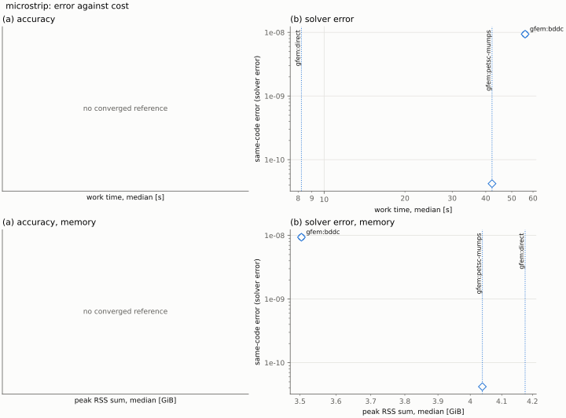

(a) No converged reference: no accuracy panel.

(b) Same-code error (solver error, not accuracy) along the tolerance ladder.

| solver | layout | tol | work s | peak RSS sum GiB | same-code error |
|---|---|---|---|---|---|
| gfem:bddc | 1x16 | 1e-08 | 56.1 | 3.5 | 9.37e-09 |

Direct runs (same-code error 0 by definition): gfem:direct 8.23 s (1x16), gfem:petsc-mumps 42.2 s (1x16).

Difference from gfem direct (not accuracy):

| solver | layout | tol | work s | difference |
|---|---|---|---|---|
| gfem:bddc | 1x16 | 1e-08 | 56.1 | 9.37e-09 |
| gfem:petsc-mumps | 1x16 | — | 42.2 | 4.20e-11 |

### Time

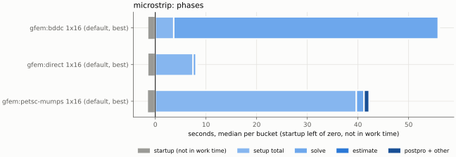

| solver | layout | role | tol | n | work s | spread | startup s | setup total s | solve total s | per sample s | mesh read s | discretize s | assemble s | setup s | solve s | estimate s | postpro s | rom s | other s | iterations | setups/solves | imbalance |
|---|---|---|---|---|---|---|---|---|---|---|---|---|---|---|---|---|---|---|---|---|---|---|
| gfem:bddc | 1x16 | default, best | 1e-08 | 3 | 56.1 | 0.3 % | 1.38 | 3.64 | 52.2 | 11.2 | 0.409 | 0.136 | 3.08 | 0.0166 | 52.2 | — | — | — | 0.206 | 783 | 6/5 | — |
| gfem:direct | 1x16 | default, best | — | 3 | 8.23 | 0.5 % | 1.37 | 7.45 | 0.592 | 1.65 | 0.408 | 0.136 | 1.1 | 5.82 | 0.592 | — | — | — | 0.183 | 0 | 5/5 | — |
| gfem:petsc-mumps | 1x16 | default, best | — | 3 | 42.2 | 0.7 % | 1.44 | 39.7 | 1.52 | 8.44 | 0.411 | 0.155 | 0.911 | 38.2 | 1.52 | — | — | — | 0.995 | 0 | 5/5 | — |

Work time is wall minus startup; startup is not in work time. Rank reduction of the buckets: gfem:bddc: max; gfem:direct: max; gfem:petsc-mumps: max. Max-of-rows is an upper bound on the slowest rank (rows may peak on different ranks); imbalance = headline bucket sum / rank-0 sum.

gfem BDDC: the assemble bucket includes the preconditioner build (NGSolve builds BDDC while it assembles the first matrix of a setup).

### Memory

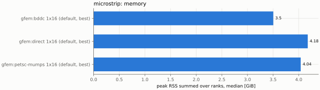

| solver | layout | role | peak RSS sum GiB | rank max GiB | largest node GiB | PSS sum GiB | sacct MaxRSS GiB | self-reports |
|---|---|---|---|---|---|---|---|---|
| gfem:bddc | 1x16 | default, best | 3.5 | 3.5 | 3.5 | 3.49 | — | solver_nbytes 2.66e+08 |
| gfem:direct | 1x16 | default, best | 4.18 | 4.18 | 4.18 | 4.04 | — | solver_nbytes 2.51e+09 |
| gfem:petsc-mumps | 1x16 | default, best | 4.04 | 4.04 | 4.04 | 3.84 | — | solver_nbytes 2.77e+09 |

The RSS sum counts shared pages once per rank in both codes alike; it is an upper bound on the simultaneous footprint, and PSS corrects it. sacct MaxRSS only for runs over 60 s.

### Accuracy

A newer reference `microstrip-20261118-1a0108b` exists.
Rescored cells: vs `microstrip-20261118-1a0108b`; stored values beside.

| solver | order | layout | tol | metric | error | bound | resolved | ceiling | plausible | same-code error | δ | rescored |
|---|---|---|---|---|---|---|---|---|---|---|---|---|
| gfem:bddc | 2 | 1x16 (default) | 1e-08 | — | no_reference | — | — | — | skipped | 9.37e-09 | — | ≤ 4.34e-02 (unresolved) (rescored vs microstrip-20261118-1a0108b) |
| gfem:direct | 2 | 1x16 (default) | — | — | no_reference | — | — | — | skipped | 1.99e-12 | — | ≤ 4.34e-02 (unresolved) (rescored vs microstrip-20261118-1a0108b) |
| gfem:petsc-mumps | 2 | 1x16 (default) | — | — | no_reference | — | — | — | skipped | 4.20e-11 | — | ≤ 4.34e-02 (unresolved) (rescored vs microstrip-20261118-1a0108b) |

### Layouts

| solver | tol | layout | n | median work s | min-max |  |
|---|---|---|---|---|---|---|
| gfem:bddc | 1e-08 | 1x16 | 3 | 56.1 | 56-56.2 | default, best |
| gfem:direct | — | 1x16 | 3 | 8.23 | 8.2-8.24 | default, best |
| gfem:petsc-mumps | — | 1x16 | 3 | 42.2 | 42.1-42.5 | default, best |

| solver | default | best | ties | default / best |
|---|---|---|---|---|
| gfem:bddc | 1x16 | 1x16 (best of listed) | — | 1 |
| gfem:direct | 1x16 | 1x16 (best of listed) | — | 1 |
| gfem:petsc-mumps | 1x16 | 1x16 (best of listed) | — | 1 |

### Cross-solver snapshot

DOF: gfem [315870].

Direct kinds:

| solver | role | layout | n | work s | peak RSS sum GiB | error | jobs |
|---|---|---|---|---|---|---|---|
| gfem:direct | default | 1x16 | 3 | 8.23 | 4.18 | — | 49175437 |
| gfem:direct | best | 1x16 | 3 | 8.23 | 4.18 | — | 49175437 |
| gfem:petsc-mumps | default | 1x16 | 3 | 42.2 | 4.04 | — | 49175437 |
| gfem:petsc-mumps | best | 1x16 | 3 | 42.2 | 4.04 | — | 49175437 |

Iterative kinds:

| solver | role | layout | n | work s | peak RSS sum GiB | error | jobs |
|---|---|---|---|---|---|---|---|
| gfem:bddc | default | 1x16 | 3 | 56.1 | 3.5 | — | 49175437 |
| gfem:bddc | best | 1x16 | 3 | 56.1 | 3.5 | — | 49175437 |

Iterative kinds compare only at equal achieved error (table above).

Structural differences (reported, never removed):

- gfem:bddc: bddc_build: NGSolve builds the BDDC preconditioner while it assembles the first matrix of a setup, so the build is timed inside assemble
- gfem:direct: direct_arm: PARDISO (MKL), one process
- gfem:petsc-mumps: direct_arm: PETSc MUMPS
- pinned for gfem: linear_solver per kind; the run tolerance; eigen_tolerance 1e-10; no field output

## Trend

trend needs two campaigns.

## Caveats

1. Times and memory are observations of one machine, software stack and campaign; nothing here is a pass/fail, and no ratio is a claim beyond this campaign.
2. Headline time is work time (wall minus startup); startup is shown apart. Estimator and postprocessing are inside work time because Palace users cannot switch them off.
3. Memory is the sum of per-rank peak RSS (shared pages counted per rank); PSS and sacct are cross-checks.
4. Palace phases are max-of-rows (an upper bound on the slowest rank); rank 0 shown beside.
5. Nominal Krylov tolerances mean different things in the two codes; iterative codes are compared only at equal achieved error.
6. Accuracy is against the named converged reference; unresolved errors are shown as such; Palace errors carry the definition offset δ; same-code error is solver error, not accuracy.
7. Each code runs at its own defaults except the listed pins; structural differences are listed per case, never removed.
8. Excluded records: everything in the failures table. Medians over passing repeats; n < 3 shown.
9. Ratios across Slurm jobs are labelled "different nodes"; node class is observed, not controlled.
10. No case-specific notes.
