<!-- suite-report/1 inputs sha256 ca7ca43d02867b0e1ad7f643041a0b2a309365f6e13a8b7d8f747b6b9a328432 -->
# Campaign report 20261118-ca7ca43

- Report id: `20261118-ca7ca43`
- Inputs: sha256 `ca7ca43d02867b0e1ad7f643041a0b2a309365f6e13a8b7d8f747b6b9a328432` (`inputs.sha256`)
- Campaign `20261118-7a078ba-release-gfem` (release-gfem)
  - gfem `7a078ba60e65` (2026-11-18T01:04:48Z), harness `7a078ba60e65`
  - Solvers: —
  - Stack wheels: description_sha256 `f8638f63c753`, env_manifest_sha256 `2bd31c03cb55`, fingerprint `63af6b406682`, palace_manifest_sha256 `None`
  - Machine mn5-gpp, node classes standard, core budget 16, billed 21.5 core-h
- Reference bragg: `bragg-20261117-d2a9be3` computed 2026-11-17T22:42:49Z, closed_form
- Reference lcavity: `lcavity-20261117-058b2f5` computed 2026-11-17T18:55:07Z, closed_form
- Reference microstrip: `microstrip-20261118-1a0108b` computed 2026-11-18T00:51:04Z, richardson
- Figures: matplotlib 3.11.2
- Anchor tolerance: 1e-08
- Regenerate: `python -m benchmarks report 20261118-7a078ba-release-gfem --rescore microstrip=microstrip-20261118-7a078ba --out DIR`

## Nodes

Machine benchmark per job (`jobs/<job>/machine.json`).

| campaign | job | host | threads | dgemm GF/s | zgemm GF/s | triad GB/s |  |
|---|---|---|---|---|---|---|---|
| 20261118-7a078ba-release-gfem | 49180275 | gs05r3b23 | 16 | 1.07e+03 | 1.06e+03 | 136 |  |

A job whose triad is more than 10 % below the median is a slow node.

## Gates

| campaign | complete | provenance | dof_equal | harness failures |
|---|---|---|---|---|
| 20261118-7a078ba-release-gfem | pass | pass | skipped | 0 |

### Failures (2 records, excluded from every view)

| record | status | class | reason | failing checks |
|---|---|---|---|---|
| bragg/gfem-bddc__wheels__default__rep1 | refused | — | a Bloch-periodic eigen solve is non-symmetric; gfem solves it with direct only | — |
| bragg/gfem-petsc-mumps__wheels__default__rep1 | refused | — | a Bloch-periodic eigen solve is non-symmetric; gfem solves it with direct only | — |

## bragg

Campaigns: `20261118-7a078ba-release-gfem`

### Error against cost

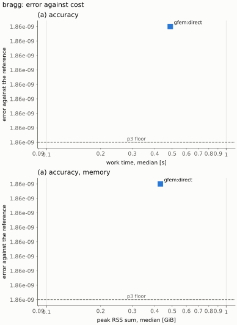

(a) Error against the converged reference, at each solver's best layout.

| solver | layout | tol | work s | peak RSS sum GiB | error |
|---|---|---|---|---|---|
| gfem:direct | 1x16 | — | 0.488 | 0.43 | 1.86e-09 |

Discretization floor (same-mesh error): p3 1.86e-09.

Below reference resolution: errors under 1.00e-11.

(b) Same-code error (solver error, not accuracy) along the tolerance ladder.

No tolerance ladder in this case.

Direct runs (same-code error 0 by definition): gfem:direct 0.488 s (1x16).

### Time

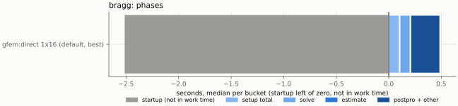

| solver | layout | role | tol | n | work s | spread | startup s | setup total s | solve total s | per sample s | mesh read s | discretize s | assemble s | setup s | solve s | estimate s | postpro s | rom s | other s | iterations | setups/solves | imbalance |
|---|---|---|---|---|---|---|---|---|---|---|---|---|---|---|---|---|---|---|---|---|---|---|
| gfem:direct | 1x16 | default, best | — | 3 | 0.488 | 97.0 % noisy | 2.51 | 0.103 | 0.103 | — | 0.0444 | 0.0152 | 0.00499 | 0.039 | 0.103 | — | — | — | 0.282 | 0 | 2/1 | — |

Work time is wall minus startup; startup is not in work time. Rank reduction of the buckets: gfem:direct: max. Max-of-rows is an upper bound on the slowest rank (rows may peak on different ranks); imbalance = headline bucket sum / rank-0 sum.

### Memory

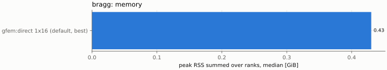

| solver | layout | role | peak RSS sum GiB | rank max GiB | largest node GiB | PSS sum GiB | sacct MaxRSS GiB | self-reports |
|---|---|---|---|---|---|---|---|---|
| gfem:direct | 1x16 | default, best | 0.43 | 0.43 | 0.43 | 0.424 | — | solver_nbytes 7.1e+06 |

The RSS sum counts shared pages once per rank in both codes alike; it is an upper bound on the simultaneous footprint, and PSS corrects it. sacct MaxRSS only for runs over 60 s.

### Accuracy

Reference `bragg-20261117-d2a9be3` (2026-11-17T22:42:49Z, closed_form, bound f_hz 1.00e-12, sha256 `708ec22eb1d6`).

| solver | order | layout | tol | metric | error | bound | resolved | ceiling | plausible | same-code error | δ |
|---|---|---|---|---|---|---|---|---|---|---|---|
| gfem:direct | 3 | 1x16 (default) | — | max_rel_dRe_f | 1.86e-09 | 1.00e-12 | yes | 1.00e-05 | pass | 1.47e-15 | — |

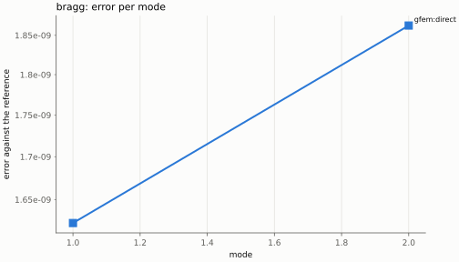

| mode | gfem:direct (1x16) |
|---|---|
| 1 | 1.62e-09 |
| 2 | 1.86e-09 |

### Layouts

| solver | tol | layout | n | median work s | min-max |  |
|---|---|---|---|---|---|---|
| gfem:direct | — | 1x16 | 3 | 0.488 | 0.486-0.96 | default, best |

| solver | default | best | ties | default / best |
|---|---|---|---|---|
| gfem:direct | 1x16 | 1x16 (best of listed) | — | 1 |

### Cross-solver snapshot

DOF: gfem [1560].

Direct kinds:

| solver | role | layout | n | work s | peak RSS sum GiB | error | jobs |
|---|---|---|---|---|---|---|---|
| gfem:direct | default | 1x16 | 3 | 0.488 | 0.43 | 1.86e-09 | 49180275 |
| gfem:direct | best | 1x16 | 3 | 0.488 | 0.43 | 1.86e-09 | 49180275 |

Structural differences (reported, never removed):

- gfem:direct: direct_arm: PARDISO (MKL), one process
- pinned for gfem: linear_solver per kind; the run tolerance; eigen_tolerance 1e-10; no field output

## lcavity

Campaigns: `20261118-7a078ba-release-gfem`

### Error against cost

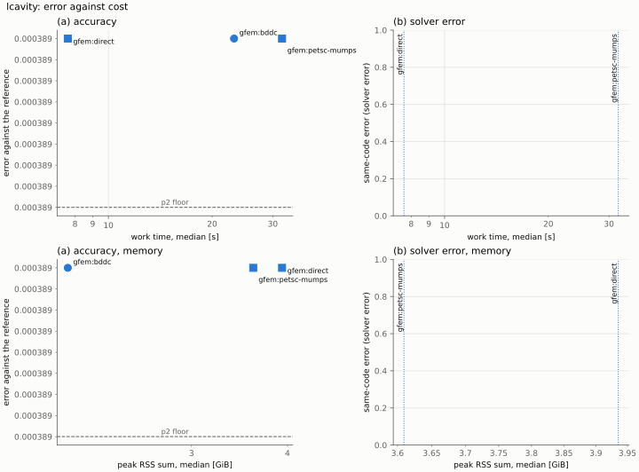

(a) Error against the converged reference, at each solver's best layout.

| solver | layout | tol | work s | peak RSS sum GiB | error |
|---|---|---|---|---|---|
| gfem:bddc | 1x16 | 1e-08 | 23.2 | 2.07 | 3.89e-04 |
| gfem:direct | 1x16 | — | 7.62 | 3.94 | 3.89e-04 |
| gfem:petsc-mumps | 1x16 | — | 31.9 | 3.61 | 3.89e-04 |

Discretization floor (same-mesh error): p2 3.89e-04.

Below reference resolution: errors under 1.00e-11.

(b) Same-code error (solver error, not accuracy) along the tolerance ladder.

| solver | layout | tol | work s | peak RSS sum GiB | same-code error |
|---|---|---|---|---|---|
| gfem:bddc | 1x16 | 1e-08 | 23.2 | 2.07 | 0.00e+00 |

Direct runs (same-code error 0 by definition): gfem:direct 7.62 s (1x16), gfem:petsc-mumps 31.9 s (1x16).

### Time

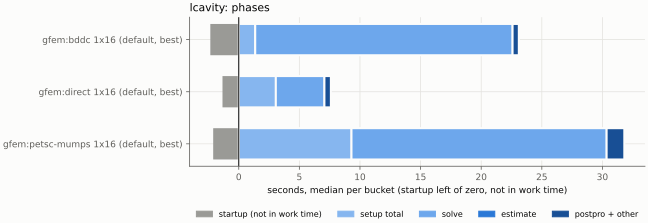

| solver | layout | role | tol | n | work s | spread | startup s | setup total s | solve total s | per sample s | mesh read s | discretize s | assemble s | setup s | solve s | estimate s | postpro s | rom s | other s | iterations | setups/solves | imbalance |
|---|---|---|---|---|---|---|---|---|---|---|---|---|---|---|---|---|---|---|---|---|---|---|
| gfem:bddc | 1x16 | default, best | 1e-08 | 3 | 23.2 | 2.8 % | 2.34 | 1.36 | 21.2 | — | 0.268 | 0.0695 | 0.758 | 0.265 | 21.2 | — | — | — | 0.513 | 0 | 2/1 | — |
| gfem:direct | 1x16 | default, best | — | 3 | 7.62 | 2.3 % | 1.34 | 3.07 | 4.01 | — | 0.265 | 0.0702 | 0.152 | 2.57 | 4.01 | — | — | — | 0.531 | 0 | 2/1 | — |
| gfem:petsc-mumps | 1x16 | default, best | — | 3 | 31.9 | 2.7 % | 2.11 | 9.3 | 21 | — | 0.266 | 0.0813 | 0.166 | 8.79 | 21 | — | — | — | 1.46 | 0 | 2/1 | — |

Work time is wall minus startup; startup is not in work time. Rank reduction of the buckets: gfem:bddc: max; gfem:direct: max; gfem:petsc-mumps: max. Max-of-rows is an upper bound on the slowest rank (rows may peak on different ranks); imbalance = headline bucket sum / rank-0 sum.

gfem BDDC: the assemble bucket includes the preconditioner build (NGSolve builds BDDC while it assembles the first matrix of a setup).

### Memory

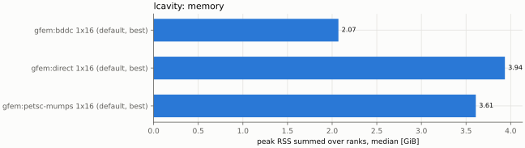

| solver | layout | role | peak RSS sum GiB | rank max GiB | largest node GiB | PSS sum GiB | sacct MaxRSS GiB | self-reports |
|---|---|---|---|---|---|---|---|---|
| gfem:bddc | 1x16 | default, best | 2.07 | 2.07 | 2.07 | 2.06 | — | solver_nbytes 2.17e+08 |
| gfem:direct | 1x16 | default, best | 3.94 | 3.94 | 3.94 | 3.88 | — | solver_nbytes 2.39e+09 |
| gfem:petsc-mumps | 1x16 | default, best | 3.61 | 3.61 | 3.61 | 3.61 | — | solver_nbytes 2.34e+09 |

The RSS sum counts shared pages once per rank in both codes alike; it is an upper bound on the simultaneous footprint, and PSS corrects it. sacct MaxRSS only for runs over 60 s.

### Accuracy

Reference `lcavity-20261117-058b2f5` (2026-11-17T18:55:07Z, closed_form, bound f_hz 1.00e-12, sha256 `b812a4ddaf0e`).

| solver | order | layout | tol | metric | error | bound | resolved | ceiling | plausible | same-code error | δ |
|---|---|---|---|---|---|---|---|---|---|---|---|
| gfem:bddc | 2 | 1x16 (default) | 1e-08 | max_rel_dRe_f | 3.89e-04 | 1.00e-12 | yes | 3.89e-03 | pass | 0.00e+00 | — |
| gfem:direct | 2 | 1x16 (default) | — | max_rel_dRe_f | 3.89e-04 | 1.00e-12 | yes | 3.89e-03 | pass | 0.00e+00 | — |
| gfem:petsc-mumps | 2 | 1x16 (default) | — | max_rel_dRe_f | 3.89e-04 | 1.00e-12 | yes | 3.89e-03 | pass | 4.12e-16 | — |

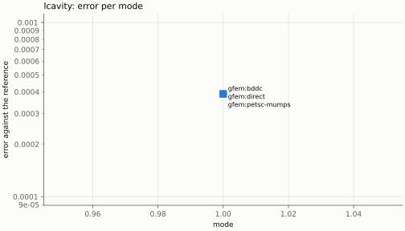

| mode | gfem:bddc (1x16) | gfem:direct (1x16) | gfem:petsc-mumps (1x16) |
|---|---|---|---|
| 1 | 3.89e-04 | 3.89e-04 | 3.89e-04 |

### Layouts

| solver | tol | layout | n | median work s | min-max |  |
|---|---|---|---|---|---|---|
| gfem:bddc | 1e-08 | 1x16 | 3 | 23.2 | 22.8-23.4 | default, best |
| gfem:direct | — | 1x16 | 3 | 7.62 | 7.48-7.65 | default, best |
| gfem:petsc-mumps | — | 1x16 | 3 | 31.9 | 31.4-32.3 | default, best |

| solver | default | best | ties | default / best |
|---|---|---|---|---|
| gfem:bddc | 1x16 | 1x16 (best of listed) | — | 1 |
| gfem:direct | 1x16 | 1x16 (best of listed) | — | 1 |
| gfem:petsc-mumps | 1x16 | 1x16 (best of listed) | — | 1 |

### Cross-solver snapshot

DOF: gfem [246416].

Direct kinds:

| solver | role | layout | n | work s | peak RSS sum GiB | error | jobs |
|---|---|---|---|---|---|---|---|
| gfem:direct | default | 1x16 | 3 | 7.62 | 3.94 | 3.89e-04 | 49180275 |
| gfem:direct | best | 1x16 | 3 | 7.62 | 3.94 | 3.89e-04 | 49180275 |
| gfem:petsc-mumps | default | 1x16 | 3 | 31.9 | 3.61 | 3.89e-04 | 49180275 |
| gfem:petsc-mumps | best | 1x16 | 3 | 31.9 | 3.61 | 3.89e-04 | 49180275 |

Iterative kinds:

| solver | role | layout | n | work s | peak RSS sum GiB | error | jobs |
|---|---|---|---|---|---|---|---|
| gfem:bddc | default | 1x16 | 3 | 23.2 | 2.07 | 3.89e-04 | 49180275 |
| gfem:bddc | best | 1x16 | 3 | 23.2 | 2.07 | 3.89e-04 | 49180275 |

Iterative kinds compare only at equal achieved error (table above).

Structural differences (reported, never removed):

- gfem:bddc: bddc_build: NGSolve builds the BDDC preconditioner while it assembles the first matrix of a setup, so the build is timed inside assemble
- gfem:direct: direct_arm: PARDISO (MKL), one process
- gfem:petsc-mumps: direct_arm: PETSc MUMPS
- pinned for gfem: linear_solver per kind; the run tolerance; eigen_tolerance 1e-10; no field output

## microstrip

Campaigns: `20261118-7a078ba-release-gfem`

### Error against cost

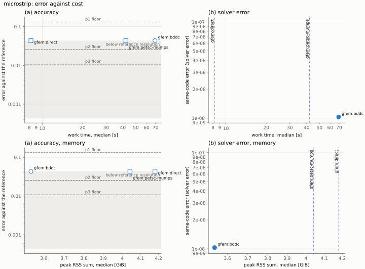

(a) Error against the converged reference, at each solver's best layout.

| solver | layout | tol | work s | peak RSS sum GiB | error |
|---|---|---|---|---|---|
| gfem:bddc | 1x16 | 1e-08 | 69.4 | 3.54 | ≤ 4.34e-02 (unresolved) |
| gfem:direct | 1x16 | — | 8.23 | 4.18 | ≤ 4.34e-02 (unresolved) |
| gfem:petsc-mumps | 1x16 | — | 42.1 | 4.04 | ≤ 4.34e-02 (unresolved) |

Discretization floor (same-mesh error): p1 1.32e-01, p2 2.55e-02, p3 1.07e-02.

Below reference resolution: errors under 4.34e-02.

(b) Same-code error (solver error, not accuracy) along the tolerance ladder.

| solver | layout | tol | work s | peak RSS sum GiB | same-code error |
|---|---|---|---|---|---|
| gfem:bddc | 1x16 | 1e-08 | 69.4 | 3.54 | 1.03e-08 |

Direct runs (same-code error 0 by definition): gfem:direct 8.23 s (1x16), gfem:petsc-mumps 42.1 s (1x16).

### Time

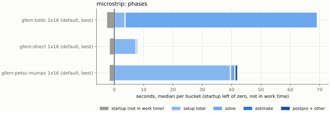

| solver | layout | role | tol | n | work s | spread | startup s | setup total s | solve total s | per sample s | mesh read s | discretize s | assemble s | setup s | solve s | estimate s | postpro s | rom s | other s | iterations | setups/solves | imbalance |
|---|---|---|---|---|---|---|---|---|---|---|---|---|---|---|---|---|---|---|---|---|---|---|
| gfem:bddc | 1x16 | default, best | 1e-08 | 3 | 69.4 | 0.2 % | 2.43 | 3.69 | 65.5 | 13.9 | 0.412 | 0.133 | 3.13 | 0.0197 | 65.5 | — | — | — | 0.215 | 897 | 6/5 | — |
| gfem:direct | 1x16 | default, best | — | 3 | 8.23 | 0.6 % | 1.5 | 7.46 | 0.594 | 1.65 | 0.409 | 0.138 | 1.1 | 5.81 | 0.594 | — | — | — | 0.184 | 0 | 5/5 | — |
| gfem:petsc-mumps | 1x16 | default, best | — | 3 | 42.1 | 0.5 % | 1.55 | 39.6 | 1.52 | 8.42 | 0.406 | 0.155 | 0.904 | 38.2 | 1.52 | — | — | — | 0.923 | 0 | 5/5 | — |

Work time is wall minus startup; startup is not in work time. Rank reduction of the buckets: gfem:bddc: max; gfem:direct: max; gfem:petsc-mumps: max. Max-of-rows is an upper bound on the slowest rank (rows may peak on different ranks); imbalance = headline bucket sum / rank-0 sum.

gfem BDDC: the assemble bucket includes the preconditioner build (NGSolve builds BDDC while it assembles the first matrix of a setup).

### Memory

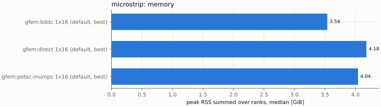

| solver | layout | role | peak RSS sum GiB | rank max GiB | largest node GiB | PSS sum GiB | sacct MaxRSS GiB | self-reports |
|---|---|---|---|---|---|---|---|---|
| gfem:bddc | 1x16 | default, best | 3.54 | 3.54 | 3.54 | 3.51 | 2.52 | solver_nbytes 2.66e+08 |
| gfem:direct | 1x16 | default, best | 4.18 | 4.18 | 4.18 | 4.12 | — | solver_nbytes 2.51e+09 |
| gfem:petsc-mumps | 1x16 | default, best | 4.04 | 4.04 | 4.04 | 3.84 | — | solver_nbytes 2.77e+09 |

The RSS sum counts shared pages once per rank in both codes alike; it is an upper bound on the simultaneous footprint, and PSS corrects it. sacct MaxRSS only for runs over 60 s.

### Accuracy

Reference `microstrip-20261118-1a0108b` (2026-11-18T00:51:04Z, richardson, bound s 4.34e-03, sha256 `811894b6ade2`).
A newer reference `microstrip-20261118-7a078ba` exists.
Rescored cells: vs `microstrip-20261118-7a078ba`; stored values beside.

| solver | order | layout | tol | metric | error | bound | resolved | ceiling | plausible | same-code error | δ | rescored |
|---|---|---|---|---|---|---|---|---|---|---|---|---|
| gfem:bddc | 2 | 1x16 (default) | 1e-08 | max_abs_dS | ≤ 10·bound = 4.34e-02 (unresolved) | 4.34e-03 | no | 2.55e-01 | pass | 1.03e-08 | — | ≤ 3.67e-02 (unresolved) (rescored vs microstrip-20261118-7a078ba) |
| gfem:direct | 2 | 1x16 (default) | — | max_abs_dS | ≤ 10·bound = 4.34e-02 (unresolved) | 4.34e-03 | no | 2.55e-01 | pass | 1.09e-12 | — | ≤ 3.67e-02 (unresolved) (rescored vs microstrip-20261118-7a078ba) |
| gfem:petsc-mumps | 2 | 1x16 (default) | — | max_abs_dS | ≤ 10·bound = 4.34e-02 (unresolved) | 4.34e-03 | no | 2.55e-01 | pass | 2.33e-11 | — | ≤ 3.67e-02 (unresolved) (rescored vs microstrip-20261118-7a078ba) |

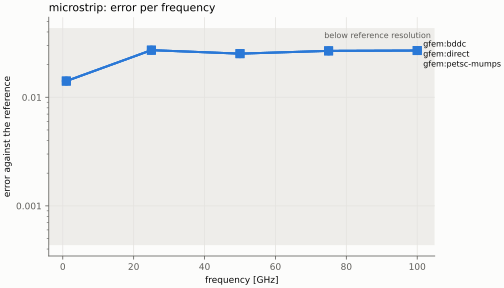

| frequency Hz | gfem:bddc (1x16) | gfem:direct (1x16) | gfem:petsc-mumps (1x16) |
|---|---|---|---|
| 1e+09 | 1.41e-02 | 1.41e-02 | 1.41e-02 |
| 2.5e+10 | 2.72e-02 | 2.72e-02 | 2.72e-02 |
| 5e+10 | 2.52e-02 | 2.52e-02 | 2.52e-02 |
| 7.5e+10 | 2.68e-02 | 2.68e-02 | 2.68e-02 |
| 1e+11 | 2.70e-02 | 2.70e-02 | 2.70e-02 |

### Layouts

| solver | tol | layout | n | median work s | min-max |  |
|---|---|---|---|---|---|---|
| gfem:bddc | 1e-08 | 1x16 | 3 | 69.4 | 69.3-69.5 | default, best |
| gfem:direct | — | 1x16 | 3 | 8.23 | 8.19-8.24 | default, best |
| gfem:petsc-mumps | — | 1x16 | 3 | 42.1 | 42.1-42.3 | default, best |

| solver | default | best | ties | default / best |
|---|---|---|---|---|
| gfem:bddc | 1x16 | 1x16 (best of listed) | — | 1 |
| gfem:direct | 1x16 | 1x16 (best of listed) | — | 1 |
| gfem:petsc-mumps | 1x16 | 1x16 (best of listed) | — | 1 |

### Cross-solver snapshot

DOF: gfem [315870].

Direct kinds:

| solver | role | layout | n | work s | peak RSS sum GiB | error | jobs |
|---|---|---|---|---|---|---|---|
| gfem:direct | default | 1x16 | 3 | 8.23 | 4.18 | 2.72e-02 | 49180275 |
| gfem:direct | best | 1x16 | 3 | 8.23 | 4.18 | 2.72e-02 | 49180275 |
| gfem:petsc-mumps | default | 1x16 | 3 | 42.1 | 4.04 | 2.72e-02 | 49180275 |
| gfem:petsc-mumps | best | 1x16 | 3 | 42.1 | 4.04 | 2.72e-02 | 49180275 |

Iterative kinds:

| solver | role | layout | n | work s | peak RSS sum GiB | error | jobs |
|---|---|---|---|---|---|---|---|
| gfem:bddc | default | 1x16 | 3 | 69.4 | 3.54 | 2.72e-02 | 49180275 |
| gfem:bddc | best | 1x16 | 3 | 69.4 | 3.54 | 2.72e-02 | 49180275 |

Iterative kinds compare only at equal achieved error (table above).

Structural differences (reported, never removed):

- gfem:bddc: bddc_build: NGSolve builds the BDDC preconditioner while it assembles the first matrix of a setup, so the build is timed inside assemble
- gfem:direct: direct_arm: PARDISO (MKL), one process
- gfem:petsc-mumps: direct_arm: PETSc MUMPS
- pinned for gfem: linear_solver per kind; the run tolerance; eigen_tolerance 1e-10; no field output

## Trend

trend needs two campaigns.

## Caveats

1. Times and memory are observations of one machine, software stack and campaign; nothing here is a pass/fail, and no ratio is a claim beyond this campaign.
2. Headline time is work time (wall minus startup); startup is shown apart. Estimator and postprocessing are inside work time because Palace users cannot switch them off.
3. Memory is the sum of per-rank peak RSS (shared pages counted per rank); PSS and sacct are cross-checks.
4. Palace phases are max-of-rows (an upper bound on the slowest rank); rank 0 shown beside.
5. Nominal Krylov tolerances mean different things in the two codes; iterative codes are compared only at equal achieved error.
6. Accuracy is against the named converged reference; unresolved errors are shown as such; Palace errors carry the definition offset δ; same-code error is solver error, not accuracy.
7. Each code runs at its own defaults except the listed pins; structural differences are listed per case, never removed.
8. Excluded records: everything in the failures table. Medians over passing repeats; n < 3 shown.
9. Ratios across Slurm jobs are labelled "different nodes"; node class is observed, not controlled.
10. No case-specific notes.
