<!-- suite-report/1 inputs sha256 c666c7dac92c40fedb34ff72f8d87d29ae5ee8b19113bc7ab765c3e1a5c7f297 -->
# Campaign report 20261119-c666c7d

- Report id: `20261119-c666c7d`
- Inputs: sha256 `c666c7dac92c40fedb34ff72f8d87d29ae5ee8b19113bc7ab765c3e1a5c7f297` (`inputs.sha256`)
- Campaign `20261119-43f36e5-smoke` (smoke)
  - gfem `43f36e5af87e` (2026-11-19T13:16:31Z), harness `43f36e5af87e`
  - Solvers: palace 0.19.0
  - Stack wheels: description_sha256 `f8638f63c753`, env_manifest_sha256 `f1092569b0b5`, fingerprint `63af6b406682`, palace_manifest_sha256 `a133a028deb5`
  - Machine mn5-gpp, node classes highmem, standard, core budget 16, billed 396.7 core-h
- Campaign `20261119-43f36e5-smoke-r10m` (smoke-r10m)
  - gfem `43f36e5af87e` (2026-11-19T13:16:31Z), harness `43f36e5af87e`
  - Solvers: palace 0.19.0
  - Stack wheels: description_sha256 `f8638f63c753`, env_manifest_sha256 `f1092569b0b5`, fingerprint `63af6b406682`, palace_manifest_sha256 `a133a028deb5`
  - Machine mn5-gpp, node classes highmem, core budget 112, billed 22.4 core-h
- Reference bragg: `bragg-20261118-a0ff134` (not in the store)
- Reference lcavity: `lcavity-20261117-058b2f5` computed 2026-11-17T18:55:07Z, closed_form
- Reference microstrip: `microstrip-20261119-7a078ba` computed 2026-11-19T13:15:50Z, richardson
- Reference r10M_void: `r10M_void-20261117-058b2f5` computed 2026-11-17T18:55:08Z, none
- Figures: matplotlib 3.11.2
- Anchor tolerance: 1e-08
- Regenerate: `python -m benchmarks report 20261119-43f36e5-smoke 20261119-43f36e5-smoke-r10m --out DIR`

## Nodes

Machine benchmark per job (`jobs/<job>/machine.json`).

| campaign | job | host | threads | dgemm GF/s | zgemm GF/s | triad GB/s |  |
|---|---|---|---|---|---|---|---|
| 20261119-43f36e5-smoke | 49239172 | gs02r2b72 | 16 | 1.07e+03 | 1.06e+03 | 136 |  |
| 20261119-43f36e5-smoke | 49239655 | gs01r2b21 | 16 | 1.07e+03 | 1.06e+03 | 154 |  |
| 20261119-43f36e5-smoke | 49240720 | gs10r3b67 | 16 | 1.07e+03 | 1.06e+03 | 136 |  |
| 20261119-43f36e5-smoke-r10m | 49240721 | gs01r3b15 | 112 | 4.63e+03 | 5.19e+03 | 477 |  |

A job whose triad is more than 10 % below the median is a slow node.

## Gates

| campaign | complete | provenance | dof_equal | harness failures |
|---|---|---|---|---|
| 20261119-43f36e5-smoke | pass | pass | pass | 0 |
| 20261119-43f36e5-smoke-r10m | pass | pass | pass | 0 |

- `20261119-43f36e5-smoke` dof_equal bragg: pass (gfem [10620], palace [10620])
- `20261119-43f36e5-smoke` dof_equal lcavity: pass (gfem [246416], palace [246416])
- `20261119-43f36e5-smoke` dof_equal microstrip: pass (gfem [315870], palace [315870])
- `20261119-43f36e5-smoke-r10m` dof_equal r10M_void: pass (gfem [10248856], palace [10248856])

### Failures (21 records, excluded from every view)

| record | status | class | reason | failing checks |
|---|---|---|---|---|
| bragg/gfem-bddc__wheels__1x16__rep1 | refused | — | a Bloch-periodic eigen solve is non-symmetric; gfem solves it with direct only | — |
| bragg/gfem-petsc-mumps__wheels__1x16__rep1 | refused | — | a Bloch-periodic eigen solve is non-symmetric; gfem solves it with direct only | — |
| bragg/palace-mumps__wheels__4x4__rep3 | ok | — | — | placement |
| bragg/palace-pmg__wheels__16x1__rep1 | timeout | — | wall cap 120 s | complete |
| bragg/palace-pmg__wheels__16x1__rep2 | not_started | — | earlier_repeat_timeout | — |
| bragg/palace-pmg__wheels__16x1__rep3 | not_started | — | earlier_repeat_timeout | — |
| bragg/palace-pmg__wheels__1x16__rep1 | timeout | — | wall cap 120 s | complete |
| bragg/palace-pmg__wheels__1x16__rep2 | not_started | — | earlier_repeat_timeout | — |
| bragg/palace-pmg__wheels__1x16__rep3 | not_started | — | earlier_repeat_timeout | — |
| bragg/palace-pmg__wheels__2x8__rep1 | timeout | — | wall cap 120 s | complete |
| bragg/palace-pmg__wheels__2x8__rep2 | not_started | — | earlier_repeat_timeout | — |
| bragg/palace-pmg__wheels__2x8__rep3 | not_started | — | earlier_repeat_timeout | — |
| bragg/palace-pmg__wheels__4x4__rep1 | timeout | — | wall cap 120 s | complete |
| bragg/palace-pmg__wheels__4x4__rep2 | not_started | — | earlier_repeat_timeout | — |
| bragg/palace-pmg__wheels__4x4__rep3 | not_started | — | earlier_repeat_timeout | — |
| bragg/palace-pmg__wheels__8x2__rep1 | timeout | — | wall cap 120 s | complete |
| bragg/palace-pmg__wheels__8x2__rep2 | not_started | — | earlier_repeat_timeout | — |
| bragg/palace-pmg__wheels__8x2__rep3 | not_started | — | earlier_repeat_timeout | — |
| lcavity/palace-mumps__wheels__2x8__rep1 | ok | — | — | placement |
| lcavity/palace-mumps__wheels__4x4__rep3 | ok | — | — | placement |
| microstrip/palace-mumps__wheels__2x8__rep3 | ok | — | — | placement |

## bragg

Campaigns: `20261119-43f36e5-smoke`

### Error against cost

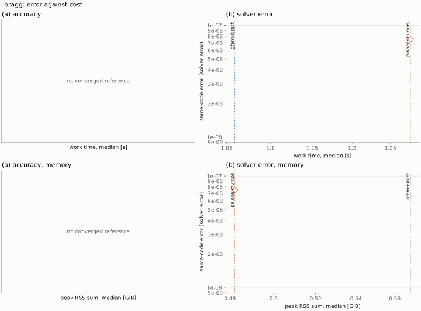

(a) No converged reference: no accuracy panel.

(b) Same-code error (solver error, not accuracy) along the tolerance ladder.

No tolerance ladder in this case.

Direct runs (same-code error 0 by definition): gfem:direct 1.06 s (1x16), palace:mumps 1.28 s (2x8).

Difference from gfem direct (not accuracy):

| solver | layout | tol | work s | difference |
|---|---|---|---|---|
| palace:mumps | 2x8 | — | 1.28 | 7.50e-08 |

### Time

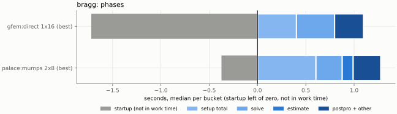

| solver | layout | role | tol | n | work s | spread | startup s | setup total s | solve total s | per sample s | mesh read s | discretize s | assemble s | setup s | solve s | estimate s | postpro s | rom s | other s | iterations | setups/solves | imbalance |
|---|---|---|---|---|---|---|---|---|---|---|---|---|---|---|---|---|---|---|---|---|---|---|
| gfem:direct | 1x16 | best | — | 3 | 1.06 | 183.7 % noisy | 1.72 | 0.402 | 0.395 | — | 0.0435 | 0.0457 | 0.0147 | 0.299 | 0.395 | — | — | — | 0.298 | 0 | 2/1 | — |
| palace:mumps | 2x8 | best | — | 3 | 1.28 | 42.9 % noisy | 0.373 | 0.605 | 0.272 | — | 0.014 | — | 0.231 | 0.36 | 0.272 | 0.113 | 0.07 | 0 | 0.215 | 52 | 1/26 | 1 |
|  |  | rank 0 |  |  | — |  |  |  |  |  | 0.0122 | — | 0.231 | 0.36 | 0.271 | 0.113 | 0.0692 | 0 | 0.219 |  |  |  |

Work time is wall minus startup; startup is not in work time. Rank reduction of the buckets: gfem:direct: max; palace:mumps: max-of-rows. Max-of-rows is an upper bound on the slowest rank (rows may peak on different ranks); imbalance = headline bucket sum / rank-0 sum.

### Memory

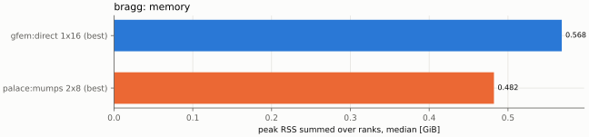

| solver | layout | role | peak RSS sum GiB | rank max GiB | largest node GiB | PSS sum GiB | sacct MaxRSS GiB | self-reports |
|---|---|---|---|---|---|---|---|---|
| gfem:direct | 1x16 | best | 0.568 | 0.568 | 0.568 | 0.563 | — | solver_nbytes 8.25e+07 |
| palace:mumps | 2x8 | best | 0.482 | 0.241 | 0.482 | 0.434 | — | — |

The RSS sum counts shared pages once per rank in both codes alike; it is an upper bound on the simultaneous footprint, and PSS corrects it. sacct MaxRSS only for runs over 60 s.

### Accuracy

Scored against `bragg-20261118-a0ff134`; a newer reference `bragg-20261117-d2a9be3` (2026-11-17T22:42:49Z) exists. Rescore with: `python -m benchmarks report <ids> --rescore bragg=bragg-20261117-d2a9be3 --out DIR`.

| solver | order | layout | tol | metric | error | bound | resolved | ceiling | plausible | same-code error | δ |
|---|---|---|---|---|---|---|---|---|---|---|---|
| gfem:direct | 3 | 1x16 | — | max_rel_dRe_f | 2.92e-11 | 1.00e-12 | yes | — | pass | 1.84e-15 | — |
| palace:mumps | 3 | 1x16 | — | max_rel_dRe_f | 4.78e-09 | 1.00e-12 | yes | — | pass | 0.00e+00 | — |
| palace:mumps | 3 | 2x8 | — | max_rel_dRe_f | 4.78e-09 | 1.00e-12 | yes | — | pass | 0.00e+00 | — |
| palace:mumps | 3 | 4x4 | — | max_rel_dRe_f | 4.78e-09 | 1.00e-12 | yes | — | pass | 0.00e+00 | — |
| palace:mumps | 3 | 8x2 | — | max_rel_dRe_f | 4.78e-09 | 1.00e-12 | yes | — | pass | 0.00e+00 | — |
| palace:mumps | 3 | 16x1 | — | max_rel_dRe_f | 4.78e-09 | 1.00e-12 | yes | — | pass | 0.00e+00 | — |

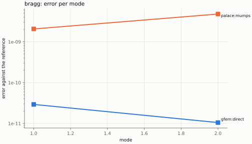

| mode | gfem:direct (1x16) | palace:mumps (2x8) |
|---|---|---|
| 1 | 2.92e-11 | 2.06e-09 |
| 2 | 1.05e-11 | 4.78e-09 |

### Layouts

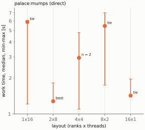

| solver | tol | layout | n | median work s | min-max |  |
|---|---|---|---|---|---|---|
| gfem:direct | — | 1x16 | 3 | 1.06 | 0.924-2.87 | best |
| palace:mumps | — | 1x16 | 3 | 5.88 | 1.21-6.08 | tie |
| palace:mumps | — | 2x8 | 3 | 1.28 | 1.27-1.82 | best |
| palace:mumps | — | 4x4 | 2 | 2.95 | 1.1-4.8 | n = 2 |
| palace:mumps | — | 8x2 | 3 | 5.44 | 1.74-7.02 | tie |
| palace:mumps | — | 16x1 | 3 | 1.42 | 1.41-1.96 | tie |

| solver | default | best | ties | default / best |
|---|---|---|---|---|
| gfem:direct | — | 1x16 | — | — |
| palace:mumps | — | 2x8 | 1x16, 8x2, 16x1 | — |

Not plotted (not passing):

- palace:mumps 4x4: ok (—)

### Cross-solver snapshot (same-mesh comparison)

DOF: gfem [10620], palace [10620].

Direct kinds:

| solver | role | layout | n | work s | peak RSS sum GiB | error | jobs |
|---|---|---|---|---|---|---|---|
| gfem:direct | best | 1x16 | 3 | 1.06 | 0.568 | 2.92e-11 | 49239172 |
| palace:mumps | best | 2x8 | 3 | 1.28 | 0.482 | 4.78e-09 | 49239172 |

| role | ratio | work | memory | pairing |
|---|---|---|---|---|
| best | palace:mumps / gfem:direct | 1.21 | 0.849 | same job |

Structural differences (reported, never removed):

- gfem:direct: direct_arm: PARDISO (MKL), one process
- palace:mumps: direct_arm: GMRES around complex MUMPS (MGMaxLevels 1)
- palace:mumps: estimator: always on, lightened (EstimatorTol 1e-2, EstimatorMG)
- pinned for gfem: linear_solver per kind; the run tolerance; eigen_tolerance 1e-10; no field output
- pinned for palace: Refinement 0; Absorbing.Order 1; Linear.Type pinned per kind; MUMPS kind: MGMaxLevels 1, ComplexCoarseSolve, Tol 1e-10; iterative Tol = the run tolerance, MaxIts 2000; EstimatorTol 1e-2, EstimatorMG; eigen Tol 1e-10, inner Linear.Tol 1e-12; no field output

## lcavity

Campaigns: `20261119-43f36e5-smoke`

### Error against cost

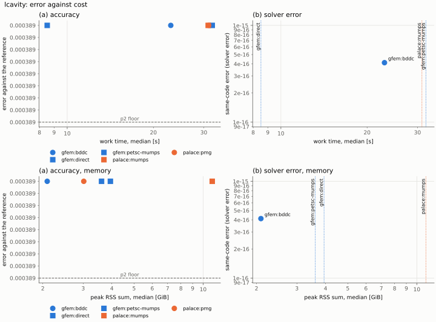

(a) Error against the converged reference, at each solver's best layout.

| solver | layout | tol | work s | peak RSS sum GiB | error |
|---|---|---|---|---|---|
| gfem:bddc | 1x16 | 1e-08 | 23 | 2.09 | 3.89e-04 |
| gfem:direct | 1x16 | — | 8.52 | 3.94 | 3.89e-04 |
| gfem:petsc-mumps | 1x16 | — | 32.1 | 3.61 | 3.89e-04 |
| palace:mumps | 16x1 | — | 31.1 | 11 | 3.89e-04 |
| palace:pmg | 16x1 | 1e-08 | 31.2 | 3.02 | 3.89e-04 |

Discretization floor (same-mesh error): p2 3.89e-04.

Below reference resolution: errors under 1.00e-11.

(b) Same-code error (solver error, not accuracy) along the tolerance ladder.

| solver | layout | tol | work s | peak RSS sum GiB | same-code error |
|---|---|---|---|---|---|
| gfem:bddc | 1x16 | 1e-08 | 23 | 2.09 | 4.12e-16 |
| palace:pmg | 16x1 | 1e-08 | 31.2 | 3.02 | 0.00e+00 |

Direct runs (same-code error 0 by definition): gfem:direct 8.52 s (1x16), gfem:petsc-mumps 32.1 s (1x16), palace:mumps 31.1 s (16x1).

### Time

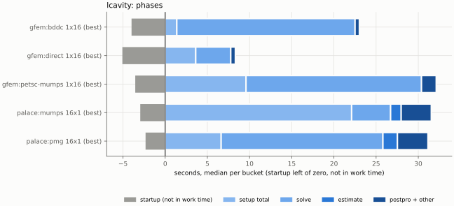

| solver | layout | role | tol | n | work s | spread | startup s | setup total s | solve total s | per sample s | mesh read s | discretize s | assemble s | setup s | solve s | estimate s | postpro s | rom s | other s | iterations | setups/solves | imbalance |
|---|---|---|---|---|---|---|---|---|---|---|---|---|---|---|---|---|---|---|---|---|---|---|
| gfem:bddc | 1x16 | best | 1e-08 | 3 | 23 | 2.5 % | 3.99 | 1.38 | 21.1 | — | 0.275 | 0.0694 | 0.768 | 0.266 | 21.1 | — | — | — | 0.507 | 0 | 2/1 | — |
| gfem:direct | 1x16 | best | — | 3 | 8.52 | 16.3 % noisy | 5.08 | 3.78 | 4.15 | — | 0.276 | 0.0702 | 0.154 | 3.12 | 4.15 | — | — | — | 0.541 | 0 | 2/1 | — |
| gfem:petsc-mumps | 1x16 | best | — | 3 | 32.1 | 2.8 % | 3.55 | 9.58 | 20.8 | — | 0.277 | 0.0834 | 0.168 | 9.06 | 20.8 | — | — | — | 1.74 | 0 | 2/1 | — |
| palace:mumps | 16x1 | best | — | 3 | 31.1 | 2.8 % | 2.95 | 22.1 | 4.62 | — | 0.764 | — | 3.97 | 17.4 | 4.62 | 1.25 | 3.57 | 0 | 0 | 22 | 1/16 | 1.01 |
|  |  | rank 0 |  |  | — |  |  |  |  |  | 0.229 | — | 3.47 | 17.4 | 4.6 | 0.281 | 3.08 | 0 | 2.21 |  |  |  |
| palace:pmg | 16x1 | best | 1e-08 | 3 | 31.2 | 0.5 % | 2.33 | 6.64 | 19.2 | — | 0.751 | — | 3.48 | 2.41 | 19.2 | 1.72 | 3.47 | 0 | 0.146 | 199 | 1/16 | 1 |
|  |  | rank 0 |  |  | — |  |  |  |  |  | 0.228 | — | 3.48 | 2.41 | 19.1 | 0.758 | 3 | 0 | 2.16 |  |  |  |

Work time is wall minus startup; startup is not in work time. Rank reduction of the buckets: gfem:bddc: max; gfem:direct: max; gfem:petsc-mumps: max; palace:mumps: max-of-rows; palace:pmg: max-of-rows. Max-of-rows is an upper bound on the slowest rank (rows may peak on different ranks); imbalance = headline bucket sum / rank-0 sum.

gfem BDDC: the assemble bucket includes the preconditioner build (NGSolve builds BDDC while it assembles the first matrix of a setup).

### Memory

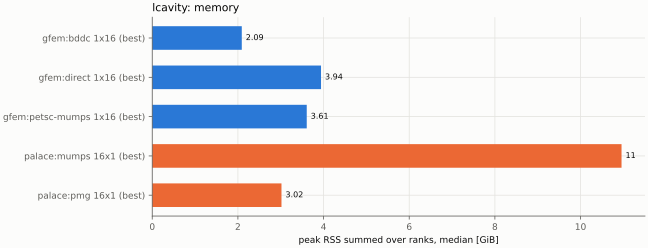

| solver | layout | role | peak RSS sum GiB | rank max GiB | largest node GiB | PSS sum GiB | sacct MaxRSS GiB | self-reports |
|---|---|---|---|---|---|---|---|---|
| gfem:bddc | 1x16 | best | 2.09 | 2.09 | 2.09 | 2.07 | — | solver_nbytes 2.17e+08 |
| gfem:direct | 1x16 | best | 3.94 | 3.94 | 3.94 | 3.9 | — | solver_nbytes 2.39e+09 |
| gfem:petsc-mumps | 1x16 | best | 3.61 | 3.61 | 3.61 | 3.61 | — | solver_nbytes 2.34e+09 |
| palace:mumps | 16x1 | best | 11 | 0.873 | 11 | 10.3 | — | — |
| palace:pmg | 16x1 | best | 3.02 | 0.208 | 3.02 | 2.32 | — | — |

The RSS sum counts shared pages once per rank in both codes alike; it is an upper bound on the simultaneous footprint, and PSS corrects it. sacct MaxRSS only for runs over 60 s.

### Accuracy

Reference `lcavity-20261117-058b2f5` (2026-11-17T18:55:07Z, closed_form, bound f_hz 1.00e-12, sha256 `b812a4ddaf0e`).

| solver | order | layout | tol | metric | error | bound | resolved | ceiling | plausible | same-code error | δ |
|---|---|---|---|---|---|---|---|---|---|---|---|
| gfem:bddc | 2 | 1x16 | 1e-08 | max_rel_dRe_f | 3.89e-04 | 1.00e-12 | yes | 3.89e-03 | pass | 4.12e-16 | — |
| gfem:direct | 2 | 1x16 | — | max_rel_dRe_f | 3.89e-04 | 1.00e-12 | yes | 3.89e-03 | pass | 0.00e+00 | — |
| gfem:petsc-mumps | 2 | 1x16 | — | max_rel_dRe_f | 3.89e-04 | 1.00e-12 | yes | 3.89e-03 | pass | 2.06e-16 | — |
| palace:mumps | 2 | 1x16 | — | max_rel_dRe_f | 3.89e-04 | 1.00e-12 | yes | 3.89e-03 | pass | 0.00e+00 | — |
| palace:mumps | 2 | 2x8 | — | max_rel_dRe_f | 3.89e-04 | 1.00e-12 | yes | 3.89e-03 | pass | 0.00e+00 | — |
| palace:mumps | 2 | 4x4 | — | max_rel_dRe_f | 3.89e-04 | 1.00e-12 | yes | 3.89e-03 | pass | 0.00e+00 | — |
| palace:mumps | 2 | 8x2 | — | max_rel_dRe_f | 3.89e-04 | 1.00e-12 | yes | 3.89e-03 | pass | 0.00e+00 | — |
| palace:mumps | 2 | 16x1 | — | max_rel_dRe_f | 3.89e-04 | 1.00e-12 | yes | 3.89e-03 | pass | 0.00e+00 | — |
| palace:pmg | 2 | 1x16 | 1e-08 | max_rel_dRe_f | 3.89e-04 | 1.00e-12 | yes | 3.89e-03 | pass | 0.00e+00 | — |
| palace:pmg | 2 | 2x8 | 1e-08 | max_rel_dRe_f | 3.89e-04 | 1.00e-12 | yes | 3.89e-03 | pass | 0.00e+00 | — |
| palace:pmg | 2 | 4x4 | 1e-08 | max_rel_dRe_f | 3.89e-04 | 1.00e-12 | yes | 3.89e-03 | pass | 0.00e+00 | — |
| palace:pmg | 2 | 8x2 | 1e-08 | max_rel_dRe_f | 3.89e-04 | 1.00e-12 | yes | 3.89e-03 | pass | 0.00e+00 | — |
| palace:pmg | 2 | 16x1 | 1e-08 | max_rel_dRe_f | 3.89e-04 | 1.00e-12 | yes | 3.89e-03 | pass | 0.00e+00 | — |

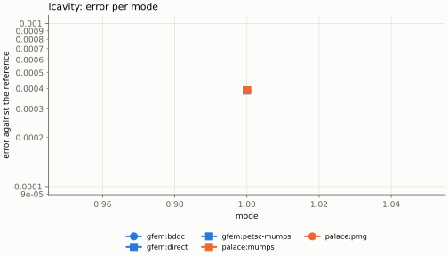

| mode | gfem:bddc (1x16) | gfem:direct (1x16) | gfem:petsc-mumps (1x16) | palace:mumps (16x1) | palace:pmg (16x1) |
|---|---|---|---|---|---|
| 1 | 3.89e-04 | 3.89e-04 | 3.89e-04 | 3.89e-04 | 3.89e-04 |

### Layouts

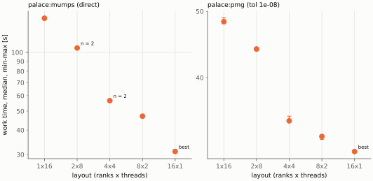

| solver | tol | layout | n | median work s | min-max |  |
|---|---|---|---|---|---|---|
| gfem:bddc | 1e-08 | 1x16 | 3 | 23 | 22.8-23.4 | best |
| gfem:direct | — | 1x16 | 3 | 8.52 | 7.88-9.26 | best |
| gfem:petsc-mumps | — | 1x16 | 3 | 32.1 | 31.7-32.6 | best |
| palace:mumps | — | 1x16 | 3 | 149 | 149-150 |  |
| palace:mumps | — | 2x8 | 2 | 105 | 105-106 | n = 2 |
| palace:mumps | — | 4x4 | 2 | 56.6 | 56.4-56.7 | n = 2 |
| palace:mumps | — | 8x2 | 3 | 47.1 | 46.7-47.2 |  |
| palace:mumps | — | 16x1 | 3 | 31.1 | 30.9-31.8 | best |
| palace:pmg | 1e-08 | 1x16 | 3 | 48.3 | 47.9-48.9 |  |
| palace:pmg | 1e-08 | 2x8 | 3 | 44 | 43.8-44.1 |  |
| palace:pmg | 1e-08 | 4x4 | 3 | 34.6 | 34.5-35.1 |  |
| palace:pmg | 1e-08 | 8x2 | 3 | 32.8 | 32.5-32.9 |  |
| palace:pmg | 1e-08 | 16x1 | 3 | 31.2 | 31.2-31.3 | best |

| solver | default | best | ties | default / best |
|---|---|---|---|---|
| gfem:bddc | — | 1x16 | — | — |
| gfem:direct | — | 1x16 | — | — |
| gfem:petsc-mumps | — | 1x16 | — | — |
| palace:mumps | — | 16x1 | — | — |
| palace:pmg | — | 16x1 | — | — |

Not plotted (not passing):

- palace:mumps 2x8: ok (—)
- palace:mumps 4x4: ok (—)

### Cross-solver snapshot (same-mesh comparison)

DOF: gfem [246416], palace [246416].

Direct kinds:

| solver | role | layout | n | work s | peak RSS sum GiB | error | jobs |
|---|---|---|---|---|---|---|---|
| gfem:direct | best | 1x16 | 3 | 8.52 | 3.94 | 3.89e-04 | 49239655 |
| gfem:petsc-mumps | best | 1x16 | 3 | 32.1 | 3.61 | 3.89e-04 | 49239655 |
| palace:mumps | best | 16x1 | 3 | 31.1 | 11 | 3.89e-04 | 49239655 |

| role | ratio | work | memory | pairing |
|---|---|---|---|---|
| best | palace:mumps / gfem:direct | 3.65 | 2.78 | same job |

Iterative kinds:

| solver | role | layout | n | work s | peak RSS sum GiB | error | jobs |
|---|---|---|---|---|---|---|---|
| gfem:bddc | best | 1x16 | 3 | 23 | 2.09 | 3.89e-04 | 49239655 |
| palace:pmg | best | 16x1 | 3 | 31.2 | 3.02 | 3.89e-04 | 49239655 |

Iterative kinds compare only at equal achieved error (table above).

Structural differences (reported, never removed):

- gfem:bddc: bddc_build: NGSolve builds the BDDC preconditioner while it assembles the first matrix of a setup, so the build is timed inside assemble
- gfem:direct: direct_arm: PARDISO (MKL), one process
- gfem:petsc-mumps: direct_arm: PETSc MUMPS
- palace:mumps: direct_arm: GMRES around complex MUMPS (MGMaxLevels 1)
- palace:mumps: estimator: always on, lightened (EstimatorTol 1e-2, EstimatorMG)
- palace:pmg: estimator: always on, lightened (EstimatorTol 1e-2, EstimatorMG)
- palace:pmg: fine_level: matrix-free (partial assembly)
- palace:pmg: pmg_coarse: SuperLU on the real-valued coarse matrix
- pinned for gfem: linear_solver per kind; the run tolerance; eigen_tolerance 1e-10; no field output
- pinned for palace: Refinement 0; Absorbing.Order 1; Linear.Type pinned per kind; MUMPS kind: MGMaxLevels 1, ComplexCoarseSolve, Tol 1e-10; iterative Tol = the run tolerance, MaxIts 2000; EstimatorTol 1e-2, EstimatorMG; eigen Tol 1e-10, inner Linear.Tol 1e-12; no field output

## microstrip

Campaigns: `20261119-43f36e5-smoke`

### Error against cost

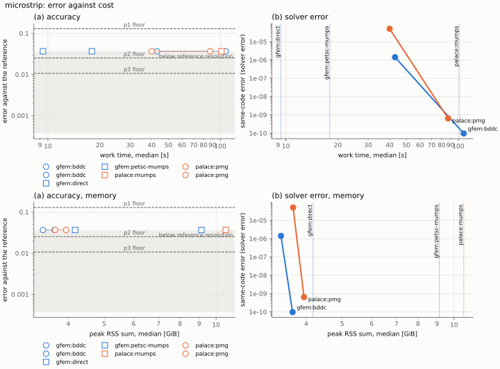

(a) Error against the converged reference, at each solver's best layout.

| solver | layout | tol | work s | peak RSS sum GiB | error |
|---|---|---|---|---|---|
| gfem:bddc | 1x16 | 1e-06 | 43 | 3.42 | ≤ 3.67e-02 (unresolved) |
| gfem:bddc | 1x16 | 1e-10 | 108 | 3.68 | ≤ 3.67e-02 (unresolved) |
| gfem:direct | 1x16 | — | 9.37 | 4.17 | ≤ 3.67e-02 (unresolved) |
| gfem:petsc-mumps | 8x2 | — | 18 | 9.13 | ≤ 3.67e-02 (unresolved) |
| palace:mumps | 16x1 | — | 102 | 10.6 | ≤ 3.67e-02 (unresolved) |
| palace:pmg | 16x1 | 1e-06 | 40 | 3.69 | ≤ 3.67e-02 (unresolved) |
| palace:pmg | 16x1 | 1e-10 | 87.3 | 3.95 | ≤ 3.67e-02 (unresolved) |

Discretization floor (same-mesh error): p1 1.30e-01, p2 2.53e-02, p3 1.07e-02.

Below reference resolution: errors under 3.67e-02.

(b) Same-code error (solver error, not accuracy) along the tolerance ladder.

| solver | layout | tol | work s | peak RSS sum GiB | same-code error |
|---|---|---|---|---|---|
| gfem:bddc | 1x16 | 1e-06 | 43 | 3.42 | 1.41e-06 |
| gfem:bddc | 1x16 | 1e-10 | 108 | 3.68 | 9.68e-11 |
| palace:pmg | 16x1 | 1e-06 | 40 | 3.69 | 5.04e-05 |
| palace:pmg | 16x1 | 1e-10 | 87.3 | 3.95 | 6.47e-10 |

Direct runs (same-code error 0 by definition): gfem:direct 9.37 s (1x16), gfem:petsc-mumps 18 s (8x2), palace:mumps 102 s (16x1).

Cost at equal achieved same-code error (interpolated log-log between neighbouring rungs, never extrapolated):

| error | gfem:bddc work s | gfem:bddc GiB | palace:pmg work s | palace:pmg GiB | palace:pmg / gfem:bddc |
|---|---|---|---|---|---|
| 6.47e-10 | 89.7 | 3.62 | 87.3 | 3.95 | 0.974 |
| 1.00e-09 | 86 | 3.61 | 84.7 | 3.94 | 0.985 |
| 1.00e-08 | 69 | 3.55 | 72.2 | 3.88 | 1.05 |
| 3.02e-08 | 62.1 | 3.52 | 66.9 | 3.86 | 1.08 |
| 1.00e-07 | 55.4 | 3.49 | 61.6 | 3.83 | 1.11 |
| 1.00e-06 | 44.4 | 3.43 | 52.5 | 3.78 | 1.18 |
| 1.41e-06 | 43 | 3.42 | 51.2 | 3.77 | 1.19 |

### Time

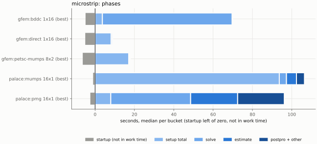

| solver | layout | role | tol | n | work s | spread | startup s | setup total s | solve total s | per sample s | mesh read s | discretize s | assemble s | setup s | solve s | estimate s | postpro s | rom s | other s | iterations | setups/solves | imbalance |
|---|---|---|---|---|---|---|---|---|---|---|---|---|---|---|---|---|---|---|---|---|---|---|
| gfem:bddc | 1x16 | best | 1e-08 | 3 | 69.9 | 0.4 % | 4.85 | 3.71 | 66 | 14 | 0.415 | 0.137 | 3.14 | 0.0185 | 66 | — | — | — | 0.215 | 897 | 6/5 | — |
| gfem:direct | 1x16 | best | — | 3 | 9.37 | 5.6 % | 5 | 8.12 | 0.595 | 1.87 | 0.511 | 0.135 | 1.07 | 6.41 | 0.595 | — | — | — | 0.211 | 0 | 5/5 | — |
| gfem:petsc-mumps | 8x2 | best | — | 3 | 18 | 28.2 % noisy | 6.27 | 17.2 | 0.449 | 3.6 | 4.09 | 0.368 | 0.241 | 12.4 | 0.449 | — | — | — | 0.359 | 0 | 5/5 | 1.26 |
|  |  | rank 0 |  |  | — |  |  |  |  |  | 0.516 | 0.344 | 0.175 | 12.4 | 0.444 | — | — | — | 0.354 |  |  |  |
| palace:mumps | 16x1 | best | — | 3 | 102 | 39.5 % noisy | 1 | 92.5 | 3.64 | 20.3 | 0.538 | — | 1.25 | 91.9 | 3.64 | 5.08 | 4.07 | 0 | 0 | 16 | 10/10 | 1.01 |
|  |  | rank 0 |  |  | — |  |  |  |  |  | 0.415 | — | 0.653 | 91.9 | 3.63 | 3.46 | 3.53 | 0 | 1.88 |  |  |  |
| palace:pmg | 16x1 | best | 1e-08 | 3 | 76.3 | 23.8 % noisy | 2.41 | 8 | 40.6 | 15.3 | 1.03 | — | 1.88 | 5.07 | 40.6 | 23.9 | 23.7 | 0 | 0 | 341 | 10/10 | 1.26 |
|  |  | rank 0 |  |  | — |  |  |  |  |  | 0.415 | — | 1.37 | 5.06 | 40.4 | 3.49 | 23.2 | 0 | 2.28 |  |  |  |

Work time is wall minus startup; startup is not in work time. Rank reduction of the buckets: gfem:bddc: max; gfem:direct: max; gfem:petsc-mumps: max; palace:mumps: max-of-rows; palace:pmg: max-of-rows. Max-of-rows is an upper bound on the slowest rank (rows may peak on different ranks); imbalance = headline bucket sum / rank-0 sum.

gfem BDDC: the assemble bucket includes the preconditioner build (NGSolve builds BDDC while it assembles the first matrix of a setup).

### Memory

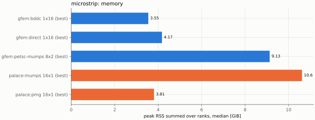

| solver | layout | role | peak RSS sum GiB | rank max GiB | largest node GiB | PSS sum GiB | sacct MaxRSS GiB | self-reports |
|---|---|---|---|---|---|---|---|---|
| gfem:bddc | 1x16 | best | 3.55 | 3.55 | 3.55 | 3.53 | 2.48 | solver_nbytes 2.66e+08 |
| gfem:direct | 1x16 | best | 4.17 | 4.17 | 4.17 | 3.91 | — | solver_nbytes 2.51e+09 |
| gfem:petsc-mumps | 8x2 | best | 9.13 | 1.26 | 9.13 | 8.01 | — | solver_nbytes 4.24e+09 |
| palace:mumps | 16x1 | best | 10.6 | 0.83 | 10.6 | 9.98 | 0.66 | — |
| palace:pmg | 16x1 | best | 3.81 | 0.254 | 3.81 | 3.24 | 0.217 | — |

The RSS sum counts shared pages once per rank in both codes alike; it is an upper bound on the simultaneous footprint, and PSS corrects it. sacct MaxRSS only for runs over 60 s.

### Accuracy

Reference `microstrip-20261119-7a078ba` (2026-11-19T13:15:50Z, richardson, bound s 3.67e-03, sha256 `8df3915891b4`).

| solver | order | layout | tol | metric | error | bound | resolved | ceiling | plausible | same-code error | δ |
|---|---|---|---|---|---|---|---|---|---|---|---|
| gfem:bddc | 2 | 1x16 (default) | 1e-06 | max_abs_dS | ≤ 10·bound = 3.67e-02 (unresolved) | 3.67e-03 | no | 2.53e-01 | pass | 1.41e-06 | — |
| gfem:bddc | 2 | 1x16 (default) | 1e-10 | max_abs_dS | ≤ 10·bound = 3.67e-02 (unresolved) | 3.67e-03 | no | 2.53e-01 | pass | 9.68e-11 | — |
| gfem:bddc | 2 | 1x16 | 1e-08 | max_abs_dS | ≤ 10·bound = 3.67e-02 (unresolved) | 3.67e-03 | no | 2.53e-01 | pass | 1.03e-08 | — |
| gfem:bddc | 2 | 2x8 | 1e-08 | max_abs_dS | ≤ 10·bound = 3.67e-02 (unresolved) | 3.67e-03 | no | 2.53e-01 | pass | 1.03e-08 | — |
| gfem:bddc | 2 | 4x4 | 1e-08 | max_abs_dS | ≤ 10·bound = 3.67e-02 (unresolved) | 3.67e-03 | no | 2.53e-01 | pass | 1.03e-08 | — |
| gfem:bddc | 2 | 8x2 | 1e-08 | max_abs_dS | ≤ 10·bound = 3.67e-02 (unresolved) | 3.67e-03 | no | 2.53e-01 | pass | 1.03e-08 | — |
| gfem:bddc | 2 | 16x1 | 1e-08 | max_abs_dS | ≤ 10·bound = 3.67e-02 (unresolved) | 3.67e-03 | no | 2.53e-01 | pass | 1.03e-08 | — |
| gfem:direct | 2 | 1x16 | — | max_abs_dS | ≤ 10·bound = 3.67e-02 (unresolved) | 3.67e-03 | no | 2.53e-01 | pass | 7.76e-13 | — |
| gfem:petsc-mumps | 2 | 1x16 | — | max_abs_dS | ≤ 10·bound = 3.67e-02 (unresolved) | 3.67e-03 | no | 2.53e-01 | pass | 2.17e-11 | — |
| gfem:petsc-mumps | 2 | 2x8 | — | max_abs_dS | ≤ 10·bound = 3.67e-02 (unresolved) | 3.67e-03 | no | 2.53e-01 | pass | 1.89e-11 | — |
| gfem:petsc-mumps | 2 | 4x4 | — | max_abs_dS | ≤ 10·bound = 3.67e-02 (unresolved) | 3.67e-03 | no | 2.53e-01 | pass | 3.54e-11 | — |
| gfem:petsc-mumps | 2 | 8x2 | — | max_abs_dS | ≤ 10·bound = 3.67e-02 (unresolved) | 3.67e-03 | no | 2.53e-01 | pass | 8.14e-12 | — |
| gfem:petsc-mumps | 2 | 16x1 | — | max_abs_dS | ≤ 10·bound = 3.67e-02 (unresolved) | 3.67e-03 | no | 2.53e-01 | pass | 1.02e-11 | — |
| palace:mumps | 2 | 1x16 | — | max_abs_dS | ≤ 10·bound = 3.67e-02 (unresolved) | 3.67e-03 | no | 2.53e-01 | pass | 3.26e-12 | 6.78e-11 |
| palace:mumps | 2 | 2x8 | — | max_abs_dS | ≤ 10·bound = 3.67e-02 (unresolved) | 3.67e-03 | no | 2.53e-01 | pass | 1.50e-11 | 6.78e-11 |
| palace:mumps | 2 | 4x4 | — | max_abs_dS | ≤ 10·bound = 3.67e-02 (unresolved) | 3.67e-03 | no | 2.53e-01 | pass | 2.21e-12 | 6.78e-11 |
| palace:mumps | 2 | 8x2 | — | max_abs_dS | ≤ 10·bound = 3.67e-02 (unresolved) | 3.67e-03 | no | 2.53e-01 | pass | 3.79e-12 | 6.78e-11 |
| palace:mumps | 2 | 16x1 | — | max_abs_dS | ≤ 10·bound = 3.67e-02 (unresolved) | 3.67e-03 | no | 2.53e-01 | pass | 1.14e-12 | 6.78e-11 |
| palace:pmg | 2 | 16x1 (default) | 1e-06 | max_abs_dS | ≤ 10·bound = 3.67e-02 (unresolved) | 3.67e-03 | no | 2.53e-01 | pass | 5.04e-05 | 6.78e-11 |
| palace:pmg | 2 | 16x1 (default) | 1e-10 | max_abs_dS | ≤ 10·bound = 3.67e-02 (unresolved) | 3.67e-03 | no | 2.53e-01 | pass | 6.47e-10 | 6.78e-11 |
| palace:pmg | 2 | 1x16 | 1e-08 | max_abs_dS | ≤ 10·bound = 3.67e-02 (unresolved) | 3.67e-03 | no | 2.53e-01 | pass | 1.97e-07 | 6.78e-11 |
| palace:pmg | 2 | 2x8 | 1e-08 | max_abs_dS | ≤ 10·bound = 3.67e-02 (unresolved) | 3.67e-03 | no | 2.53e-01 | pass | 1.97e-07 | 6.78e-11 |
| palace:pmg | 2 | 4x4 | 1e-08 | max_abs_dS | ≤ 10·bound = 3.67e-02 (unresolved) | 3.67e-03 | no | 2.53e-01 | pass | 1.96e-07 | 6.78e-11 |
| palace:pmg | 2 | 8x2 | 1e-08 | max_abs_dS | ≤ 10·bound = 3.67e-02 (unresolved) | 3.67e-03 | no | 2.53e-01 | pass | 1.96e-07 | 6.78e-11 |
| palace:pmg | 2 | 16x1 | 1e-08 | max_abs_dS | ≤ 10·bound = 3.67e-02 (unresolved) | 3.67e-03 | no | 2.53e-01 | pass | 1.95e-07 | 6.78e-11 |

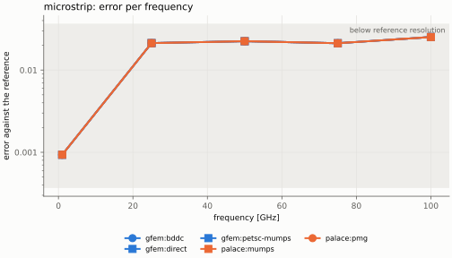

| frequency Hz | gfem:bddc (1x16) | gfem:direct (1x16) | gfem:petsc-mumps (8x2) | palace:mumps (16x1) | palace:pmg (16x1) |
|---|---|---|---|---|---|
| 1e+09 | 9.33e-04 | 9.33e-04 | 9.33e-04 | 9.33e-04 | 9.33e-04 |
| 2.5e+10 | 2.13e-02 | 2.13e-02 | 2.13e-02 | 2.13e-02 | 2.13e-02 |
| 5e+10 | 2.25e-02 | 2.25e-02 | 2.25e-02 | 2.25e-02 | 2.25e-02 |
| 7.5e+10 | 2.12e-02 | 2.12e-02 | 2.12e-02 | 2.12e-02 | 2.12e-02 |
| 1e+11 | 2.53e-02 | 2.53e-02 | 2.53e-02 | 2.53e-02 | 2.53e-02 |

### Layouts

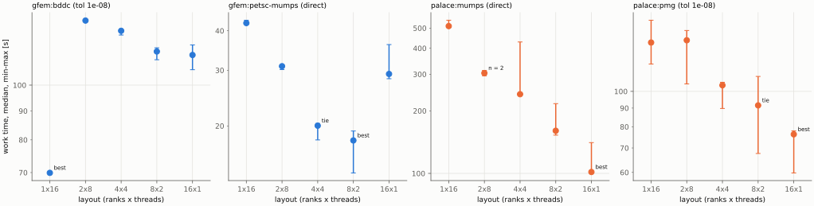

| solver | tol | layout | n | median work s | min-max |  |
|---|---|---|---|---|---|---|
| gfem:bddc | 1e-08 | 1x16 | 3 | 69.9 | 69.9-70.2 | best |
| gfem:bddc | 1e-08 | 2x8 | 3 | 130 | 130-130 |  |
| gfem:bddc | 1e-08 | 4x4 | 3 | 125 | 123-125 |  |
| gfem:bddc | 1e-08 | 8x2 | 3 | 115 | 111-116 |  |
| gfem:bddc | 1e-08 | 16x1 | 3 | 113 | 106-118 |  |
| gfem:direct | — | 1x16 | 3 | 9.37 | 8.92-9.44 | best |
| gfem:petsc-mumps | — | 1x16 | 3 | 42.3 | 42.3-43.2 |  |
| gfem:petsc-mumps | — | 2x8 | 3 | 30.9 | 30.2-31 |  |
| gfem:petsc-mumps | — | 4x4 | 3 | 20 | 18.1-20.4 | tie |
| gfem:petsc-mumps | — | 8x2 | 3 | 18 | 14.2-19.3 | best |
| gfem:petsc-mumps | — | 16x1 | 3 | 29.2 | 28.2-36.2 |  |
| palace:mumps | — | 1x16 | 3 | 511 | 504-546 |  |
| palace:mumps | — | 2x8 | 2 | 304 | 295-313 | n = 2 |
| palace:mumps | — | 4x4 | 3 | 240 | 237-429 |  |
| palace:mumps | — | 8x2 | 3 | 160 | 153-217 |  |
| palace:mumps | — | 16x1 | 3 | 102 | 101-141 | best |
| palace:pmg | 1e-08 | 1x16 | 3 | 136 | 119-157 |  |
| palace:pmg | 1e-08 | 2x8 | 3 | 138 | 105-147 |  |
| palace:pmg | 1e-08 | 4x4 | 3 | 104 | 89.8-106 |  |
| palace:pmg | 1e-08 | 8x2 | 3 | 91.5 | 67.6-110 | tie |
| palace:pmg | 1e-08 | 16x1 | 3 | 76.3 | 59.8-78 | best |

| solver | default | best | ties | default / best |
|---|---|---|---|---|
| gfem:bddc | — | 1x16 | — | — |
| gfem:direct | — | 1x16 | — | — |
| gfem:petsc-mumps | — | 8x2 | 4x4 | — |
| palace:mumps | — | 16x1 | — | — |
| palace:pmg | — | 16x1 | 8x2 | — |

Not plotted (not passing):

- palace:mumps 2x8: ok (—)

### Cross-solver snapshot (same-mesh comparison)

DOF: gfem [315870], palace [315870].

Direct kinds:

| solver | role | layout | n | work s | peak RSS sum GiB | error | jobs |
|---|---|---|---|---|---|---|---|
| gfem:direct | best | 1x16 | 3 | 9.37 | 4.17 | 2.53e-02 | 49240720 |
| gfem:petsc-mumps | best | 8x2 | 3 | 18 | 9.13 | 2.53e-02 | 49240720 |
| palace:mumps | best | 16x1 | 3 | 102 | 10.6 | 2.53e-02 | 49240720 |

| role | ratio | work | memory | pairing |
|---|---|---|---|---|
| best | palace:mumps / gfem:direct | 10.8 | 2.54 | same job |

Iterative kinds:

| solver | role | layout | n | work s | peak RSS sum GiB | error | jobs |
|---|---|---|---|---|---|---|---|
| gfem:bddc | best | 1x16 | 3 | 69.9 | 3.55 | 2.53e-02 | 49240720 |
| palace:pmg | best | 16x1 | 3 | 76.3 | 3.81 | 2.53e-02 | 49240720 |

Iterative kinds compare only at equal achieved error (table above).

Structural differences (reported, never removed):

- gfem:bddc: bddc_build: NGSolve builds the BDDC preconditioner while it assembles the first matrix of a setup, so the build is timed inside assemble
- gfem:direct: direct_arm: PARDISO (MKL), one process
- gfem:petsc-mumps: direct_arm: PETSc MUMPS
- palace:mumps: direct_arm: GMRES around complex MUMPS (MGMaxLevels 1)
- palace:mumps: estimator: always on, lightened (EstimatorTol 1e-2, EstimatorMG)
- palace:pmg: estimator: always on, lightened (EstimatorTol 1e-2, EstimatorMG)
- palace:pmg: fine_level: matrix-free (partial assembly)
- palace:pmg: pmg_coarse: SuperLU on the real-valued coarse matrix
- pinned for gfem: linear_solver per kind; the run tolerance; eigen_tolerance 1e-10; no field output
- pinned for palace: Refinement 0; Absorbing.Order 1; Linear.Type pinned per kind; MUMPS kind: MGMaxLevels 1, ComplexCoarseSolve, Tol 1e-10; iterative Tol = the run tolerance, MaxIts 2000; EstimatorTol 1e-2, EstimatorMG; eigen Tol 1e-10, inner Linear.Tol 1e-12; no field output

## r10M_void

Campaigns: `20261119-43f36e5-smoke-r10m`

### Error against cost

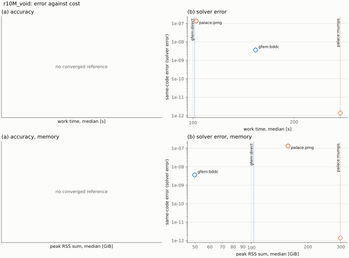

(a) No converged reference: no accuracy panel.

(b) Same-code error (solver error, not accuracy) along the tolerance ladder.

| solver | layout | tol | work s | peak RSS sum GiB | same-code error |
|---|---|---|---|---|---|
| gfem:bddc | 1x112 | 1e-08 | 154 | 49.8 | 3.60e-09 |
| palace:pmg | 112x1 | 1e-08 | 102 | 157 | 1.33e-07 |

Direct runs (same-code error 0 by definition): gfem:direct 101 s (1x112), palace:mumps 275 s (112x1).

Difference from gfem direct (not accuracy):

| solver | layout | tol | work s | difference |
|---|---|---|---|---|
| gfem:bddc | 1x112 | 1e-08 | 154 | 3.60e-09 |
| palace:mumps | 112x1 | — | 275 | 1.39e-12 |
| palace:pmg | 112x1 | 1e-08 | 102 | 1.33e-07 |

Cost at equal achieved same-code error (interpolated log-log between neighbouring rungs, never extrapolated):

No overlap of the error ranges.

### Time

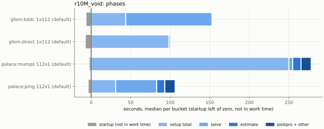

| solver | layout | role | tol | n | work s | spread | startup s | setup total s | solve total s | per sample s | mesh read s | discretize s | assemble s | setup s | solve s | estimate s | postpro s | rom s | other s | iterations | setups/solves | imbalance |
|---|---|---|---|---|---|---|---|---|---|---|---|---|---|---|---|---|---|---|---|---|---|---|
| gfem:bddc | 1x112 | default | 1e-08 | 1 | 154 | 0.0 % | 5.89 | 43.7 | 109 | 154 | 14.7 | 4.29 | 24.7 | 0.0242 | 109 | — | — | — | 0.841 | 64 | 1/1 | — |
| gfem:direct | 1x112 | default | — | 1 | 101 | 0.0 % | 6.74 | 98.4 | 1.88 | 101 | 14.9 | 4.52 | 17.6 | 61.3 | 1.88 | — | — | — | 0.894 | 0 | 1/1 | — |
| palace:mumps | 112x1 | default | — | 1 | 275 | 0.0 % | 1.76 | 250 | 4.71 | 275 | 23.2 | — | 1.51 | 225 | 4.71 | 10.6 | 12.9 | 0 | 0 | 2 | 1/1 | 1.01 |
|  |  | rank 0 |  |  | — |  |  |  |  |  | 16.8 | — | 1.5 | 225 | 4.61 | 8.15 | 12.2 | 0 | 6.09 |  |  |  |
| palace:pmg | 112x1 | default | 1e-08 | 1 | 102 | 0.0 % | 3.14 | 31 | 51.9 | 102 | 24 | — | 2.28 | 4.7 | 51.9 | 10.3 | 13 | 0 | 0 | 23 | 1/1 | 1.04 |
|  |  | rank 0 |  |  | — |  |  |  |  |  | 16.8 | — | 2.26 | 4.64 | 51.4 | 8.18 | 12.3 | 0 | 6.63 |  |  |  |

Work time is wall minus startup; startup is not in work time. Rank reduction of the buckets: gfem:bddc: max; gfem:direct: max; palace:mumps: max-of-rows; palace:pmg: max-of-rows. Max-of-rows is an upper bound on the slowest rank (rows may peak on different ranks); imbalance = headline bucket sum / rank-0 sum.

gfem BDDC: the assemble bucket includes the preconditioner build (NGSolve builds BDDC while it assembles the first matrix of a setup).

### Memory

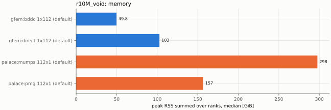

| solver | layout | role | peak RSS sum GiB | rank max GiB | largest node GiB | PSS sum GiB | sacct MaxRSS GiB | self-reports |
|---|---|---|---|---|---|---|---|---|
| gfem:bddc | 1x112 | default | 49.8 | 49.8 | 49.8 | 49.8 | 46.1 | solver_nbytes 8.37e+09 |
| gfem:direct | 1x112 | default | 103 | 103 | 103 | 103 | 42.9 | solver_nbytes 8.4e+10 |
| palace:mumps | 112x1 | default | 298 | 10.4 | 298 | 272 | 9.7 | — |
| palace:pmg | 112x1 | default | 157 | 1.57 | 157 | 105 | 1.12 | — |

The RSS sum counts shared pages once per rank in both codes alike; it is an upper bound on the simultaneous footprint, and PSS corrects it. sacct MaxRSS only for runs over 60 s.

### Accuracy

Reference `r10M_void-20261117-058b2f5` (2026-11-17T18:55:08Z, none, bound —, sha256 `5a58d3549dcf`).

| solver | order | layout | tol | metric | error | bound | resolved | ceiling | plausible | same-code error | δ |
|---|---|---|---|---|---|---|---|---|---|---|---|
| gfem:bddc | 2 | 1x112 (default) | 1e-08 | — | no_reference | — | — | — | skipped | 3.60e-09 | — |
| gfem:direct | 2 | 1x112 (default) | — | — | no_reference | — | — | — | skipped | 0.00e+00 | — |
| palace:mumps | 2 | 112x1 (default) | — | — | no_reference | — | — | — | skipped | 0.00e+00 | — |
| palace:pmg | 2 | 112x1 (default) | 1e-08 | — | no_reference | — | — | — | skipped | 1.33e-07 | — |

### Layouts

| solver | tol | layout | n | median work s | min-max |  |
|---|---|---|---|---|---|---|
| gfem:bddc | 1e-08 | 1x112 | 1 | 154 | 154-154 | default, n = 1 |
| gfem:direct | — | 1x112 | 1 | 101 | 101-101 | default, n = 1 |
| palace:mumps | — | 112x1 | 1 | 275 | 275-275 | default, n = 1 |
| palace:pmg | 1e-08 | 112x1 | 1 | 102 | 102-102 | default, n = 1 |

| solver | default | best | ties | default / best |
|---|---|---|---|---|
| gfem:bddc | 1x112 | — (best of listed) | — | — |
| gfem:direct | 1x112 | — (best of listed) | — | — |
| palace:mumps | 112x1 | — (best of listed) | — | — |
| palace:pmg | 112x1 | — (best of listed) | — | — |

### Cross-solver snapshot (same-mesh comparison)

DOF: gfem [10248856], palace [10248856].

Direct kinds:

| solver | role | layout | n | work s | peak RSS sum GiB | error | jobs |
|---|---|---|---|---|---|---|---|
| gfem:direct | default | 1x112 | 1 | 101 | 103 | — | 49240721 |
| palace:mumps | default | 112x1 | 1 | 275 | 298 | — | 49240721 |

| role | ratio | work | memory | pairing |
|---|---|---|---|---|
| default | palace:mumps / gfem:direct | 2.71 | 2.9 | same job |

Iterative kinds:

| solver | role | layout | n | work s | peak RSS sum GiB | error | jobs |
|---|---|---|---|---|---|---|---|
| gfem:bddc | default | 1x112 | 1 | 154 | 49.8 | — | 49240721 |
| palace:pmg | default | 112x1 | 1 | 102 | 157 | — | 49240721 |

Iterative kinds compare only at equal achieved error (table above).

Structural differences (reported, never removed):

- gfem:bddc: bddc_build: NGSolve builds the BDDC preconditioner while it assembles the first matrix of a setup, so the build is timed inside assemble
- gfem:direct: direct_arm: PARDISO (MKL), one process
- palace:mumps: direct_arm: GMRES around complex MUMPS (MGMaxLevels 1)
- palace:mumps: estimator: always on, lightened (EstimatorTol 1e-2, EstimatorMG)
- palace:pmg: estimator: always on, lightened (EstimatorTol 1e-2, EstimatorMG)
- palace:pmg: fine_level: matrix-free (partial assembly)
- palace:pmg: pmg_coarse: SuperLU on the real-valued coarse matrix
- pinned for gfem: linear_solver per kind; the run tolerance; eigen_tolerance 1e-10; no field output
- pinned for palace: Refinement 0; Absorbing.Order 1; Linear.Type pinned per kind; MUMPS kind: MGMaxLevels 1, ComplexCoarseSolve, Tol 1e-10; iterative Tol = the run tolerance, MaxIts 2000; EstimatorTol 1e-2, EstimatorMG; eigen Tol 1e-10, inner Linear.Tol 1e-12; no field output

## Trend

trend needs two campaigns.

## Caveats

1. Times and memory are observations of one machine, software stack and campaign; nothing here is a pass/fail, and no ratio is a claim beyond this campaign.
2. Headline time is work time (wall minus startup); startup is shown apart. Estimator and postprocessing are inside work time because Palace users cannot switch them off.
3. Memory is the sum of per-rank peak RSS (shared pages counted per rank); PSS and sacct are cross-checks.
4. Palace phases are max-of-rows (an upper bound on the slowest rank); rank 0 shown beside.
5. Nominal Krylov tolerances mean different things in the two codes; iterative codes are compared only at equal achieved error.
6. Accuracy is against the named converged reference; unresolved errors are shown as such; Palace errors carry the definition offset δ; same-code error is solver error, not accuracy.
7. Each code runs at its own defaults except the listed pins; structural differences are listed per case, never removed.
8. Excluded records: everything in the failures table. Medians over passing repeats; n < 3 shown.
9. Ratios across Slurm jobs are labelled "different nodes"; node class is observed, not controlled.
10. Notes of this report:
   - r10M_void: no converged reference (no_reference: no converged reference fits the budget (one split is about 80 M DOF); records carry the same-code error only)
