<!-- suite-report/1 inputs sha256 37c723acfacf70fc6803ba76feeac17e865ff92ebe97bf067492bd387f1c31b8 -->
# Campaign report 20261120-37c723a

- Report id: `20261120-37c723a`
- Inputs: sha256 `37c723acfacf70fc6803ba76feeac17e865ff92ebe97bf067492bd387f1c31b8` (`inputs.sha256`)
- Campaign `20261120-e7d58a9-full-c8` (full-c8)
  - gfem `e7d58a9a9db9` (2026-11-20T02:59:00Z), harness `e7d58a9a9db9`
  - Solvers: palace 0.19.0
  - Stack wheels: description_sha256 `f8638f63c753`, env_manifest_sha256 `ecfc3e2097c4`, fingerprint `63af6b406682`, palace_manifest_sha256 `a133a028deb5`
  - Machine mn5-gpp, node classes standard, core budget 8, billed 334.4 core-h
- Campaign `20261120-e7d58a9-full-c16` (full-c16)
  - gfem `e7d58a9a9db9` (2026-11-20T02:59:00Z), harness `e7d58a9a9db9`
  - Solvers: palace 0.19.0
  - Stack wheels: description_sha256 `f8638f63c753`, env_manifest_sha256 `ecfc3e2097c4`, fingerprint `63af6b406682`, palace_manifest_sha256 `a133a028deb5`
  - Machine mn5-gpp, node classes standard, core budget 16, billed 318.4 core-h
- Campaign `20261120-e7d58a9-full-c32` (full-c32)
  - gfem `e7d58a9a9db9` (2026-11-20T02:59:00Z), harness `e7d58a9a9db9`
  - Solvers: palace 0.19.0
  - Stack wheels: description_sha256 `f8638f63c753`, env_manifest_sha256 `ecfc3e2097c4`, fingerprint `63af6b406682`, palace_manifest_sha256 `a133a028deb5`
  - Machine mn5-gpp, node classes standard, core budget 32, billed 316.4 core-h
- Campaign `20261120-e7d58a9-full-c56` (full-c56)
  - gfem `e7d58a9a9db9` (2026-11-20T02:59:00Z), harness `e7d58a9a9db9`
  - Solvers: palace 0.19.0
  - Stack wheels: description_sha256 `f8638f63c753`, env_manifest_sha256 `ecfc3e2097c4`, fingerprint `63af6b406682`, palace_manifest_sha256 `a133a028deb5`
  - Machine mn5-gpp, node classes standard, core budget 56, billed 356 core-h
- Campaign `20261120-e7d58a9-full-c112` (full-c112)
  - gfem `e7d58a9a9db9` (2026-11-20T02:59:00Z), harness `e7d58a9a9db9`
  - Solvers: palace 0.19.0
  - Stack wheels: description_sha256 `f8638f63c753`, env_manifest_sha256 `ecfc3e2097c4`, fingerprint `63af6b406682`, palace_manifest_sha256 `a133a028deb5`
  - Machine mn5-gpp, node classes standard, core budget 112, billed 392.2 core-h
- Campaign `20261120-e7d58a9-full-bragg-c8` (full-bragg-c8)
  - gfem `e7d58a9a9db9` (2026-11-20T02:59:00Z), harness `e7d58a9a9db9`
  - Solvers: palace 0.19.0
  - Stack wheels: description_sha256 `f8638f63c753`, env_manifest_sha256 `ecfc3e2097c4`, fingerprint `63af6b406682`, palace_manifest_sha256 `a133a028deb5`
  - Machine mn5-gpp, node classes standard, core budget 8, billed 5.413 core-h
- Campaign `20261120-e7d58a9-full-bragg-c16` (full-bragg-c16)
  - gfem `e7d58a9a9db9` (2026-11-20T02:59:00Z), harness `e7d58a9a9db9`
  - Solvers: palace 0.19.0
  - Stack wheels: description_sha256 `f8638f63c753`, env_manifest_sha256 `ecfc3e2097c4`, fingerprint `63af6b406682`, palace_manifest_sha256 `a133a028deb5`
  - Machine mn5-gpp, node classes standard, core budget 16, billed 5.569 core-h
- Campaign `20261120-e7d58a9-full-bragg-c32` (full-bragg-c32)
  - gfem `e7d58a9a9db9` (2026-11-20T02:59:00Z), harness `e7d58a9a9db9`
  - Solvers: palace 0.19.0
  - Stack wheels: description_sha256 `f8638f63c753`, env_manifest_sha256 `ecfc3e2097c4`, fingerprint `63af6b406682`, palace_manifest_sha256 `a133a028deb5`
  - Machine mn5-gpp, node classes standard, core budget 32, billed 6.191 core-h
- Campaign `20261120-e7d58a9-full-bragg-c56` (full-bragg-c56)
  - gfem `e7d58a9a9db9` (2026-11-20T02:59:00Z), harness `e7d58a9a9db9`
  - Solvers: palace 0.19.0
  - Stack wheels: description_sha256 `f8638f63c753`, env_manifest_sha256 `ecfc3e2097c4`, fingerprint `63af6b406682`, palace_manifest_sha256 `a133a028deb5`
  - Machine mn5-gpp, node classes standard, core budget 56, billed 8.462 core-h
- Campaign `20261120-e7d58a9-full-bragg-c112` (full-bragg-c112)
  - gfem `e7d58a9a9db9` (2026-11-20T02:59:00Z), harness `e7d58a9a9db9`
  - Solvers: palace 0.19.0
  - Stack wheels: description_sha256 `f8638f63c753`, env_manifest_sha256 `ecfc3e2097c4`, fingerprint `63af6b406682`, palace_manifest_sha256 `a133a028deb5`
  - Machine mn5-gpp, node classes standard, core budget 112, billed 7.747 core-h
- Campaign `20261120-e7d58a9-full-bragg-pmg-c16` (full-bragg-pmg-c16)
  - gfem `e7d58a9a9db9` (2026-11-20T02:59:00Z), harness `e7d58a9a9db9`
  - Solvers: palace 0.19.0
  - Stack wheels: description_sha256 `f8638f63c753`, env_manifest_sha256 `ecfc3e2097c4`, fingerprint `63af6b406682`, palace_manifest_sha256 `a133a028deb5`
  - Machine mn5-gpp, node classes standard, core budget 16, billed 31.42 core-h
- Campaign `20261120-e7d58a9-full-scale-c8` (full-scale-c8)
  - gfem `e7d58a9a9db9` (2026-11-20T02:59:00Z), harness `e7d58a9a9db9`
  - Solvers: palace 0.19.0
  - Stack wheels: description_sha256 `f8638f63c753`, env_manifest_sha256 `ecfc3e2097c4`, fingerprint `63af6b406682`, palace_manifest_sha256 `a133a028deb5`
  - Machine mn5-gpp, node classes highmem, core budget 8, billed 1065 core-h
- Campaign `20261120-e7d58a9-full-scale-c16` (full-scale-c16)
  - gfem `e7d58a9a9db9` (2026-11-20T02:59:00Z), harness `e7d58a9a9db9`
  - Solvers: palace 0.19.0
  - Stack wheels: description_sha256 `f8638f63c753`, env_manifest_sha256 `ecfc3e2097c4`, fingerprint `63af6b406682`, palace_manifest_sha256 `a133a028deb5`
  - Machine mn5-gpp, node classes highmem, core budget 16, billed 835.1 core-h
- Campaign `20261120-e7d58a9-full-scale-c32` (full-scale-c32)
  - gfem `e7d58a9a9db9` (2026-11-20T02:59:00Z), harness `e7d58a9a9db9`
  - Solvers: palace 0.19.0
  - Stack wheels: description_sha256 `f8638f63c753`, env_manifest_sha256 `ecfc3e2097c4`, fingerprint `63af6b406682`, palace_manifest_sha256 `a133a028deb5`
  - Machine mn5-gpp, node classes highmem, core budget 32, billed 683.2 core-h
- Campaign `20261120-e7d58a9-full-scale-c56` (full-scale-c56)
  - gfem `e7d58a9a9db9` (2026-11-20T02:59:00Z), harness `e7d58a9a9db9`
  - Solvers: palace 0.19.0
  - Stack wheels: description_sha256 `f8638f63c753`, env_manifest_sha256 `ecfc3e2097c4`, fingerprint `63af6b406682`, palace_manifest_sha256 `a133a028deb5`
  - Machine mn5-gpp, node classes highmem, core budget 56, billed 509.7 core-h
- Campaign `20261120-e7d58a9-full-scale-c112` (full-scale-c112)
  - gfem `e7d58a9a9db9` (2026-11-20T02:59:00Z), harness `e7d58a9a9db9`
  - Solvers: palace 0.19.0
  - Stack wheels: description_sha256 `f8638f63c753`, env_manifest_sha256 `ecfc3e2097c4`, fingerprint `63af6b406682`, palace_manifest_sha256 `a133a028deb5`
  - Machine mn5-gpp, node classes highmem, core budget 112, billed 394.2 core-h
- Reference lcavity: `lcavity-20261117-058b2f5` computed 2026-11-17T18:55:07Z, closed_form
- Reference microstrip: `microstrip-20261120-7a078ba` computed 2026-11-20T00:00:27Z, richardson
- Reference bragg: `bragg-20261118-a0ff134` computed 2026-11-18T11:01:45Z, closed_form
- Reference r10M_void: `r10M_void-20261117-058b2f5` computed 2026-11-17T18:55:08Z, none
- Reference microstrip_p3: `microstrip-20261120-7a078ba` computed 2026-11-20T00:00:27Z, richardson
- Figures: matplotlib 3.11.2
- Anchor tolerance: 1e-08
- Regenerate: `python -m benchmarks report 20261120-e7d58a9-full-c8 20261120-e7d58a9-full-c16 20261120-e7d58a9-full-c32 20261120-e7d58a9-full-c56 20261120-e7d58a9-full-c112 20261120-e7d58a9-full-bragg-c8 20261120-e7d58a9-full-bragg-c16 20261120-e7d58a9-full-bragg-c32 20261120-e7d58a9-full-bragg-c56 20261120-e7d58a9-full-bragg-c112 20261120-e7d58a9-full-bragg-pmg-c16 20261120-e7d58a9-full-scale-c8 20261120-e7d58a9-full-scale-c16 20261120-e7d58a9-full-scale-c32 20261120-e7d58a9-full-scale-c56 20261120-e7d58a9-full-scale-c112 --out DIR`

## Nodes

Machine benchmark per job (`jobs/<job>/machine.json`).

| campaign | job | host | threads | dgemm GF/s | zgemm GF/s | triad GB/s |  |
|---|---|---|---|---|---|---|---|
| 20261120-e7d58a9-full-c8 | 49256972 | gs07r1b53 | 8 | 535 | 533 | 104 | slow node |
| 20261120-e7d58a9-full-c8 | 49256974 | gs07r1b71 | 8 | 535 | 533 | 105 | slow node |
| 20261120-e7d58a9-full-c16 | 49256510 | gs05r1b72 | 16 | 1.07e+03 | 1.06e+03 | 136 | slow node |
| 20261120-e7d58a9-full-c16 | 49256955 | gs09r1b53 | 16 | 1.07e+03 | 1.06e+03 | 136 | slow node |
| 20261120-e7d58a9-full-c32 | 49256969 | gs07r1b49 | 32 | 2.1e+03 | 2.01e+03 | 172 |  |
| 20261120-e7d58a9-full-c32 | 49256970 | gs07r1b51 | 32 | 2.1e+03 | 2e+03 | 172 |  |
| 20261120-e7d58a9-full-c56 | 49256966 | gs14r1b70 | 56 | 3.08e+03 | 3.04e+03 | 201 |  |
| 20261120-e7d58a9-full-c56 | 49256968 | gs07r1b01 | 56 | 3.04e+03 | 3.01e+03 | 201 |  |
| 20261120-e7d58a9-full-c112 | 49256964 | gs14r1b01 | 112 | 4.61e+03 | 5.18e+03 | 406 |  |
| 20261120-e7d58a9-full-c112 | 49256965 | gs14r1b69 | 112 | 4.61e+03 | 5.14e+03 | 406 |  |
| 20261120-e7d58a9-full-bragg-c8 | 49256956 | gs09r1b56 | 8 | 534 | 533 | 104 | slow node |
| 20261120-e7d58a9-full-bragg-c16 | 49256509 | gs06r1b09 | 16 | 1.07e+03 | 1.06e+03 | 136 | slow node |
| 20261120-e7d58a9-full-bragg-c32 | 49256957 | gs09r1b58 | 32 | 2.1e+03 | 2e+03 | 172 |  |
| 20261120-e7d58a9-full-bragg-c56 | 49256960 | gs12r2b63 | 56 | 3.08e+03 | 3.06e+03 | 202 |  |
| 20261120-e7d58a9-full-bragg-c112 | 49256961 | gs12r2b64 | 112 | 4.58e+03 | 5.18e+03 | 403 |  |
| 20261120-e7d58a9-full-bragg-pmg-c16 | 49256962 | gs12r2b65 | 1 | 67.4 | 67.8 | 17.8 | slow node |
| 20261120-e7d58a9-full-scale-c8 | 49258772 | gs01r3b64 | 8 | 535 | 533 | 112 | slow node |
| 20261120-e7d58a9-full-scale-c8 | 49258773 | gs01r3b66 | 8 | 535 | 533 | 111 | slow node |
| 20261120-e7d58a9-full-scale-c16 | 49258770 | gs01r3b50 | 16 | 1.07e+03 | 1.06e+03 | 154 | slow node |
| 20261120-e7d58a9-full-scale-c16 | 49258771 | gs01r3b61 | 16 | 1.07e+03 | 1.06e+03 | 154 | slow node |
| 20261120-e7d58a9-full-scale-c32 | 49258768 | gs01r3b37 | 32 | 2.1e+03 | 2.01e+03 | 203 |  |
| 20261120-e7d58a9-full-scale-c32 | 49258769 | gs01r3b42 | 32 | 2.1e+03 | 2.01e+03 | 202 |  |
| 20261120-e7d58a9-full-scale-c56 | 49258766 | gs01r3b30 | 56 | 3.08e+03 | 3.06e+03 | 236 |  |
| 20261120-e7d58a9-full-scale-c56 | 49258767 | gs01r3b36 | 56 | 3.11e+03 | 3.07e+03 | 237 |  |
| 20261120-e7d58a9-full-scale-c112 | 49256975 | gs01r2b15 | 112 | 4.65e+03 | 5.19e+03 | 477 |  |
| 20261120-e7d58a9-full-scale-c112 | 49256976 | gs01r2b62 | 112 | 4.67e+03 | 5.19e+03 | 474 |  |

A job whose triad is more than 10 % below the median is a slow node.

## Gates

| campaign | complete | provenance | dof_equal | harness failures |
|---|---|---|---|---|
| 20261120-e7d58a9-full-c8 | pass | pass | pass | 0 |
| 20261120-e7d58a9-full-c16 | pass | pass | pass | 0 |
| 20261120-e7d58a9-full-c32 | pass | pass | pass | 0 |
| 20261120-e7d58a9-full-c56 | pass | pass | pass | 0 |
| 20261120-e7d58a9-full-c112 | pass | pass | pass | 0 |
| 20261120-e7d58a9-full-bragg-c8 | pass | pass | pass | 0 |
| 20261120-e7d58a9-full-bragg-c16 | pass | pass | pass | 0 |
| 20261120-e7d58a9-full-bragg-c32 | pass | pass | pass | 0 |
| 20261120-e7d58a9-full-bragg-c56 | pass | pass | pass | 0 |
| 20261120-e7d58a9-full-bragg-c112 | pass | pass | pass | 0 |
| 20261120-e7d58a9-full-bragg-pmg-c16 | pass | pass | skipped | 0 |
| 20261120-e7d58a9-full-scale-c8 | pass | pass | pass | 0 |
| 20261120-e7d58a9-full-scale-c16 | pass | pass | pass | 0 |
| 20261120-e7d58a9-full-scale-c32 | pass | pass | pass | 0 |
| 20261120-e7d58a9-full-scale-c56 | pass | pass | pass | 0 |
| 20261120-e7d58a9-full-scale-c112 | pass | pass | pass | 0 |

- `20261120-e7d58a9-full-c8` dof_equal lcavity: pass (gfem [246416], palace [246416])
- `20261120-e7d58a9-full-c8` dof_equal microstrip: pass (gfem [315870], palace [315870])
- `20261120-e7d58a9-full-c16` dof_equal lcavity: pass (gfem [246416], palace [246416])
- `20261120-e7d58a9-full-c16` dof_equal microstrip: pass (gfem [315870], palace [315870])
- `20261120-e7d58a9-full-c32` dof_equal lcavity: pass (gfem [246416], palace [246416])
- `20261120-e7d58a9-full-c32` dof_equal microstrip: pass (gfem [315870], palace [315870])
- `20261120-e7d58a9-full-c56` dof_equal lcavity: pass (gfem [246416], palace [246416])
- `20261120-e7d58a9-full-c56` dof_equal microstrip: pass (gfem [315870], palace [315870])
- `20261120-e7d58a9-full-c112` dof_equal lcavity: pass (gfem [246416], palace [246416])
- `20261120-e7d58a9-full-c112` dof_equal microstrip: pass (gfem [315870], palace [315870])
- `20261120-e7d58a9-full-bragg-c8` dof_equal bragg: pass (gfem [10620], palace [10620])
- `20261120-e7d58a9-full-bragg-c16` dof_equal bragg: pass (gfem [10620], palace [10620])
- `20261120-e7d58a9-full-bragg-c32` dof_equal bragg: pass (gfem [10620], palace [10620])
- `20261120-e7d58a9-full-bragg-c56` dof_equal bragg: pass (gfem [10620], palace [10620])
- `20261120-e7d58a9-full-bragg-c112` dof_equal bragg: pass (gfem [10620], palace [10620])
- `20261120-e7d58a9-full-scale-c8` dof_equal microstrip_p3: pass (gfem [907791], palace [907791])
- `20261120-e7d58a9-full-scale-c8` dof_equal r10M_void: pass (gfem [10248856], palace [10248856])
- `20261120-e7d58a9-full-scale-c16` dof_equal microstrip_p3: pass (gfem [907791], palace [907791])
- `20261120-e7d58a9-full-scale-c16` dof_equal r10M_void: pass (gfem [10248856], palace [10248856])
- `20261120-e7d58a9-full-scale-c32` dof_equal microstrip_p3: pass (gfem [907791], palace [907791])
- `20261120-e7d58a9-full-scale-c32` dof_equal r10M_void: pass (gfem [10248856], palace [10248856])
- `20261120-e7d58a9-full-scale-c56` dof_equal microstrip_p3: pass (gfem [907791], palace [907791])
- `20261120-e7d58a9-full-scale-c56` dof_equal r10M_void: pass (gfem [10248856], palace [10248856])
- `20261120-e7d58a9-full-scale-c112` dof_equal microstrip_p3: pass (gfem [907791], palace [907791])
- `20261120-e7d58a9-full-scale-c112` dof_equal r10M_void: pass (gfem [10248856], palace [10248856])

### Failures (65 records, excluded from every view)

| record | status | class | reason | failing checks |
|---|---|---|---|---|
| microstrip/palace-mumps__wheels__1x32__rep1 | timeout | — | wall cap 600 s | complete |
| microstrip/palace-mumps__wheels__1x32__rep2 | not_started | — | earlier_repeat_timeout | — |
| microstrip/palace-mumps__wheels__1x32__rep3 | not_started | — | earlier_repeat_timeout | — |
| microstrip/palace-mumps__wheels__1x56__rep1 | timeout | — | wall cap 600 s | complete |
| microstrip/palace-mumps__wheels__1x56__rep2 | not_started | — | earlier_repeat_timeout | — |
| microstrip/palace-mumps__wheels__1x56__rep3 | not_started | — | earlier_repeat_timeout | — |
| microstrip/palace-mumps__wheels__1x112__rep1 | timeout | — | wall cap 600 s | complete |
| microstrip/palace-mumps__wheels__1x112__rep2 | not_started | — | earlier_repeat_timeout | — |
| microstrip/palace-mumps__wheels__1x112__rep3 | not_started | — | earlier_repeat_timeout | — |
| bragg/gfem-bddc__wheels__1x8__rep1 | refused | — | a Bloch-periodic eigen solve is non-symmetric; gfem solves it with direct only | — |
| bragg/gfem-petsc-mumps__wheels__1x8__rep1 | refused | — | a Bloch-periodic eigen solve is non-symmetric; gfem solves it with direct only | — |
| bragg/gfem-bddc__wheels__1x16__rep1 | refused | — | a Bloch-periodic eigen solve is non-symmetric; gfem solves it with direct only | — |
| bragg/gfem-petsc-mumps__wheels__1x16__rep1 | refused | — | a Bloch-periodic eigen solve is non-symmetric; gfem solves it with direct only | — |
| bragg/gfem-bddc__wheels__1x32__rep1 | refused | — | a Bloch-periodic eigen solve is non-symmetric; gfem solves it with direct only | — |
| bragg/gfem-petsc-mumps__wheels__1x32__rep1 | refused | — | a Bloch-periodic eigen solve is non-symmetric; gfem solves it with direct only | — |
| bragg/gfem-bddc__wheels__1x56__rep1 | refused | — | a Bloch-periodic eigen solve is non-symmetric; gfem solves it with direct only | — |
| bragg/gfem-petsc-mumps__wheels__1x56__rep1 | refused | — | a Bloch-periodic eigen solve is non-symmetric; gfem solves it with direct only | — |
| bragg/palace-mumps__wheels__1x56__rep1 | failed | solver | crashed: signal 11 (SIGSEGV); slurm step CANCELLED; incomplete: no ElapsedTime in palace.json (exit 139) | complete |
| bragg/palace-mumps__wheels__1x56__rep2 | failed | solver | crashed: signal 11 (SIGSEGV); slurm step CANCELLED; incomplete: no ElapsedTime in palace.json (exit 139) | complete |
| bragg/palace-mumps__wheels__1x56__rep3 | failed | solver | crashed: signal 11 (SIGSEGV); slurm step CANCELLED; incomplete: no ElapsedTime in palace.json (exit 139) | complete |
| bragg/palace-mumps__wheels__2x28__rep1 | failed | solver | crashed: signal 11 (SIGSEGV); slurm step CANCELLED; incomplete: no ElapsedTime in palace.json (exit 139) | complete |
| bragg/palace-mumps__wheels__2x28__rep2 | failed | solver | crashed: signal 11 (SIGSEGV); slurm step CANCELLED; incomplete: no ElapsedTime in palace.json (exit 139) | complete |
| bragg/palace-mumps__wheels__2x28__rep3 | failed | solver | crashed: signal 11 (SIGSEGV); slurm step CANCELLED; incomplete: no ElapsedTime in palace.json (exit 139) | complete |
| bragg/gfem-bddc__wheels__1x112__rep1 | refused | — | a Bloch-periodic eigen solve is non-symmetric; gfem solves it with direct only | — |
| bragg/gfem-petsc-mumps__wheels__1x112__rep1 | refused | — | a Bloch-periodic eigen solve is non-symmetric; gfem solves it with direct only | — |
| bragg/palace-mumps__wheels__14x8__rep1 | failed | solver | crashed: signal 11 (SIGSEGV); slurm step CANCELLED; incomplete: no ElapsedTime in palace.json (exit 139) | complete |
| bragg/palace-mumps__wheels__14x8__rep2 | failed | solver | crashed: signal 11 (SIGSEGV); slurm step CANCELLED; incomplete: no ElapsedTime in palace.json (exit 139) | complete |
| bragg/palace-mumps__wheels__14x8__rep3 | failed | solver | crashed: signal 11 (SIGSEGV); slurm step CANCELLED; incomplete: no ElapsedTime in palace.json (exit 139) | complete |
| bragg/palace-mumps__wheels__16x7__rep1 | failed | solver | crashed: signal 11 (SIGSEGV); slurm step CANCELLED; incomplete: no ElapsedTime in palace.json (exit 139) | complete |
| bragg/palace-mumps__wheels__16x7__rep2 | failed | solver | crashed: signal 11 (SIGSEGV); slurm step CANCELLED; incomplete: no ElapsedTime in palace.json (exit 139) | complete |
| bragg/palace-mumps__wheels__16x7__rep3 | failed | solver | crashed: signal 11 (SIGSEGV); slurm step CANCELLED; incomplete: no ElapsedTime in palace.json (exit 139) | complete |
| bragg/palace-mumps__wheels__1x112__rep1 | failed | solver | crashed: signal 11 (SIGSEGV); slurm step CANCELLED; incomplete: no ElapsedTime in palace.json (exit 139) | complete |
| bragg/palace-mumps__wheels__1x112__rep2 | failed | solver | crashed: signal 11 (SIGSEGV); slurm step CANCELLED; incomplete: no ElapsedTime in palace.json (exit 139) | complete |
| bragg/palace-mumps__wheels__1x112__rep3 | failed | solver | crashed: signal 11 (SIGSEGV); slurm step CANCELLED; incomplete: no ElapsedTime in palace.json (exit 139) | complete |
| bragg/palace-mumps__wheels__2x56__rep1 | failed | solver | crashed: signal 11 (SIGSEGV); slurm step CANCELLED; incomplete: no ElapsedTime in palace.json (exit 139) | complete |
| bragg/palace-mumps__wheels__2x56__rep2 | failed | solver | crashed: signal 11 (SIGSEGV); slurm step CANCELLED; incomplete: no ElapsedTime in palace.json (exit 139) | complete |
| bragg/palace-mumps__wheels__2x56__rep3 | failed | solver | crashed: signal 11 (SIGSEGV); slurm step CANCELLED; incomplete: no ElapsedTime in palace.json (exit 139) | complete |
| bragg/palace-mumps__wheels__4x28__rep1 | failed | solver | crashed: signal 11 (SIGSEGV); slurm step CANCELLED; incomplete: no ElapsedTime in palace.json (exit 139) | complete |
| bragg/palace-mumps__wheels__4x28__rep2 | failed | solver | crashed: signal 11 (SIGSEGV); slurm step CANCELLED; incomplete: no ElapsedTime in palace.json (exit 139) | complete |
| bragg/palace-mumps__wheels__4x28__rep3 | failed | solver | crashed: signal 11 (SIGSEGV); slurm step CANCELLED; incomplete: no ElapsedTime in palace.json (exit 139) | complete |
| bragg/palace-mumps__wheels__56x2__rep2 | ok | — | — | — |
| bragg/palace-mumps__wheels__8x14__rep1 | failed | solver | crashed: signal 11 (SIGSEGV); slurm step CANCELLED; incomplete: no ElapsedTime in palace.json (exit 139) | complete |
| bragg/palace-mumps__wheels__8x14__rep2 | failed | solver | crashed: signal 11 (SIGSEGV); slurm step CANCELLED; incomplete: no ElapsedTime in palace.json (exit 139) | complete |
| bragg/palace-mumps__wheels__8x14__rep3 | failed | solver | crashed: signal 11 (SIGSEGV); slurm step CANCELLED; incomplete: no ElapsedTime in palace.json (exit 139) | complete |
| microstrip_p3/gfem-direct__wheels__2x4__rep1 | refused | — | gfem:direct (PARDISO) runs in one process only | — |
| microstrip_p3/palace-mumps__wheels__2x4__rep1 | timeout | — | wall cap 1800 s | complete |
| microstrip_p3/palace-mumps__wheels__2x4__rep2 | not_started | — | earlier_repeat_timeout | — |
| microstrip_p3/palace-mumps__wheels__2x4__rep3 | not_started | — | earlier_repeat_timeout | — |
| microstrip_p3/palace-mumps__wheels__default__rep2 | timeout | — | wall cap 1800 s | complete |
| microstrip_p3/palace-mumps__wheels__default__rep3 | timeout | — | wall cap 1800 s | complete |
| r10M_void/gfem-direct__wheels__2x4__rep1 | refused | — | gfem:direct (PARDISO) runs in one process only | — |
| r10M_void/palace-mumps__wheels__2x4__rep1 | timeout | — | wall cap 1800 s | complete |
| r10M_void/palace-mumps__wheels__2x4__rep2 | not_started | — | earlier_repeat_timeout | — |
| r10M_void/palace-mumps__wheels__2x4__rep3 | not_started | — | earlier_repeat_timeout | — |
| microstrip_p3/gfem-direct__wheels__4x4__rep1 | refused | — | gfem:direct (PARDISO) runs in one process only | — |
| microstrip_p3/palace-mumps__wheels__4x4__rep1 | timeout | — | wall cap 1800 s | complete |
| microstrip_p3/palace-mumps__wheels__4x4__rep2 | not_started | — | earlier_repeat_timeout | — |
| microstrip_p3/palace-mumps__wheels__4x4__rep3 | not_started | — | earlier_repeat_timeout | — |
| r10M_void/gfem-direct__wheels__4x4__rep1 | refused | — | gfem:direct (PARDISO) runs in one process only | — |
| microstrip_p3/gfem-direct__wheels__8x4__rep1 | refused | — | gfem:direct (PARDISO) runs in one process only | — |
| r10M_void/gfem-direct__wheels__8x4__rep1 | refused | — | gfem:direct (PARDISO) runs in one process only | — |
| microstrip_p3/gfem-direct__wheels__14x4__rep1 | refused | — | gfem:direct (PARDISO) runs in one process only | — |
| r10M_void/gfem-direct__wheels__14x4__rep1 | refused | — | gfem:direct (PARDISO) runs in one process only | — |
| microstrip_p3/gfem-direct__wheels__28x4__rep1 | refused | — | gfem:direct (PARDISO) runs in one process only | — |
| r10M_void/gfem-direct__wheels__28x4__rep1 | refused | — | gfem:direct (PARDISO) runs in one process only | — |

## lcavity

Campaigns: `20261120-e7d58a9-full-c8`, `20261120-e7d58a9-full-c16`, `20261120-e7d58a9-full-c32`, `20261120-e7d58a9-full-c56`, `20261120-e7d58a9-full-c112`

Reference `lcavity-20261117-058b2f5` (2026-11-17T18:55:07Z, closed_form, bound f_hz 1.00e-12, sha256 `b812a4ddaf0e`).

Structural differences (reported, never removed):

- gfem:bddc: bddc_build: NGSolve builds the BDDC preconditioner while it assembles the first matrix of a setup, so the build is timed inside assemble
- gfem:direct: direct_arm: PARDISO (MKL), one process
- gfem:petsc-mumps: direct_arm: PETSc MUMPS
- palace:mumps: direct_arm: GMRES around complex MUMPS (MGMaxLevels 1)
- palace:mumps: estimator: always on, lightened (EstimatorTol 1e-2, EstimatorMG)
- palace:pmg: estimator: always on, lightened (EstimatorTol 1e-2, EstimatorMG)
- palace:pmg: fine_level: matrix-free (partial assembly)
- palace:pmg: pmg_coarse: SuperLU on the real-valued coarse matrix
- pinned for gfem: linear_solver per kind; the run tolerance; eigen_tolerance 1e-10; no field output
- pinned for palace: Refinement 0; Absorbing.Order 1; Linear.Type pinned per kind; MUMPS kind: MGMaxLevels 1, ComplexCoarseSolve, Tol 1e-10; iterative Tol = the run tolerance, MaxIts 2000; EstimatorTol 1e-2, EstimatorMG; eigen Tol 1e-10, inner Linear.Tol 1e-12; no field output

### lcavity at c8 (standard, 1 node)

#### Error against cost

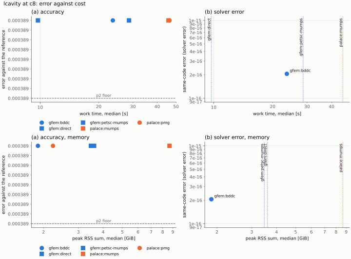

(a) Error against the converged reference, at each solver's best layout.

| solver | layout | tol | work s | peak RSS sum GiB | error |
|---|---|---|---|---|---|
| gfem:bddc | 1x8 | 1e-08 | 23.6 | 1.87 | 3.89e-04 |
| gfem:direct | 1x8 | — | 9.74 | 3.6 | 3.89e-04 |
| gfem:petsc-mumps | 1x8 | — | 28.6 | 3.47 | 3.89e-04 |
| palace:mumps | 8x1 | — | 45.7 | 8.67 | 3.89e-04 |
| palace:pmg | 8x1 | 1e-08 | 46.3 | 2.23 | 3.89e-04 |

Discretization floor (same-mesh error): p2 3.89e-04.

All 5 runs of order 2 are at the p2 floor (largest deviation 0.001 %): accuracy differences between codes do not show at this order on this mesh; compare codes by same-code error along the tolerance ladder.

Below reference resolution: errors under 1.00e-11.

(b) Same-code error (solver error, not accuracy) along the tolerance ladder.

| solver | layout | tol | work s | peak RSS sum GiB | same-code error |
|---|---|---|---|---|---|
| gfem:bddc | 1x8 | 1e-08 | 23.6 | 1.87 | 2.06e-16 |
| palace:pmg | 8x1 | 1e-08 | 46.3 | 2.23 | 0.00e+00 |

Direct runs (same-code error 0 by definition): gfem:direct 9.74 s (1x8), gfem:petsc-mumps 28.6 s (1x8), palace:mumps 45.7 s (8x1).

#### Time

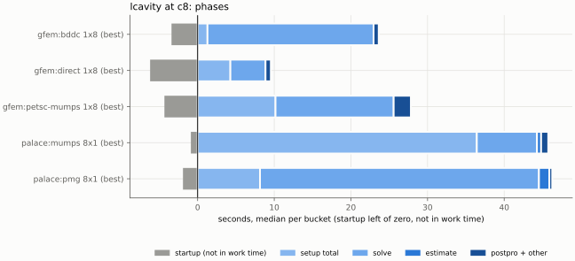

| solver | layout | role | tol | n | work s | spread | startup s | setup total s | solve total s | per sample s | mesh read s | discretize s | assemble s | setup s | solve s | estimate s | postpro s | rom s | other s | iterations | setups/solves | imbalance |
|---|---|---|---|---|---|---|---|---|---|---|---|---|---|---|---|---|---|---|---|---|---|---|
| gfem:bddc | 1x8 | best | 1e-08 | 3 | 23.6 | 7.7 % | 3.4 | 1.31 | 21.7 | — | 0.282 | 0.0721 | 0.647 | 0.287 | 21.7 | — | — | — | 0.672 | 0 | 2/1 | — |
| gfem:direct | 1x8 | best | — | 3 | 9.74 | 6.3 % | 6.2 | 4.28 | 4.58 | — | 0.291 | 0.0736 | 0.247 | 3.67 | 4.58 | — | — | — | 0.695 | 0 | 2/1 | — |
| gfem:petsc-mumps | 1x8 | best | — | 3 | 28.6 | 8.1 % | 4.33 | 10.1 | 15.4 | — | 0.263 | 0.087 | 0.282 | 9.53 | 15.4 | — | — | — | 2.24 | 0 | 2/1 | — |
| palace:mumps | 8x1 | best | — | 3 | 45.7 | 22.4 % noisy | 0.878 | 36.4 | 7.86 | — | 0.28 | — | 4.16 | 32 | 7.86 | 0.532 | 0.576 | 0 | 0.357 | 26 | 1/16 | 1 |
|  |  | rank 0 |  |  | — |  |  |  |  |  | 0.233 | — | 4.16 | 32 | 7.82 | 0.528 | 0.575 | 0 | 0.446 |  |  |  |
| palace:pmg | 8x1 | best | 1e-08 | 3 | 46.3 | 6.6 % | 1.91 | 8.2 | 36.4 | — | 0.273 | — | 4.17 | 3.69 | 36.4 | 1.35 | 0.11 | 0 | 0.267 | 201 | 1/16 | 1 |
|  |  | rank 0 |  |  | — |  |  |  |  |  | 0.228 | — | 4.17 | 3.69 | 36.2 | 1.35 | 0.11 | 0 | 0.443 |  |  |  |

Work time is wall minus startup; startup is not in work time. Rank reduction of the buckets: gfem:bddc: max; gfem:direct: max; gfem:petsc-mumps: max; palace:mumps: max-of-rows; palace:pmg: max-of-rows. Max-of-rows is an upper bound on the slowest rank (rows may peak on different ranks); imbalance = headline bucket sum / rank-0 sum.

gfem BDDC: the assemble bucket includes the preconditioner build (NGSolve builds BDDC while it assembles the first matrix of a setup).

#### Memory

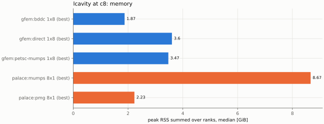

| solver | layout | role | peak RSS sum GiB | rank max GiB | largest node GiB | PSS sum GiB | sacct MaxRSS GiB | self-reports |
|---|---|---|---|---|---|---|---|---|
| gfem:bddc | 1x8 | best | 1.87 | 1.87 | 1.87 | 1.85 | — | solver_nbytes 2.08e+08 |
| gfem:direct | 1x8 | best | 3.6 | 3.6 | 3.6 | 3.6 | — | solver_nbytes 2.23e+09 |
| gfem:petsc-mumps | 1x8 | best | 3.47 | 3.47 | 3.47 | 3.47 | — | solver_nbytes 2.34e+09 |
| palace:mumps | 8x1 | best | 8.67 | 1.28 | 8.67 | 8.45 | — | — |
| palace:pmg | 8x1 | best | 2.23 | 0.291 | 2.23 | 1.9 | — | — |

The RSS sum counts shared pages once per rank in both codes alike; it is an upper bound on the simultaneous footprint, and PSS corrects it. sacct MaxRSS only for runs over 60 s.

#### Accuracy

| solver | order | layout | tol | metric | error | bound | resolved | ceiling | plausible | same-code error | δ |
|---|---|---|---|---|---|---|---|---|---|---|---|
| gfem:bddc | 2 | 1x8 | 1e-08 | max_rel_dRe_f | 3.89e-04 | 1.00e-12 | yes | 3.89e-03 | pass | 2.06e-16 | — |
| gfem:direct | 2 | 1x8 | — | max_rel_dRe_f | 3.89e-04 | 1.00e-12 | yes | 3.89e-03 | pass | 4.12e-16 | — |
| gfem:petsc-mumps | 2 | 1x8 | — | max_rel_dRe_f | 3.89e-04 | 1.00e-12 | yes | 3.89e-03 | pass | 4.12e-16 | — |
| palace:mumps | 2 | 1x8 | — | max_rel_dRe_f | 3.89e-04 | 1.00e-12 | yes | 3.89e-03 | pass | 0.00e+00 | — |
| palace:mumps | 2 | 2x4 | — | max_rel_dRe_f | 3.89e-04 | 1.00e-12 | yes | 3.89e-03 | pass | 0.00e+00 | — |
| palace:mumps | 2 | 4x2 | — | max_rel_dRe_f | 3.89e-04 | 1.00e-12 | yes | 3.89e-03 | pass | 0.00e+00 | — |
| palace:mumps | 2 | 8x1 | — | max_rel_dRe_f | 3.89e-04 | 1.00e-12 | yes | 3.89e-03 | pass | 0.00e+00 | — |
| palace:pmg | 2 | 1x8 | 1e-08 | max_rel_dRe_f | 3.89e-04 | 1.00e-12 | yes | 3.89e-03 | pass | 0.00e+00 | — |
| palace:pmg | 2 | 2x4 | 1e-08 | max_rel_dRe_f | 3.89e-04 | 1.00e-12 | yes | 3.89e-03 | pass | 0.00e+00 | — |
| palace:pmg | 2 | 4x2 | 1e-08 | max_rel_dRe_f | 3.89e-04 | 1.00e-12 | yes | 3.89e-03 | pass | 0.00e+00 | — |
| palace:pmg | 2 | 8x1 | 1e-08 | max_rel_dRe_f | 3.89e-04 | 1.00e-12 | yes | 3.89e-03 | pass | 0.00e+00 | — |

Discretization floor (same-mesh error): p2 3.89e-04.

All 11 runs of order 2 are at the p2 floor (largest deviation 0.001 %): accuracy differences between codes do not show at this order on this mesh; compare codes by same-code error along the tolerance ladder.

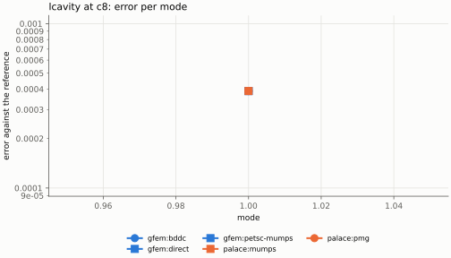

| mode | gfem:bddc (1x8) | gfem:direct (1x8) | gfem:petsc-mumps (1x8) | palace:mumps (8x1) | palace:pmg (8x1) |
|---|---|---|---|---|---|
| 1 | 3.89e-04 | 3.89e-04 | 3.89e-04 | 3.89e-04 | 3.89e-04 |

#### Layouts

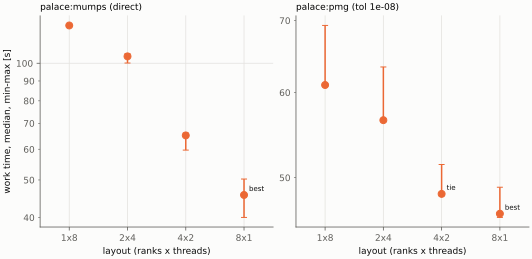

| solver | tol | layout | n | median work s | min-max |  |
|---|---|---|---|---|---|---|
| gfem:bddc | 1e-08 | 1x8 | 3 | 23.6 | 23.4-25.2 | best |
| gfem:direct | — | 1x8 | 3 | 9.74 | 9.43-10 | best |
| gfem:petsc-mumps | — | 1x8 | 3 | 28.6 | 28.4-30.7 | best |
| palace:mumps | — | 1x8 | 3 | 125 | 125-125 |  |
| palace:mumps | — | 2x4 | 3 | 104 | 100-106 |  |
| palace:mumps | — | 4x2 | 3 | 65.1 | 59.7-66.1 |  |
| palace:mumps | — | 8x1 | 3 | 45.7 | 40-50.3 | best |
| palace:pmg | 1e-08 | 1x8 | 3 | 61 | 60.9-69.3 |  |
| palace:pmg | 1e-08 | 2x4 | 3 | 56.5 | 56.4-63.4 |  |
| palace:pmg | 1e-08 | 4x2 | 3 | 48.3 | 48.1-51.4 | tie |
| palace:pmg | 1e-08 | 8x1 | 3 | 46.3 | 45.9-49 | best |

| solver | default | best | ties | default / best |
|---|---|---|---|---|
| gfem:bddc | — | 1x8 | — | — |
| gfem:direct | — | 1x8 | — | — |
| gfem:petsc-mumps | — | 1x8 | — | — |
| palace:mumps | — | 8x1 | — | — |
| palace:pmg | — | 8x1 | 4x2 | — |

#### Cross-solver snapshot (same-mesh comparison)

DOF: gfem [246416], palace [246416].

Direct kinds:

| solver | role | layout | n | work s | peak RSS sum GiB | error | jobs |
|---|---|---|---|---|---|---|---|
| gfem:direct | best | 1x8 | 3 | 9.74 | 3.6 | 3.89e-04 | 49256972 (slow node) |
| gfem:petsc-mumps | best | 1x8 | 3 | 28.6 | 3.47 | 3.89e-04 | 49256972 (slow node) |
| palace:mumps | best | 8x1 | 3 | 45.7 | 8.67 | 3.89e-04 | 49256972 (slow node) |

| role | ratio | work | memory | pairing |
|---|---|---|---|---|
| best | palace:mumps / gfem:direct | 4.7 | 2.41 | same job |

Iterative kinds:

| solver | role | layout | n | work s | peak RSS sum GiB | error | jobs |
|---|---|---|---|---|---|---|---|
| gfem:bddc | best | 1x8 | 3 | 23.6 | 1.87 | 3.89e-04 | 49256972 (slow node) |
| palace:pmg | best | 8x1 | 3 | 46.3 | 2.23 | 3.89e-04 | 49256972 (slow node) |

Iterative kinds compare only at equal achieved error (table above).

### lcavity at c16 (standard, 1 node)

#### Error against cost

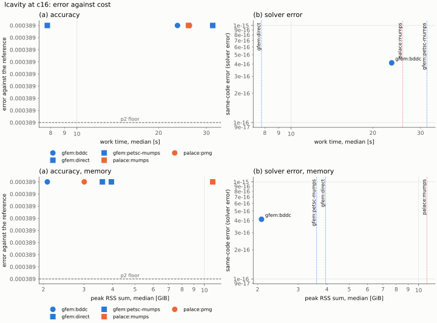

(a) Error against the converged reference, at each solver's best layout.

| solver | layout | tol | work s | peak RSS sum GiB | error |
|---|---|---|---|---|---|
| gfem:bddc | 1x16 | 1e-08 | 23.5 | 2.08 | 3.89e-04 |
| gfem:direct | 1x16 | — | 7.78 | 3.95 | 3.89e-04 |
| gfem:petsc-mumps | 1x16 | — | 31.7 | 3.61 | 3.89e-04 |
| palace:mumps | 16x1 | — | 25.8 | 10.9 | 3.89e-04 |
| palace:pmg | 16x1 | 1e-08 | 26 | 3.01 | 3.89e-04 |

Discretization floor (same-mesh error): p2 3.89e-04.

All 5 runs of order 2 are at the p2 floor (largest deviation 0.001 %): accuracy differences between codes do not show at this order on this mesh; compare codes by same-code error along the tolerance ladder.

Below reference resolution: errors under 1.00e-11.

(b) Same-code error (solver error, not accuracy) along the tolerance ladder.

| solver | layout | tol | work s | peak RSS sum GiB | same-code error |
|---|---|---|---|---|---|
| gfem:bddc | 1x16 | 1e-08 | 23.5 | 2.08 | 4.12e-16 |
| palace:pmg | 16x1 | 1e-08 | 26 | 3.01 | 0.00e+00 |

Direct runs (same-code error 0 by definition): gfem:direct 7.78 s (1x16), gfem:petsc-mumps 31.7 s (1x16), palace:mumps 25.8 s (16x1).

#### Time

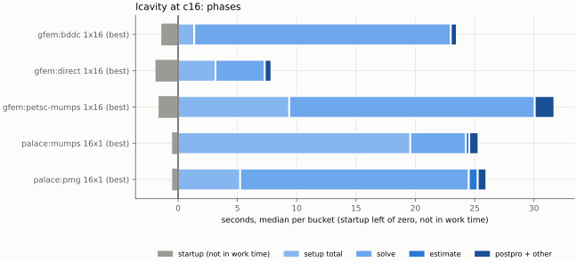

| solver | layout | role | tol | n | work s | spread | startup s | setup total s | solve total s | per sample s | mesh read s | discretize s | assemble s | setup s | solve s | estimate s | postpro s | rom s | other s | iterations | setups/solves | imbalance |
|---|---|---|---|---|---|---|---|---|---|---|---|---|---|---|---|---|---|---|---|---|---|---|
| gfem:bddc | 1x16 | best | 1e-08 | 3 | 23.5 | 2.0 % | 1.41 | 1.36 | 21.6 | — | 0.267 | 0.0671 | 0.766 | 0.264 | 21.6 | — | — | — | 0.511 | 0 | 2/1 | — |
| gfem:direct | 1x16 | best | — | 3 | 7.78 | 15.4 % noisy | 1.9 | 3.16 | 4.15 | — | 0.29 | 0.0709 | 0.151 | 2.65 | 4.15 | — | — | — | 0.561 | 0 | 2/1 | — |
| gfem:petsc-mumps | 1x16 | best | — | 3 | 31.7 | 1.5 % | 1.65 | 9.37 | 20.7 | — | 0.265 | 0.0819 | 0.167 | 8.86 | 20.7 | — | — | — | 1.65 | 0 | 2/1 | — |
| palace:mumps | 16x1 | best | — | 3 | 25.8 | 6.6 % | 0.505 | 19.6 | 4.68 | — | 0.269 | — | 2.51 | 16.8 | 4.68 | 0.287 | 0.09 | 0 | 0.684 | 22 | 1/16 | 1 |
|  |  | rank 0 |  |  | — |  |  |  |  |  | 0.224 | — | 2.51 | 16.8 | 4.67 | 0.284 | 0.0894 | 0 | 0.745 |  |  |  |
| palace:pmg | 16x1 | best | 1e-08 | 3 | 26 | 0.4 % | 0.5 | 5.24 | 19.3 | — | 0.274 | — | 2.52 | 2.45 | 19.3 | 0.755 | 0.091 | 0 | 0.631 | 199 | 1/16 | 1 |
|  |  | rank 0 |  |  | — |  |  |  |  |  | 0.228 | — | 2.51 | 2.45 | 19.2 | 0.753 | 0.09 | 0 | 0.76 |  |  |  |

Work time is wall minus startup; startup is not in work time. Rank reduction of the buckets: gfem:bddc: max; gfem:direct: max; gfem:petsc-mumps: max; palace:mumps: max-of-rows; palace:pmg: max-of-rows. Max-of-rows is an upper bound on the slowest rank (rows may peak on different ranks); imbalance = headline bucket sum / rank-0 sum.

gfem BDDC: the assemble bucket includes the preconditioner build (NGSolve builds BDDC while it assembles the first matrix of a setup).

#### Memory

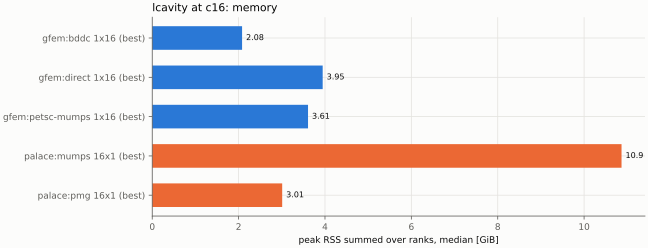

| solver | layout | role | peak RSS sum GiB | rank max GiB | largest node GiB | PSS sum GiB | sacct MaxRSS GiB | self-reports |
|---|---|---|---|---|---|---|---|---|
| gfem:bddc | 1x16 | best | 2.08 | 2.08 | 2.08 | 2.07 | — | solver_nbytes 2.17e+08 |
| gfem:direct | 1x16 | best | 3.95 | 3.95 | 3.95 | 3.9 | — | solver_nbytes 2.39e+09 |
| gfem:petsc-mumps | 1x16 | best | 3.61 | 3.61 | 3.61 | 3.61 | — | solver_nbytes 2.34e+09 |
| palace:mumps | 16x1 | best | 10.9 | 0.849 | 10.9 | 10.2 | — | — |
| palace:pmg | 16x1 | best | 3.01 | 0.208 | 3.01 | 2.34 | — | — |

The RSS sum counts shared pages once per rank in both codes alike; it is an upper bound on the simultaneous footprint, and PSS corrects it. sacct MaxRSS only for runs over 60 s.

#### Accuracy

| solver | order | layout | tol | metric | error | bound | resolved | ceiling | plausible | same-code error | δ |
|---|---|---|---|---|---|---|---|---|---|---|---|
| gfem:bddc | 2 | 1x16 | 1e-08 | max_rel_dRe_f | 3.89e-04 | 1.00e-12 | yes | 3.89e-03 | pass | 4.12e-16 | — |
| gfem:direct | 2 | 1x16 | — | max_rel_dRe_f | 3.89e-04 | 1.00e-12 | yes | 3.89e-03 | pass | 0.00e+00 | — |
| gfem:petsc-mumps | 2 | 1x16 | — | max_rel_dRe_f | 3.89e-04 | 1.00e-12 | yes | 3.89e-03 | pass | 6.18e-16 | — |
| palace:mumps | 2 | 1x16 | — | max_rel_dRe_f | 3.89e-04 | 1.00e-12 | yes | 3.89e-03 | pass | 0.00e+00 | — |
| palace:mumps | 2 | 2x8 | — | max_rel_dRe_f | 3.89e-04 | 1.00e-12 | yes | 3.89e-03 | pass | 0.00e+00 | — |
| palace:mumps | 2 | 4x4 | — | max_rel_dRe_f | 3.89e-04 | 1.00e-12 | yes | 3.89e-03 | pass | 0.00e+00 | — |
| palace:mumps | 2 | 8x2 | — | max_rel_dRe_f | 3.89e-04 | 1.00e-12 | yes | 3.89e-03 | pass | 0.00e+00 | — |
| palace:mumps | 2 | 16x1 | — | max_rel_dRe_f | 3.89e-04 | 1.00e-12 | yes | 3.89e-03 | pass | 0.00e+00 | — |
| palace:pmg | 2 | 1x16 | 1e-08 | max_rel_dRe_f | 3.89e-04 | 1.00e-12 | yes | 3.89e-03 | pass | 0.00e+00 | — |
| palace:pmg | 2 | 2x8 | 1e-08 | max_rel_dRe_f | 3.89e-04 | 1.00e-12 | yes | 3.89e-03 | pass | 0.00e+00 | — |
| palace:pmg | 2 | 4x4 | 1e-08 | max_rel_dRe_f | 3.89e-04 | 1.00e-12 | yes | 3.89e-03 | pass | 0.00e+00 | — |
| palace:pmg | 2 | 8x2 | 1e-08 | max_rel_dRe_f | 3.89e-04 | 1.00e-12 | yes | 3.89e-03 | pass | 0.00e+00 | — |
| palace:pmg | 2 | 16x1 | 1e-08 | max_rel_dRe_f | 3.89e-04 | 1.00e-12 | yes | 3.89e-03 | pass | 0.00e+00 | — |

Discretization floor (same-mesh error): p2 3.89e-04.

All 13 runs of order 2 are at the p2 floor (largest deviation 0.001 %): accuracy differences between codes do not show at this order on this mesh; compare codes by same-code error along the tolerance ladder.

| mode | gfem:bddc (1x16) | gfem:direct (1x16) | gfem:petsc-mumps (1x16) | palace:mumps (16x1) | palace:pmg (16x1) |
|---|---|---|---|---|---|
| 1 | 3.89e-04 | 3.89e-04 | 3.89e-04 | 3.89e-04 | 3.89e-04 |

#### Layouts

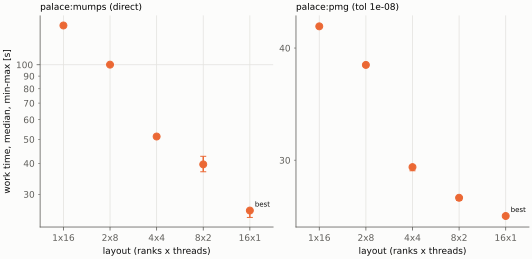

| solver | tol | layout | n | median work s | min-max |  |
|---|---|---|---|---|---|---|
| gfem:bddc | 1e-08 | 1x16 | 3 | 23.5 | 23.2-23.7 | best |
| gfem:direct | — | 1x16 | 3 | 7.78 | 7.69-8.89 | best |
| gfem:petsc-mumps | — | 1x16 | 3 | 31.7 | 31.5-32 | best |
| palace:mumps | — | 1x16 | 3 | 144 | 144-144 |  |
| palace:mumps | — | 2x8 | 3 | 100 | 99.9-100 |  |
| palace:mumps | — | 4x4 | 3 | 51.3 | 51.1-51.8 |  |
| palace:mumps | — | 8x2 | 3 | 39.6 | 37-42.7 |  |
| palace:mumps | — | 16x1 | 3 | 25.8 | 24.2-25.9 | best |
| palace:pmg | 1e-08 | 1x16 | 3 | 42.3 | 42.3-42.4 |  |
| palace:pmg | 1e-08 | 2x8 | 3 | 38.3 | 38.1-38.3 |  |
| palace:pmg | 1e-08 | 4x4 | 3 | 29.5 | 29.2-29.6 |  |
| palace:pmg | 1e-08 | 8x2 | 3 | 27.2 | 27.1-27.3 |  |
| palace:pmg | 1e-08 | 16x1 | 3 | 26 | 25.9-26 | best |

| solver | default | best | ties | default / best |
|---|---|---|---|---|
| gfem:bddc | — | 1x16 | — | — |
| gfem:direct | — | 1x16 | — | — |
| gfem:petsc-mumps | — | 1x16 | — | — |
| palace:mumps | — | 16x1 | — | — |
| palace:pmg | — | 16x1 | — | — |

#### Cross-solver snapshot (same-mesh comparison)

DOF: gfem [246416], palace [246416].

Direct kinds:

| solver | role | layout | n | work s | peak RSS sum GiB | error | jobs |
|---|---|---|---|---|---|---|---|
| gfem:direct | best | 1x16 | 3 | 7.78 | 3.95 | 3.89e-04 | 49256510 (slow node) |
| gfem:petsc-mumps | best | 1x16 | 3 | 31.7 | 3.61 | 3.89e-04 | 49256510 (slow node) |
| palace:mumps | best | 16x1 | 3 | 25.8 | 10.9 | 3.89e-04 | 49256510 (slow node) |

| role | ratio | work | memory | pairing |
|---|---|---|---|---|
| best | palace:mumps / gfem:direct | 3.32 | 2.75 | same job |

Iterative kinds:

| solver | role | layout | n | work s | peak RSS sum GiB | error | jobs |
|---|---|---|---|---|---|---|---|
| gfem:bddc | best | 1x16 | 3 | 23.5 | 2.08 | 3.89e-04 | 49256510 (slow node) |
| palace:pmg | best | 16x1 | 3 | 26 | 3.01 | 3.89e-04 | 49256510 (slow node) |

Iterative kinds compare only at equal achieved error (table above).

### lcavity at c32 (standard, 1 node)

#### Error against cost

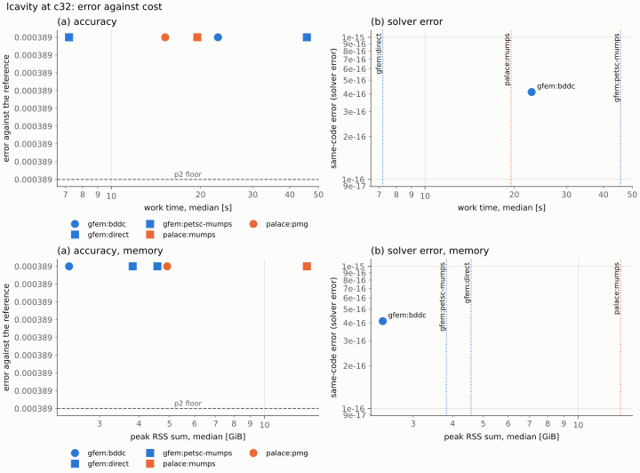

(a) Error against the converged reference, at each solver's best layout.

| solver | layout | tol | work s | peak RSS sum GiB | error |
|---|---|---|---|---|---|
| gfem:bddc | 1x32 | 1e-08 | 22.9 | 2.4 | 3.89e-04 |
| gfem:direct | 1x32 | — | 7.2 | 4.58 | 3.89e-04 |
| gfem:petsc-mumps | 1x32 | — | 45.7 | 3.82 | 3.89e-04 |
| palace:mumps | 32x1 | — | 19.5 | 13.6 | 3.89e-04 |
| palace:pmg | 32x1 | 1e-08 | 15.2 | 4.91 | 3.89e-04 |

Discretization floor (same-mesh error): p2 3.89e-04.

All 5 runs of order 2 are at the p2 floor (largest deviation 0.001 %): accuracy differences between codes do not show at this order on this mesh; compare codes by same-code error along the tolerance ladder.

Below reference resolution: errors under 1.00e-11.

(b) Same-code error (solver error, not accuracy) along the tolerance ladder.

| solver | layout | tol | work s | peak RSS sum GiB | same-code error |
|---|---|---|---|---|---|
| gfem:bddc | 1x32 | 1e-08 | 22.9 | 2.4 | 4.12e-16 |
| palace:pmg | 32x1 | 1e-08 | 15.2 | 4.91 | 0.00e+00 |

Direct runs (same-code error 0 by definition): gfem:direct 7.2 s (1x32), gfem:petsc-mumps 45.7 s (1x32), palace:mumps 19.5 s (32x1).

#### Time

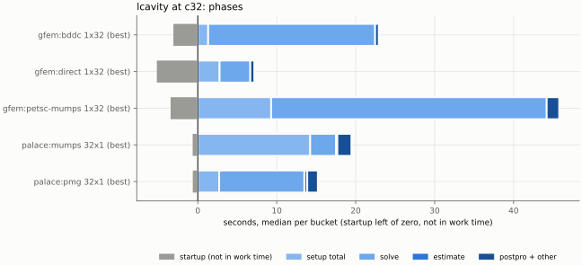

| solver | layout | role | tol | n | work s | spread | startup s | setup total s | solve total s | per sample s | mesh read s | discretize s | assemble s | setup s | solve s | estimate s | postpro s | rom s | other s | iterations | setups/solves | imbalance |
|---|---|---|---|---|---|---|---|---|---|---|---|---|---|---|---|---|---|---|---|---|---|---|
| gfem:bddc | 1x32 | best | 1e-08 | 3 | 22.9 | 1.6 % | 3.09 | 1.33 | 21.1 | — | 0.28 | 0.0693 | 0.683 | 0.282 | 21.1 | — | — | — | 0.459 | 0 | 2/1 | — |
| gfem:direct | 1x32 | best | — | 3 | 7.2 | 17.3 % noisy | 5.19 | 2.78 | 3.89 | — | 0.299 | 0.0708 | 0.107 | 2.29 | 3.89 | — | — | — | 0.506 | 0 | 2/1 | — |
| gfem:petsc-mumps | 1x32 | best | — | 3 | 45.7 | 9.1 % | 3.44 | 9.29 | 34.9 | — | 0.281 | 0.0816 | 0.115 | 8.81 | 34.9 | — | — | — | 1.58 | 0 | 2/1 | — |
| palace:mumps | 32x1 | best | — | 3 | 19.5 | 61.3 % noisy | 0.652 | 14.2 | 3.28 | — | 0.295 | — | 1.17 | 12.8 | 3.28 | 0.166 | 0.495 | 0 | 1.28 | 21 | 1/16 | 0.999 |
|  |  | rank 0 |  |  | — |  |  |  |  |  | 0.245 | — | 1.17 | 12.8 | 3.27 | 0.165 | 0.495 | 0 | 1.37 |  |  |  |
| palace:pmg | 32x1 | best | 1e-08 | 3 | 15.2 | 0.1 % | 0.636 | 2.71 | 10.8 | — | 0.297 | — | 1.17 | 1.24 | 10.8 | 0.368 | 0.082 | 0 | 1.25 | 200 | 1/16 | 1 |
|  |  | rank 0 |  |  | — |  |  |  |  |  | 0.25 | — | 1.17 | 1.24 | 10.7 | 0.366 | 0.081 | 0 | 1.34 |  |  |  |

Work time is wall minus startup; startup is not in work time. Rank reduction of the buckets: gfem:bddc: max; gfem:direct: max; gfem:petsc-mumps: max; palace:mumps: max-of-rows; palace:pmg: max-of-rows. Max-of-rows is an upper bound on the slowest rank (rows may peak on different ranks); imbalance = headline bucket sum / rank-0 sum.

gfem BDDC: the assemble bucket includes the preconditioner build (NGSolve builds BDDC while it assembles the first matrix of a setup).

#### Memory

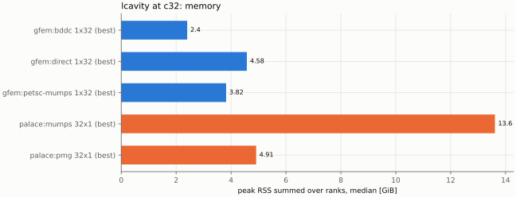

| solver | layout | role | peak RSS sum GiB | rank max GiB | largest node GiB | PSS sum GiB | sacct MaxRSS GiB | self-reports |
|---|---|---|---|---|---|---|---|---|
| gfem:bddc | 1x32 | best | 2.4 | 2.4 | 2.4 | 2.4 | — | solver_nbytes 2.85e+08 |
| gfem:direct | 1x32 | best | 4.58 | 4.58 | 4.58 | 4.41 | — | solver_nbytes 2.73e+09 |
| gfem:petsc-mumps | 1x32 | best | 3.82 | 3.82 | 3.82 | 3.83 | — | solver_nbytes 2.34e+09 |
| palace:mumps | 32x1 | best | 13.6 | 0.518 | 13.6 | 11.8 | — | — |
| palace:pmg | 32x1 | best | 4.91 | 0.168 | 4.91 | 2.94 | — | — |

The RSS sum counts shared pages once per rank in both codes alike; it is an upper bound on the simultaneous footprint, and PSS corrects it. sacct MaxRSS only for runs over 60 s.

#### Accuracy

| solver | order | layout | tol | metric | error | bound | resolved | ceiling | plausible | same-code error | δ |
|---|---|---|---|---|---|---|---|---|---|---|---|
| gfem:bddc | 2 | 1x32 | 1e-08 | max_rel_dRe_f | 3.89e-04 | 1.00e-12 | yes | 3.89e-03 | pass | 4.12e-16 | — |
| gfem:direct | 2 | 1x32 | — | max_rel_dRe_f | 3.89e-04 | 1.00e-12 | yes | 3.89e-03 | pass | 0.00e+00 | — |
| gfem:petsc-mumps | 2 | 1x32 | — | max_rel_dRe_f | 3.89e-04 | 1.00e-12 | yes | 3.89e-03 | pass | 4.12e-16 | — |
| palace:mumps | 2 | 1x32 | — | max_rel_dRe_f | 3.89e-04 | 1.00e-12 | yes | 3.89e-03 | pass | 0.00e+00 | — |
| palace:mumps | 2 | 2x16 | — | max_rel_dRe_f | 3.89e-04 | 1.00e-12 | yes | 3.89e-03 | pass | 0.00e+00 | — |
| palace:mumps | 2 | 4x8 | — | max_rel_dRe_f | 3.89e-04 | 1.00e-12 | yes | 3.89e-03 | pass | 0.00e+00 | — |
| palace:mumps | 2 | 8x4 | — | max_rel_dRe_f | 3.89e-04 | 1.00e-12 | yes | 3.89e-03 | pass | 0.00e+00 | — |
| palace:mumps | 2 | 16x2 | — | max_rel_dRe_f | 3.89e-04 | 1.00e-12 | yes | 3.89e-03 | pass | 0.00e+00 | — |
| palace:mumps | 2 | 32x1 | — | max_rel_dRe_f | 3.89e-04 | 1.00e-12 | yes | 3.89e-03 | pass | 0.00e+00 | — |
| palace:pmg | 2 | 1x32 | 1e-08 | max_rel_dRe_f | 3.89e-04 | 1.00e-12 | yes | 3.89e-03 | pass | 0.00e+00 | — |
| palace:pmg | 2 | 2x16 | 1e-08 | max_rel_dRe_f | 3.89e-04 | 1.00e-12 | yes | 3.89e-03 | pass | 0.00e+00 | — |
| palace:pmg | 2 | 4x8 | 1e-08 | max_rel_dRe_f | 3.89e-04 | 1.00e-12 | yes | 3.89e-03 | pass | 0.00e+00 | — |
| palace:pmg | 2 | 8x4 | 1e-08 | max_rel_dRe_f | 3.89e-04 | 1.00e-12 | yes | 3.89e-03 | pass | 0.00e+00 | — |
| palace:pmg | 2 | 16x2 | 1e-08 | max_rel_dRe_f | 3.89e-04 | 1.00e-12 | yes | 3.89e-03 | pass | 0.00e+00 | — |
| palace:pmg | 2 | 32x1 | 1e-08 | max_rel_dRe_f | 3.89e-04 | 1.00e-12 | yes | 3.89e-03 | pass | 0.00e+00 | — |

Discretization floor (same-mesh error): p2 3.89e-04.

All 15 runs of order 2 are at the p2 floor (largest deviation 0.001 %): accuracy differences between codes do not show at this order on this mesh; compare codes by same-code error along the tolerance ladder.

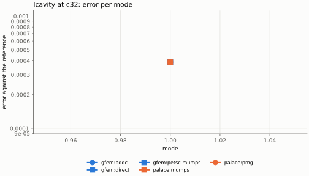

| mode | gfem:bddc (1x32) | gfem:direct (1x32) | gfem:petsc-mumps (1x32) | palace:mumps (32x1) | palace:pmg (32x1) |
|---|---|---|---|---|---|
| 1 | 3.89e-04 | 3.89e-04 | 3.89e-04 | 3.89e-04 | 3.89e-04 |

#### Layouts

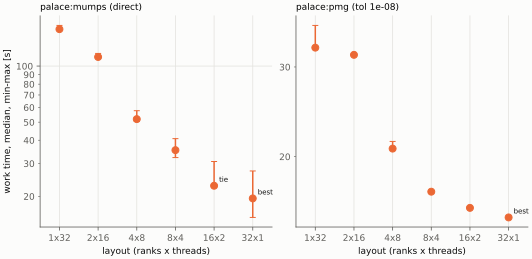

| solver | tol | layout | n | median work s | min-max |  |
|---|---|---|---|---|---|---|
| gfem:bddc | 1e-08 | 1x32 | 3 | 22.9 | 22.9-23.3 | best |
| gfem:direct | — | 1x32 | 3 | 7.2 | 6.91-8.16 | best |
| gfem:petsc-mumps | — | 1x32 | 3 | 45.7 | 44.6-48.7 | best |
| palace:mumps | — | 1x32 | 3 | 158 | 157-165 |  |
| palace:mumps | — | 2x16 | 3 | 112 | 111-117 |  |
| palace:mumps | — | 4x8 | 3 | 51.9 | 50.5-57.6 |  |
| palace:mumps | — | 8x4 | 3 | 35.4 | 32.3-40.8 |  |
| palace:mumps | — | 16x2 | 3 | 22.8 | 22.3-30.8 | tie |
| palace:mumps | — | 32x1 | 3 | 19.5 | 15.4-27.4 | best |
| palace:pmg | 1e-08 | 1x32 | 3 | 32.7 | 32.7-36.2 |  |
| palace:pmg | 1e-08 | 2x16 | 3 | 31.7 | 31.7-31.7 |  |
| palace:pmg | 1e-08 | 4x8 | 3 | 20.7 | 20.7-21.4 |  |
| palace:pmg | 1e-08 | 8x4 | 3 | 17.1 | 17-17.1 |  |
| palace:pmg | 1e-08 | 16x2 | 3 | 15.9 | 15.8-15.9 |  |
| palace:pmg | 1e-08 | 32x1 | 3 | 15.2 | 15.2-15.2 | best |

| solver | default | best | ties | default / best |
|---|---|---|---|---|
| gfem:bddc | — | 1x32 | — | — |
| gfem:direct | — | 1x32 | — | — |
| gfem:petsc-mumps | — | 1x32 | — | — |
| palace:mumps | — | 32x1 | 16x2 | — |
| palace:pmg | — | 32x1 | — | — |

#### Cross-solver snapshot (same-mesh comparison)

DOF: gfem [246416], palace [246416].

Direct kinds:

| solver | role | layout | n | work s | peak RSS sum GiB | error | jobs |
|---|---|---|---|---|---|---|---|
| gfem:direct | best | 1x32 | 3 | 7.2 | 4.58 | 3.89e-04 | 49256969 |
| gfem:petsc-mumps | best | 1x32 | 3 | 45.7 | 3.82 | 3.89e-04 | 49256969 |
| palace:mumps | best | 32x1 | 3 | 19.5 | 13.6 | 3.89e-04 | 49256969 |

| role | ratio | work | memory | pairing |
|---|---|---|---|---|
| best | palace:mumps / gfem:direct | 2.71 | 2.97 | same job |

Iterative kinds:

| solver | role | layout | n | work s | peak RSS sum GiB | error | jobs |
|---|---|---|---|---|---|---|---|
| gfem:bddc | best | 1x32 | 3 | 22.9 | 2.4 | 3.89e-04 | 49256969 |
| palace:pmg | best | 32x1 | 3 | 15.2 | 4.91 | 3.89e-04 | 49256969 |

Iterative kinds compare only at equal achieved error (table above).

### lcavity at c56 (standard, 1 node)

#### Error against cost

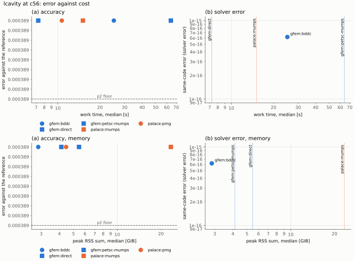

(a) Error against the converged reference, at each solver's best layout.

| solver | layout | tol | work s | peak RSS sum GiB | error |
|---|---|---|---|---|---|
| gfem:bddc | 1x56 | 1e-08 | 25.1 | 2.86 | 3.89e-04 |
| gfem:direct | 1x56 | — | 7.25 | 5.46 | 3.89e-04 |
| gfem:petsc-mumps | 1x56 | — | 64.1 | 4.13 | 3.89e-04 |
| palace:mumps | 56x1 | — | 15.1 | 23.4 | 3.89e-04 |
| palace:pmg | 28x2 | 1e-08 | 10.7 | 4.45 | 3.89e-04 |

Discretization floor (same-mesh error): p2 3.89e-04.

All 5 runs of order 2 are at the p2 floor (largest deviation 0.001 %): accuracy differences between codes do not show at this order on this mesh; compare codes by same-code error along the tolerance ladder.

Below reference resolution: errors under 1.00e-11.

(b) Same-code error (solver error, not accuracy) along the tolerance ladder.

| solver | layout | tol | work s | peak RSS sum GiB | same-code error |
|---|---|---|---|---|---|
| gfem:bddc | 1x56 | 1e-08 | 25.1 | 2.86 | 6.18e-16 |
| palace:pmg | 28x2 | 1e-08 | 10.7 | 4.45 | 0.00e+00 |

Direct runs (same-code error 0 by definition): gfem:direct 7.25 s (1x56), gfem:petsc-mumps 64.1 s (1x56), palace:mumps 15.1 s (56x1).

#### Time

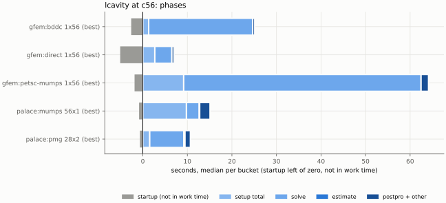

| solver | layout | role | tol | n | work s | spread | startup s | setup total s | solve total s | per sample s | mesh read s | discretize s | assemble s | setup s | solve s | estimate s | postpro s | rom s | other s | iterations | setups/solves | imbalance |
|---|---|---|---|---|---|---|---|---|---|---|---|---|---|---|---|---|---|---|---|---|---|---|
| gfem:bddc | 1x56 | best | 1e-08 | 3 | 25.1 | 0.4 % | 2.61 | 1.32 | 23.4 | — | 0.29 | 0.0707 | 0.694 | 0.264 | 23.4 | — | — | — | 0.443 | 0 | 2/1 | — |
| gfem:direct | 1x56 | best | — | 3 | 7.25 | 11.8 % noisy | 5.08 | 2.69 | 3.83 | — | 0.342 | 0.0721 | 0.0916 | 2.19 | 3.83 | — | — | — | 0.491 | 0 | 2/1 | — |
| gfem:petsc-mumps | 1x56 | best | — | 3 | 64.1 | 6.2 % | 1.85 | 9.18 | 53.3 | — | 0.281 | 0.0801 | 0.0976 | 8.72 | 53.3 | — | — | — | 1.68 | 0 | 2/1 | — |
| palace:mumps | 56x1 | best | — | 3 | 15.1 | 15.8 % noisy | 0.839 | 9.79 | 2.87 | — | 0.324 | — | 0.602 | 8.87 | 2.87 | 0.111 | 0.08 | 0 | 2.24 | 20 | 1/16 | 1 |
|  |  | rank 0 |  |  | — |  |  |  |  |  | 0.276 | — | 0.601 | 8.87 | 2.85 | 0.11 | 0.0788 | 0 | 2.29 |  |  |  |
| palace:pmg | 28x2 | best | 1e-08 | 3 | 10.7 | 0.1 % | 0.651 | 1.55 | 7.65 | — | 0.292 | — | 0.627 | 0.633 | 7.65 | 0.269 | 0.079 | 0 | 1.13 | 200 | 1/16 | 1 |
|  |  | rank 0 |  |  | — |  |  |  |  |  | 0.244 | — | 0.626 | 0.633 | 7.6 | 0.267 | 0.0779 | 0 | 1.22 |  |  |  |

Work time is wall minus startup; startup is not in work time. Rank reduction of the buckets: gfem:bddc: max; gfem:direct: max; gfem:petsc-mumps: max; palace:mumps: max-of-rows; palace:pmg: max-of-rows. Max-of-rows is an upper bound on the slowest rank (rows may peak on different ranks); imbalance = headline bucket sum / rank-0 sum.

gfem BDDC: the assemble bucket includes the preconditioner build (NGSolve builds BDDC while it assembles the first matrix of a setup).

#### Memory

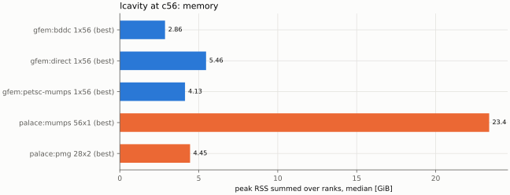

| solver | layout | role | peak RSS sum GiB | rank max GiB | largest node GiB | PSS sum GiB | sacct MaxRSS GiB | self-reports |
|---|---|---|---|---|---|---|---|---|
| gfem:bddc | 1x56 | best | 2.86 | 2.86 | 2.86 | 2.83 | — | solver_nbytes 3.86e+08 |
| gfem:direct | 1x56 | best | 5.46 | 5.46 | 5.46 | 5.31 | — | solver_nbytes 3.23e+09 |
| gfem:petsc-mumps | 1x56 | best | 4.13 | 4.13 | 4.13 | 4.14 | 4.07 | solver_nbytes 2.34e+09 |
| palace:mumps | 56x1 | best | 23.4 | 0.485 | 23.4 | 14.1 | — | — |
| palace:pmg | 28x2 | best | 4.45 | 0.172 | 4.45 | 2.91 | — | — |

The RSS sum counts shared pages once per rank in both codes alike; it is an upper bound on the simultaneous footprint, and PSS corrects it. sacct MaxRSS only for runs over 60 s.

#### Accuracy

| solver | order | layout | tol | metric | error | bound | resolved | ceiling | plausible | same-code error | δ |
|---|---|---|---|---|---|---|---|---|---|---|---|
| gfem:bddc | 2 | 1x56 | 1e-08 | max_rel_dRe_f | 3.89e-04 | 1.00e-12 | yes | 3.89e-03 | pass | 6.18e-16 | — |
| gfem:direct | 2 | 1x56 | — | max_rel_dRe_f | 3.89e-04 | 1.00e-12 | yes | 3.89e-03 | pass | 0.00e+00 | — |
| gfem:petsc-mumps | 2 | 1x56 | — | max_rel_dRe_f | 3.89e-04 | 1.00e-12 | yes | 3.89e-03 | pass | 6.18e-16 | — |
| palace:mumps | 2 | 1x56 | — | max_rel_dRe_f | 3.89e-04 | 1.00e-12 | yes | 3.89e-03 | pass | 0.00e+00 | — |
| palace:mumps | 2 | 2x28 | — | max_rel_dRe_f | 3.89e-04 | 1.00e-12 | yes | 3.89e-03 | pass | 0.00e+00 | — |
| palace:mumps | 2 | 4x14 | — | max_rel_dRe_f | 3.89e-04 | 1.00e-12 | yes | 3.89e-03 | pass | 0.00e+00 | — |
| palace:mumps | 2 | 7x8 | — | max_rel_dRe_f | 3.89e-04 | 1.00e-12 | yes | 3.89e-03 | pass | 0.00e+00 | — |
| palace:mumps | 2 | 8x7 | — | max_rel_dRe_f | 3.89e-04 | 1.00e-12 | yes | 3.89e-03 | pass | 0.00e+00 | — |
| palace:mumps | 2 | 14x4 | — | max_rel_dRe_f | 3.89e-04 | 1.00e-12 | yes | 3.89e-03 | pass | 0.00e+00 | — |
| palace:mumps | 2 | 28x2 | — | max_rel_dRe_f | 3.89e-04 | 1.00e-12 | yes | 3.89e-03 | pass | 0.00e+00 | — |
| palace:mumps | 2 | 56x1 | — | max_rel_dRe_f | 3.89e-04 | 1.00e-12 | yes | 3.89e-03 | pass | 0.00e+00 | — |
| palace:pmg | 2 | 1x56 | 1e-08 | max_rel_dRe_f | 3.89e-04 | 1.00e-12 | yes | 3.89e-03 | pass | 0.00e+00 | — |
| palace:pmg | 2 | 2x28 | 1e-08 | max_rel_dRe_f | 3.89e-04 | 1.00e-12 | yes | 3.89e-03 | pass | 0.00e+00 | — |
| palace:pmg | 2 | 4x14 | 1e-08 | max_rel_dRe_f | 3.89e-04 | 1.00e-12 | yes | 3.89e-03 | pass | 0.00e+00 | — |
| palace:pmg | 2 | 7x8 | 1e-08 | max_rel_dRe_f | 3.89e-04 | 1.00e-12 | yes | 3.89e-03 | pass | 0.00e+00 | — |
| palace:pmg | 2 | 8x7 | 1e-08 | max_rel_dRe_f | 3.89e-04 | 1.00e-12 | yes | 3.89e-03 | pass | 0.00e+00 | — |
| palace:pmg | 2 | 14x4 | 1e-08 | max_rel_dRe_f | 3.89e-04 | 1.00e-12 | yes | 3.89e-03 | pass | 0.00e+00 | — |
| palace:pmg | 2 | 28x2 | 1e-08 | max_rel_dRe_f | 3.89e-04 | 1.00e-12 | yes | 3.89e-03 | pass | 0.00e+00 | — |
| palace:pmg | 2 | 56x1 | 1e-08 | max_rel_dRe_f | 3.89e-04 | 1.00e-12 | yes | 3.89e-03 | pass | 0.00e+00 | — |

Discretization floor (same-mesh error): p2 3.89e-04.

All 19 runs of order 2 are at the p2 floor (largest deviation 0.001 %): accuracy differences between codes do not show at this order on this mesh; compare codes by same-code error along the tolerance ladder.

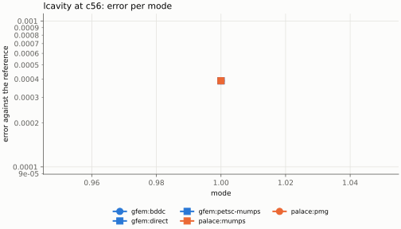

| mode | gfem:bddc (1x56) | gfem:direct (1x56) | gfem:petsc-mumps (1x56) | palace:mumps (56x1) | palace:pmg (28x2) |
|---|---|---|---|---|---|
| 1 | 3.89e-04 | 3.89e-04 | 3.89e-04 | 3.89e-04 | 3.89e-04 |

#### Layouts

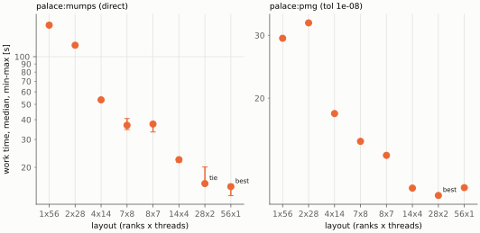

| solver | tol | layout | n | median work s | min-max |  |
|---|---|---|---|---|---|---|
| gfem:bddc | 1e-08 | 1x56 | 3 | 25.1 | 25.1-25.2 | best |
| gfem:direct | — | 1x56 | 3 | 7.25 | 6.93-7.78 | best |
| gfem:petsc-mumps | — | 1x56 | 3 | 64.1 | 63.8-67.8 | best |
| palace:mumps | — | 1x56 | 3 | 158 | 158-164 |  |
| palace:mumps | — | 2x28 | 3 | 118 | 118-118 |  |
| palace:mumps | — | 4x14 | 3 | 53.4 | 53.3-53.4 |  |
| palace:mumps | — | 7x8 | 3 | 36.9 | 34.7-40.7 |  |
| palace:mumps | — | 8x7 | 3 | 37.6 | 33.5-38.3 |  |
| palace:mumps | — | 14x4 | 3 | 22.4 | 21.5-22.7 |  |
| palace:mumps | — | 28x2 | 3 | 15.8 | 15.5-20.1 | tie |
| palace:mumps | — | 56x1 | 3 | 15.1 | 13.3-15.7 | best |
| palace:pmg | 1e-08 | 1x56 | 3 | 29.4 | 29.4-29.5 |  |
| palace:pmg | 1e-08 | 2x28 | 3 | 32.5 | 32.4-32.5 |  |
| palace:pmg | 1e-08 | 4x14 | 3 | 18.1 | 18-18.1 |  |
| palace:pmg | 1e-08 | 7x8 | 3 | 15.1 | 15.1-15.2 |  |
| palace:pmg | 1e-08 | 8x7 | 3 | 13.8 | 13.8-13.8 |  |
| palace:pmg | 1e-08 | 14x4 | 3 | 11.2 | 11.2-11.2 |  |
| palace:pmg | 1e-08 | 28x2 | 3 | 10.7 | 10.7-10.7 | best |
| palace:pmg | 1e-08 | 56x1 | 3 | 11.2 | 11.2-11.3 |  |

| solver | default | best | ties | default / best |
|---|---|---|---|---|
| gfem:bddc | — | 1x56 | — | — |
| gfem:direct | — | 1x56 | — | — |
| gfem:petsc-mumps | — | 1x56 | — | — |
| palace:mumps | — | 56x1 | 28x2 | — |
| palace:pmg | — | 28x2 | — | — |

#### Cross-solver snapshot (same-mesh comparison)

DOF: gfem [246416], palace [246416].

Direct kinds:

| solver | role | layout | n | work s | peak RSS sum GiB | error | jobs |
|---|---|---|---|---|---|---|---|
| gfem:direct | best | 1x56 | 3 | 7.25 | 5.46 | 3.89e-04 | 49256966 |
| gfem:petsc-mumps | best | 1x56 | 3 | 64.1 | 4.13 | 3.89e-04 | 49256966 |
| palace:mumps | best | 56x1 | 3 | 15.1 | 23.4 | 3.89e-04 | 49256966 |

| role | ratio | work | memory | pairing |
|---|---|---|---|---|
| best | palace:mumps / gfem:direct | 2.08 | 4.28 | same job |

Iterative kinds:

| solver | role | layout | n | work s | peak RSS sum GiB | error | jobs |
|---|---|---|---|---|---|---|---|
| gfem:bddc | best | 1x56 | 3 | 25.1 | 2.86 | 3.89e-04 | 49256966 |
| palace:pmg | best | 28x2 | 3 | 10.7 | 4.45 | 3.89e-04 | 49256966 |

Iterative kinds compare only at equal achieved error (table above).

### lcavity at c112 (standard, 1 node)

#### Error against cost

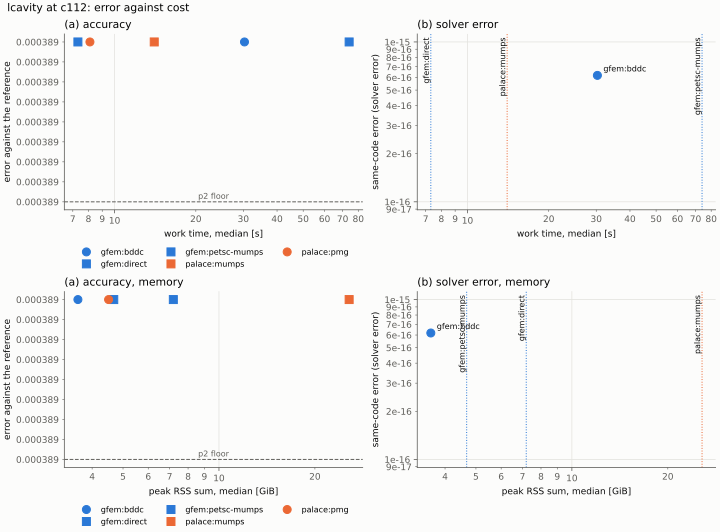

(a) Error against the converged reference, at each solver's best layout.

| solver | layout | tol | work s | peak RSS sum GiB | error |
|---|---|---|---|---|---|
| gfem:bddc | 1x112 | 1e-08 | 30.3 | 3.61 | 3.89e-04 |
| gfem:direct | 1x112 | — | 7.31 | 7.19 | 3.89e-04 |
| gfem:petsc-mumps | 1x112 | — | 74 | 4.68 | 3.89e-04 |
| palace:mumps | 56x2 | — | 14 | 25.6 | 3.89e-04 |
| palace:pmg | 28x4 | 1e-08 | 8.1 | 4.5 | 3.89e-04 |

Discretization floor (same-mesh error): p2 3.89e-04.

All 5 runs of order 2 are at the p2 floor (largest deviation 0.001 %): accuracy differences between codes do not show at this order on this mesh; compare codes by same-code error along the tolerance ladder.

Below reference resolution: errors under 1.00e-11.

(b) Same-code error (solver error, not accuracy) along the tolerance ladder.

| solver | layout | tol | work s | peak RSS sum GiB | same-code error |
|---|---|---|---|---|---|
| gfem:bddc | 1x112 | 1e-08 | 30.3 | 3.61 | 6.18e-16 |
| palace:pmg | 28x4 | 1e-08 | 8.1 | 4.5 | 0.00e+00 |

Direct runs (same-code error 0 by definition): gfem:direct 7.31 s (1x112), gfem:petsc-mumps 74 s (1x112), palace:mumps 14 s (56x2).

#### Time

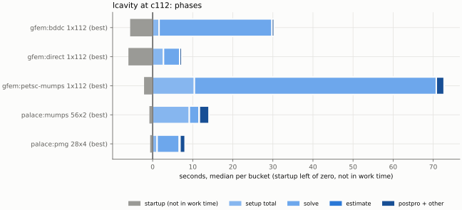

| solver | layout | role | tol | n | work s | spread | startup s | setup total s | solve total s | per sample s | mesh read s | discretize s | assemble s | setup s | solve s | estimate s | postpro s | rom s | other s | iterations | setups/solves | imbalance |
|---|---|---|---|---|---|---|---|---|---|---|---|---|---|---|---|---|---|---|---|---|---|---|
| gfem:bddc | 1x112 | best | 1e-08 | 3 | 30.3 | 3.4 % | 5.61 | 1.6 | 28.2 | — | 0.342 | 0.0787 | 0.889 | 0.302 | 28.2 | — | — | — | 0.526 | 0 | 2/1 | — |
| gfem:direct | 1x112 | best | — | 3 | 7.31 | 0.9 % | 6.04 | 2.7 | 4.04 | — | 0.359 | 0.0773 | 0.0969 | 2.18 | 4.04 | — | — | — | 0.511 | 0 | 2/1 | — |
| gfem:petsc-mumps | 1x112 | best | — | 3 | 74 | 7.9 % | 2.14 | 10.4 | 60.4 | — | 0.313 | 0.0869 | 0.104 | 9.92 | 60.4 | — | — | — | 1.94 | 0 | 2/1 | — |
| palace:mumps | 56x2 | best | — | 3 | 14 | 1.8 % | 0.806 | 9.13 | 2.42 | — | 0.318 | — | 0.423 | 8.41 | 2.42 | 0.079 | 0.077 | 0 | 2.32 | 20 | 1/16 | 1 |
|  |  | rank 0 |  |  | — |  |  |  |  |  | 0.272 | — | 0.422 | 8.41 | 2.42 | 0.0771 | 0.0757 | 0 | 2.37 |  |  |  |
| palace:pmg | 28x4 | best | 1e-08 | 3 | 8.1 | 1.0 % | 0.61 | 1.11 | 5.53 | — | 0.287 | — | 0.44 | 0.387 | 5.53 | 0.182 | 0.076 | 0 | 1.19 | 200 | 1/16 | 1 |
|  |  | rank 0 |  |  | — |  |  |  |  |  | 0.24 | — | 0.439 | 0.387 | 5.49 | 0.181 | 0.0743 | 0 | 1.28 |  |  |  |

Work time is wall minus startup; startup is not in work time. Rank reduction of the buckets: gfem:bddc: max; gfem:direct: max; gfem:petsc-mumps: max; palace:mumps: max-of-rows; palace:pmg: max-of-rows. Max-of-rows is an upper bound on the slowest rank (rows may peak on different ranks); imbalance = headline bucket sum / rank-0 sum.

gfem BDDC: the assemble bucket includes the preconditioner build (NGSolve builds BDDC while it assembles the first matrix of a setup).

#### Memory

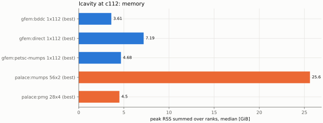

| solver | layout | role | peak RSS sum GiB | rank max GiB | largest node GiB | PSS sum GiB | sacct MaxRSS GiB | self-reports |
|---|---|---|---|---|---|---|---|---|
| gfem:bddc | 1x112 | best | 3.61 | 3.61 | 3.61 | 3.61 | — | solver_nbytes 6.23e+08 |
| gfem:direct | 1x112 | best | 7.19 | 7.19 | 7.19 | 7.07 | — | solver_nbytes 4.39e+09 |
| gfem:petsc-mumps | 1x112 | best | 4.68 | 4.68 | 4.68 | 4.69 | 4.62 | solver_nbytes 2.34e+09 |
| palace:mumps | 56x2 | best | 25.6 | 0.542 | 25.6 | 14.3 | — | — |
| palace:pmg | 28x4 | best | 4.5 | 0.171 | 4.5 | 2.99 | — | — |

The RSS sum counts shared pages once per rank in both codes alike; it is an upper bound on the simultaneous footprint, and PSS corrects it. sacct MaxRSS only for runs over 60 s.

#### Accuracy

| solver | order | layout | tol | metric | error | bound | resolved | ceiling | plausible | same-code error | δ |
|---|---|---|---|---|---|---|---|---|---|---|---|
| gfem:bddc | 2 | 1x112 | 1e-08 | max_rel_dRe_f | 3.89e-04 | 1.00e-12 | yes | 3.89e-03 | pass | 6.18e-16 | — |
| gfem:direct | 2 | 1x112 | — | max_rel_dRe_f | 3.89e-04 | 1.00e-12 | yes | 3.89e-03 | pass | 2.06e-16 | — |
| gfem:petsc-mumps | 2 | 1x112 | — | max_rel_dRe_f | 3.89e-04 | 1.00e-12 | yes | 3.89e-03 | pass | 6.18e-16 | — |
| palace:mumps | 2 | 1x112 | — | max_rel_dRe_f | 3.89e-04 | 1.00e-12 | yes | 3.89e-03 | pass | 0.00e+00 | — |
| palace:mumps | 2 | 2x56 | — | max_rel_dRe_f | 3.89e-04 | 1.00e-12 | yes | 3.89e-03 | pass | 0.00e+00 | — |
| palace:mumps | 2 | 4x28 | — | max_rel_dRe_f | 3.89e-04 | 1.00e-12 | yes | 3.89e-03 | pass | 0.00e+00 | — |
| palace:mumps | 2 | 8x14 | — | max_rel_dRe_f | 3.89e-04 | 1.00e-12 | yes | 3.89e-03 | pass | 0.00e+00 | — |
| palace:mumps | 2 | 14x8 | — | max_rel_dRe_f | 3.89e-04 | 1.00e-12 | yes | 3.89e-03 | pass | 0.00e+00 | — |
| palace:mumps | 2 | 16x7 | — | max_rel_dRe_f | 3.89e-04 | 1.00e-12 | yes | 3.89e-03 | pass | 0.00e+00 | — |
| palace:mumps | 2 | 28x4 | — | max_rel_dRe_f | 3.89e-04 | 1.00e-12 | yes | 3.89e-03 | pass | 0.00e+00 | — |
| palace:mumps | 2 | 56x2 | — | max_rel_dRe_f | 3.89e-04 | 1.00e-12 | yes | 3.89e-03 | pass | 0.00e+00 | — |
| palace:mumps | 2 | 112x1 | — | max_rel_dRe_f | 3.89e-04 | 1.00e-12 | yes | 3.89e-03 | pass | 0.00e+00 | — |
| palace:pmg | 2 | 1x112 | 1e-08 | max_rel_dRe_f | 3.89e-04 | 1.00e-12 | yes | 3.89e-03 | pass | 0.00e+00 | — |
| palace:pmg | 2 | 2x56 | 1e-08 | max_rel_dRe_f | 3.89e-04 | 1.00e-12 | yes | 3.89e-03 | pass | 0.00e+00 | — |
| palace:pmg | 2 | 4x28 | 1e-08 | max_rel_dRe_f | 3.89e-04 | 1.00e-12 | yes | 3.89e-03 | pass | 0.00e+00 | — |
| palace:pmg | 2 | 8x14 | 1e-08 | max_rel_dRe_f | 3.89e-04 | 1.00e-12 | yes | 3.89e-03 | pass | 0.00e+00 | — |
| palace:pmg | 2 | 14x8 | 1e-08 | max_rel_dRe_f | 3.89e-04 | 1.00e-12 | yes | 3.89e-03 | pass | 0.00e+00 | — |
| palace:pmg | 2 | 16x7 | 1e-08 | max_rel_dRe_f | 3.89e-04 | 1.00e-12 | yes | 3.89e-03 | pass | 0.00e+00 | — |
| palace:pmg | 2 | 28x4 | 1e-08 | max_rel_dRe_f | 3.89e-04 | 1.00e-12 | yes | 3.89e-03 | pass | 0.00e+00 | — |
| palace:pmg | 2 | 56x2 | 1e-08 | max_rel_dRe_f | 3.89e-04 | 1.00e-12 | yes | 3.89e-03 | pass | 0.00e+00 | — |
| palace:pmg | 2 | 112x1 | 1e-08 | max_rel_dRe_f | 3.89e-04 | 1.00e-12 | yes | 3.89e-03 | pass | 0.00e+00 | — |

Discretization floor (same-mesh error): p2 3.89e-04.

All 21 runs of order 2 are at the p2 floor (largest deviation 0.001 %): accuracy differences between codes do not show at this order on this mesh; compare codes by same-code error along the tolerance ladder.

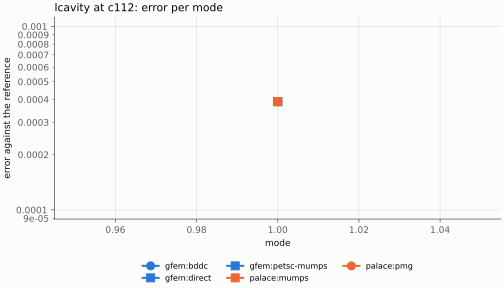

| mode | gfem:bddc (1x112) | gfem:direct (1x112) | gfem:petsc-mumps (1x112) | palace:mumps (56x2) | palace:pmg (28x4) |
|---|---|---|---|---|---|
| 1 | 3.89e-04 | 3.89e-04 | 3.89e-04 | 3.89e-04 | 3.89e-04 |

#### Layouts

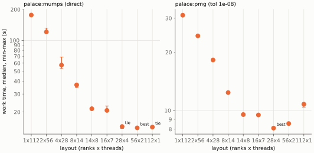

| solver | tol | layout | n | median work s | min-max |  |
|---|---|---|---|---|---|---|
| gfem:bddc | 1e-08 | 1x112 | 3 | 30.3 | 29.9-30.9 | best |
| gfem:direct | — | 1x112 | 3 | 7.31 | 7.31-7.37 | best |
| gfem:petsc-mumps | — | 1x112 | 3 | 74 | 71.9-77.8 | best |
| palace:mumps | — | 1x112 | 3 | 177 | 176-177 |  |
| palace:mumps | — | 2x56 | 3 | 121 | 120-132 |  |
| palace:mumps | — | 4x28 | 3 | 57.4 | 53.2-68.7 |  |
| palace:mumps | — | 8x14 | 3 | 36.8 | 34.7-37.8 |  |
| palace:mumps | — | 14x8 | 3 | 21.6 | 21-21.7 |  |
| palace:mumps | — | 16x7 | 3 | 20.8 | 20.6-22.9 |  |
| palace:mumps | — | 28x4 | 3 | 14.5 | 13.9-14.5 | tie |
| palace:mumps | — | 56x2 | 3 | 14 | 13.9-14.2 | best |
| palace:mumps | — | 112x1 | 3 | 14.3 | 14.1-14.6 | tie |
| palace:pmg | 1e-08 | 1x112 | 3 | 31.1 | 31-31.2 |  |
| palace:pmg | 1e-08 | 2x56 | 3 | 24.3 | 24.2-24.4 |  |
| palace:pmg | 1e-08 | 4x28 | 3 | 18.2 | 18.2-18.3 |  |
| palace:pmg | 1e-08 | 8x14 | 3 | 12.4 | 12.4-12.4 |  |
| palace:pmg | 1e-08 | 14x8 | 3 | 9.52 | 9.52-9.55 |  |
| palace:pmg | 1e-08 | 16x7 | 3 | 9.48 | 9.45-9.51 |  |
| palace:pmg | 1e-08 | 28x4 | 3 | 8.1 | 8.07-8.15 | best |
| palace:pmg | 1e-08 | 56x2 | 3 | 8.55 | 8.55-8.57 |  |
| palace:pmg | 1e-08 | 112x1 | 3 | 10.8 | 10.4-10.8 |  |

| solver | default | best | ties | default / best |
|---|---|---|---|---|
| gfem:bddc | — | 1x112 | — | — |
| gfem:direct | — | 1x112 | — | — |
| gfem:petsc-mumps | — | 1x112 | — | — |
| palace:mumps | — | 56x2 | 28x4, 112x1 | — |
| palace:pmg | — | 28x4 | — | — |

#### Cross-solver snapshot (same-mesh comparison)

DOF: gfem [246416], palace [246416].

Direct kinds:

| solver | role | layout | n | work s | peak RSS sum GiB | error | jobs |
|---|---|---|---|---|---|---|---|
| gfem:direct | best | 1x112 | 3 | 7.31 | 7.19 | 3.89e-04 | 49256964 |
| gfem:petsc-mumps | best | 1x112 | 3 | 74 | 4.68 | 3.89e-04 | 49256964 |
| palace:mumps | best | 56x2 | 3 | 14 | 25.6 | 3.89e-04 | 49256964 |

| role | ratio | work | memory | pairing |
|---|---|---|---|---|
| best | palace:mumps / gfem:direct | 1.92 | 3.56 | same job |

Iterative kinds:

| solver | role | layout | n | work s | peak RSS sum GiB | error | jobs |
|---|---|---|---|---|---|---|---|
| gfem:bddc | best | 1x112 | 3 | 30.3 | 3.61 | 3.89e-04 | 49256964 |
| palace:pmg | best | 28x4 | 3 | 8.1 | 4.5 | 3.89e-04 | 49256964 |

Iterative kinds compare only at equal achieved error (table above).

### lcavity scaling across core budgets

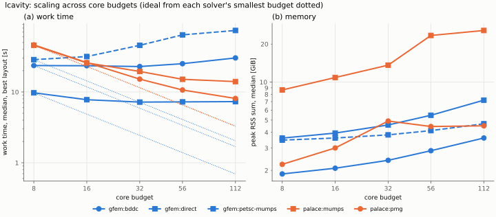

Per solver at its best layout of each budget (anchor tolerance), the default layout beside. Speedup $S(c) = T(c_0)/T(c)$ and parallel efficiency $E(c) = c_0\,T(c_0)/(c\,T(c))$ on median work time $T$, against the solver's smallest budget $c_0$ on the same node class; a node class change restarts the line. Never extrapolated.

| solver | cores | class | nodes | best layout | n | work s | min-max | default work s | $c_0$ | $S$ | $E$ | peak RSS sum GiB | largest node GiB | error | jobs |  |
|---|---|---|---|---|---|---|---|---|---|---|---|---|---|---|---|---|
| gfem:bddc | 8 | standard | 1 | 1x8 | 3 | 23.6 | 23.4-25.2 | — | c8 | 1 | 1 | 1.87 | — | 3.89e-04 | 49256972 |  |
| gfem:bddc | 16 | standard | 1 | 1x16 | 3 | 23.5 | 23.2-23.7 | — | c8 | 1.01 | 0.503 | 2.08 | — | 3.89e-04 | 49256510 |  |
| gfem:bddc | 32 | standard | 1 | 1x32 | 3 | 22.9 | 22.9-23.3 | — | c8 | 1.03 | 0.258 | 2.4 | — | 3.89e-04 | 49256969 |  |
| gfem:bddc | 56 | standard | 1 | 1x56 | 3 | 25.1 | 25.1-25.2 | — | c8 | 0.942 | 0.135 | 2.86 | — | 3.89e-04 | 49256966 |  |
| gfem:bddc | 112 | standard | 1 | 1x112 | 3 | 30.3 | 29.9-30.9 | — | c8 | 0.78 | 0.0557 | 3.61 | — | 3.89e-04 | 49256964 |  |
| gfem:direct | 8 | standard | 1 | 1x8 | 3 | 9.74 | 9.43-10 | — | c8 | 1 | 1 | 3.6 | — | 3.89e-04 | 49256972 |  |
| gfem:direct | 16 | standard | 1 | 1x16 | 3 | 7.78 | 7.69-8.89 | — | c8 | 1.25 | 0.626 | 3.95 | — | 3.89e-04 | 49256510 |  |
| gfem:direct | 32 | standard | 1 | 1x32 | 3 | 7.2 | 6.91-8.16 | — | c8 | 1.35 | 0.338 | 4.58 | — | 3.89e-04 | 49256969 |  |
| gfem:direct | 56 | standard | 1 | 1x56 | 3 | 7.25 | 6.93-7.78 | — | c8 | 1.34 | 0.192 | 5.46 | — | 3.89e-04 | 49256966 |  |
| gfem:direct | 112 | standard | 1 | 1x112 | 3 | 7.31 | 7.31-7.37 | — | c8 | 1.33 | 0.0951 | 7.19 | — | 3.89e-04 | 49256964 |  |
| gfem:petsc-mumps | 8 | standard | 1 | 1x8 | 3 | 28.6 | 28.4-30.7 | — | c8 | 1 | 1 | 3.47 | — | 3.89e-04 | 49256972 |  |
| gfem:petsc-mumps | 16 | standard | 1 | 1x16 | 3 | 31.7 | 31.5-32 | — | c8 | 0.904 | 0.452 | 3.61 | — | 3.89e-04 | 49256510 |  |
| gfem:petsc-mumps | 32 | standard | 1 | 1x32 | 3 | 45.7 | 44.6-48.7 | — | c8 | 0.627 | 0.157 | 3.82 | — | 3.89e-04 | 49256969 |  |
| gfem:petsc-mumps | 56 | standard | 1 | 1x56 | 3 | 64.1 | 63.8-67.8 | — | c8 | 0.447 | 0.0638 | 4.13 | — | 3.89e-04 | 49256966 |  |
| gfem:petsc-mumps | 112 | standard | 1 | 1x112 | 3 | 74 | 71.9-77.8 | — | c8 | 0.387 | 0.0276 | 4.68 | — | 3.89e-04 | 49256964 |  |
| palace:mumps | 8 | standard | 1 | 8x1 | 3 | 45.7 | 40-50.3 | — | c8 | 1 | 1 | 8.67 | — | 3.89e-04 | 49256972 |  |
| palace:mumps | 16 | standard | 1 | 16x1 | 3 | 25.8 | 24.2-25.9 | — | c8 | 1.77 | 0.887 | 10.9 | — | 3.89e-04 | 49256510 |  |
| palace:mumps | 32 | standard | 1 | 32x1 | 3 | 19.5 | 15.4-27.4 | — | c8 | 2.34 | 0.586 | 13.6 | — | 3.89e-04 | 49256969 |  |
| palace:mumps | 56 | standard | 1 | 56x1 | 3 | 15.1 | 13.3-15.7 | — | c8 | 3.03 | 0.432 | 23.4 | — | 3.89e-04 | 49256966 |  |
| palace:mumps | 112 | standard | 1 | 56x2 | 3 | 14 | 13.9-14.2 | — | c8 | 3.26 | 0.233 | 25.6 | — | 3.89e-04 | 49256964 |  |
| palace:pmg | 8 | standard | 1 | 8x1 | 3 | 46.3 | 45.9-49 | — | c8 | 1 | 1 | 2.23 | — | 3.89e-04 | 49256972 |  |
| palace:pmg | 16 | standard | 1 | 16x1 | 3 | 26 | 25.9-26 | — | c8 | 1.78 | 0.89 | 3.01 | — | 3.89e-04 | 49256510 |  |
| palace:pmg | 32 | standard | 1 | 32x1 | 3 | 15.2 | 15.2-15.2 | — | c8 | 3.05 | 0.762 | 4.91 | — | 3.89e-04 | 49256969 |  |
| palace:pmg | 56 | standard | 1 | 28x2 | 3 | 10.7 | 10.7-10.7 | — | c8 | 4.34 | 0.619 | 4.45 | — | 3.89e-04 | 49256966 |  |
| palace:pmg | 112 | standard | 1 | 28x4 | 3 | 8.1 | 8.07-8.15 | — | c8 | 5.71 | 0.408 | 4.5 | — | 3.89e-04 | 49256964 |  |

Cross-code ratios per budget, at best layout:

| cores | class | ratio | work | memory | pairing |  |
|---|---|---|---|---|---|---|
| 8 | standard | palace:mumps / gfem:direct | 4.7 | 2.41 | same job |  |
| 8 | standard | palace:mumps / gfem:petsc-mumps | 1.6 | 2.5 | same job |  |
| 8 | standard | palace:pmg / gfem:bddc | 1.96 | 1.19 | same job | nominal tolerances differ; iterative kinds compare at equal achieved error (the equal-error table of each budget) |
| 16 | standard | palace:mumps / gfem:direct | 3.32 | 2.75 | same job |  |
| 16 | standard | palace:mumps / gfem:petsc-mumps | 0.814 | 3.01 | same job |  |
| 16 | standard | palace:pmg / gfem:bddc | 1.11 | 1.45 | same job | nominal tolerances differ; iterative kinds compare at equal achieved error (the equal-error table of each budget) |
| 32 | standard | palace:mumps / gfem:direct | 2.71 | 2.97 | same job |  |
| 32 | standard | palace:mumps / gfem:petsc-mumps | 0.427 | 3.56 | same job |  |
| 32 | standard | palace:pmg / gfem:bddc | 0.664 | 2.05 | same job | nominal tolerances differ; iterative kinds compare at equal achieved error (the equal-error table of each budget) |
| 56 | standard | palace:mumps / gfem:direct | 2.08 | 4.28 | same job |  |
| 56 | standard | palace:mumps / gfem:petsc-mumps | 0.236 | 5.67 | same job |  |
| 56 | standard | palace:pmg / gfem:bddc | 0.425 | 1.55 | same job | nominal tolerances differ; iterative kinds compare at equal achieved error (the equal-error table of each budget) |
| 112 | standard | palace:mumps / gfem:direct | 1.92 | 3.56 | same job |  |
| 112 | standard | palace:mumps / gfem:petsc-mumps | 0.19 | 5.48 | same job |  |
| 112 | standard | palace:pmg / gfem:bddc | 0.267 | 1.25 | same job | nominal tolerances differ; iterative kinds compare at equal achieved error (the equal-error table of each budget) |

## microstrip

Campaigns: `20261120-e7d58a9-full-c8`, `20261120-e7d58a9-full-c16`, `20261120-e7d58a9-full-c32`, `20261120-e7d58a9-full-c56`, `20261120-e7d58a9-full-c112`

Reference `microstrip-20261120-7a078ba` (2026-11-20T00:00:27Z, richardson, bound s 1.07e-02, sha256 `dda0357961e0`).

Structural differences (reported, never removed):

- gfem:bddc: bddc_build: NGSolve builds the BDDC preconditioner while it assembles the first matrix of a setup, so the build is timed inside assemble
- gfem:direct: direct_arm: PARDISO (MKL), one process
- gfem:petsc-mumps: direct_arm: PETSc MUMPS
- palace:mumps: direct_arm: GMRES around complex MUMPS (MGMaxLevels 1)
- palace:mumps: estimator: always on, lightened (EstimatorTol 1e-2, EstimatorMG)
- palace:pmg: estimator: always on, lightened (EstimatorTol 1e-2, EstimatorMG)
- palace:pmg: fine_level: matrix-free (partial assembly)
- palace:pmg: pmg_coarse: SuperLU on the real-valued coarse matrix
- pinned for gfem: linear_solver per kind; the run tolerance; eigen_tolerance 1e-10; no field output
- pinned for palace: Refinement 0; Absorbing.Order 1; Linear.Type pinned per kind; MUMPS kind: MGMaxLevels 1, ComplexCoarseSolve, Tol 1e-10; iterative Tol = the run tolerance, MaxIts 2000; EstimatorTol 1e-2, EstimatorMG; eigen Tol 1e-10, inner Linear.Tol 1e-12; no field output

### microstrip at c8 (standard, 1 node)

#### Error against cost

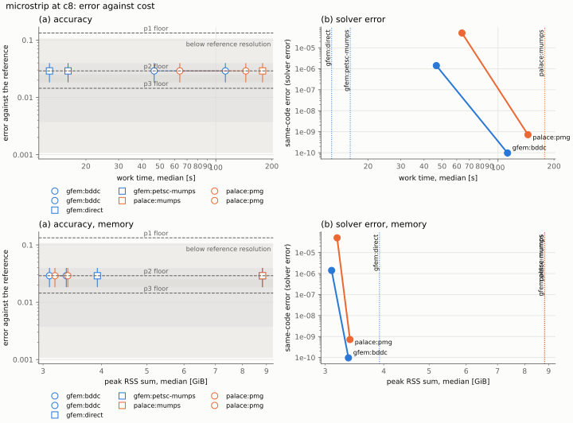

(a) Error against the converged reference, at each solver's best layout.

| solver | layout | tol | work s | peak RSS sum GiB | error |
|---|---|---|---|---|---|
| gfem:bddc | 1x8 | 1e-06 | 46.6 | 3.1 | 2.90e-02 ± 1.07e-02 (unresolved) |
| gfem:bddc | 1x8 | 1e-10 | 113 | 3.36 | 2.90e-02 ± 1.07e-02 (unresolved) |
| gfem:direct | 1x8 | — | 12.7 | 3.92 | 2.90e-02 ± 1.07e-02 (unresolved) |
| gfem:petsc-mumps | 8x1 | — | 16 | 8.82 | 2.90e-02 ± 1.07e-02 (unresolved) |
| palace:mumps | 8x1 | — | 178 | 8.83 | 2.90e-02 ± 1.07e-02 (unresolved) |
| palace:pmg | 8x1 | 1e-06 | 64 | 3.18 | 2.90e-02 ± 1.07e-02 (unresolved) |
| palace:pmg | 8x1 | 1e-10 | 145 | 3.39 | 2.90e-02 ± 1.07e-02 (unresolved) |

Discretization floor (same-mesh error): p1 1.33e-01, p2 2.90e-02 ± 1.07e-02 (unresolved), p3 1.44e-02 ± 1.07e-02 (unresolved).

All 7 runs of order 2 are at the p2 floor (largest deviation 0.039 %): accuracy differences between codes do not show at this order on this mesh; compare codes by same-code error along the tolerance ladder.

Below reference resolution: errors under 1.07e-01.

(b) Same-code error (solver error, not accuracy) along the tolerance ladder.

| solver | layout | tol | work s | peak RSS sum GiB | same-code error |
|---|---|---|---|---|---|
| gfem:bddc | 1x8 | 1e-06 | 46.6 | 3.1 | 1.41e-06 |
| gfem:bddc | 1x8 | 1e-10 | 113 | 3.36 | 9.69e-11 |
| palace:pmg | 8x1 | 1e-06 | 64 | 3.18 | 5.04e-05 |
| palace:pmg | 8x1 | 1e-10 | 145 | 3.39 | 7.21e-10 |

Direct runs (same-code error 0 by definition): gfem:direct 12.7 s (1x8), gfem:petsc-mumps 16 s (8x1), palace:mumps 178 s (8x1).

Cost at equal achieved same-code error (interpolated log-log between neighbouring rungs, never extrapolated):

| error | gfem:bddc work s | gfem:bddc GiB | palace:pmg work s | palace:pmg GiB | palace:pmg / gfem:bddc |
|---|---|---|---|---|---|
| 7.21e-10 | 93.6 | 3.31 | 145 | 3.39 | 1.55 |
| 1.00e-09 | 90.8 | 3.3 | 141 | 3.38 | 1.56 |
| 1.00e-08 | 73.5 | 3.23 | 120 | 3.34 | 1.63 |
| 3.19e-08 | 66 | 3.2 | 110 | 3.32 | 1.66 |
| 1.00e-07 | 59.4 | 3.17 | 101 | 3.29 | 1.7 |
| 1.00e-06 | 48.1 | 3.11 | 85.3 | 3.25 | 1.77 |
| 1.41e-06 | 46.6 | 3.1 | 83.2 | 3.25 | 1.78 |

#### Time

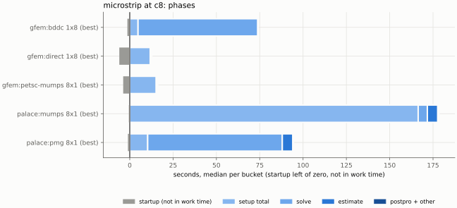

| solver | layout | role | tol | n | work s | spread | startup s | setup total s | solve total s | per sample s | mesh read s | discretize s | assemble s | setup s | solve s | estimate s | postpro s | rom s | other s | iterations | setups/solves | imbalance |
|---|---|---|---|---|---|---|---|---|---|---|---|---|---|---|---|---|---|---|---|---|---|---|
| gfem:bddc | 1x8 | best | 1e-08 | 3 | 74.2 | 0.4 % | 1.37 | 4.78 | 69.1 | 14.8 | 0.403 | 0.141 | 4.22 | 0.0175 | 69.1 | — | — | — | 0.201 | 897 | 6/5 | — |
| gfem:direct | 1x8 | best | — | 3 | 12.7 | 7.3 % | 6.03 | 11.8 | 0.693 | 2.55 | 0.441 | 0.148 | 1.16 | 10 | 0.693 | — | — | — | 0.218 | 0 | 5/5 | — |
| gfem:petsc-mumps | 8x1 | best | — | 3 | 16 | 5.8 % | 3.78 | 15.3 | 0.528 | 3.21 | 0.451 | 0.342 | 0.331 | 14.2 | 0.528 | — | — | — | 0.322 | 0 | 5/5 | 1.01 |
|  |  | rank 0 |  |  | — |  |  |  |  |  | 0.45 | 0.318 | 0.264 | 14.2 | 0.523 | — | — | — | 0.322 |  |  |  |
| palace:mumps | 8x1 | best | — | 3 | 178 | 12.7 % noisy | 0.513 | 166 | 5.29 | 35.7 | 0.551 | — | 0.189 | 166 | 5.29 | 6.02 | 0.382 | 0 | 0.261 | 16 | 10/10 | 1 |
|  |  | rank 0 |  |  | — |  |  |  |  |  | 0.43 | — | 0.182 | 166 | 5.25 | 6.01 | 0.382 | 0 | 0.444 |  |  |  |
| palace:pmg | 8x1 | best | 1e-08 | 3 | 94.4 | 0.8 % | 1.05 | 10.4 | 77.7 | 18.9 | 0.549 | — | 0.487 | 9.32 | 77.7 | 6.08 | 0.394 | 0 | 0 | 341 | 10/10 | 1 |
|  |  | rank 0 |  |  | — |  |  |  |  |  | 0.428 | — | 0.487 | 9.29 | 77.3 | 6.06 | 0.394 | 0 | 0.443 |  |  |  |

Work time is wall minus startup; startup is not in work time. Rank reduction of the buckets: gfem:bddc: max; gfem:direct: max; gfem:petsc-mumps: max; palace:mumps: max-of-rows; palace:pmg: max-of-rows. Max-of-rows is an upper bound on the slowest rank (rows may peak on different ranks); imbalance = headline bucket sum / rank-0 sum.

gfem BDDC: the assemble bucket includes the preconditioner build (NGSolve builds BDDC while it assembles the first matrix of a setup).

#### Memory

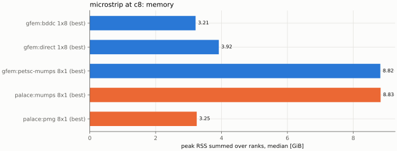

| solver | layout | role | peak RSS sum GiB | rank max GiB | largest node GiB | PSS sum GiB | sacct MaxRSS GiB | self-reports |
|---|---|---|---|---|---|---|---|---|
| gfem:bddc | 1x8 | best | 3.21 | 3.21 | 3.21 | 3.19 | 2.04 | solver_nbytes 2.66e+08 |
| gfem:direct | 1x8 | best | 3.92 | 3.92 | 3.92 | 3.7 | — | solver_nbytes 2.36e+09 |
| gfem:petsc-mumps | 8x1 | best | 8.82 | 1.19 | 8.82 | 7.73 | — | solver_nbytes 4.18e+09 |
| palace:mumps | 8x1 | best | 8.83 | 1.23 | 8.83 | 8.55 | 0.903 | — |
| palace:pmg | 8x1 | best | 3.25 | 0.423 | 3.25 | 2.59 | 0.34 | — |

The RSS sum counts shared pages once per rank in both codes alike; it is an upper bound on the simultaneous footprint, and PSS corrects it. sacct MaxRSS only for runs over 60 s.

#### Accuracy

| solver | order | layout | tol | metric | error | bound | resolved | ceiling | plausible | same-code error | δ |
|---|---|---|---|---|---|---|---|---|---|---|---|
| gfem:bddc | 2 | 1x8 (default) | 1e-06 | max_abs_dS | 2.90e-02 ± 1.07e-02 (unresolved) | 1.07e-02 | no | 2.90e-01 | pass | 1.41e-06 | — |
| gfem:bddc | 2 | 1x8 (default) | 1e-10 | max_abs_dS | 2.90e-02 ± 1.07e-02 (unresolved) | 1.07e-02 | no | 2.90e-01 | pass | 9.69e-11 | — |
| gfem:bddc | 2 | 1x8 | 1e-08 | max_abs_dS | 2.90e-02 ± 1.07e-02 (unresolved) | 1.07e-02 | no | 2.90e-01 | pass | 1.03e-08 | — |
| gfem:bddc | 2 | 2x4 | 1e-08 | max_abs_dS | 2.90e-02 ± 1.07e-02 (unresolved) | 1.07e-02 | no | 2.90e-01 | pass | 1.03e-08 | — |
| gfem:bddc | 2 | 4x2 | 1e-08 | max_abs_dS | 2.90e-02 ± 1.07e-02 (unresolved) | 1.07e-02 | no | 2.90e-01 | pass | 1.03e-08 | — |
| gfem:bddc | 2 | 8x1 | 1e-08 | max_abs_dS | 2.90e-02 ± 1.07e-02 (unresolved) | 1.07e-02 | no | 2.90e-01 | pass | 1.03e-08 | — |
| gfem:direct | 2 | 1x8 | — | max_abs_dS | 2.90e-02 ± 1.07e-02 (unresolved) | 1.07e-02 | no | 2.90e-01 | pass | 1.14e-12 | — |
| gfem:petsc-mumps | 2 | 1x8 | — | max_abs_dS | 2.90e-02 ± 1.07e-02 (unresolved) | 1.07e-02 | no | 2.90e-01 | pass | 3.66e-11 | — |
| gfem:petsc-mumps | 2 | 2x4 | — | max_abs_dS | 2.90e-02 ± 1.07e-02 (unresolved) | 1.07e-02 | no | 2.90e-01 | pass | 2.51e-11 | — |
| gfem:petsc-mumps | 2 | 4x2 | — | max_abs_dS | 2.90e-02 ± 1.07e-02 (unresolved) | 1.07e-02 | no | 2.90e-01 | pass | 4.03e-11 | — |
| gfem:petsc-mumps | 2 | 8x1 | — | max_abs_dS | 2.90e-02 ± 1.07e-02 (unresolved) | 1.07e-02 | no | 2.90e-01 | pass | 2.84e-11 | — |
| palace:mumps | 2 | 1x8 | — | max_abs_dS | 2.90e-02 ± 1.07e-02 (unresolved) | 1.07e-02 | no | 2.90e-01 | pass | 3.88e-13 | 8.86e-11 |
| palace:mumps | 2 | 2x4 | — | max_abs_dS | 2.90e-02 ± 1.07e-02 (unresolved) | 1.07e-02 | no | 2.90e-01 | pass | 4.05e-12 | 8.86e-11 |
| palace:mumps | 2 | 4x2 | — | max_abs_dS | 2.90e-02 ± 1.07e-02 (unresolved) | 1.07e-02 | no | 2.90e-01 | pass | 2.74e-12 | 8.86e-11 |
| palace:mumps | 2 | 8x1 | — | max_abs_dS | 2.90e-02 ± 1.07e-02 (unresolved) | 1.07e-02 | no | 2.90e-01 | pass | 7.43e-12 | 8.86e-11 |
| palace:pmg | 2 | 8x1 (default) | 1e-06 | max_abs_dS | 2.90e-02 ± 1.07e-02 (unresolved) | 1.07e-02 | no | 2.90e-01 | pass | 5.04e-05 | 8.86e-11 |
| palace:pmg | 2 | 8x1 (default) | 1e-10 | max_abs_dS | 2.90e-02 ± 1.07e-02 (unresolved) | 1.07e-02 | no | 2.90e-01 | pass | 7.21e-10 | 8.86e-11 |
| palace:pmg | 2 | 1x8 | 1e-08 | max_abs_dS | 2.90e-02 ± 1.07e-02 (unresolved) | 1.07e-02 | no | 2.90e-01 | pass | 1.97e-07 | 8.86e-11 |
| palace:pmg | 2 | 2x4 | 1e-08 | max_abs_dS | 2.90e-02 ± 1.07e-02 (unresolved) | 1.07e-02 | no | 2.90e-01 | pass | 1.97e-07 | 8.86e-11 |
| palace:pmg | 2 | 4x2 | 1e-08 | max_abs_dS | 2.90e-02 ± 1.07e-02 (unresolved) | 1.07e-02 | no | 2.90e-01 | pass | 1.96e-07 | 8.86e-11 |
| palace:pmg | 2 | 8x1 | 1e-08 | max_abs_dS | 2.90e-02 ± 1.07e-02 (unresolved) | 1.07e-02 | no | 2.90e-01 | pass | 1.96e-07 | 8.86e-11 |

Discretization floor (same-mesh error): p1 1.33e-01, p2 2.90e-02 ± 1.07e-02 (unresolved), p3 1.44e-02 ± 1.07e-02 (unresolved).

All 21 runs of order 2 are at the p2 floor (largest deviation 0.039 %): accuracy differences between codes do not show at this order on this mesh; compare codes by same-code error along the tolerance ladder.

| frequency Hz | gfem:bddc (1x8) | gfem:direct (1x8) | gfem:petsc-mumps (8x1) | palace:mumps (8x1) | palace:pmg (8x1) | reference bound |
|---|---|---|---|---|---|---|
| 1e+09 | 9.33e-04 | 9.33e-04 | 9.33e-04 | 9.33e-04 | 9.33e-04 | 1.80e-04 |
| 2.5e+10 | 2.13e-02 | 2.13e-02 | 2.13e-02 | 2.13e-02 | 2.13e-02 | 3.52e-03 |
| 5e+10 | 2.25e-02 | 2.25e-02 | 2.25e-02 | 2.25e-02 | 2.25e-02 | 6.54e-03 |
| 7.5e+10 | 2.37e-02 | 2.37e-02 | 2.37e-02 | 2.37e-02 | 2.37e-02 | 8.74e-03 |
| 1e+11 | 2.90e-02 | 2.90e-02 | 2.90e-02 | 2.90e-02 | 2.90e-02 | 1.07e-02 |

#### Layouts

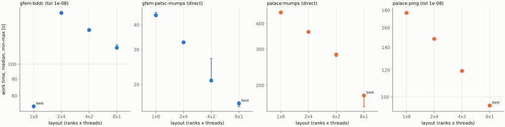

| solver | tol | layout | n | median work s | min-max |  |
|---|---|---|---|---|---|---|
| gfem:bddc | 1e-08 | 1x8 | 3 | 74.2 | 74.1-74.4 | best |
| gfem:bddc | 1e-08 | 2x4 | 3 | 144 | 142-144 |  |
| gfem:bddc | 1e-08 | 4x2 | 3 | 127 | 127-128 |  |
| gfem:bddc | 1e-08 | 8x1 | 3 | 112 | 112-115 |  |
| gfem:direct | — | 1x8 | 3 | 12.7 | 11.9-12.9 | best |
| gfem:petsc-mumps | — | 1x8 | 3 | 44.7 | 44.6-46.2 |  |
| gfem:petsc-mumps | — | 2x4 | 3 | 32.6 | 32.4-33.1 |  |
| gfem:petsc-mumps | — | 4x2 | 3 | 20.9 | 20.7-27.1 |  |
| gfem:petsc-mumps | — | 8x1 | 3 | 16 | 15.5-16.4 | best |
| palace:mumps | — | 1x8 | 3 | 453 | 453-453 |  |
| palace:mumps | — | 2x4 | 3 | 364 | 364-366 |  |
| palace:mumps | — | 4x2 | 3 | 282 | 276-285 |  |
| palace:mumps | — | 8x1 | 3 | 178 | 157-180 | best |
| palace:pmg | 1e-08 | 1x8 | 3 | 177 | 176-177 |  |
| palace:pmg | 1e-08 | 2x4 | 3 | 148 | 148-149 |  |
| palace:pmg | 1e-08 | 4x2 | 3 | 119 | 118-119 |  |
| palace:pmg | 1e-08 | 8x1 | 3 | 94.4 | 93.7-94.5 | best |

| solver | default | best | ties | default / best |
|---|---|---|---|---|
| gfem:bddc | — | 1x8 | — | — |
| gfem:direct | — | 1x8 | — | — |
| gfem:petsc-mumps | — | 8x1 | — | — |
| palace:mumps | — | 8x1 | — | — |
| palace:pmg | — | 8x1 | — | — |

#### Cross-solver snapshot (same-mesh comparison)

DOF: gfem [315870], palace [315870].

Direct kinds:

| solver | role | layout | n | work s | peak RSS sum GiB | error | jobs |
|---|---|---|---|---|---|---|---|
| gfem:direct | best | 1x8 | 3 | 12.7 | 3.92 | 2.90e-02 | 49256974 (slow node) |
| gfem:petsc-mumps | best | 8x1 | 3 | 16 | 8.82 | 2.90e-02 | 49256974 (slow node) |
| palace:mumps | best | 8x1 | 3 | 178 | 8.83 | 2.90e-02 | 49256974 (slow node) |

| role | ratio | work | memory | pairing |
|---|---|---|---|---|
| best | palace:mumps / gfem:direct | 14 | 2.25 | same job |

Iterative kinds:

| solver | role | layout | n | work s | peak RSS sum GiB | error | jobs |
|---|---|---|---|---|---|---|---|
| gfem:bddc | best | 1x8 | 3 | 74.2 | 3.21 | 2.90e-02 | 49256974 (slow node) |
| palace:pmg | best | 8x1 | 3 | 94.4 | 3.25 | 2.90e-02 | 49256974 (slow node) |

Iterative kinds compare only at equal achieved error (table above).

### microstrip at c16 (standard, 1 node)

#### Error against cost

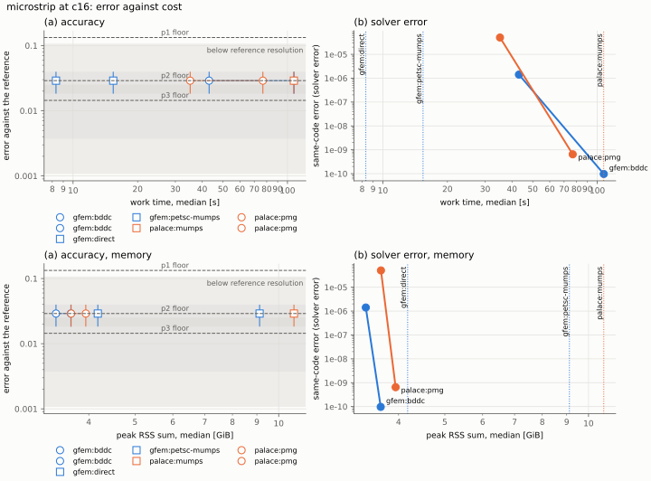

(a) Error against the converged reference, at each solver's best layout.

| solver | layout | tol | work s | peak RSS sum GiB | error |
|---|---|---|---|---|---|
| gfem:bddc | 1x16 | 1e-06 | 43.1 | 3.42 | 2.90e-02 ± 1.07e-02 (unresolved) |
| gfem:bddc | 1x16 | 1e-10 | 107 | 3.67 | 2.90e-02 ± 1.07e-02 (unresolved) |
| gfem:direct | 1x16 | — | 8.32 | 4.18 | 2.90e-02 ± 1.07e-02 (unresolved) |
| gfem:petsc-mumps | 8x2 | — | 15.4 | 9.12 | 2.90e-02 ± 1.07e-02 (unresolved) |
| palace:mumps | 16x1 | — | 107 | 10.8 | 2.90e-02 ± 1.07e-02 (unresolved) |
| palace:pmg | 16x1 | 1e-06 | 35.2 | 3.67 | 2.90e-02 ± 1.07e-02 (unresolved) |
| palace:pmg | 16x1 | 1e-10 | 76.8 | 3.94 | 2.90e-02 ± 1.07e-02 (unresolved) |

Discretization floor (same-mesh error): p1 1.33e-01, p2 2.90e-02 ± 1.07e-02 (unresolved), p3 1.44e-02 ± 1.07e-02 (unresolved).

All 7 runs of order 2 are at the p2 floor (largest deviation 0.039 %): accuracy differences between codes do not show at this order on this mesh; compare codes by same-code error along the tolerance ladder.

Below reference resolution: errors under 1.07e-01.

(b) Same-code error (solver error, not accuracy) along the tolerance ladder.

| solver | layout | tol | work s | peak RSS sum GiB | same-code error |
|---|---|---|---|---|---|
| gfem:bddc | 1x16 | 1e-06 | 43.1 | 3.42 | 1.41e-06 |
| gfem:bddc | 1x16 | 1e-10 | 107 | 3.67 | 9.69e-11 |
| palace:pmg | 16x1 | 1e-06 | 35.2 | 3.67 | 5.04e-05 |
| palace:pmg | 16x1 | 1e-10 | 76.8 | 3.94 | 6.47e-10 |

Direct runs (same-code error 0 by definition): gfem:direct 8.32 s (1x16), gfem:petsc-mumps 15.4 s (8x2), palace:mumps 107 s (16x1).

Cost at equal achieved same-code error (interpolated log-log between neighbouring rungs, never extrapolated):

| error | gfem:bddc work s | gfem:bddc GiB | palace:pmg work s | palace:pmg GiB | palace:pmg / gfem:bddc |
|---|---|---|---|---|---|
| 6.47e-10 | 89.5 | 3.62 | 76.8 | 3.94 | 0.858 |
| 1.00e-09 | 85.9 | 3.61 | 74.5 | 3.93 | 0.868 |
| 1.00e-08 | 69 | 3.54 | 63.5 | 3.88 | 0.921 |
| 3.02e-08 | 62.1 | 3.52 | 58.8 | 3.85 | 0.947 |
| 1.00e-07 | 55.4 | 3.48 | 54.1 | 3.82 | 0.977 |
| 1.00e-06 | 44.5 | 3.42 | 46.2 | 3.77 | 1.04 |
| 1.41e-06 | 43.1 | 3.42 | 45.1 | 3.76 | 1.05 |

#### Time

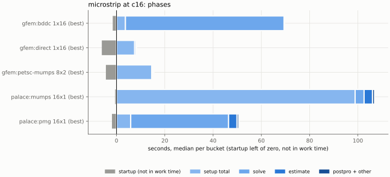

| solver | layout | role | tol | n | work s | spread | startup s | setup total s | solve total s | per sample s | mesh read s | discretize s | assemble s | setup s | solve s | estimate s | postpro s | rom s | other s | iterations | setups/solves | imbalance |
|---|---|---|---|---|---|---|---|---|---|---|---|---|---|---|---|---|---|---|---|---|---|---|
| gfem:bddc | 1x16 | best | 1e-08 | 3 | 69.8 | 1.0 % | 1.57 | 3.69 | 65.7 | 14 | 0.411 | 0.134 | 3.13 | 0.0183 | 65.7 | — | — | — | 0.199 | 897 | 6/5 | — |
| gfem:direct | 1x16 | best | — | 3 | 8.32 | 3.5 % | 6.09 | 7.53 | 0.593 | 1.66 | 0.436 | 0.134 | 1.1 | 5.85 | 0.593 | — | — | — | 0.216 | 0 | 5/5 | — |
| gfem:petsc-mumps | 8x2 | best | — | 3 | 15.4 | 38.7 % noisy | 4.4 | 14.6 | 0.513 | 3.08 | 0.435 | 0.359 | 0.241 | 13.6 | 0.513 | — | — | — | 0.356 | 0 | 5/5 | 1.01 |
|  |  | rank 0 |  |  | — |  |  |  |  |  | 0.432 | 0.339 | 0.174 | 13.6 | 0.508 | — | — | — | 0.344 |  |  |  |
| palace:mumps | 16x1 | best | — | 3 | 107 | 8.6 % | 0.582 | 98.8 | 3.71 | 21.4 | 0.535 | — | 0.128 | 98.2 | 3.71 | 3.48 | 0.291 | 0 | 0.565 | 16 | 10/10 | 1 |
|  |  | rank 0 |  |  | — |  |  |  |  |  | 0.414 | — | 0.117 | 98.2 | 3.69 | 3.46 | 0.29 | 0 | 0.733 |  |  |  |
| palace:pmg | 16x1 | best | 1e-08 | 3 | 50.6 | 0.6 % | 1.89 | 5.89 | 40.5 | 10.1 | 0.531 | — | 0.278 | 5.08 | 40.5 | 3.5 | 0.293 | 0 | 0.415 | 341 | 10/10 | 1 |
|  |  | rank 0 |  |  | — |  |  |  |  |  | 0.412 | — | 0.277 | 5.06 | 40.3 | 3.48 | 0.293 | 0 | 0.718 |  |  |  |

Work time is wall minus startup; startup is not in work time. Rank reduction of the buckets: gfem:bddc: max; gfem:direct: max; gfem:petsc-mumps: max; palace:mumps: max-of-rows; palace:pmg: max-of-rows. Max-of-rows is an upper bound on the slowest rank (rows may peak on different ranks); imbalance = headline bucket sum / rank-0 sum.

gfem BDDC: the assemble bucket includes the preconditioner build (NGSolve builds BDDC while it assembles the first matrix of a setup).

#### Memory

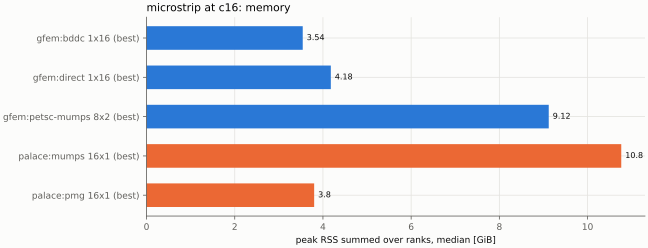

| solver | layout | role | peak RSS sum GiB | rank max GiB | largest node GiB | PSS sum GiB | sacct MaxRSS GiB | self-reports |
|---|---|---|---|---|---|---|---|---|
| gfem:bddc | 1x16 | best | 3.54 | 3.54 | 3.54 | 3.54 | 2.51 | solver_nbytes 2.66e+08 |
| gfem:direct | 1x16 | best | 4.18 | 4.18 | 4.18 | 3.91 | — | solver_nbytes 2.51e+09 |
| gfem:petsc-mumps | 8x2 | best | 9.12 | 1.3 | 9.12 | 7.96 | — | solver_nbytes 4.27e+09 |
| palace:mumps | 16x1 | best | 10.8 | 0.792 | 10.8 | 10.1 | 0.75 | — |
| palace:pmg | 16x1 | best | 3.8 | 0.256 | 3.8 | 3.23 | — | — |

The RSS sum counts shared pages once per rank in both codes alike; it is an upper bound on the simultaneous footprint, and PSS corrects it. sacct MaxRSS only for runs over 60 s.

#### Accuracy

| solver | order | layout | tol | metric | error | bound | resolved | ceiling | plausible | same-code error | δ |
|---|---|---|---|---|---|---|---|---|---|---|---|
| gfem:bddc | 2 | 1x16 (default) | 1e-06 | max_abs_dS | 2.90e-02 ± 1.07e-02 (unresolved) | 1.07e-02 | no | 2.90e-01 | pass | 1.41e-06 | — |
| gfem:bddc | 2 | 1x16 (default) | 1e-10 | max_abs_dS | 2.90e-02 ± 1.07e-02 (unresolved) | 1.07e-02 | no | 2.90e-01 | pass | 9.69e-11 | — |
| gfem:bddc | 2 | 1x16 | 1e-08 | max_abs_dS | 2.90e-02 ± 1.07e-02 (unresolved) | 1.07e-02 | no | 2.90e-01 | pass | 1.03e-08 | — |
| gfem:bddc | 2 | 2x8 | 1e-08 | max_abs_dS | 2.90e-02 ± 1.07e-02 (unresolved) | 1.07e-02 | no | 2.90e-01 | pass | 1.03e-08 | — |
| gfem:bddc | 2 | 4x4 | 1e-08 | max_abs_dS | 2.90e-02 ± 1.07e-02 (unresolved) | 1.07e-02 | no | 2.90e-01 | pass | 1.03e-08 | — |
| gfem:bddc | 2 | 8x2 | 1e-08 | max_abs_dS | 2.90e-02 ± 1.07e-02 (unresolved) | 1.07e-02 | no | 2.90e-01 | pass | 1.03e-08 | — |
| gfem:bddc | 2 | 16x1 | 1e-08 | max_abs_dS | 2.90e-02 ± 1.07e-02 (unresolved) | 1.07e-02 | no | 2.90e-01 | pass | 1.03e-08 | — |
| gfem:direct | 2 | 1x16 | — | max_abs_dS | 2.90e-02 ± 1.07e-02 (unresolved) | 1.07e-02 | no | 2.90e-01 | pass | 6.20e-13 | — |
| gfem:petsc-mumps | 2 | 1x16 | — | max_abs_dS | 2.90e-02 ± 1.07e-02 (unresolved) | 1.07e-02 | no | 2.90e-01 | pass | 2.73e-11 | — |
| gfem:petsc-mumps | 2 | 2x8 | — | max_abs_dS | 2.90e-02 ± 1.07e-02 (unresolved) | 1.07e-02 | no | 2.90e-01 | pass | 2.12e-11 | — |
| gfem:petsc-mumps | 2 | 4x4 | — | max_abs_dS | 2.90e-02 ± 1.07e-02 (unresolved) | 1.07e-02 | no | 2.90e-01 | pass | 3.05e-11 | — |
| gfem:petsc-mumps | 2 | 8x2 | — | max_abs_dS | 2.90e-02 ± 1.07e-02 (unresolved) | 1.07e-02 | no | 2.90e-01 | pass | 3.17e-11 | — |
| gfem:petsc-mumps | 2 | 16x1 | — | max_abs_dS | 2.90e-02 ± 1.07e-02 (unresolved) | 1.07e-02 | no | 2.90e-01 | pass | 2.44e-11 | — |
| palace:mumps | 2 | 1x16 | — | max_abs_dS | 2.90e-02 ± 1.07e-02 (unresolved) | 1.07e-02 | no | 2.90e-01 | pass | 2.57e-12 | 8.86e-11 |
| palace:mumps | 2 | 2x8 | — | max_abs_dS | 2.90e-02 ± 1.07e-02 (unresolved) | 1.07e-02 | no | 2.90e-01 | pass | 7.80e-12 | 8.86e-11 |
| palace:mumps | 2 | 4x4 | — | max_abs_dS | 2.90e-02 ± 1.07e-02 (unresolved) | 1.07e-02 | no | 2.90e-01 | pass | 3.83e-12 | 8.86e-11 |
| palace:mumps | 2 | 8x2 | — | max_abs_dS | 2.90e-02 ± 1.07e-02 (unresolved) | 1.07e-02 | no | 2.90e-01 | pass | 3.67e-11 | 8.86e-11 |
| palace:mumps | 2 | 16x1 | — | max_abs_dS | 2.90e-02 ± 1.07e-02 (unresolved) | 1.07e-02 | no | 2.90e-01 | pass | 3.40e-12 | 8.86e-11 |
| palace:pmg | 2 | 16x1 (default) | 1e-06 | max_abs_dS | 2.90e-02 ± 1.07e-02 (unresolved) | 1.07e-02 | no | 2.90e-01 | pass | 5.04e-05 | 8.86e-11 |
| palace:pmg | 2 | 16x1 (default) | 1e-10 | max_abs_dS | 2.90e-02 ± 1.07e-02 (unresolved) | 1.07e-02 | no | 2.90e-01 | pass | 6.47e-10 | 8.86e-11 |
| palace:pmg | 2 | 1x16 | 1e-08 | max_abs_dS | 2.90e-02 ± 1.07e-02 (unresolved) | 1.07e-02 | no | 2.90e-01 | pass | 1.97e-07 | 8.86e-11 |
| palace:pmg | 2 | 2x8 | 1e-08 | max_abs_dS | 2.90e-02 ± 1.07e-02 (unresolved) | 1.07e-02 | no | 2.90e-01 | pass | 1.97e-07 | 8.86e-11 |
| palace:pmg | 2 | 4x4 | 1e-08 | max_abs_dS | 2.90e-02 ± 1.07e-02 (unresolved) | 1.07e-02 | no | 2.90e-01 | pass | 1.96e-07 | 8.86e-11 |
| palace:pmg | 2 | 8x2 | 1e-08 | max_abs_dS | 2.90e-02 ± 1.07e-02 (unresolved) | 1.07e-02 | no | 2.90e-01 | pass | 1.96e-07 | 8.86e-11 |
| palace:pmg | 2 | 16x1 | 1e-08 | max_abs_dS | 2.90e-02 ± 1.07e-02 (unresolved) | 1.07e-02 | no | 2.90e-01 | pass | 1.95e-07 | 8.86e-11 |

Discretization floor (same-mesh error): p1 1.33e-01, p2 2.90e-02 ± 1.07e-02 (unresolved), p3 1.44e-02 ± 1.07e-02 (unresolved).

All 25 runs of order 2 are at the p2 floor (largest deviation 0.039 %): accuracy differences between codes do not show at this order on this mesh; compare codes by same-code error along the tolerance ladder.

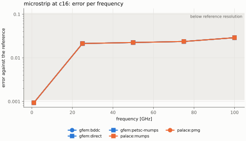

| frequency Hz | gfem:bddc (1x16) | gfem:direct (1x16) | gfem:petsc-mumps (8x2) | palace:mumps (16x1) | palace:pmg (16x1) | reference bound |
|---|---|---|---|---|---|---|
| 1e+09 | 9.33e-04 | 9.33e-04 | 9.33e-04 | 9.33e-04 | 9.33e-04 | 1.80e-04 |
| 2.5e+10 | 2.13e-02 | 2.13e-02 | 2.13e-02 | 2.13e-02 | 2.13e-02 | 3.52e-03 |
| 5e+10 | 2.25e-02 | 2.25e-02 | 2.25e-02 | 2.25e-02 | 2.25e-02 | 6.54e-03 |
| 7.5e+10 | 2.37e-02 | 2.37e-02 | 2.37e-02 | 2.37e-02 | 2.37e-02 | 8.74e-03 |
| 1e+11 | 2.90e-02 | 2.90e-02 | 2.90e-02 | 2.90e-02 | 2.90e-02 | 1.07e-02 |

#### Layouts

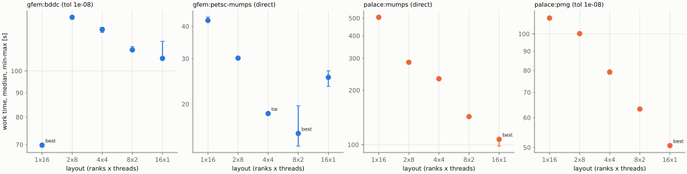

| solver | tol | layout | n | median work s | min-max |  |
|---|---|---|---|---|---|---|
| gfem:bddc | 1e-08 | 1x16 | 3 | 69.8 | 69.5-70.2 | best |
| gfem:bddc | 1e-08 | 2x8 | 3 | 130 | 129-130 |  |
| gfem:bddc | 1e-08 | 4x4 | 3 | 122 | 121-124 |  |
| gfem:bddc | 1e-08 | 8x2 | 3 | 111 | 111-113 |  |
| gfem:bddc | 1e-08 | 16x1 | 3 | 106 | 106-115 |  |
| gfem:direct | — | 1x16 | 3 | 8.32 | 8.29-8.59 | best |
| gfem:petsc-mumps | — | 1x16 | 3 | 42.2 | 42.1-43.5 |  |
| gfem:petsc-mumps | — | 2x8 | 3 | 30.1 | 30-30.2 |  |
| gfem:petsc-mumps | — | 4x4 | 3 | 18.4 | 18.1-18.5 | tie |
| gfem:petsc-mumps | — | 8x2 | 3 | 15.4 | 13.8-19.7 | best |
| gfem:petsc-mumps | — | 16x1 | 3 | 25.4 | 23.4-26.9 |  |
| palace:mumps | — | 1x16 | 3 | 506 | 505-507 |  |
| palace:mumps | — | 2x8 | 3 | 285 | 285-285 |  |
| palace:mumps | — | 4x4 | 3 | 231 | 228-231 |  |
| palace:mumps | — | 8x2 | 3 | 143 | 143-143 |  |
| palace:mumps | — | 16x1 | 3 | 107 | 98.3-107 | best |
| palace:pmg | 1e-08 | 1x16 | 3 | 110 | 110-111 |  |
| palace:pmg | 1e-08 | 2x8 | 3 | 100 | 99.7-100 |  |
| palace:pmg | 1e-08 | 4x4 | 3 | 79.3 | 78.2-79.4 |  |
| palace:pmg | 1e-08 | 8x2 | 3 | 63.2 | 63.2-63.2 |  |
| palace:pmg | 1e-08 | 16x1 | 3 | 50.6 | 50.4-50.7 | best |

| solver | default | best | ties | default / best |
|---|---|---|---|---|
| gfem:bddc | — | 1x16 | — | — |
| gfem:direct | — | 1x16 | — | — |
| gfem:petsc-mumps | — | 8x2 | 4x4 | — |
| palace:mumps | — | 16x1 | — | — |
| palace:pmg | — | 16x1 | — | — |

#### Cross-solver snapshot (same-mesh comparison)

DOF: gfem [315870], palace [315870].

Direct kinds:

| solver | role | layout | n | work s | peak RSS sum GiB | error | jobs |
|---|---|---|---|---|---|---|---|
| gfem:direct | best | 1x16 | 3 | 8.32 | 4.18 | 2.90e-02 | 49256955 (slow node) |
| gfem:petsc-mumps | best | 8x2 | 3 | 15.4 | 9.12 | 2.90e-02 | 49256955 (slow node) |
| palace:mumps | best | 16x1 | 3 | 107 | 10.8 | 2.90e-02 | 49256955 (slow node) |

| role | ratio | work | memory | pairing |
|---|---|---|---|---|
| best | palace:mumps / gfem:direct | 12.9 | 2.58 | same job |

Iterative kinds:

| solver | role | layout | n | work s | peak RSS sum GiB | error | jobs |
|---|---|---|---|---|---|---|---|
| gfem:bddc | best | 1x16 | 3 | 69.8 | 3.54 | 2.90e-02 | 49256955 (slow node) |
| palace:pmg | best | 16x1 | 3 | 50.6 | 3.8 | 2.90e-02 | 49256955 (slow node) |

Iterative kinds compare only at equal achieved error (table above).

### microstrip at c32 (standard, 1 node)

#### Error against cost

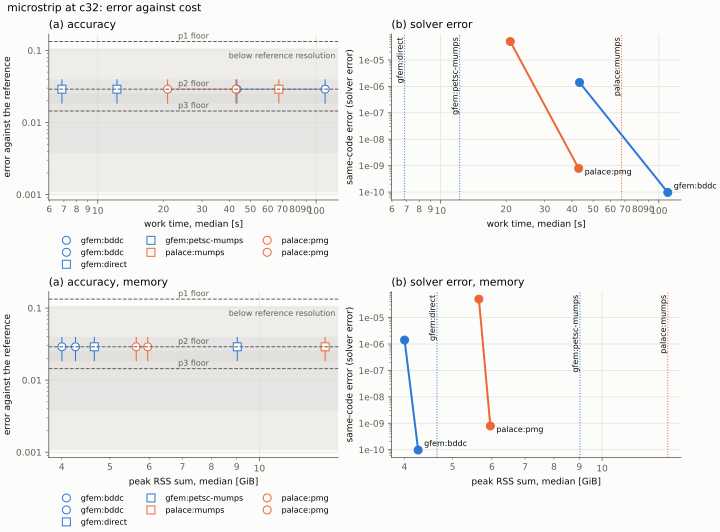

(a) Error against the converged reference, at each solver's best layout.

| solver | layout | tol | work s | peak RSS sum GiB | error |
|---|---|---|---|---|---|
| gfem:bddc | 1x32 | 1e-06 | 43.3 | 4 | 2.90e-02 ± 1.07e-02 (unresolved) |
| gfem:bddc | 1x32 | 1e-10 | 110 | 4.26 | 2.90e-02 ± 1.07e-02 (unresolved) |
| gfem:direct | 1x32 | — | 6.86 | 4.65 | 2.90e-02 ± 1.07e-02 (unresolved) |
| gfem:petsc-mumps | 8x4 | — | 12.2 | 9.02 | 2.90e-02 ± 1.07e-02 (unresolved) |
| palace:mumps | 32x1 | — | 67.5 | 13.6 | 2.90e-02 ± 1.07e-02 (unresolved) |
| palace:pmg | 32x1 | 1e-06 | 20.9 | 5.65 | 2.90e-02 ± 1.07e-02 (unresolved) |
| palace:pmg | 32x1 | 1e-10 | 42.9 | 5.96 | 2.90e-02 ± 1.07e-02 (unresolved) |

Discretization floor (same-mesh error): p1 1.33e-01, p2 2.90e-02 ± 1.07e-02 (unresolved), p3 1.44e-02 ± 1.07e-02 (unresolved).

All 7 runs of order 2 are at the p2 floor (largest deviation 0.039 %): accuracy differences between codes do not show at this order on this mesh; compare codes by same-code error along the tolerance ladder.

Below reference resolution: errors under 1.07e-01.

(b) Same-code error (solver error, not accuracy) along the tolerance ladder.

| solver | layout | tol | work s | peak RSS sum GiB | same-code error |
|---|---|---|---|---|---|
| gfem:bddc | 1x32 | 1e-06 | 43.3 | 4 | 1.41e-06 |
| gfem:bddc | 1x32 | 1e-10 | 110 | 4.26 | 9.68e-11 |
| palace:pmg | 32x1 | 1e-06 | 20.9 | 5.65 | 5.02e-05 |
| palace:pmg | 32x1 | 1e-10 | 42.9 | 5.96 | 7.87e-10 |

Direct runs (same-code error 0 by definition): gfem:direct 6.86 s (1x32), gfem:petsc-mumps 12.2 s (8x4), palace:mumps 67.5 s (32x1).

Cost at equal achieved same-code error (interpolated log-log between neighbouring rungs, never extrapolated):

| error | gfem:bddc work s | gfem:bddc GiB | palace:pmg work s | palace:pmg GiB | palace:pmg / gfem:bddc |
|---|---|---|---|---|---|
| 7.87e-10 | 89.7 | 4.2 | 42.9 | 5.96 | 0.479 |
| 1.00e-09 | 87.6 | 4.2 | 42.3 | 5.95 | 0.483 |
| 1.00e-08 | 70.1 | 4.14 | 36.4 | 5.89 | 0.519 |
| 3.33e-08 | 62.3 | 4.1 | 33.6 | 5.85 | 0.54 |
| 1.00e-07 | 56 | 4.07 | 31.3 | 5.82 | 0.559 |
| 1.00e-06 | 44.8 | 4.01 | 27 | 5.76 | 0.601 |
| 1.41e-06 | 43.3 | 4 | 26.4 | 5.75 | 0.608 |

#### Time

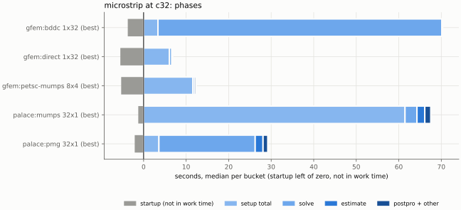

| solver | layout | role | tol | n | work s | spread | startup s | setup total s | solve total s | per sample s | mesh read s | discretize s | assemble s | setup s | solve s | estimate s | postpro s | rom s | other s | iterations | setups/solves | imbalance |
|---|---|---|---|---|---|---|---|---|---|---|---|---|---|---|---|---|---|---|---|---|---|---|
| gfem:bddc | 1x32 | best | 1e-08 | 3 | 70.3 | 0.2 % | 3.72 | 3.38 | 66.8 | 14.1 | 0.418 | 0.128 | 2.81 | 0.0189 | 66.8 | — | — | — | 0.212 | 897 | 6/5 | — |
| gfem:direct | 1x32 | best | — | 3 | 6.86 | 9.4 % | 5.47 | 6.07 | 0.576 | 1.37 | 0.437 | 0.134 | 1.04 | 4.46 | 0.576 | — | — | — | 0.208 | 0 | 5/5 | — |
| gfem:petsc-mumps | 8x4 | best | — | 3 | 12.2 | 47.8 % noisy | 5.27 | 11.6 | 0.42 | 2.45 | 0.452 | 0.386 | 0.201 | 10.5 | 0.42 | — | — | — | 0.368 | 0 | 5/5 | 1.01 |
|  |  | rank 0 |  |  | — |  |  |  |  |  | 0.449 | 0.37 | 0.134 | 10.5 | 0.415 | — | — | — | 0.368 |  |  |  |
| palace:mumps | 32x1 | best | — | 3 | 67.5 | 11.9 % noisy | 1.25 | 61.5 | 2.81 | 13.5 | 0.551 | — | 0.088 | 60.8 | 2.81 | 1.84 | 0.235 | 0 | 1.17 | 16 | 10/10 | 1 |
|  |  | rank 0 |  |  | — |  |  |  |  |  | 0.429 | — | 0.0815 | 60.8 | 2.78 | 1.82 | 0.235 | 0 | 1.34 |  |  |  |
| palace:pmg | 32x1 | best | 1e-08 | 3 | 29.2 | 0.4 % | 2.09 | 3.6 | 22.6 | 5.84 | 0.549 | — | 0.17 | 2.88 | 22.6 | 1.85 | 0.239 | 0 | 0.873 | 341 | 10/10 | 1 |
|  |  | rank 0 |  |  | — |  |  |  |  |  | 0.428 | — | 0.168 | 2.88 | 22.3 | 1.83 | 0.238 | 0 | 1.34 |  |  |  |

Work time is wall minus startup; startup is not in work time. Rank reduction of the buckets: gfem:bddc: max; gfem:direct: max; gfem:petsc-mumps: max; palace:mumps: max-of-rows; palace:pmg: max-of-rows. Max-of-rows is an upper bound on the slowest rank (rows may peak on different ranks); imbalance = headline bucket sum / rank-0 sum.

gfem BDDC: the assemble bucket includes the preconditioner build (NGSolve builds BDDC while it assembles the first matrix of a setup).

#### Memory

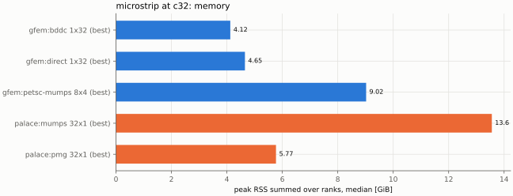

| solver | layout | role | peak RSS sum GiB | rank max GiB | largest node GiB | PSS sum GiB | sacct MaxRSS GiB | self-reports |
|---|---|---|---|---|---|---|---|---|
| gfem:bddc | 1x32 | best | 4.12 | 4.12 | 4.12 | 4.05 | 2.86 | solver_nbytes 2.66e+08 |
| gfem:direct | 1x32 | best | 4.65 | 4.65 | 4.65 | 4.39 | — | solver_nbytes 2.82e+09 |
| gfem:petsc-mumps | 8x4 | best | 9.02 | 1.23 | 9.02 | 7.95 | — | solver_nbytes 4.24e+09 |
| palace:mumps | 32x1 | best | 13.6 | 0.498 | 13.6 | 11.7 | 0.408 | — |
| palace:pmg | 32x1 | best | 5.77 | 0.195 | 5.77 | 4.15 | — | — |

The RSS sum counts shared pages once per rank in both codes alike; it is an upper bound on the simultaneous footprint, and PSS corrects it. sacct MaxRSS only for runs over 60 s.

#### Accuracy

| solver | order | layout | tol | metric | error | bound | resolved | ceiling | plausible | same-code error | δ |
|---|---|---|---|---|---|---|---|---|---|---|---|
| gfem:bddc | 2 | 1x32 (default) | 1e-06 | max_abs_dS | 2.90e-02 ± 1.07e-02 (unresolved) | 1.07e-02 | no | 2.90e-01 | pass | 1.41e-06 | — |
| gfem:bddc | 2 | 1x32 (default) | 1e-10 | max_abs_dS | 2.90e-02 ± 1.07e-02 (unresolved) | 1.07e-02 | no | 2.90e-01 | pass | 9.68e-11 | — |
| gfem:bddc | 2 | 1x32 | 1e-08 | max_abs_dS | 2.90e-02 ± 1.07e-02 (unresolved) | 1.07e-02 | no | 2.90e-01 | pass | 1.03e-08 | — |
| gfem:bddc | 2 | 2x16 | 1e-08 | max_abs_dS | 2.90e-02 ± 1.07e-02 (unresolved) | 1.07e-02 | no | 2.90e-01 | pass | 1.03e-08 | — |
| gfem:bddc | 2 | 4x8 | 1e-08 | max_abs_dS | 2.90e-02 ± 1.07e-02 (unresolved) | 1.07e-02 | no | 2.90e-01 | pass | 1.03e-08 | — |
| gfem:bddc | 2 | 8x4 | 1e-08 | max_abs_dS | 2.90e-02 ± 1.07e-02 (unresolved) | 1.07e-02 | no | 2.90e-01 | pass | 1.03e-08 | — |
| gfem:bddc | 2 | 16x2 | 1e-08 | max_abs_dS | 2.90e-02 ± 1.07e-02 (unresolved) | 1.07e-02 | no | 2.90e-01 | pass | 1.03e-08 | — |
| gfem:bddc | 2 | 32x1 | 1e-08 | max_abs_dS | 2.90e-02 ± 1.07e-02 (unresolved) | 1.07e-02 | no | 2.90e-01 | pass | 1.03e-08 | — |
| gfem:direct | 2 | 1x32 | — | max_abs_dS | 2.90e-02 ± 1.07e-02 (unresolved) | 1.07e-02 | no | 2.90e-01 | pass | 1.77e-11 | — |
| gfem:petsc-mumps | 2 | 1x32 | — | max_abs_dS | 2.90e-02 ± 1.07e-02 (unresolved) | 1.07e-02 | no | 2.90e-01 | pass | 5.20e-11 | — |
| gfem:petsc-mumps | 2 | 2x16 | — | max_abs_dS | 2.90e-02 ± 1.07e-02 (unresolved) | 1.07e-02 | no | 2.90e-01 | pass | 4.22e-11 | — |
| gfem:petsc-mumps | 2 | 4x8 | — | max_abs_dS | 2.90e-02 ± 1.07e-02 (unresolved) | 1.07e-02 | no | 2.90e-01 | pass | 7.27e-11 | — |
| gfem:petsc-mumps | 2 | 8x4 | — | max_abs_dS | 2.90e-02 ± 1.07e-02 (unresolved) | 1.07e-02 | no | 2.90e-01 | pass | 5.73e-11 | — |
| gfem:petsc-mumps | 2 | 16x2 | — | max_abs_dS | 2.90e-02 ± 1.07e-02 (unresolved) | 1.07e-02 | no | 2.90e-01 | pass | 3.56e-11 | — |
| gfem:petsc-mumps | 2 | 32x1 | — | max_abs_dS | 2.90e-02 ± 1.07e-02 (unresolved) | 1.07e-02 | no | 2.90e-01 | pass | 1.23e-11 | — |
| palace:mumps | 2 | 2x16 | — | max_abs_dS | 2.90e-02 ± 1.07e-02 (unresolved) | 1.07e-02 | no | 2.90e-01 | pass | 4.81e-12 | 8.86e-11 |
| palace:mumps | 2 | 4x8 | — | max_abs_dS | 2.90e-02 ± 1.07e-02 (unresolved) | 1.07e-02 | no | 2.90e-01 | pass | 7.53e-12 | 8.86e-11 |
| palace:mumps | 2 | 8x4 | — | max_abs_dS | 2.90e-02 ± 1.07e-02 (unresolved) | 1.07e-02 | no | 2.90e-01 | pass | 5.18e-12 | 8.86e-11 |
| palace:mumps | 2 | 16x2 | — | max_abs_dS | 2.90e-02 ± 1.07e-02 (unresolved) | 1.07e-02 | no | 2.90e-01 | pass | 2.54e-12 | 8.86e-11 |
| palace:mumps | 2 | 32x1 | — | max_abs_dS | 2.90e-02 ± 1.07e-02 (unresolved) | 1.07e-02 | no | 2.90e-01 | pass | 2.89e-12 | 8.86e-11 |
| palace:pmg | 2 | 32x1 (default) | 1e-06 | max_abs_dS | 2.90e-02 ± 1.07e-02 (unresolved) | 1.07e-02 | no | 2.90e-01 | pass | 5.02e-05 | 8.86e-11 |
| palace:pmg | 2 | 32x1 (default) | 1e-10 | max_abs_dS | 2.90e-02 ± 1.07e-02 (unresolved) | 1.07e-02 | no | 2.90e-01 | pass | 7.87e-10 | 8.86e-11 |
| palace:pmg | 2 | 1x32 | 1e-08 | max_abs_dS | 2.90e-02 ± 1.07e-02 (unresolved) | 1.07e-02 | no | 2.90e-01 | pass | 1.97e-07 | 8.86e-11 |
| palace:pmg | 2 | 2x16 | 1e-08 | max_abs_dS | 2.90e-02 ± 1.07e-02 (unresolved) | 1.07e-02 | no | 2.90e-01 | pass | 1.97e-07 | 8.86e-11 |
| palace:pmg | 2 | 4x8 | 1e-08 | max_abs_dS | 2.90e-02 ± 1.07e-02 (unresolved) | 1.07e-02 | no | 2.90e-01 | pass | 1.96e-07 | 8.86e-11 |
| palace:pmg | 2 | 8x4 | 1e-08 | max_abs_dS | 2.90e-02 ± 1.07e-02 (unresolved) | 1.07e-02 | no | 2.90e-01 | pass | 1.96e-07 | 8.86e-11 |
| palace:pmg | 2 | 16x2 | 1e-08 | max_abs_dS | 2.90e-02 ± 1.07e-02 (unresolved) | 1.07e-02 | no | 2.90e-01 | pass | 1.95e-07 | 8.86e-11 |
| palace:pmg | 2 | 32x1 | 1e-08 | max_abs_dS | 2.90e-02 ± 1.07e-02 (unresolved) | 1.07e-02 | no | 2.90e-01 | pass | 1.95e-07 | 8.86e-11 |

Discretization floor (same-mesh error): p1 1.33e-01, p2 2.90e-02 ± 1.07e-02 (unresolved), p3 1.44e-02 ± 1.07e-02 (unresolved).

All 28 runs of order 2 are at the p2 floor (largest deviation 0.039 %): accuracy differences between codes do not show at this order on this mesh; compare codes by same-code error along the tolerance ladder.

| frequency Hz | gfem:bddc (1x32) | gfem:direct (1x32) | gfem:petsc-mumps (8x4) | palace:mumps (32x1) | palace:pmg (32x1) | reference bound |
|---|---|---|---|---|---|---|
| 1e+09 | 9.33e-04 | 9.33e-04 | 9.33e-04 | 9.33e-04 | 9.33e-04 | 1.80e-04 |
| 2.5e+10 | 2.13e-02 | 2.13e-02 | 2.13e-02 | 2.13e-02 | 2.13e-02 | 3.52e-03 |
| 5e+10 | 2.25e-02 | 2.25e-02 | 2.25e-02 | 2.25e-02 | 2.25e-02 | 6.54e-03 |
| 7.5e+10 | 2.37e-02 | 2.37e-02 | 2.37e-02 | 2.37e-02 | 2.37e-02 | 8.74e-03 |
| 1e+11 | 2.90e-02 | 2.90e-02 | 2.90e-02 | 2.90e-02 | 2.90e-02 | 1.07e-02 |

#### Layouts

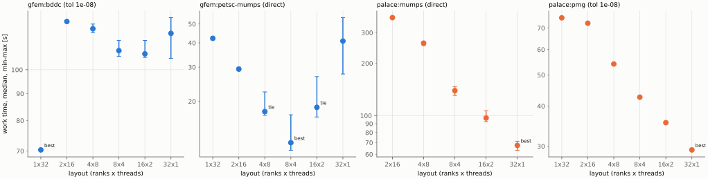

| solver | tol | layout | n | median work s | min-max |  |
|---|---|---|---|---|---|---|
| gfem:bddc | 1e-08 | 1x32 | 3 | 70.3 | 70.2-70.4 | best |
| gfem:bddc | 1e-08 | 2x16 | 3 | 124 | 123-124 |  |
| gfem:bddc | 1e-08 | 4x8 | 3 | 120 | 118-122 |  |
| gfem:bddc | 1e-08 | 8x4 | 3 | 109 | 106-114 |  |
| gfem:bddc | 1e-08 | 16x2 | 3 | 107 | 106-114 |  |
| gfem:bddc | 1e-08 | 32x1 | 3 | 117 | 105-126 |  |
| gfem:direct | — | 1x32 | 3 | 6.86 | 6.81-7.46 | best |
| gfem:petsc-mumps | — | 1x32 | 3 | 42.2 | 42-43 |  |
| gfem:petsc-mumps | — | 2x16 | 3 | 29.3 | 29.3-30 |  |
| gfem:petsc-mumps | — | 4x8 | 3 | 17.7 | 16.9-22.4 | tie |
| gfem:petsc-mumps | — | 8x4 | 3 | 12.2 | 11.2-17 | best |
| gfem:petsc-mumps | — | 16x2 | 3 | 18.6 | 16.6-26.8 | tie |
| gfem:petsc-mumps | — | 32x1 | 3 | 40.9 | 27.6-54 |  |
| palace:mumps | — | 2x16 | 3 | 366 | 366-366 |  |
| palace:mumps | — | 4x8 | 3 | 261 | 252-265 |  |
| palace:mumps | — | 8x4 | 3 | 139 | 131-147 |  |
| palace:mumps | — | 16x2 | 3 | 97.1 | 92.5-107 |  |
| palace:mumps | — | 32x1 | 3 | 67.5 | 63.3-71.3 | best |
| palace:pmg | 1e-08 | 1x32 | 3 | 75.3 | 75.3-75.4 |  |
| palace:pmg | 1e-08 | 2x16 | 3 | 72.5 | 72.3-72.5 |  |
| palace:pmg | 1e-08 | 4x8 | 3 | 54.1 | 53.8-54.1 |  |
| palace:pmg | 1e-08 | 8x4 | 3 | 42.6 | 42.6-42.8 |  |
| palace:pmg | 1e-08 | 16x2 | 3 | 35.5 | 35.5-35.5 |  |
| palace:pmg | 1e-08 | 32x1 | 3 | 29.2 | 29.1-29.3 | best |

| solver | default | best | ties | default / best |
|---|---|---|---|---|
| gfem:bddc | — | 1x32 | — | — |
| gfem:direct | — | 1x32 | — | — |
| gfem:petsc-mumps | — | 8x4 | 4x8, 16x2 | — |
| palace:mumps | — | 32x1 | — | — |
| palace:pmg | — | 32x1 | — | — |

Not plotted (not passing):

- palace:mumps 1x32: not_started, timeout (wall cap 600 s; earlier_repeat_timeout)

#### Cross-solver snapshot (same-mesh comparison)

DOF: gfem [315870], palace [315870].

Direct kinds:

| solver | role | layout | n | work s | peak RSS sum GiB | error | jobs |
|---|---|---|---|---|---|---|---|
| gfem:direct | best | 1x32 | 3 | 6.86 | 4.65 | 2.90e-02 | 49256970 |
| gfem:petsc-mumps | best | 8x4 | 3 | 12.2 | 9.02 | 2.90e-02 | 49256970 |
| palace:mumps | best | 32x1 | 3 | 67.5 | 13.6 | 2.90e-02 | 49256970 |

| role | ratio | work | memory | pairing |
|---|---|---|---|---|
| best | palace:mumps / gfem:direct | 9.84 | 2.91 | same job |

Iterative kinds:

| solver | role | layout | n | work s | peak RSS sum GiB | error | jobs |
|---|---|---|---|---|---|---|---|
| gfem:bddc | best | 1x32 | 3 | 70.3 | 4.12 | 2.90e-02 | 49256970 |
| palace:pmg | best | 32x1 | 3 | 29.2 | 5.77 | 2.90e-02 | 49256970 |

Iterative kinds compare only at equal achieved error (table above).

### microstrip at c56 (standard, 1 node)

#### Error against cost

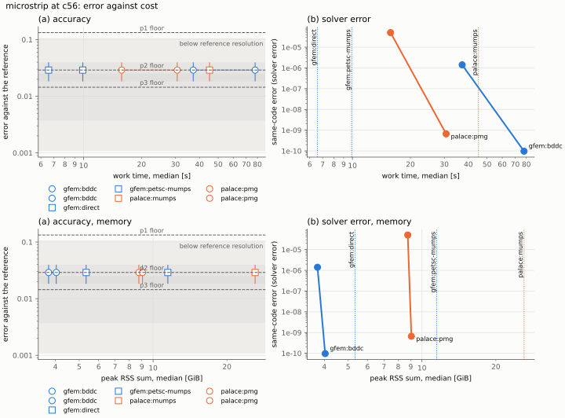

(a) Error against the converged reference, at each solver's best layout.

| solver | layout | tol | work s | peak RSS sum GiB | error |
|---|---|---|---|---|---|
| gfem:bddc | 1x56 | 1e-06 | 37.1 | 3.75 | 2.90e-02 ± 1.07e-02 (unresolved) |
| gfem:bddc | 1x56 | 1e-10 | 77.8 | 4.03 | 2.90e-02 ± 1.07e-02 (unresolved) |
| gfem:direct | 1x56 | — | 6.58 | 5.34 | 2.90e-02 ± 1.07e-02 (unresolved) |
| gfem:petsc-mumps | 14x4 | — | 9.9 | 11.5 | 2.90e-02 ± 1.07e-02 (unresolved) |
| palace:mumps | 56x1 | — | 45.1 | 26.1 | 2.90e-02 ± 1.07e-02 (unresolved) |
| palace:pmg | 56x1 | 1e-06 | 15.8 | 8.75 | 2.90e-02 ± 1.07e-02 (unresolved) |
| palace:pmg | 56x1 | 1e-10 | 30.7 | 9.05 | 2.90e-02 ± 1.07e-02 (unresolved) |

Discretization floor (same-mesh error): p1 1.33e-01, p2 2.90e-02 ± 1.07e-02 (unresolved), p3 1.44e-02 ± 1.07e-02 (unresolved).

All 7 runs of order 2 are at the p2 floor (largest deviation 0.04 %): accuracy differences between codes do not show at this order on this mesh; compare codes by same-code error along the tolerance ladder.

Below reference resolution: errors under 1.07e-01.

(b) Same-code error (solver error, not accuracy) along the tolerance ladder.

| solver | layout | tol | work s | peak RSS sum GiB | same-code error |
|---|---|---|---|---|---|
| gfem:bddc | 1x56 | 1e-06 | 37.1 | 3.75 | 1.41e-06 |
| gfem:bddc | 1x56 | 1e-10 | 77.8 | 4.03 | 9.68e-11 |
| palace:pmg | 56x1 | 1e-06 | 15.8 | 8.75 | 5.05e-05 |
| palace:pmg | 56x1 | 1e-10 | 30.7 | 9.05 | 6.63e-10 |

Direct runs (same-code error 0 by definition): gfem:direct 6.58 s (1x56), gfem:petsc-mumps 9.9 s (14x4), palace:mumps 45.1 s (56x1).

Cost at equal achieved same-code error (interpolated log-log between neighbouring rungs, never extrapolated):

| error | gfem:bddc work s | gfem:bddc GiB | palace:pmg work s | palace:pmg GiB | palace:pmg / gfem:bddc |
|---|---|---|---|---|---|
| 6.63e-10 | 67.1 | 3.97 | 30.7 | 9.05 | 0.457 |
| 1.00e-09 | 65 | 3.96 | 29.9 | 9.04 | 0.461 |
| 1.00e-08 | 54.4 | 3.89 | 26.1 | 8.98 | 0.48 |
| 3.06e-08 | 49.9 | 3.86 | 24.4 | 8.95 | 0.49 |
| 1.00e-07 | 45.5 | 3.83 | 22.8 | 8.92 | 0.5 |
| 1.00e-06 | 38.1 | 3.76 | 19.9 | 8.86 | 0.522 |
| 1.41e-06 | 37.1 | 3.75 | 19.5 | 8.85 | 0.525 |

#### Time

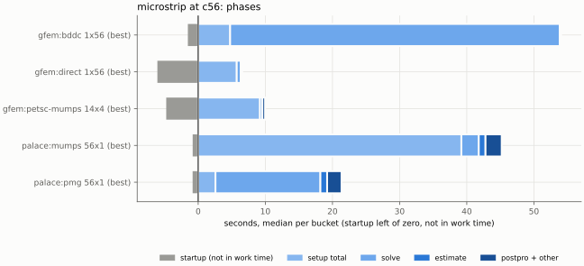

| solver | layout | role | tol | n | work s | spread | startup s | setup total s | solve total s | per sample s | mesh read s | discretize s | assemble s | setup s | solve s | estimate s | postpro s | rom s | other s | iterations | setups/solves | imbalance |
|---|---|---|---|---|---|---|---|---|---|---|---|---|---|---|---|---|---|---|---|---|---|---|
| gfem:bddc | 1x56 | best | 1e-08 | 3 | 54 | 0.3 % | 1.53 | 4.76 | 49.1 | 10.8 | 0.419 | 0.131 | 4.19 | 0.0169 | 49.1 | — | — | — | 0.204 | 897 | 6/5 | — |
| gfem:direct | 1x56 | best | — | 3 | 6.58 | 8.9 % | 6.07 | 5.73 | 0.588 | 1.32 | 0.463 | 0.135 | 0.989 | 4.16 | 0.588 | — | — | — | 0.223 | 0 | 5/5 | — |
| gfem:petsc-mumps | 14x4 | best | — | 3 | 9.9 | 0.9 % | 4.76 | 9.21 | 0.353 | 1.98 | 0.464 | 0.389 | 0.137 | 8.22 | 0.353 | — | — | — | 0.399 | 0 | 5/5 | 1.01 |
|  |  | rank 0 |  |  | — |  |  |  |  |  | 0.459 | 0.361 | 0.0858 | 8.22 | 0.35 | — | — | — | 0.398 |  |  |  |
| palace:mumps | 56x1 | best | — | 3 | 45.1 | 3.7 % | 0.819 | 39.2 | 2.6 | 9.02 | 0.569 | — | 0.086 | 38.5 | 2.6 | 1 | 0.226 | 0 | 2.18 | 16 | 10/10 | 1 |
|  |  | rank 0 |  |  | — |  |  |  |  |  | 0.446 | — | 0.0826 | 38.5 | 2.58 | 0.983 | 0.224 | 0 | 2.35 |  |  |  |
| palace:pmg | 56x1 | best | 1e-08 | 3 | 21.4 | 0.0 % | 0.826 | 2.57 | 15.6 | 4.27 | 0.566 | — | 0.131 | 1.88 | 15.6 | 0.999 | 0.222 | 0 | 1.92 | 341 | 10/10 | 1 |
|  |  | rank 0 |  |  | — |  |  |  |  |  | 0.444 | — | 0.109 | 1.88 | 15.4 | 0.984 | 0.22 | 0 | 2.32 |  |  |  |

Work time is wall minus startup; startup is not in work time. Rank reduction of the buckets: gfem:bddc: max; gfem:direct: max; gfem:petsc-mumps: max; palace:mumps: max-of-rows; palace:pmg: max-of-rows. Max-of-rows is an upper bound on the slowest rank (rows may peak on different ranks); imbalance = headline bucket sum / rank-0 sum.

gfem BDDC: the assemble bucket includes the preconditioner build (NGSolve builds BDDC while it assembles the first matrix of a setup).

#### Memory

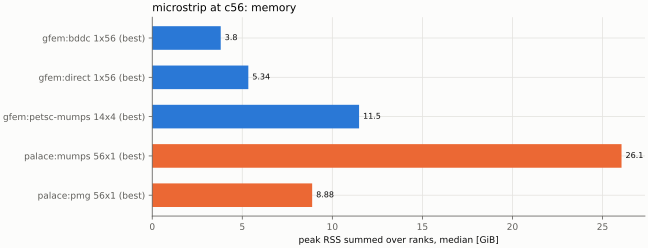

| solver | layout | role | peak RSS sum GiB | rank max GiB | largest node GiB | PSS sum GiB | sacct MaxRSS GiB | self-reports |
|---|---|---|---|---|---|---|---|---|
| gfem:bddc | 1x56 | best | 3.8 | 3.8 | 3.8 | 3.8 | — | solver_nbytes 2.66e+08 |
| gfem:direct | 1x56 | best | 5.34 | 5.34 | 5.34 | 5.08 | — | solver_nbytes 3.29e+09 |
| gfem:petsc-mumps | 14x4 | best | 11.5 | 0.931 | 11.5 | 9.21 | — | solver_nbytes 6.69e+09 |
| palace:mumps | 56x1 | best | 26.1 | 0.517 | 26.1 | 13.7 | — | — |
| palace:pmg | 56x1 | best | 8.88 | 0.165 | 8.88 | 5 | — | — |

The RSS sum counts shared pages once per rank in both codes alike; it is an upper bound on the simultaneous footprint, and PSS corrects it. sacct MaxRSS only for runs over 60 s.

#### Accuracy

| solver | order | layout | tol | metric | error | bound | resolved | ceiling | plausible | same-code error | δ |
|---|---|---|---|---|---|---|---|---|---|---|---|
| gfem:bddc | 2 | 1x56 (default) | 1e-06 | max_abs_dS | 2.90e-02 ± 1.07e-02 (unresolved) | 1.07e-02 | no | 2.90e-01 | pass | 1.41e-06 | — |
| gfem:bddc | 2 | 1x56 (default) | 1e-10 | max_abs_dS | 2.90e-02 ± 1.07e-02 (unresolved) | 1.07e-02 | no | 2.90e-01 | pass | 9.68e-11 | — |
| gfem:bddc | 2 | 1x56 | 1e-08 | max_abs_dS | 2.90e-02 ± 1.07e-02 (unresolved) | 1.07e-02 | no | 2.90e-01 | pass | 1.03e-08 | — |
| gfem:bddc | 2 | 2x28 | 1e-08 | max_abs_dS | 2.90e-02 ± 1.07e-02 (unresolved) | 1.07e-02 | no | 2.90e-01 | pass | 1.03e-08 | — |
| gfem:bddc | 2 | 4x14 | 1e-08 | max_abs_dS | 2.90e-02 ± 1.07e-02 (unresolved) | 1.07e-02 | no | 2.90e-01 | pass | 1.03e-08 | — |
| gfem:bddc | 2 | 7x8 | 1e-08 | max_abs_dS | 2.90e-02 ± 1.07e-02 (unresolved) | 1.07e-02 | no | 2.90e-01 | pass | 1.03e-08 | — |
| gfem:bddc | 2 | 8x7 | 1e-08 | max_abs_dS | 2.90e-02 ± 1.07e-02 (unresolved) | 1.07e-02 | no | 2.90e-01 | pass | 1.03e-08 | — |
| gfem:bddc | 2 | 14x4 | 1e-08 | max_abs_dS | 2.90e-02 ± 1.07e-02 (unresolved) | 1.07e-02 | no | 2.90e-01 | pass | 1.03e-08 | — |
| gfem:bddc | 2 | 28x2 | 1e-08 | max_abs_dS | 2.90e-02 ± 1.07e-02 (unresolved) | 1.07e-02 | no | 2.90e-01 | pass | 1.03e-08 | — |
| gfem:bddc | 2 | 56x1 | 1e-08 | max_abs_dS | 2.90e-02 ± 1.07e-02 (unresolved) | 1.07e-02 | no | 2.90e-01 | pass | 1.03e-08 | — |
| gfem:direct | 2 | 1x56 | — | max_abs_dS | 2.90e-02 ± 1.07e-02 (unresolved) | 1.07e-02 | no | 2.90e-01 | pass | 2.77e-12 | — |
| gfem:petsc-mumps | 2 | 1x56 | — | max_abs_dS | 2.90e-02 ± 1.07e-02 (unresolved) | 1.07e-02 | no | 2.90e-01 | pass | 3.37e-11 | — |
| gfem:petsc-mumps | 2 | 2x28 | — | max_abs_dS | 2.90e-02 ± 1.07e-02 (unresolved) | 1.07e-02 | no | 2.90e-01 | pass | 3.69e-11 | — |
| gfem:petsc-mumps | 2 | 4x14 | — | max_abs_dS | 2.90e-02 ± 1.07e-02 (unresolved) | 1.07e-02 | no | 2.90e-01 | pass | 3.51e-11 | — |
| gfem:petsc-mumps | 2 | 7x8 | — | max_abs_dS | 2.90e-02 ± 1.07e-02 (unresolved) | 1.07e-02 | no | 2.90e-01 | pass | 4.88e-11 | — |
| gfem:petsc-mumps | 2 | 8x7 | — | max_abs_dS | 2.90e-02 ± 1.07e-02 (unresolved) | 1.07e-02 | no | 2.90e-01 | pass | 2.59e-11 | — |
| gfem:petsc-mumps | 2 | 14x4 | — | max_abs_dS | 2.90e-02 ± 1.07e-02 (unresolved) | 1.07e-02 | no | 2.90e-01 | pass | 3.21e-11 | — |
| gfem:petsc-mumps | 2 | 28x2 | — | max_abs_dS | 2.90e-02 ± 1.07e-02 (unresolved) | 1.07e-02 | no | 2.90e-01 | pass | 1.00e-11 | — |
| gfem:petsc-mumps | 2 | 56x1 | — | max_abs_dS | 2.90e-02 ± 1.07e-02 (unresolved) | 1.07e-02 | no | 2.90e-01 | pass | 2.25e-11 | — |
| palace:mumps | 2 | 2x28 | — | max_abs_dS | 2.90e-02 ± 1.07e-02 (unresolved) | 1.07e-02 | no | 2.90e-01 | pass | 7.45e-12 | 8.86e-11 |
| palace:mumps | 2 | 4x14 | — | max_abs_dS | 2.90e-02 ± 1.07e-02 (unresolved) | 1.07e-02 | no | 2.90e-01 | pass | 3.06e-12 | 8.86e-11 |
| palace:mumps | 2 | 7x8 | — | max_abs_dS | 2.90e-02 ± 1.07e-02 (unresolved) | 1.07e-02 | no | 2.90e-01 | pass | 1.23e-11 | 8.86e-11 |
| palace:mumps | 2 | 8x7 | — | max_abs_dS | 2.90e-02 ± 1.07e-02 (unresolved) | 1.07e-02 | no | 2.90e-01 | pass | 2.20e-12 | 8.86e-11 |
| palace:mumps | 2 | 14x4 | — | max_abs_dS | 2.90e-02 ± 1.07e-02 (unresolved) | 1.07e-02 | no | 2.90e-01 | pass | 3.20e-12 | 8.86e-11 |
| palace:mumps | 2 | 28x2 | — | max_abs_dS | 2.90e-02 ± 1.07e-02 (unresolved) | 1.07e-02 | no | 2.90e-01 | pass | 3.23e-12 | 8.86e-11 |
| palace:mumps | 2 | 56x1 | — | max_abs_dS | 2.90e-02 ± 1.07e-02 (unresolved) | 1.07e-02 | no | 2.90e-01 | pass | 3.96e-12 | 8.86e-11 |
| palace:pmg | 2 | 56x1 (default) | 1e-06 | max_abs_dS | 2.90e-02 ± 1.07e-02 (unresolved) | 1.07e-02 | no | 2.90e-01 | pass | 5.05e-05 | 8.86e-11 |
| palace:pmg | 2 | 56x1 (default) | 1e-10 | max_abs_dS | 2.90e-02 ± 1.07e-02 (unresolved) | 1.07e-02 | no | 2.90e-01 | pass | 6.63e-10 | 8.86e-11 |
| palace:pmg | 2 | 1x56 | 1e-08 | max_abs_dS | 2.90e-02 ± 1.07e-02 (unresolved) | 1.07e-02 | no | 2.90e-01 | pass | 1.97e-07 | 8.86e-11 |
| palace:pmg | 2 | 2x28 | 1e-08 | max_abs_dS | 2.90e-02 ± 1.07e-02 (unresolved) | 1.07e-02 | no | 2.90e-01 | pass | 1.97e-07 | 8.86e-11 |
| palace:pmg | 2 | 4x14 | 1e-08 | max_abs_dS | 2.90e-02 ± 1.07e-02 (unresolved) | 1.07e-02 | no | 2.90e-01 | pass | 1.96e-07 | 8.86e-11 |
| palace:pmg | 2 | 7x8 | 1e-08 | max_abs_dS | 2.90e-02 ± 1.07e-02 (unresolved) | 1.07e-02 | no | 2.90e-01 | pass | 1.97e-07 | 8.86e-11 |
| palace:pmg | 2 | 8x7 | 1e-08 | max_abs_dS | 2.90e-02 ± 1.07e-02 (unresolved) | 1.07e-02 | no | 2.90e-01 | pass | 1.96e-07 | 8.86e-11 |
| palace:pmg | 2 | 14x4 | 1e-08 | max_abs_dS | 2.90e-02 ± 1.07e-02 (unresolved) | 1.07e-02 | no | 2.90e-01 | pass | 1.96e-07 | 8.86e-11 |
| palace:pmg | 2 | 28x2 | 1e-08 | max_abs_dS | 2.90e-02 ± 1.07e-02 (unresolved) | 1.07e-02 | no | 2.90e-01 | pass | 1.93e-07 | 8.86e-11 |
| palace:pmg | 2 | 56x1 | 1e-08 | max_abs_dS | 2.90e-02 ± 1.07e-02 (unresolved) | 1.07e-02 | no | 2.90e-01 | pass | 1.95e-07 | 8.86e-11 |

Discretization floor (same-mesh error): p1 1.33e-01, p2 2.90e-02 ± 1.07e-02 (unresolved), p3 1.44e-02 ± 1.07e-02 (unresolved).

All 36 runs of order 2 are at the p2 floor (largest deviation 0.04 %): accuracy differences between codes do not show at this order on this mesh; compare codes by same-code error along the tolerance ladder.

| frequency Hz | gfem:bddc (1x56) | gfem:direct (1x56) | gfem:petsc-mumps (14x4) | palace:mumps (56x1) | palace:pmg (56x1) | reference bound |
|---|---|---|---|---|---|---|
| 1e+09 | 9.33e-04 | 9.33e-04 | 9.33e-04 | 9.33e-04 | 9.33e-04 | 1.80e-04 |
| 2.5e+10 | 2.13e-02 | 2.13e-02 | 2.13e-02 | 2.13e-02 | 2.13e-02 | 3.52e-03 |
| 5e+10 | 2.25e-02 | 2.25e-02 | 2.25e-02 | 2.25e-02 | 2.25e-02 | 6.54e-03 |
| 7.5e+10 | 2.37e-02 | 2.37e-02 | 2.37e-02 | 2.37e-02 | 2.37e-02 | 8.74e-03 |
| 1e+11 | 2.90e-02 | 2.90e-02 | 2.90e-02 | 2.90e-02 | 2.90e-02 | 1.07e-02 |

#### Layouts

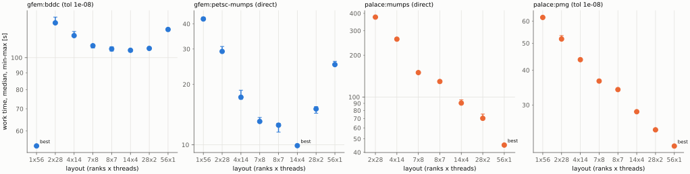

| solver | tol | layout | n | median work s | min-max |  |
|---|---|---|---|---|---|---|
| gfem:bddc | 1e-08 | 1x56 | 3 | 54 | 54-54.2 | best |
| gfem:bddc | 1e-08 | 2x28 | 3 | 127 | 127-133 |  |
| gfem:bddc | 1e-08 | 4x14 | 3 | 117 | 116-120 |  |
| gfem:bddc | 1e-08 | 7x8 | 3 | 109 | 107-109 |  |
| gfem:bddc | 1e-08 | 8x7 | 3 | 106 | 105-108 |  |
| gfem:bddc | 1e-08 | 14x4 | 3 | 105 | 104-106 |  |
| gfem:bddc | 1e-08 | 28x2 | 3 | 107 | 106-108 |  |
| gfem:bddc | 1e-08 | 56x1 | 3 | 122 | 120-123 |  |
| gfem:direct | — | 1x56 | 3 | 6.58 | 6.53-7.11 | best |
| gfem:petsc-mumps | — | 1x56 | 3 | 42.3 | 42.3-43.3 |  |
| gfem:petsc-mumps | — | 2x28 | 3 | 29.2 | 29.2-30.9 |  |
| gfem:petsc-mumps | — | 4x14 | 3 | 17.3 | 16.9-18.7 |  |
| gfem:petsc-mumps | — | 7x8 | 3 | 13.1 | 13-13.7 |  |
| gfem:petsc-mumps | — | 8x7 | 3 | 12.5 | 11.6-12.8 |  |
| gfem:petsc-mumps | — | 14x4 | 3 | 9.9 | 9.86-9.95 | best |
| gfem:petsc-mumps | — | 28x2 | 3 | 15.1 | 14.4-15.5 |  |
| gfem:petsc-mumps | — | 56x1 | 3 | 25.1 | 24.9-26 |  |
| palace:mumps | — | 2x28 | 3 | 376 | 375-376 |  |
| palace:mumps | — | 4x14 | 3 | 261 | 258-265 |  |
| palace:mumps | — | 7x8 | 3 | 150 | 150-150 |  |
| palace:mumps | — | 8x7 | 3 | 129 | 129-130 |  |
| palace:mumps | — | 14x4 | 3 | 90.5 | 89.7-95.4 |  |
| palace:mumps | — | 28x2 | 3 | 70.3 | 68.4-75.4 |  |
| palace:mumps | — | 56x1 | 3 | 45.1 | 44.4-46 | best |
| palace:pmg | 1e-08 | 1x56 | 3 | 61.9 | 61.8-62.1 |  |
| palace:pmg | 1e-08 | 2x28 | 3 | 51.8 | 51.8-53.3 |  |
| palace:pmg | 1e-08 | 4x14 | 3 | 43.6 | 43.6-43.7 |  |
| palace:pmg | 1e-08 | 7x8 | 3 | 36.6 | 36.5-36.6 |  |
| palace:pmg | 1e-08 | 8x7 | 3 | 34.1 | 34.1-34.1 |  |
| palace:pmg | 1e-08 | 14x4 | 3 | 28.4 | 28.1-28.4 |  |
| palace:pmg | 1e-08 | 28x2 | 3 | 24.4 | 24.3-24.5 |  |
| palace:pmg | 1e-08 | 56x1 | 3 | 21.4 | 21.3-21.4 | best |

| solver | default | best | ties | default / best |
|---|---|---|---|---|
| gfem:bddc | — | 1x56 | — | — |
| gfem:direct | — | 1x56 | — | — |
| gfem:petsc-mumps | — | 14x4 | — | — |
| palace:mumps | — | 56x1 | — | — |
| palace:pmg | — | 56x1 | — | — |

Not plotted (not passing):

- palace:mumps 1x56: not_started, timeout (wall cap 600 s; earlier_repeat_timeout)

#### Cross-solver snapshot (same-mesh comparison)

DOF: gfem [315870], palace [315870].

Direct kinds:

| solver | role | layout | n | work s | peak RSS sum GiB | error | jobs |
|---|---|---|---|---|---|---|---|
| gfem:direct | best | 1x56 | 3 | 6.58 | 5.34 | 2.90e-02 | 49256968 |
| gfem:petsc-mumps | best | 14x4 | 3 | 9.9 | 11.5 | 2.90e-02 | 49256968 |
| palace:mumps | best | 56x1 | 3 | 45.1 | 26.1 | 2.90e-02 | 49256968 |

| role | ratio | work | memory | pairing |
|---|---|---|---|---|
| best | palace:mumps / gfem:direct | 6.85 | 4.88 | same job |

Iterative kinds:

| solver | role | layout | n | work s | peak RSS sum GiB | error | jobs |
|---|---|---|---|---|---|---|---|
| gfem:bddc | best | 1x56 | 3 | 54 | 3.8 | 2.90e-02 | 49256968 |
| palace:pmg | best | 56x1 | 3 | 21.4 | 8.88 | 2.90e-02 | 49256968 |

Iterative kinds compare only at equal achieved error (table above).

### microstrip at c112 (standard, 1 node)

#### Error against cost

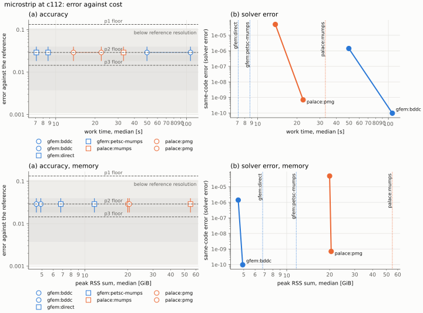

(a) Error against the converged reference, at each solver's best layout.

| solver | layout | tol | work s | peak RSS sum GiB | error |
|---|---|---|---|---|---|
| gfem:bddc | 1x112 | 1e-06 | 49.8 | 4.57 | 2.90e-02 ± 1.07e-02 (unresolved) |
| gfem:bddc | 1x112 | 1e-10 | 107 | 4.92 | 2.90e-02 ± 1.07e-02 (unresolved) |
| gfem:direct | 1x112 | — | 7.11 | 6.78 | 2.90e-02 ± 1.07e-02 (unresolved) |
| gfem:petsc-mumps | 14x8 | — | 8.75 | 11.7 | 2.90e-02 ± 1.07e-02 (unresolved) |
| palace:mumps | 112x1 | — | 33 | 55 | 2.90e-02 ± 1.07e-02 (unresolved) |
| palace:pmg | 112x1 | 1e-06 | 13.7 | 20 | 2.90e-02 ± 1.07e-02 (unresolved) |
| palace:pmg | 112x1 | 1e-10 | 22.3 | 20.5 | 2.90e-02 ± 1.07e-02 (unresolved) |

Discretization floor (same-mesh error): p1 1.33e-01, p2 2.90e-02 ± 1.07e-02 (unresolved), p3 1.44e-02 ± 1.07e-02 (unresolved).

All 7 runs of order 2 are at the p2 floor (largest deviation 0.038 %): accuracy differences between codes do not show at this order on this mesh; compare codes by same-code error along the tolerance ladder.

Below reference resolution: errors under 1.07e-01.

(b) Same-code error (solver error, not accuracy) along the tolerance ladder.

| solver | layout | tol | work s | peak RSS sum GiB | same-code error |
|---|---|---|---|---|---|
| gfem:bddc | 1x112 | 1e-06 | 49.8 | 4.57 | 1.41e-06 |
| gfem:bddc | 1x112 | 1e-10 | 107 | 4.92 | 9.68e-11 |
| palace:pmg | 112x1 | 1e-06 | 13.7 | 20 | 4.99e-05 |
| palace:pmg | 112x1 | 1e-10 | 22.3 | 20.5 | 7.00e-10 |

Direct runs (same-code error 0 by definition): gfem:direct 7.11 s (1x112), gfem:petsc-mumps 8.75 s (14x8), palace:mumps 33 s (112x1).

Cost at equal achieved same-code error (interpolated log-log between neighbouring rungs, never extrapolated):

| error | gfem:bddc work s | gfem:bddc GiB | palace:pmg work s | palace:pmg GiB | palace:pmg / gfem:bddc |
|---|---|---|---|---|---|
| 7.00e-10 | 91.5 | 4.84 | 22.3 | 20.5 | 0.244 |
| 1.00e-09 | 89 | 4.83 | 22 | 20.5 | 0.247 |
| 1.00e-08 | 74 | 4.75 | 19.8 | 20.4 | 0.268 |
| 3.14e-08 | 67.5 | 4.71 | 18.9 | 20.3 | 0.279 |
| 1.00e-07 | 61.6 | 4.67 | 17.9 | 20.3 | 0.291 |
| 1.00e-06 | 51.2 | 4.59 | 16.2 | 20.2 | 0.317 |
| 1.41e-06 | 49.8 | 4.57 | 16 | 20.2 | 0.321 |

#### Time

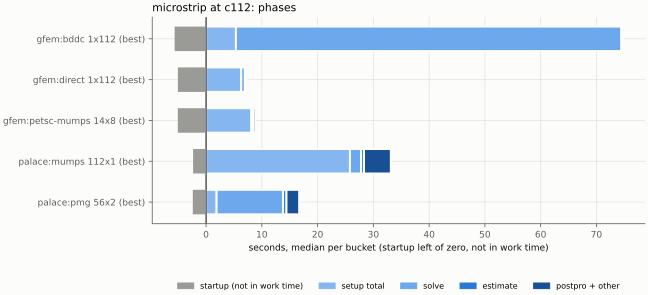

| solver | layout | role | tol | n | work s | spread | startup s | setup total s | solve total s | per sample s | mesh read s | discretize s | assemble s | setup s | solve s | estimate s | postpro s | rom s | other s | iterations | setups/solves | imbalance |
|---|---|---|---|---|---|---|---|---|---|---|---|---|---|---|---|---|---|---|---|---|---|---|
| gfem:bddc | 1x112 | best | 1e-08 | 3 | 74.7 | 1.1 % | 5.64 | 5.37 | 69.1 | 14.9 | 0.451 | 0.139 | 4.74 | 0.0178 | 69.1 | — | — | — | 0.218 | 897 | 6/5 | — |
| gfem:direct | 1x112 | best | — | 3 | 7.11 | 8.3 % | 5.06 | 6.25 | 0.652 | 1.42 | 0.51 | 0.138 | 1.05 | 4.62 | 0.652 | — | — | — | 0.247 | 0 | 5/5 | — |
| gfem:petsc-mumps | 14x8 | best | — | 3 | 8.75 | 96.2 % noisy | 5.07 | 8.13 | 0.322 | 1.75 | 0.509 | 0.38 | 0.0872 | 7.15 | 0.322 | — | — | — | 0.396 | 0 | 5/5 | 1.01 |
|  |  | rank 0 |  |  | — |  |  |  |  |  | 0.5 | 0.353 | 0.0534 | 7.15 | 0.319 | — | — | — | 0.396 |  |  |  |
| palace:mumps | 112x1 | best | — | 3 | 33 | 12.3 % noisy | 2.33 | 25.8 | 2.01 | 6.6 | 0.668 | — | 0.073 | 25.1 | 2.01 | 0.519 | 0.214 | 0 | 4.6 | 16 | 10/10 | 1 |
|  |  | rank 0 |  |  | — |  |  |  |  |  | 0.541 | — | 0.0697 | 25.1 | 2 | 0.501 | 0.21 | 0 | 4.62 |  |  |  |
| palace:pmg | 56x2 | best | 1e-08 | 3 | 16.7 | 0.8 % | 2.38 | 1.89 | 11.9 | 3.34 | 0.567 | — | 0.084 | 1.24 | 11.9 | 0.616 | 0.203 | 0 | 2.08 | 341 | 10/10 | 1 |
|  |  | rank 0 |  |  | — |  |  |  |  |  | 0.443 | — | 0.0772 | 1.24 | 11.6 | 0.599 | 0.201 | 0 | 2.49 |  |  |  |

Work time is wall minus startup; startup is not in work time. Rank reduction of the buckets: gfem:bddc: max; gfem:direct: max; gfem:petsc-mumps: max; palace:mumps: max-of-rows; palace:pmg: max-of-rows. Max-of-rows is an upper bound on the slowest rank (rows may peak on different ranks); imbalance = headline bucket sum / rank-0 sum.

gfem BDDC: the assemble bucket includes the preconditioner build (NGSolve builds BDDC while it assembles the first matrix of a setup).

#### Memory

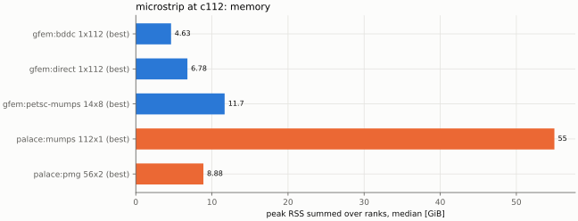

| solver | layout | role | peak RSS sum GiB | rank max GiB | largest node GiB | PSS sum GiB | sacct MaxRSS GiB | self-reports |
|---|---|---|---|---|---|---|---|---|
| gfem:bddc | 1x112 | best | 4.63 | 4.63 | 4.63 | 4.54 | 3.74 | solver_nbytes 2.66e+08 |
| gfem:direct | 1x112 | best | 6.78 | 6.78 | 6.78 | 6.57 | — | solver_nbytes 4.37e+09 |
| gfem:petsc-mumps | 14x8 | best | 11.7 | 0.902 | 11.7 | 9.56 | — | solver_nbytes 6.64e+09 |
| palace:mumps | 112x1 | best | 55 | 0.552 | 55 | 18.5 | — | — |
| palace:pmg | 56x2 | best | 8.88 | 0.165 | 8.88 | 5.05 | — | — |

The RSS sum counts shared pages once per rank in both codes alike; it is an upper bound on the simultaneous footprint, and PSS corrects it. sacct MaxRSS only for runs over 60 s.

#### Accuracy

| solver | order | layout | tol | metric | error | bound | resolved | ceiling | plausible | same-code error | δ |
|---|---|---|---|---|---|---|---|---|---|---|---|
| gfem:bddc | 2 | 1x112 (default) | 1e-06 | max_abs_dS | 2.90e-02 ± 1.07e-02 (unresolved) | 1.07e-02 | no | 2.90e-01 | pass | 1.41e-06 | — |
| gfem:bddc | 2 | 1x112 (default) | 1e-10 | max_abs_dS | 2.90e-02 ± 1.07e-02 (unresolved) | 1.07e-02 | no | 2.90e-01 | pass | 9.68e-11 | — |
| gfem:bddc | 2 | 1x112 | 1e-08 | max_abs_dS | 2.90e-02 ± 1.07e-02 (unresolved) | 1.07e-02 | no | 2.90e-01 | pass | 1.03e-08 | — |
| gfem:bddc | 2 | 2x56 | 1e-08 | max_abs_dS | 2.90e-02 ± 1.07e-02 (unresolved) | 1.07e-02 | no | 2.90e-01 | pass | 1.03e-08 | — |
| gfem:bddc | 2 | 4x28 | 1e-08 | max_abs_dS | 2.90e-02 ± 1.07e-02 (unresolved) | 1.07e-02 | no | 2.90e-01 | pass | 1.03e-08 | — |
| gfem:bddc | 2 | 8x14 | 1e-08 | max_abs_dS | 2.90e-02 ± 1.07e-02 (unresolved) | 1.07e-02 | no | 2.90e-01 | pass | 1.03e-08 | — |
| gfem:bddc | 2 | 14x8 | 1e-08 | max_abs_dS | 2.90e-02 ± 1.07e-02 (unresolved) | 1.07e-02 | no | 2.90e-01 | pass | 1.03e-08 | — |
| gfem:bddc | 2 | 16x7 | 1e-08 | max_abs_dS | 2.90e-02 ± 1.07e-02 (unresolved) | 1.07e-02 | no | 2.90e-01 | pass | 1.03e-08 | — |
| gfem:bddc | 2 | 28x4 | 1e-08 | max_abs_dS | 2.90e-02 ± 1.07e-02 (unresolved) | 1.07e-02 | no | 2.90e-01 | pass | 1.03e-08 | — |
| gfem:bddc | 2 | 56x2 | 1e-08 | max_abs_dS | 2.90e-02 ± 1.07e-02 (unresolved) | 1.07e-02 | no | 2.90e-01 | pass | 1.03e-08 | — |
| gfem:bddc | 2 | 112x1 | 1e-08 | max_abs_dS | 2.90e-02 ± 1.07e-02 (unresolved) | 1.07e-02 | no | 2.90e-01 | pass | 1.03e-08 | — |
| gfem:direct | 2 | 1x112 | — | max_abs_dS | 2.90e-02 ± 1.07e-02 (unresolved) | 1.07e-02 | no | 2.90e-01 | pass | 2.58e-12 | — |
| gfem:petsc-mumps | 2 | 1x112 | — | max_abs_dS | 2.90e-02 ± 1.07e-02 (unresolved) | 1.07e-02 | no | 2.90e-01 | pass | 3.95e-11 | — |
| gfem:petsc-mumps | 2 | 2x56 | — | max_abs_dS | 2.90e-02 ± 1.07e-02 (unresolved) | 1.07e-02 | no | 2.90e-01 | pass | 1.82e-11 | — |
| gfem:petsc-mumps | 2 | 4x28 | — | max_abs_dS | 2.90e-02 ± 1.07e-02 (unresolved) | 1.07e-02 | no | 2.90e-01 | pass | 2.89e-11 | — |
| gfem:petsc-mumps | 2 | 8x14 | — | max_abs_dS | 2.90e-02 ± 1.07e-02 (unresolved) | 1.07e-02 | no | 2.90e-01 | pass | 3.63e-11 | — |
| gfem:petsc-mumps | 2 | 14x8 | — | max_abs_dS | 2.90e-02 ± 1.07e-02 (unresolved) | 1.07e-02 | no | 2.90e-01 | pass | 3.88e-11 | — |
| gfem:petsc-mumps | 2 | 16x7 | — | max_abs_dS | 2.90e-02 ± 1.07e-02 (unresolved) | 1.07e-02 | no | 2.90e-01 | pass | 2.43e-12 | — |
| gfem:petsc-mumps | 2 | 28x4 | — | max_abs_dS | 2.90e-02 ± 1.07e-02 (unresolved) | 1.07e-02 | no | 2.90e-01 | pass | 4.27e-11 | — |
| gfem:petsc-mumps | 2 | 56x2 | — | max_abs_dS | 2.90e-02 ± 1.07e-02 (unresolved) | 1.07e-02 | no | 2.90e-01 | pass | 1.33e-11 | — |
| gfem:petsc-mumps | 2 | 112x1 | — | max_abs_dS | 2.90e-02 ± 1.07e-02 (unresolved) | 1.07e-02 | no | 2.90e-01 | pass | 3.27e-11 | — |
| palace:mumps | 2 | 2x56 | — | max_abs_dS | 2.90e-02 ± 1.07e-02 (unresolved) | 1.07e-02 | no | 2.90e-01 | pass | 5.37e-12 | 8.86e-11 |
| palace:mumps | 2 | 4x28 | — | max_abs_dS | 2.90e-02 ± 1.07e-02 (unresolved) | 1.07e-02 | no | 2.90e-01 | pass | 6.86e-12 | 8.86e-11 |
| palace:mumps | 2 | 8x14 | — | max_abs_dS | 2.90e-02 ± 1.07e-02 (unresolved) | 1.07e-02 | no | 2.90e-01 | pass | 9.03e-12 | 8.86e-11 |
| palace:mumps | 2 | 14x8 | — | max_abs_dS | 2.90e-02 ± 1.07e-02 (unresolved) | 1.07e-02 | no | 2.90e-01 | pass | 5.33e-12 | 8.86e-11 |
| palace:mumps | 2 | 16x7 | — | max_abs_dS | 2.90e-02 ± 1.07e-02 (unresolved) | 1.07e-02 | no | 2.90e-01 | pass | 7.63e-12 | 8.86e-11 |
| palace:mumps | 2 | 28x4 | — | max_abs_dS | 2.90e-02 ± 1.07e-02 (unresolved) | 1.07e-02 | no | 2.90e-01 | pass | 3.89e-12 | 8.86e-11 |
| palace:mumps | 2 | 56x2 | — | max_abs_dS | 2.90e-02 ± 1.07e-02 (unresolved) | 1.07e-02 | no | 2.90e-01 | pass | 6.50e-12 | 8.86e-11 |
| palace:mumps | 2 | 112x1 | — | max_abs_dS | 2.90e-02 ± 1.07e-02 (unresolved) | 1.07e-02 | no | 2.90e-01 | pass | 3.60e-12 | 8.86e-11 |
| palace:pmg | 2 | 112x1 (default) | 1e-06 | max_abs_dS | 2.90e-02 ± 1.07e-02 (unresolved) | 1.07e-02 | no | 2.90e-01 | pass | 4.99e-05 | 8.86e-11 |
| palace:pmg | 2 | 112x1 (default) | 1e-10 | max_abs_dS | 2.90e-02 ± 1.07e-02 (unresolved) | 1.07e-02 | no | 2.90e-01 | pass | 7.00e-10 | 8.86e-11 |
| palace:pmg | 2 | 1x112 | 1e-08 | max_abs_dS | 2.90e-02 ± 1.07e-02 (unresolved) | 1.07e-02 | no | 2.90e-01 | pass | 1.97e-07 | 8.86e-11 |
| palace:pmg | 2 | 2x56 | 1e-08 | max_abs_dS | 2.90e-02 ± 1.07e-02 (unresolved) | 1.07e-02 | no | 2.90e-01 | pass | 1.97e-07 | 8.86e-11 |
| palace:pmg | 2 | 4x28 | 1e-08 | max_abs_dS | 2.90e-02 ± 1.07e-02 (unresolved) | 1.07e-02 | no | 2.90e-01 | pass | 1.96e-07 | 8.86e-11 |
| palace:pmg | 2 | 8x14 | 1e-08 | max_abs_dS | 2.90e-02 ± 1.07e-02 (unresolved) | 1.07e-02 | no | 2.90e-01 | pass | 1.96e-07 | 8.86e-11 |
| palace:pmg | 2 | 14x8 | 1e-08 | max_abs_dS | 2.90e-02 ± 1.07e-02 (unresolved) | 1.07e-02 | no | 2.90e-01 | pass | 1.96e-07 | 8.86e-11 |
| palace:pmg | 2 | 16x7 | 1e-08 | max_abs_dS | 2.90e-02 ± 1.07e-02 (unresolved) | 1.07e-02 | no | 2.90e-01 | pass | 1.95e-07 | 8.86e-11 |
| palace:pmg | 2 | 28x4 | 1e-08 | max_abs_dS | 2.90e-02 ± 1.07e-02 (unresolved) | 1.07e-02 | no | 2.90e-01 | pass | 1.93e-07 | 8.86e-11 |
| palace:pmg | 2 | 56x2 | 1e-08 | max_abs_dS | 2.90e-02 ± 1.07e-02 (unresolved) | 1.07e-02 | no | 2.90e-01 | pass | 1.95e-07 | 8.86e-11 |
| palace:pmg | 2 | 112x1 | 1e-08 | max_abs_dS | 2.90e-02 ± 1.07e-02 (unresolved) | 1.07e-02 | no | 2.90e-01 | pass | 2.00e-07 | 8.86e-11 |

Discretization floor (same-mesh error): p1 1.33e-01, p2 2.90e-02 ± 1.07e-02 (unresolved), p3 1.44e-02 ± 1.07e-02 (unresolved).

All 40 runs of order 2 are at the p2 floor (largest deviation 0.038 %): accuracy differences between codes do not show at this order on this mesh; compare codes by same-code error along the tolerance ladder.

| frequency Hz | gfem:bddc (1x112) | gfem:direct (1x112) | gfem:petsc-mumps (14x8) | palace:mumps (112x1) | palace:pmg (56x2) | reference bound |
|---|---|---|---|---|---|---|
| 1e+09 | 9.33e-04 | 9.33e-04 | 9.33e-04 | 9.33e-04 | 9.33e-04 | 1.80e-04 |
| 2.5e+10 | 2.13e-02 | 2.13e-02 | 2.13e-02 | 2.13e-02 | 2.13e-02 | 3.52e-03 |
| 5e+10 | 2.25e-02 | 2.25e-02 | 2.25e-02 | 2.25e-02 | 2.25e-02 | 6.54e-03 |
| 7.5e+10 | 2.37e-02 | 2.37e-02 | 2.37e-02 | 2.37e-02 | 2.37e-02 | 8.74e-03 |
| 1e+11 | 2.90e-02 | 2.90e-02 | 2.90e-02 | 2.90e-02 | 2.90e-02 | 1.07e-02 |

#### Layouts

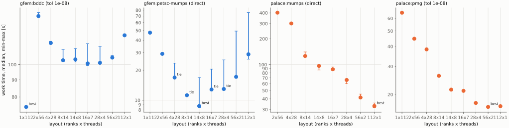

| solver | tol | layout | n | median work s | min-max |  |
|---|---|---|---|---|---|---|
| gfem:bddc | 1e-08 | 1x112 | 3 | 74.7 | 74.4-75.2 | best |
| gfem:bddc | 1e-08 | 2x56 | 3 | 140 | 139-143 |  |
| gfem:bddc | 1e-08 | 4x28 | 3 | 116 | 116-117 |  |
| gfem:bddc | 1e-08 | 8x14 | 3 | 103 | 103-111 |  |
| gfem:bddc | 1e-08 | 14x8 | 3 | 104 | 102-112 |  |
| gfem:bddc | 1e-08 | 16x7 | 3 | 101 | 99.3-115 |  |
| gfem:bddc | 1e-08 | 28x4 | 3 | 101 | 100-113 |  |
| gfem:bddc | 1e-08 | 56x2 | 3 | 105 | 105-106 |  |
| gfem:bddc | 1e-08 | 112x1 | 3 | 122 | 122-123 |  |
| gfem:direct | — | 1x112 | 3 | 7.11 | 6.94-7.53 | best |
| gfem:petsc-mumps | — | 1x112 | 3 | 47.6 | 47.5-48.8 |  |
| gfem:petsc-mumps | — | 2x56 | 3 | 29.2 | 28.9-29.5 |  |
| gfem:petsc-mumps | — | 4x28 | 3 | 16.9 | 16.5-23.6 | tie |
| gfem:petsc-mumps | — | 8x14 | 3 | 11.2 | 11-11.5 | tie |
| gfem:petsc-mumps | — | 14x8 | 3 | 8.75 | 8.46-16.9 | best |
| gfem:petsc-mumps | — | 16x7 | 3 | 12.8 | 12.5-20.5 | tie |
| gfem:petsc-mumps | — | 28x4 | 3 | 13 | 12.6-25.4 | tie |
| gfem:petsc-mumps | — | 56x2 | 3 | 17.2 | 17-49.4 |  |
| gfem:petsc-mumps | — | 112x1 | 3 | 28.9 | 25.8-75.7 |  |
| palace:mumps | — | 2x56 | 3 | 402 | 402-404 |  |
| palace:mumps | — | 4x28 | 3 | 301 | 300-303 |  |
| palace:mumps | — | 8x14 | 3 | 126 | 126-140 |  |
| palace:mumps | — | 14x8 | 3 | 96.5 | 86.6-101 |  |
| palace:mumps | — | 16x7 | 3 | 88.2 | 87.4-94 |  |
| palace:mumps | — | 28x4 | 3 | 66.3 | 59.9-67.3 |  |
| palace:mumps | — | 56x2 | 3 | 41.4 | 40.1-45.4 |  |
| palace:mumps | — | 112x1 | 3 | 33 | 31.7-35.8 | best |
| palace:pmg | 1e-08 | 1x112 | 3 | 65.1 | 64.8-65.2 |  |
| palace:pmg | 1e-08 | 2x56 | 3 | 44.7 | 44.6-44.8 |  |
| palace:pmg | 1e-08 | 4x28 | 3 | 38.3 | 38.3-38.5 |  |
| palace:pmg | 1e-08 | 8x14 | 3 | 26.2 | 26.1-26.2 |  |
| palace:pmg | 1e-08 | 14x8 | 3 | 21.4 | 21.4-21.5 |  |
| palace:pmg | 1e-08 | 16x7 | 3 | 21.1 | 21.1-21.1 |  |
| palace:pmg | 1e-08 | 28x4 | 3 | 17.7 | 17.7-17.7 |  |
| palace:pmg | 1e-08 | 56x2 | 3 | 16.7 | 16.6-16.7 | best |
| palace:pmg | 1e-08 | 112x1 | 3 | 16.9 | 16.8-16.9 |  |

| solver | default | best | ties | default / best |
|---|---|---|---|---|
| gfem:bddc | — | 1x112 | — | — |
| gfem:direct | — | 1x112 | — | — |
| gfem:petsc-mumps | — | 14x8 | 4x28, 8x14, 16x7, 28x4 | — |
| palace:mumps | — | 112x1 | — | — |
| palace:pmg | — | 56x2 | — | — |

Not plotted (not passing):

- palace:mumps 1x112: not_started, timeout (wall cap 600 s; earlier_repeat_timeout)

#### Cross-solver snapshot (same-mesh comparison)

DOF: gfem [315870], palace [315870].

Direct kinds:

| solver | role | layout | n | work s | peak RSS sum GiB | error | jobs |
|---|---|---|---|---|---|---|---|
| gfem:direct | best | 1x112 | 3 | 7.11 | 6.78 | 2.90e-02 | 49256965 |
| gfem:petsc-mumps | best | 14x8 | 3 | 8.75 | 11.7 | 2.90e-02 | 49256965 |
| palace:mumps | best | 112x1 | 3 | 33 | 55 | 2.90e-02 | 49256965 |

| role | ratio | work | memory | pairing |
|---|---|---|---|---|
| best | palace:mumps / gfem:direct | 4.64 | 8.11 | same job |

Iterative kinds:

| solver | role | layout | n | work s | peak RSS sum GiB | error | jobs |
|---|---|---|---|---|---|---|---|
| gfem:bddc | best | 1x112 | 3 | 74.7 | 4.63 | 2.90e-02 | 49256965 |
| palace:pmg | best | 56x2 | 3 | 16.7 | 8.88 | 2.90e-02 | 49256965 |

Iterative kinds compare only at equal achieved error (table above).

### microstrip scaling across core budgets

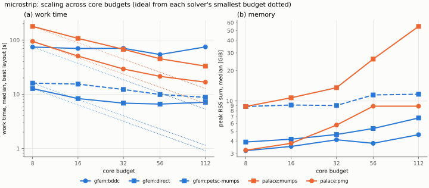

Per solver at its best layout of each budget (anchor tolerance), the default layout beside. Speedup $S(c) = T(c_0)/T(c)$ and parallel efficiency $E(c) = c_0\,T(c_0)/(c\,T(c))$ on median work time $T$, against the solver's smallest budget $c_0$ on the same node class; a node class change restarts the line. Never extrapolated.

| solver | cores | class | nodes | best layout | n | work s | min-max | default work s | $c_0$ | $S$ | $E$ | peak RSS sum GiB | largest node GiB | error | jobs |  |
|---|---|---|---|---|---|---|---|---|---|---|---|---|---|---|---|---|
| gfem:bddc | 8 | standard | 1 | 1x8 | 3 | 74.2 | 74.1-74.4 | — | c8 | 1 | 1 | 3.21 | — | 2.90e-02 ± 1.07e-02 (unresolved) | 49256974 |  |
| gfem:bddc | 16 | standard | 1 | 1x16 | 3 | 69.8 | 69.5-70.2 | — | c8 | 1.06 | 0.531 | 3.54 | — | 2.90e-02 ± 1.07e-02 (unresolved) | 49256955 |  |
| gfem:bddc | 32 | standard | 1 | 1x32 | 3 | 70.3 | 70.2-70.4 | — | c8 | 1.05 | 0.264 | 4.12 | — | 2.90e-02 ± 1.07e-02 (unresolved) | 49256970 |  |
| gfem:bddc | 56 | standard | 1 | 1x56 | 3 | 54 | 54-54.2 | — | c8 | 1.37 | 0.196 | 3.8 | — | 2.90e-02 ± 1.07e-02 (unresolved) | 49256968 |  |
| gfem:bddc | 112 | standard | 1 | 1x112 | 3 | 74.7 | 74.4-75.2 | — | c8 | 0.993 | 0.071 | 4.63 | — | 2.90e-02 ± 1.07e-02 (unresolved) | 49256965 |  |
| gfem:direct | 8 | standard | 1 | 1x8 | 3 | 12.7 | 11.9-12.9 | — | c8 | 1 | 1 | 3.92 | — | 2.90e-02 ± 1.07e-02 (unresolved) | 49256974 |  |
| gfem:direct | 16 | standard | 1 | 1x16 | 3 | 8.32 | 8.29-8.59 | — | c8 | 1.53 | 0.765 | 4.18 | — | 2.90e-02 ± 1.07e-02 (unresolved) | 49256955 |  |
| gfem:direct | 32 | standard | 1 | 1x32 | 3 | 6.86 | 6.81-7.46 | — | c8 | 1.86 | 0.464 | 4.65 | — | 2.90e-02 ± 1.07e-02 (unresolved) | 49256970 |  |
| gfem:direct | 56 | standard | 1 | 1x56 | 3 | 6.58 | 6.53-7.11 | — | c8 | 1.93 | 0.276 | 5.34 | — | 2.90e-02 ± 1.07e-02 (unresolved) | 49256968 |  |
| gfem:direct | 112 | standard | 1 | 1x112 | 3 | 7.11 | 6.94-7.53 | — | c8 | 1.79 | 0.128 | 6.78 | — | 2.90e-02 ± 1.07e-02 (unresolved) | 49256965 |  |
| gfem:petsc-mumps | 8 | standard | 1 | 8x1 | 3 | 16 | 15.5-16.4 | — | c8 | 1 | 1 | 8.82 | — | 2.90e-02 ± 1.07e-02 (unresolved) | 49256974 |  |
| gfem:petsc-mumps | 16 | standard | 1 | 8x2 | 3 | 15.4 | 13.8-19.7 | — | c8 | 1.04 | 0.521 | 9.12 | — | 2.90e-02 ± 1.07e-02 (unresolved) | 49256955 |  |
| gfem:petsc-mumps | 32 | standard | 1 | 8x4 | 3 | 12.2 | 11.2-17 | — | c8 | 1.31 | 0.327 | 9.02 | — | 2.90e-02 ± 1.07e-02 (unresolved) | 49256970 |  |
| gfem:petsc-mumps | 56 | standard | 1 | 14x4 | 3 | 9.9 | 9.86-9.95 | — | c8 | 1.62 | 0.231 | 11.5 | — | 2.90e-02 ± 1.07e-02 (unresolved) | 49256968 |  |
| gfem:petsc-mumps | 112 | standard | 1 | 14x8 | 3 | 8.75 | 8.46-16.9 | — | c8 | 1.83 | 0.131 | 11.7 | — | 2.90e-02 ± 1.07e-02 (unresolved) | 49256965 |  |
| palace:mumps | 8 | standard | 1 | 8x1 | 3 | 178 | 157-180 | — | c8 | 1 | 1 | 8.83 | — | 2.90e-02 ± 1.07e-02 (unresolved) | 49256974 |  |
| palace:mumps | 16 | standard | 1 | 16x1 | 3 | 107 | 98.3-107 | — | c8 | 1.67 | 0.833 | 10.8 | — | 2.90e-02 ± 1.07e-02 (unresolved) | 49256955 |  |
| palace:mumps | 32 | standard | 1 | 32x1 | 3 | 67.5 | 63.3-71.3 | — | c8 | 2.64 | 0.661 | 13.6 | — | 2.90e-02 ± 1.07e-02 (unresolved) | 49256970 |  |
| palace:mumps | 56 | standard | 1 | 56x1 | 3 | 45.1 | 44.4-46 | — | c8 | 3.95 | 0.565 | 26.1 | — | 2.90e-02 ± 1.07e-02 (unresolved) | 49256968 |  |
| palace:mumps | 112 | standard | 1 | 112x1 | 3 | 33 | 31.7-35.8 | — | c8 | 5.41 | 0.386 | 55 | — | 2.90e-02 ± 1.07e-02 (unresolved) | 49256965 |  |
| palace:pmg | 8 | standard | 1 | 8x1 | 3 | 94.4 | 93.7-94.5 | — | c8 | 1 | 1 | 3.25 | — | 2.90e-02 ± 1.07e-02 (unresolved) | 49256974 |  |
| palace:pmg | 16 | standard | 1 | 16x1 | 3 | 50.6 | 50.4-50.7 | — | c8 | 1.87 | 0.933 | 3.8 | — | 2.90e-02 ± 1.07e-02 (unresolved) | 49256955 |  |
| palace:pmg | 32 | standard | 1 | 32x1 | 3 | 29.2 | 29.1-29.3 | — | c8 | 3.23 | 0.808 | 5.77 | — | 2.90e-02 ± 1.07e-02 (unresolved) | 49256970 |  |
| palace:pmg | 56 | standard | 1 | 56x1 | 3 | 21.4 | 21.3-21.4 | — | c8 | 4.42 | 0.632 | 8.88 | — | 2.90e-02 ± 1.07e-02 (unresolved) | 49256968 |  |
| palace:pmg | 112 | standard | 1 | 56x2 | 3 | 16.7 | 16.6-16.7 | — | c8 | 5.65 | 0.404 | 8.88 | — | 2.90e-02 ± 1.07e-02 (unresolved) | 49256965 |  |

Cross-code ratios per budget, at best layout:

| cores | class | ratio | work | memory | pairing |  |
|---|---|---|---|---|---|---|
| 8 | standard | palace:mumps / gfem:direct | 14 | 2.25 | same job |  |
| 8 | standard | palace:mumps / gfem:petsc-mumps | 11.1 | 1 | same job |  |
| 8 | standard | palace:pmg / gfem:bddc | 1.27 | 1.01 | same job | nominal tolerances differ; iterative kinds compare at equal achieved error (the equal-error table of each budget) |
| 16 | standard | palace:mumps / gfem:direct | 12.9 | 2.58 | same job |  |
| 16 | standard | palace:mumps / gfem:petsc-mumps | 6.96 | 1.18 | same job |  |
| 16 | standard | palace:pmg / gfem:bddc | 0.725 | 1.07 | same job | nominal tolerances differ; iterative kinds compare at equal achieved error (the equal-error table of each budget) |
| 32 | standard | palace:mumps / gfem:direct | 9.84 | 2.91 | same job |  |
| 32 | standard | palace:mumps / gfem:petsc-mumps | 5.51 | 1.5 | same job |  |
| 32 | standard | palace:pmg / gfem:bddc | 0.415 | 1.4 | same job | nominal tolerances differ; iterative kinds compare at equal achieved error (the equal-error table of each budget) |
| 56 | standard | palace:mumps / gfem:direct | 6.85 | 4.88 | same job |  |
| 56 | standard | palace:mumps / gfem:petsc-mumps | 4.56 | 2.27 | same job |  |
| 56 | standard | palace:pmg / gfem:bddc | 0.395 | 2.33 | same job | nominal tolerances differ; iterative kinds compare at equal achieved error (the equal-error table of each budget) |
| 112 | standard | palace:mumps / gfem:direct | 4.64 | 8.11 | same job |  |
| 112 | standard | palace:mumps / gfem:petsc-mumps | 3.77 | 4.71 | same job |  |
| 112 | standard | palace:pmg / gfem:bddc | 0.224 | 1.92 | same job | nominal tolerances differ; iterative kinds compare at equal achieved error (the equal-error table of each budget) |

## bragg

Campaigns: `20261120-e7d58a9-full-bragg-c8`, `20261120-e7d58a9-full-bragg-c16`, `20261120-e7d58a9-full-bragg-c32`, `20261120-e7d58a9-full-bragg-c56`, `20261120-e7d58a9-full-bragg-c112`, `20261120-e7d58a9-full-bragg-pmg-c16`

Reference `bragg-20261118-a0ff134` (2026-11-18T11:01:45Z, closed_form, bound f_hz 1.00e-12, sha256 `d08ce2ae8b7e`).

Structural differences (reported, never removed):

- gfem:direct: direct_arm: PARDISO (MKL), one process
- palace:mumps: direct_arm: GMRES around complex MUMPS (MGMaxLevels 1)
- palace:mumps: estimator: always on, lightened (EstimatorTol 1e-2, EstimatorMG)
- palace:pmg: estimator: always on, lightened (EstimatorTol 1e-2, EstimatorMG)
- palace:pmg: fine_level: matrix-free (partial assembly)
- palace:pmg: pmg_coarse: SuperLU on the real-valued coarse matrix
- pinned for gfem: linear_solver per kind; the run tolerance; eigen_tolerance 1e-10; no field output
- pinned for palace: Refinement 0; Absorbing.Order 1; Linear.Type pinned per kind; MUMPS kind: MGMaxLevels 1, ComplexCoarseSolve, Tol 1e-10; iterative Tol = the run tolerance, MaxIts 2000; EstimatorTol 1e-2, EstimatorMG; eigen Tol 1e-10, inner Linear.Tol 1e-12; no field output

### bragg at c8 (standard, 1 node)

#### Error against cost

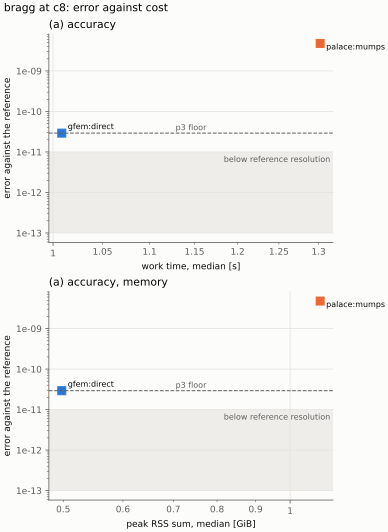

(a) Error against the converged reference, at each solver's best layout.

| solver | layout | tol | work s | peak RSS sum GiB | error |
|---|---|---|---|---|---|
| gfem:direct | 1x8 | — | 1.01 | 0.498 | 2.92e-11 |
| palace:mumps | 8x1 | — | 1.3 | 1.1 | 4.78e-09 |

Discretization floor (same-mesh error): p3 2.92e-11.

1 of 2 runs of order 3 are at the p3 floor (within 1 %); off the floor: palace:mumps 8x1 (1.6e+04 % off).

Below reference resolution: errors under 1.00e-11.

(b) Same-code error (solver error, not accuracy) along the tolerance ladder.

No tolerance ladder in this case.

Direct runs (same-code error 0 by definition): gfem:direct 1.01 s (1x8), palace:mumps 1.3 s (8x1).

#### Time

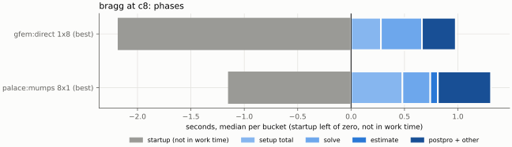

| solver | layout | role | tol | n | work s | spread | startup s | setup total s | solve total s | per sample s | mesh read s | discretize s | assemble s | setup s | solve s | estimate s | postpro s | rom s | other s | iterations | setups/solves | imbalance |
|---|---|---|---|---|---|---|---|---|---|---|---|---|---|---|---|---|---|---|---|---|---|---|
| gfem:direct | 1x8 | best | — | 3 | 1.01 | 14.5 % noisy | 2.18 | 0.3 | 0.384 | — | 0.0599 | 0.0533 | 0.0187 | 0.148 | 0.384 | — | — | — | 0.316 | 0 | 2/1 | — |
| palace:mumps | 8x1 | best | — | 3 | 1.3 | 0.9 % | 1.15 | 0.48 | 0.261 | — | 0.015 | — | 0.233 | 0.233 | 0.261 | 0.071 | 0.069 | 0 | 0.428 | 52 | 1/26 | 1 |
|  |  | rank 0 |  |  | — |  |  |  |  |  | 0.0132 | — | 0.233 | 0.233 | 0.259 | 0.07 | 0.0692 | 0 | 0.432 |  |  |  |

Work time is wall minus startup; startup is not in work time. Rank reduction of the buckets: gfem:direct: max; palace:mumps: max-of-rows. Max-of-rows is an upper bound on the slowest rank (rows may peak on different ranks); imbalance = headline bucket sum / rank-0 sum.

#### Memory

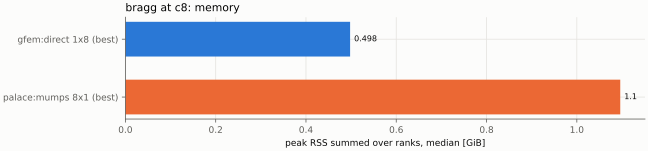

| solver | layout | role | peak RSS sum GiB | rank max GiB | largest node GiB | PSS sum GiB | sacct MaxRSS GiB | self-reports |
|---|---|---|---|---|---|---|---|---|
| gfem:direct | 1x8 | best | 0.498 | 0.498 | 0.498 | 0.493 | — | solver_nbytes 8.25e+07 |
| palace:mumps | 8x1 | best | 1.1 | 0.142 | 1.1 | 0.518 | — | — |

The RSS sum counts shared pages once per rank in both codes alike; it is an upper bound on the simultaneous footprint, and PSS corrects it. sacct MaxRSS only for runs over 60 s.

#### Accuracy

| solver | order | layout | tol | metric | error | bound | resolved | ceiling | plausible | same-code error | δ |
|---|---|---|---|---|---|---|---|---|---|---|---|
| gfem:direct | 3 | 1x8 | — | max_rel_dRe_f | 2.92e-11 | 1.00e-12 | yes | 1.00e-05 | pass | 5.29e-16 | — |
| palace:mumps | 3 | 1x8 | — | max_rel_dRe_f | 4.78e-09 | 1.00e-12 | yes | 1.00e-05 | pass | 0.00e+00 | — |
| palace:mumps | 3 | 2x4 | — | max_rel_dRe_f | 4.78e-09 | 1.00e-12 | yes | 1.00e-05 | pass | 0.00e+00 | — |
| palace:mumps | 3 | 4x2 | — | max_rel_dRe_f | 4.78e-09 | 1.00e-12 | yes | 1.00e-05 | pass | 0.00e+00 | — |
| palace:mumps | 3 | 8x1 | — | max_rel_dRe_f | 4.78e-09 | 1.00e-12 | yes | 1.00e-05 | pass | 0.00e+00 | — |

Discretization floor (same-mesh error): p3 2.92e-11.

1 of 5 runs of order 3 are at the p3 floor (within 1 %); off the floor: palace:mumps 1x8 (1.6e+04 % off), palace:mumps 2x4 (1.6e+04 % off), palace:mumps 4x2 (1.6e+04 % off), palace:mumps 8x1 (1.6e+04 % off).

| mode | gfem:direct (1x8) | palace:mumps (8x1) |
|---|---|---|
| 1 | 2.92e-11 | 2.06e-09 |
| 2 | 1.05e-11 | 4.78e-09 |

#### Layouts

| solver | tol | layout | n | median work s | min-max |  |
|---|---|---|---|---|---|---|
| gfem:direct | — | 1x8 | 3 | 1.01 | 0.934-1.08 | best |
| palace:mumps | — | 1x8 | 3 | 1.39 | 1.38-3.29 |  |
| palace:mumps | — | 2x4 | 3 | 1.44 | 1.43-1.44 |  |
| palace:mumps | — | 4x2 | 3 | 1.33 | 1.32-1.33 |  |
| palace:mumps | — | 8x1 | 3 | 1.3 | 1.3-1.31 | best |

| solver | default | best | ties | default / best |
|---|---|---|---|---|
| gfem:direct | — | 1x8 | — | — |
| palace:mumps | — | 8x1 | — | — |

#### Cross-solver snapshot (same-mesh comparison)

DOF: gfem [10620], palace [10620].

Direct kinds:

| solver | role | layout | n | work s | peak RSS sum GiB | error | jobs |
|---|---|---|---|---|---|---|---|
| gfem:direct | best | 1x8 | 3 | 1.01 | 0.498 | 2.92e-11 | 49256956 (slow node) |
| palace:mumps | best | 8x1 | 3 | 1.3 | 1.1 | 4.78e-09 | 49256956 (slow node) |

| role | ratio | work | memory | pairing |
|---|---|---|---|---|
| best | palace:mumps / gfem:direct | 1.29 | 2.2 | same job |

### bragg at c16 (standard, 1 node)

#### Error against cost

(a) Error against the converged reference, at each solver's best layout.

| solver | layout | tol | work s | peak RSS sum GiB | error |
|---|---|---|---|---|---|
| gfem:direct | 1x16 | — | 1.21 | 0.568 | 2.92e-11 |
| palace:mumps | 4x4 | — | 1.1 | 0.665 | 4.78e-09 |
| palace:pmg | 16x1 | 1e-08 | 323 | 1.85 | 4.78e-09 |

Discretization floor (same-mesh error): p3 2.92e-11.

1 of 3 runs of order 3 are at the p3 floor (within 1 %); off the floor: palace:mumps 4x4 (1.6e+04 % off), palace:pmg 16x1 tol 1e-08 (1.6e+04 % off).

Below reference resolution: errors under 1.00e-11.

(b) Same-code error (solver error, not accuracy) along the tolerance ladder.

| solver | layout | tol | work s | peak RSS sum GiB | same-code error |
|---|---|---|---|---|---|
| palace:pmg | 16x1 | 1e-08 | 323 | 1.85 | 5.13e-12 |

Direct runs (same-code error 0 by definition): gfem:direct 1.21 s (1x16), palace:mumps 1.1 s (4x4).

#### Time

| solver | layout | role | tol | n | work s | spread | startup s | setup total s | solve total s | per sample s | mesh read s | discretize s | assemble s | setup s | solve s | estimate s | postpro s | rom s | other s | iterations | setups/solves | imbalance |
|---|---|---|---|---|---|---|---|---|---|---|---|---|---|---|---|---|---|---|---|---|---|---|
| gfem:direct | 1x16 | best | — | 3 | 1.21 | 44.7 % noisy | 2.74 | 0.299 | 0.373 | — | 0.0634 | 0.0453 | 0.0143 | 0.175 | 0.373 | — | — | — | 0.308 | 0 | 2/1 | — |
| palace:mumps | 16x1 | default | — | 1 | 1.39 | 0.0 % | 1.25 | 0.354 | 0.226 | — | 0.018 | — | 0.14 | 0.196 | 0.226 | 0.049 | 0.044 | 0 | 0.719 | 52 | 1/26 | 1 |
|  |  | rank 0 |  |  | — |  |  |  |  |  | 0.0165 | — | 0.14 | 0.196 | 0.223 | 0.0476 | 0.0436 | 0 | 0.726 |  |  |  |
| palace:mumps | 4x4 | best | — | 3 | 1.1 | 2.0 % | 1.05 | 0.443 | 0.228 | — | 0.013 | — | 0.171 | 0.259 | 0.228 | 0.097 | 0.061 | 0 | 0.273 | 52 | 1/26 | 1 |
|  |  | rank 0 |  |  | — |  |  |  |  |  | 0.0116 | — | 0.171 | 0.259 | 0.227 | 0.0961 | 0.0601 | 0 | 0.277 |  |  |  |
| palace:pmg | 16x1 | default, best | 1e-08 | 3 | 323 | 0.2 % | 0.977 | 0.271 | 323 | — | 0.018 | — | 0.145 | 0.105 | 323 | 0.081 | 0.044 | 0 | 0 | 2.85e+04 | 1/26 | 1 |
|  |  | rank 0 |  |  | — |  |  |  |  |  | 0.0162 | — | 0.145 | 0.105 | 322 | 0.0796 | 0.0429 | 0 | 0.719 |  |  |  |

Work time is wall minus startup; startup is not in work time. Rank reduction of the buckets: gfem:direct: max; palace:mumps: max-of-rows; palace:pmg: max-of-rows. Max-of-rows is an upper bound on the slowest rank (rows may peak on different ranks); imbalance = headline bucket sum / rank-0 sum.

#### Memory

| solver | layout | role | peak RSS sum GiB | rank max GiB | largest node GiB | PSS sum GiB | sacct MaxRSS GiB | self-reports |
|---|---|---|---|---|---|---|---|---|
| gfem:direct | 1x16 | best | 0.568 | 0.568 | 0.568 | 0.563 | — | solver_nbytes 8.25e+07 |
| palace:mumps | 16x1 | default | 2.76 | 0.184 | 2.76 | 0.96 | — | — |
| palace:mumps | 4x4 | best | 0.665 | 0.173 | 0.665 | 0.572 | — | — |
| palace:pmg | 16x1 | default, best | 1.85 | 0.119 | 1.85 | 1.25 | 0.0819 | — |

The RSS sum counts shared pages once per rank in both codes alike; it is an upper bound on the simultaneous footprint, and PSS corrects it. sacct MaxRSS only for runs over 60 s.

#### Accuracy

| solver | order | layout | tol | metric | error | bound | resolved | ceiling | plausible | same-code error | δ |
|---|---|---|---|---|---|---|---|---|---|---|---|
| gfem:direct | 3 | 1x16 | — | max_rel_dRe_f | 2.92e-11 | 1.00e-12 | yes | 1.00e-05 | pass | 5.29e-16 | — |
| palace:mumps | 3 | 16x1 (default) | — | max_rel_dRe_f | 4.78e-09 | 1.00e-12 | yes | 1.00e-05 | pass | 0.00e+00 | — |
| palace:mumps | 3 | 1x16 | — | max_rel_dRe_f | 4.78e-09 | 1.00e-12 | yes | 1.00e-05 | pass | 0.00e+00 | — |
| palace:mumps | 3 | 2x8 | — | max_rel_dRe_f | 4.78e-09 | 1.00e-12 | yes | 1.00e-05 | pass | 0.00e+00 | — |
| palace:mumps | 3 | 4x4 | — | max_rel_dRe_f | 4.78e-09 | 1.00e-12 | yes | 1.00e-05 | pass | 0.00e+00 | — |
| palace:mumps | 3 | 8x2 | — | max_rel_dRe_f | 4.78e-09 | 1.00e-12 | yes | 1.00e-05 | pass | 0.00e+00 | — |
| palace:mumps | 3 | 16x1 | — | max_rel_dRe_f | 4.78e-09 | 1.00e-12 | yes | 1.00e-05 | pass | 0.00e+00 | — |
| palace:pmg | 3 | 16x1 (default) | 1e-08 | max_rel_dRe_f | 4.78e-09 | 1.00e-12 | yes | 1.00e-05 | pass | 5.13e-12 | — |

Discretization floor (same-mesh error): p3 2.92e-11.

1 of 8 runs of order 3 are at the p3 floor (within 1 %); off the floor: palace:mumps 16x1 (1.6e+04 % off), palace:mumps 1x16 (1.6e+04 % off), palace:mumps 2x8 (1.6e+04 % off), palace:mumps 4x4 (1.6e+04 % off), palace:mumps 8x2 (1.6e+04 % off), palace:mumps 16x1 (1.6e+04 % off), palace:pmg 16x1 tol 1e-08 (1.6e+04 % off).

| mode | gfem:direct (1x16) | palace:mumps (4x4) | palace:pmg (16x1) |
|---|---|---|---|
| 1 | 2.92e-11 | 2.06e-09 | 2.07e-09 |
| 2 | 1.05e-11 | 4.78e-09 | 4.78e-09 |

#### Layouts

| solver | tol | layout | n | median work s | min-max |  |
|---|---|---|---|---|---|---|
| gfem:direct | — | 1x16 | 3 | 1.21 | 0.864-1.41 | best |
| palace:mumps | — | 16x1 | 1 | 1.39 | 1.39-1.39 | default, n = 1 |
| palace:mumps | — | 1x16 | 3 | 1.2 | 1.2-1.25 |  |
| palace:mumps | — | 2x8 | 3 | 1.27 | 1.27-1.27 |  |
| palace:mumps | — | 4x4 | 3 | 1.1 | 1.09-1.11 | best |
| palace:mumps | — | 8x2 | 3 | 1.16 | 1.15-1.16 |  |
| palace:mumps | — | 16x1 | 3 | 1.41 | 1.4-1.42 |  |
| palace:pmg | 1e-08 | 16x1 | 3 | 323 | 323-323 | default, best |

| solver | default | best | ties | default / best |
|---|---|---|---|---|
| gfem:direct | — | 1x16 | — | — |
| palace:mumps | 16x1 | 4x4 | — | 1.26 |
| palace:pmg | 16x1 | 16x1 (best of listed) | — | 1 |

#### Cross-solver snapshot (same-mesh comparison)

DOF: gfem [10620], palace [10620].

Direct kinds:

| solver | role | layout | n | work s | peak RSS sum GiB | error | jobs |
|---|---|---|---|---|---|---|---|
| gfem:direct | best | 1x16 | 3 | 1.21 | 0.568 | 2.92e-11 | 49256509 (slow node) |
| palace:mumps | default | 16x1 | 1 | 1.39 | 2.76 | 4.78e-09 | 49256962 (slow node) |
| palace:mumps | best | 4x4 | 3 | 1.1 | 0.665 | 4.78e-09 | 49256509 (slow node) |

| role | ratio | work | memory | pairing |
|---|---|---|---|---|
| best | palace:mumps / gfem:direct | 0.91 | 1.17 | same job |

Iterative kinds:

| solver | role | layout | n | work s | peak RSS sum GiB | error | jobs |
|---|---|---|---|---|---|---|---|
| palace:pmg | default | 16x1 | 3 | 323 | 1.85 | 4.78e-09 | 49256962 (slow node) |
| palace:pmg | best | 16x1 | 3 | 323 | 1.85 | 4.78e-09 | 49256962 (slow node) |

Iterative kinds compare only at equal achieved error (table above).

### bragg at c32 (standard, 1 node)

#### Error against cost

(a) Error against the converged reference, at each solver's best layout.

| solver | layout | tol | work s | peak RSS sum GiB | error |
|---|---|---|---|---|---|
| gfem:direct | 1x32 | — | 1.13 | 0.711 | 2.92e-11 |
| palace:mumps | 4x8 | — | 1.02 | 0.69 | 4.78e-09 |

Discretization floor (same-mesh error): p3 2.92e-11.

1 of 2 runs of order 3 are at the p3 floor (within 1 %); off the floor: palace:mumps 4x8 (1.6e+04 % off).

Below reference resolution: errors under 1.00e-11.

(b) Same-code error (solver error, not accuracy) along the tolerance ladder.

No tolerance ladder in this case.

Direct runs (same-code error 0 by definition): gfem:direct 1.13 s (1x32), palace:mumps 1.02 s (4x8).

#### Time

| solver | layout | role | tol | n | work s | spread | startup s | setup total s | solve total s | per sample s | mesh read s | discretize s | assemble s | setup s | solve s | estimate s | postpro s | rom s | other s | iterations | setups/solves | imbalance |
|---|---|---|---|---|---|---|---|---|---|---|---|---|---|---|---|---|---|---|---|---|---|---|
| gfem:direct | 1x32 | best | — | 3 | 1.13 | 61.9 % noisy | 1.36 | 0.29 | 0.355 | — | 0.0874 | 0.0425 | 0.0132 | 0.146 | 0.355 | — | — | — | 0.306 | 0 | 2/1 | — |
| palace:mumps | 4x8 | best | — | 3 | 1.02 | 0.5 % | 1.01 | 0.41 | 0.216 | — | 0.013 | — | 0.144 | 0.252 | 0.216 | 0.075 | 0.052 | 0 | 0.271 | 52 | 1/26 | 1 |
|  |  | rank 0 |  |  | — |  |  |  |  |  | 0.012 | — | 0.143 | 0.252 | 0.216 | 0.0736 | 0.0521 | 0 | 0.274 |  |  |  |

Work time is wall minus startup; startup is not in work time. Rank reduction of the buckets: gfem:direct: max; palace:mumps: max-of-rows. Max-of-rows is an upper bound on the slowest rank (rows may peak on different ranks); imbalance = headline bucket sum / rank-0 sum.

#### Memory

| solver | layout | role | peak RSS sum GiB | rank max GiB | largest node GiB | PSS sum GiB | sacct MaxRSS GiB | self-reports |
|---|---|---|---|---|---|---|---|---|
| gfem:direct | 1x32 | best | 0.711 | 0.711 | 0.711 | 0.706 | — | solver_nbytes 8.25e+07 |
| palace:mumps | 4x8 | best | 0.69 | 0.185 | 0.69 | 0.617 | — | — |

The RSS sum counts shared pages once per rank in both codes alike; it is an upper bound on the simultaneous footprint, and PSS corrects it. sacct MaxRSS only for runs over 60 s.

#### Accuracy

| solver | order | layout | tol | metric | error | bound | resolved | ceiling | plausible | same-code error | δ |
|---|---|---|---|---|---|---|---|---|---|---|---|
| gfem:direct | 3 | 1x32 | — | max_rel_dRe_f | 2.92e-11 | 1.00e-12 | yes | 1.00e-05 | pass | 2.65e-15 | — |
| palace:mumps | 3 | 1x32 | — | max_rel_dRe_f | 4.78e-09 | 1.00e-12 | yes | 1.00e-05 | pass | 0.00e+00 | — |
| palace:mumps | 3 | 2x16 | — | max_rel_dRe_f | 4.78e-09 | 1.00e-12 | yes | 1.00e-05 | pass | 0.00e+00 | — |
| palace:mumps | 3 | 4x8 | — | max_rel_dRe_f | 4.78e-09 | 1.00e-12 | yes | 1.00e-05 | pass | 0.00e+00 | — |
| palace:mumps | 3 | 8x4 | — | max_rel_dRe_f | 4.78e-09 | 1.00e-12 | yes | 1.00e-05 | pass | 0.00e+00 | — |
| palace:mumps | 3 | 16x2 | — | max_rel_dRe_f | 4.78e-09 | 1.00e-12 | yes | 1.00e-05 | pass | 0.00e+00 | — |
| palace:mumps | 3 | 32x1 | — | max_rel_dRe_f | 4.78e-09 | 1.00e-12 | yes | 1.00e-05 | pass | 0.00e+00 | — |

Discretization floor (same-mesh error): p3 2.92e-11.

1 of 7 runs of order 3 are at the p3 floor (within 1 %); off the floor: palace:mumps 1x32 (1.6e+04 % off), palace:mumps 2x16 (1.6e+04 % off), palace:mumps 4x8 (1.6e+04 % off), palace:mumps 8x4 (1.6e+04 % off), palace:mumps 16x2 (1.6e+04 % off), palace:mumps 32x1 (1.6e+04 % off).

| mode | gfem:direct (1x32) | palace:mumps (4x8) |
|---|---|---|
| 1 | 2.92e-11 | 2.06e-09 |
| 2 | 1.05e-11 | 4.78e-09 |

#### Layouts

| solver | tol | layout | n | median work s | min-max |  |
|---|---|---|---|---|---|---|
| gfem:direct | — | 1x32 | 3 | 1.13 | 0.919-1.62 | best |
| palace:mumps | — | 1x32 | 3 | 1.3 | 1.29-9.04 |  |
| palace:mumps | — | 2x16 | 3 | 1.23 | 1.22-4.58 |  |
| palace:mumps | — | 4x8 | 3 | 1.02 | 1.02-1.02 | best |
| palace:mumps | — | 8x4 | 3 | 1.05 | 1.04-1.05 |  |
| palace:mumps | — | 16x2 | 3 | 1.33 | 1.33-1.34 |  |
| palace:mumps | — | 32x1 | 3 | 1.95 | 1.92-1.97 |  |

| solver | default | best | ties | default / best |
|---|---|---|---|---|
| gfem:direct | — | 1x32 | — | — |
| palace:mumps | — | 4x8 | — | — |

#### Cross-solver snapshot (same-mesh comparison)

DOF: gfem [10620], palace [10620].

Direct kinds:

| solver | role | layout | n | work s | peak RSS sum GiB | error | jobs |
|---|---|---|---|---|---|---|---|
| gfem:direct | best | 1x32 | 3 | 1.13 | 0.711 | 2.92e-11 | 49256957 |
| palace:mumps | best | 4x8 | 3 | 1.02 | 0.69 | 4.78e-09 | 49256957 |

| role | ratio | work | memory | pairing |
|---|---|---|---|---|
| best | palace:mumps / gfem:direct | 0.904 | 0.97 | same job |

### bragg at c56 (standard, 1 node)

#### Error against cost

(a) Error against the converged reference, at each solver's best layout.

| solver | layout | tol | work s | peak RSS sum GiB | error |
|---|---|---|---|---|---|
| gfem:direct | 1x56 | — | 2.09 | 0.912 | 2.92e-11 |
| palace:mumps | 7x8 | — | 1.05 | 0.993 | 4.78e-09 |

Discretization floor (same-mesh error): p3 2.92e-11.

1 of 2 runs of order 3 are at the p3 floor (within 1 %); off the floor: palace:mumps 7x8 (1.6e+04 % off).

Below reference resolution: errors under 1.00e-11.

(b) Same-code error (solver error, not accuracy) along the tolerance ladder.

No tolerance ladder in this case.

Direct runs (same-code error 0 by definition): gfem:direct 2.09 s (1x56), palace:mumps 1.05 s (7x8).

#### Time

| solver | layout | role | tol | n | work s | spread | startup s | setup total s | solve total s | per sample s | mesh read s | discretize s | assemble s | setup s | solve s | estimate s | postpro s | rom s | other s | iterations | setups/solves | imbalance |
|---|---|---|---|---|---|---|---|---|---|---|---|---|---|---|---|---|---|---|---|---|---|---|
| gfem:direct | 1x56 | best | — | 3 | 2.09 | 26.4 % noisy | 6.46 | 1 | 0.444 | — | 0.0894 | 0.0483 | 0.0127 | 0.851 | 0.444 | — | — | — | 0.649 | 0 | 2/1 | — |
| palace:mumps | 7x8 | best | — | 3 | 1.05 | 1.7 % | 1.09 | 0.34 | 0.209 | — | 0.016 | — | 0.123 | 0.2 | 0.209 | 0.062 | 0.051 | 0 | 0.387 | 52 | 1/26 | 1 |
|  |  | rank 0 |  |  | — |  |  |  |  |  | 0.014 | — | 0.123 | 0.2 | 0.208 | 0.0607 | 0.0509 | 0 | 0.391 |  |  |  |

Work time is wall minus startup; startup is not in work time. Rank reduction of the buckets: gfem:direct: max; palace:mumps: max-of-rows. Max-of-rows is an upper bound on the slowest rank (rows may peak on different ranks); imbalance = headline bucket sum / rank-0 sum.

#### Memory

| solver | layout | role | peak RSS sum GiB | rank max GiB | largest node GiB | PSS sum GiB | sacct MaxRSS GiB | self-reports |
|---|---|---|---|---|---|---|---|---|
| gfem:direct | 1x56 | best | 0.912 | 0.912 | 0.912 | 0.908 | — | solver_nbytes 8.25e+07 |
| palace:mumps | 7x8 | best | 0.993 | 0.157 | 0.993 | 0.766 | — | — |

The RSS sum counts shared pages once per rank in both codes alike; it is an upper bound on the simultaneous footprint, and PSS corrects it. sacct MaxRSS only for runs over 60 s.

#### Accuracy

| solver | order | layout | tol | metric | error | bound | resolved | ceiling | plausible | same-code error | δ |
|---|---|---|---|---|---|---|---|---|---|---|---|
| gfem:direct | 3 | 1x56 | — | max_rel_dRe_f | 2.92e-11 | 1.00e-12 | yes | 1.00e-05 | pass | 1.29e-15 | — |
| palace:mumps | 3 | 4x14 | — | max_rel_dRe_f | 4.78e-09 | 1.00e-12 | yes | 1.00e-05 | pass | 0.00e+00 | — |
| palace:mumps | 3 | 7x8 | — | max_rel_dRe_f | 4.78e-09 | 1.00e-12 | yes | 1.00e-05 | pass | 0.00e+00 | — |
| palace:mumps | 3 | 8x7 | — | max_rel_dRe_f | 4.78e-09 | 1.00e-12 | yes | 1.00e-05 | pass | 0.00e+00 | — |
| palace:mumps | 3 | 14x4 | — | max_rel_dRe_f | 4.78e-09 | 1.00e-12 | yes | 1.00e-05 | pass | 0.00e+00 | — |
| palace:mumps | 3 | 28x2 | — | max_rel_dRe_f | 4.78e-09 | 1.00e-12 | yes | 1.00e-05 | pass | 0.00e+00 | — |
| palace:mumps | 3 | 56x1 | — | max_rel_dRe_f | 4.78e-09 | 1.00e-12 | yes | 1.00e-05 | pass | 0.00e+00 | — |

Discretization floor (same-mesh error): p3 2.92e-11.

1 of 7 runs of order 3 are at the p3 floor (within 1 %); off the floor: palace:mumps 4x14 (1.6e+04 % off), palace:mumps 7x8 (1.6e+04 % off), palace:mumps 8x7 (1.6e+04 % off), palace:mumps 14x4 (1.6e+04 % off), palace:mumps 28x2 (1.6e+04 % off), palace:mumps 56x1 (1.6e+04 % off).

| mode | gfem:direct (1x56) | palace:mumps (7x8) |
|---|---|---|
| 1 | 2.92e-11 | 2.06e-09 |
| 2 | 1.05e-11 | 4.78e-09 |

#### Layouts

| solver | tol | layout | n | median work s | min-max |  |
|---|---|---|---|---|---|---|
| gfem:direct | — | 1x56 | 3 | 2.09 | 1.76-2.32 | best |
| palace:mumps | — | 4x14 | 3 | 1.11 | 1.11-1.14 |  |
| palace:mumps | — | 7x8 | 3 | 1.05 | 1.05-1.06 | best |
| palace:mumps | — | 8x7 | 3 | 1.07 | 1.06-1.09 |  |
| palace:mumps | — | 14x4 | 3 | 1.28 | 1.27-1.28 |  |
| palace:mumps | — | 28x2 | 3 | 1.79 | 1.79-1.83 |  |
| palace:mumps | — | 56x1 | 3 | 2.95 | 2.87-2.96 |  |

| solver | default | best | ties | default / best |
|---|---|---|---|---|
| gfem:direct | — | 1x56 | — | — |
| palace:mumps | — | 7x8 | — | — |

Not plotted (not passing):

- palace:mumps 1x56: failed (crashed: signal 11 (SIGSEGV); slurm step CANCELLED; incomplete: no ElapsedTime in palace.json (exit 139))
- palace:mumps 2x28: failed (crashed: signal 11 (SIGSEGV); slurm step CANCELLED; incomplete: no ElapsedTime in palace.json (exit 139))

#### Cross-solver snapshot (same-mesh comparison)

DOF: gfem [10620], palace [10620].

Direct kinds:

| solver | role | layout | n | work s | peak RSS sum GiB | error | jobs |
|---|---|---|---|---|---|---|---|
| gfem:direct | best | 1x56 | 3 | 2.09 | 0.912 | 2.92e-11 | 49256960 |
| palace:mumps | best | 7x8 | 3 | 1.05 | 0.993 | 4.78e-09 | 49256960 |

| role | ratio | work | memory | pairing |
|---|---|---|---|---|
| best | palace:mumps / gfem:direct | 0.503 | 1.09 | same job |

### bragg at c112 (standard, 1 node)

#### Error against cost

(a) Error against the converged reference, at each solver's best layout.

| solver | layout | tol | work s | peak RSS sum GiB | error |
|---|---|---|---|---|---|
| gfem:direct | 1x112 | — | 1.2 | 1.32 | 2.92e-11 |
| palace:mumps | 28x4 | — | 1.94 | 5.57 | 4.78e-09 |

Discretization floor (same-mesh error): p3 2.92e-11.

1 of 2 runs of order 3 are at the p3 floor (within 1 %); off the floor: palace:mumps 28x4 (1.6e+04 % off).

Below reference resolution: errors under 1.00e-11.

(b) Same-code error (solver error, not accuracy) along the tolerance ladder.

No tolerance ladder in this case.

Direct runs (same-code error 0 by definition): gfem:direct 1.2 s (1x112), palace:mumps 1.94 s (28x4).

#### Time

| solver | layout | role | tol | n | work s | spread | startup s | setup total s | solve total s | per sample s | mesh read s | discretize s | assemble s | setup s | solve s | estimate s | postpro s | rom s | other s | iterations | setups/solves | imbalance |
|---|---|---|---|---|---|---|---|---|---|---|---|---|---|---|---|---|---|---|---|---|---|---|
| gfem:direct | 1x112 | best | — | 3 | 1.2 | 9.3 % | 5.16 | 0.401 | 0.35 | — | 0.108 | 0.0573 | 0.0239 | 0.211 | 0.35 | — | — | — | 0.353 | 0 | 2/1 | — |
| palace:mumps | 28x4 | best | — | 3 | 1.94 | 1.2 % | 0.602 | 0.284 | 0.245 | — | 0.026 | — | 0.077 | 0.181 | 0.245 | 0.055 | 0.045 | 0 | 1.3 | 52 | 1/26 | 1 |
|  |  | rank 0 |  |  | — |  |  |  |  |  | 0.0239 | — | 0.0764 | 0.181 | 0.243 | 0.0536 | 0.0429 | 0 | 1.31 |  |  |  |

Work time is wall minus startup; startup is not in work time. Rank reduction of the buckets: gfem:direct: max; palace:mumps: max-of-rows. Max-of-rows is an upper bound on the slowest rank (rows may peak on different ranks); imbalance = headline bucket sum / rank-0 sum.

#### Memory

| solver | layout | role | peak RSS sum GiB | rank max GiB | largest node GiB | PSS sum GiB | sacct MaxRSS GiB | self-reports |
|---|---|---|---|---|---|---|---|---|
| gfem:direct | 1x112 | best | 1.32 | 1.32 | 1.32 | 1.26 | — | solver_nbytes 8.25e+07 |
| palace:mumps | 28x4 | best | 5.57 | 0.218 | 5.57 | 1.69 | — | — |

The RSS sum counts shared pages once per rank in both codes alike; it is an upper bound on the simultaneous footprint, and PSS corrects it. sacct MaxRSS only for runs over 60 s.

#### Accuracy

| solver | order | layout | tol | metric | error | bound | resolved | ceiling | plausible | same-code error | δ |
|---|---|---|---|---|---|---|---|---|---|---|---|
| gfem:direct | 3 | 1x112 | — | max_rel_dRe_f | 2.92e-11 | 1.00e-12 | yes | 1.00e-05 | pass | 2.25e-15 | — |
| palace:mumps | 3 | 28x4 | — | max_rel_dRe_f | 4.78e-09 | 1.00e-12 | yes | 1.00e-05 | pass | 0.00e+00 | — |
| palace:mumps | 3 | 56x2 | — | max_rel_dRe_f | 4.78e-09 | 1.00e-12 | yes | 1.00e-05 | pass | 0.00e+00 | — |
| palace:mumps | 3 | 112x1 | — | max_rel_dRe_f | 4.78e-09 | 1.00e-12 | yes | 1.00e-05 | pass | 0.00e+00 | — |

Discretization floor (same-mesh error): p3 2.92e-11.

1 of 4 runs of order 3 are at the p3 floor (within 1 %); off the floor: palace:mumps 28x4 (1.6e+04 % off), palace:mumps 56x2 (1.6e+04 % off), palace:mumps 112x1 (1.6e+04 % off).

| mode | gfem:direct (1x112) | palace:mumps (28x4) |
|---|---|---|
| 1 | 2.92e-11 | 2.06e-09 |
| 2 | 1.05e-11 | 4.78e-09 |

#### Layouts

| solver | tol | layout | n | median work s | min-max |  |
|---|---|---|---|---|---|---|
| gfem:direct | — | 1x112 | 3 | 1.2 | 1.11-1.22 | best |
| palace:mumps | — | 28x4 | 3 | 1.94 | 1.92-1.94 | best |
| palace:mumps | — | 56x2 | 2 | 2.97 | 2.87-3.07 | n = 2 |
| palace:mumps | — | 112x1 | 3 | 5.57 | 5.33-5.66 |  |

| solver | default | best | ties | default / best |
|---|---|---|---|---|
| gfem:direct | — | 1x112 | — | — |
| palace:mumps | — | 28x4 | — | — |

Not plotted (not passing):

- palace:mumps 14x8: failed (crashed: signal 11 (SIGSEGV); slurm step CANCELLED; incomplete: no ElapsedTime in palace.json (exit 139))
- palace:mumps 16x7: failed (crashed: signal 11 (SIGSEGV); slurm step CANCELLED; incomplete: no ElapsedTime in palace.json (exit 139))
- palace:mumps 1x112: failed (crashed: signal 11 (SIGSEGV); slurm step CANCELLED; incomplete: no ElapsedTime in palace.json (exit 139))
- palace:mumps 2x56: failed (crashed: signal 11 (SIGSEGV); slurm step CANCELLED; incomplete: no ElapsedTime in palace.json (exit 139))
- palace:mumps 4x28: failed (crashed: signal 11 (SIGSEGV); slurm step CANCELLED; incomplete: no ElapsedTime in palace.json (exit 139))
- palace:mumps 56x2: unverified (placement not verified)
- palace:mumps 8x14: failed (crashed: signal 11 (SIGSEGV); slurm step CANCELLED; incomplete: no ElapsedTime in palace.json (exit 139))

#### Cross-solver snapshot (same-mesh comparison)

DOF: gfem [10620], palace [10620].

Direct kinds:

| solver | role | layout | n | work s | peak RSS sum GiB | error | jobs |
|---|---|---|---|---|---|---|---|
| gfem:direct | best | 1x112 | 3 | 1.2 | 1.32 | 2.92e-11 | 49256961 |
| palace:mumps | best | 28x4 | 3 | 1.94 | 5.57 | 4.78e-09 | 49256961 |

| role | ratio | work | memory | pairing |
|---|---|---|---|---|
| best | palace:mumps / gfem:direct | 1.62 | 4.23 | same job |

### bragg scaling across core budgets

Per solver at its best layout of each budget (anchor tolerance), the default layout beside. Speedup $S(c) = T(c_0)/T(c)$ and parallel efficiency $E(c) = c_0\,T(c_0)/(c\,T(c))$ on median work time $T$, against the solver's smallest budget $c_0$ on the same node class; a node class change restarts the line. Never extrapolated.

| solver | cores | class | nodes | best layout | n | work s | min-max | default work s | $c_0$ | $S$ | $E$ | peak RSS sum GiB | largest node GiB | error | jobs |  |
|---|---|---|---|---|---|---|---|---|---|---|---|---|---|---|---|---|
| gfem:direct | 8 | standard | 1 | 1x8 | 3 | 1.01 | 0.934-1.08 | — | c8 | 1 | 1 | 0.498 | — | 2.92e-11 | 49256956 |  |
| gfem:direct | 16 | standard | 1 | 1x16 | 3 | 1.21 | 0.864-1.41 | — | c8 | 0.833 | 0.416 | 0.568 | — | 2.92e-11 | 49256509 |  |
| gfem:direct | 32 | standard | 1 | 1x32 | 3 | 1.13 | 0.919-1.62 | — | c8 | 0.893 | 0.223 | 0.711 | — | 2.92e-11 | 49256957 |  |
| gfem:direct | 56 | standard | 1 | 1x56 | 3 | 2.09 | 1.76-2.32 | — | c8 | 0.482 | 0.0689 | 0.912 | — | 2.92e-11 | 49256960 |  |
| gfem:direct | 112 | standard | 1 | 1x112 | 3 | 1.2 | 1.11-1.22 | — | c8 | 0.843 | 0.0602 | 1.32 | — | 2.92e-11 | 49256961 |  |
| palace:mumps | 8 | standard | 1 | 8x1 | 3 | 1.3 | 1.3-1.31 | — | c8 | 1 | 1 | 1.1 | — | 4.78e-09 | 49256956 |  |
| palace:mumps | 16 | standard | 1 | 4x4 | 3 | 1.1 | 1.09-1.11 | 1.39 (16x1) | c8 | 1.18 | 0.591 | 0.665 | — | 4.78e-09 | 49256509 |  |
| palace:mumps | 32 | standard | 1 | 4x8 | 3 | 1.02 | 1.02-1.02 | — | c8 | 1.28 | 0.319 | 0.69 | — | 4.78e-09 | 49256957 |  |
| palace:mumps | 56 | standard | 1 | 7x8 | 3 | 1.05 | 1.05-1.06 | — | c8 | 1.24 | 0.177 | 0.993 | — | 4.78e-09 | 49256960 |  |
| palace:mumps | 112 | standard | 1 | 28x4 | 3 | 1.94 | 1.92-1.94 | — | c8 | 0.672 | 0.048 | 5.57 | — | 4.78e-09 | 49256961 |  |
| palace:pmg | 16 | standard | 1 | 16x1 | 3 | 323 | 323-323 | 323 (16x1) | c16 | 1 | 1 | 1.85 | — | 4.78e-09 | 49256962 |  |

Cross-code ratios per budget, at best layout:

| cores | class | ratio | work | memory | pairing |  |
|---|---|---|---|---|---|---|
| 8 | standard | palace:mumps / gfem:direct | 1.29 | 2.2 | same job |  |
| 16 | standard | palace:mumps / gfem:direct | 0.91 | 1.17 | same job |  |
| 32 | standard | palace:mumps / gfem:direct | 0.904 | 0.97 | same job |  |
| 56 | standard | palace:mumps / gfem:direct | 0.503 | 1.09 | same job |  |
| 112 | standard | palace:mumps / gfem:direct | 1.62 | 4.23 | same job |  |

## r10M_void

Campaigns: `20261120-e7d58a9-full-scale-c8`, `20261120-e7d58a9-full-scale-c16`, `20261120-e7d58a9-full-scale-c32`, `20261120-e7d58a9-full-scale-c56`, `20261120-e7d58a9-full-scale-c112`

Reference `r10M_void-20261117-058b2f5` (2026-11-17T18:55:08Z, none, bound —, sha256 `5a58d3549dcf`).

Structural differences (reported, never removed):

- gfem:bddc: bddc_build: NGSolve builds the BDDC preconditioner while it assembles the first matrix of a setup, so the build is timed inside assemble
- gfem:direct: direct_arm: PARDISO (MKL), one process
- gfem:petsc-mumps: direct_arm: PETSc MUMPS
- palace:mumps: direct_arm: GMRES around complex MUMPS (MGMaxLevels 1)
- palace:mumps: estimator: always on, lightened (EstimatorTol 1e-2, EstimatorMG)
- palace:pmg: estimator: always on, lightened (EstimatorTol 1e-2, EstimatorMG)
- palace:pmg: fine_level: matrix-free (partial assembly)
- palace:pmg: pmg_coarse: SuperLU on the real-valued coarse matrix
- pinned for gfem: linear_solver per kind; the run tolerance; eigen_tolerance 1e-10; no field output
- pinned for palace: Refinement 0; Absorbing.Order 1; Linear.Type pinned per kind; MUMPS kind: MGMaxLevels 1, ComplexCoarseSolve, Tol 1e-10; iterative Tol = the run tolerance, MaxIts 2000; EstimatorTol 1e-2, EstimatorMG; eigen Tol 1e-10, inner Linear.Tol 1e-12; no field output

### r10M_void at c8 (highmem, 1 node)

#### Error against cost

(a) No converged reference: no accuracy panel.

(b) Same-code error (solver error, not accuracy) along the tolerance ladder.

| solver | layout | tol | work s | peak RSS sum GiB | same-code error |
|---|---|---|---|---|---|
| gfem:bddc | 1x8 | 1e-06 | 132 | 38.3 | 2.40e-07 |
| gfem:bddc | 1x8 | 1e-08 | 178 | 40.9 | 3.60e-09 |
| gfem:bddc | 1x8 | 1e-10 | 230 | 43.4 | 5.77e-11 |
| palace:pmg | 8x1 | 1e-06 | 315 | 62.7 | 4.03e-05 |
| palace:pmg | 8x1 | 1e-08 | 395 | 63.8 | 1.40e-07 |
| palace:pmg | 8x1 | 1e-10 | 494 | 66.1 | 1.42e-09 |

Direct runs (same-code error 0 by definition): gfem:direct 155 s (1x8), gfem:petsc-mumps 427 s (2x4), palace:mumps 832 s (8x1).

Difference from gfem direct (not accuracy):

| solver | layout | tol | work s | difference |
|---|---|---|---|---|
| gfem:bddc | 1x8 | 1e-06 | 132 | 2.40e-07 |
| gfem:bddc | 1x8 | 1e-08 | 178 | 3.60e-09 |
| gfem:bddc | 1x8 | 1e-10 | 230 | 5.77e-11 |
| gfem:petsc-mumps | 2x4 | — | 427 | 2.29e-12 |
| palace:mumps | 8x1 | — | 832 | 1.18e-12 |
| palace:pmg | 8x1 | 1e-06 | 315 | 4.03e-05 |
| palace:pmg | 8x1 | 1e-08 | 395 | 1.40e-07 |
| palace:pmg | 8x1 | 1e-10 | 494 | 1.42e-09 |

Cost at equal achieved same-code error (interpolated log-log between neighbouring rungs, never extrapolated):

| error | gfem:bddc work s | gfem:bddc GiB | palace:pmg work s | palace:pmg GiB | palace:pmg / gfem:bddc |
|---|---|---|---|---|---|
| 1.42e-09 | 189 | 41.5 | 494 | 66.1 | 2.62 |
| 1.00e-08 | 166 | 40.3 | 449 | 65.1 | 2.71 |
| 1.85e-08 | 159 | 39.9 | 436 | 64.8 | 2.75 |
| 1.00e-07 | 141 | 38.9 | 401 | 63.9 | 2.86 |
| 2.40e-07 | 132 | 38.3 | 386 | 63.7 | 2.93 |

#### Time

| solver | layout | role | tol | n | work s | spread | startup s | setup total s | solve total s | per sample s | mesh read s | discretize s | assemble s | setup s | solve s | estimate s | postpro s | rom s | other s | iterations | setups/solves | imbalance |
|---|---|---|---|---|---|---|---|---|---|---|---|---|---|---|---|---|---|---|---|---|---|---|
| gfem:bddc | 1x8 | default, best | 1e-08 | 3 | 178 | 0.5 % | 5.92 | 52.5 | 125 | 178 | 14.7 | 5.09 | 32.7 | 0.0194 | 125 | — | — | — | 0.78 | 64 | 1/1 | — |
| gfem:direct | 1x8 | default, best | — | 3 | 155 | 0.8 % | 5.98 | 152 | 2.02 | 155 | 14.9 | 5.27 | 23.3 | 108 | 2.02 | — | — | — | 0.926 | 0 | 1/1 | — |
| gfem:petsc-mumps | 1x8 | default | — | 3 | 455 | 0.7 % | 5.84 | 445 | 8.19 | 455 | 14.7 | 5.12 | 23.4 | 402 | 8.19 | — | — | — | 1.74 | 0 | 1/1 | — |
| gfem:petsc-mumps | 2x4 | best | — | 3 | 427 | 0.8 % | 5.87 | 428 | 6.56 | 427 | 15.5 | 15.8 | 26.4 | 370 | 6.56 | — | — | — | 1.13 | 0 | 1/1 | 1.02 |
|  |  | rank 0 |  |  | — |  |  |  |  |  | 15.5 | 10.7 | 23.2 | 370 | 6.41 | — | — | — | 1.13 |  |  |  |
| palace:mumps | 8x1 | default, best | — | 3 | 832 | 14.1 % noisy | 2.07 | 748 | 16.1 | 832 | 24.4 | — | 4.17 | 722 | 16.1 | 66.9 | 13.8 | 0 | 0 | 2 | 1/1 | 1.01 |
|  |  | rank 0 |  |  | — |  |  |  |  |  | 18.1 | — | 3.47 | 722 | 15.5 | 64.8 | 13.2 | 0 | 1.72 |  |  |  |
| palace:pmg | 8x1 | default, best | 1e-08 | 3 | 395 | 0.8 % | 2.51 | 77.8 | 245 | 395 | 24.5 | — | 5.71 | 47.7 | 245 | 68 | 14.7 | 0 | 0 | 23 | 1/1 | 1.03 |
|  |  | rank 0 |  |  | — |  |  |  |  |  | 18 | — | 5.71 | 47.6 | 243 | 65 | 14.3 | 0 | 1.95 |  |  |  |

Work time is wall minus startup; startup is not in work time. Rank reduction of the buckets: gfem:bddc: max; gfem:direct: max; gfem:petsc-mumps: max; palace:mumps: max-of-rows; palace:pmg: max-of-rows. Max-of-rows is an upper bound on the slowest rank (rows may peak on different ranks); imbalance = headline bucket sum / rank-0 sum.

gfem BDDC: the assemble bucket includes the preconditioner build (NGSolve builds BDDC while it assembles the first matrix of a setup).

#### Memory

| solver | layout | role | peak RSS sum GiB | rank max GiB | largest node GiB | PSS sum GiB | sacct MaxRSS GiB | self-reports |
|---|---|---|---|---|---|---|---|---|
| gfem:bddc | 1x8 | default, best | 40.9 | 40.9 | 40.9 | 40.9 | 40.5 | solver_nbytes 8.37e+09 |
| gfem:direct | 1x8 | default, best | 84.7 | 84.7 | 84.7 | 84.7 | 74.8 | solver_nbytes 6.22e+10 |
| gfem:petsc-mumps | 1x8 | default | 89.9 | 89.9 | 89.9 | 89.8 | 84.4 | solver_nbytes 7.12e+10 |
| gfem:petsc-mumps | 2x4 | best | 104 | 76.7 | 104 | 104 | 76.6 | solver_nbytes 6.69e+10 |
| palace:mumps | 8x1 | default, best | 180 | 24.7 | 180 | 180 | 24.4 | — |
| palace:pmg | 8x1 | default, best | 63.8 | 8.41 | 63.8 | 63.5 | 6.81 | — |

The RSS sum counts shared pages once per rank in both codes alike; it is an upper bound on the simultaneous footprint, and PSS corrects it. sacct MaxRSS only for runs over 60 s.

#### Accuracy

| solver | order | layout | tol | metric | error | bound | resolved | ceiling | plausible | same-code error | δ |
|---|---|---|---|---|---|---|---|---|---|---|---|
| gfem:bddc | 2 | 1x8 (default) | 1e-06 | — | no_reference | — | — | — | skipped | 2.40e-07 | — |
| gfem:bddc | 2 | 1x8 (default) | 1e-08 | — | no_reference | — | — | — | skipped | 3.60e-09 | — |
| gfem:bddc | 2 | 1x8 (default) | 1e-10 | — | no_reference | — | — | — | skipped | 5.77e-11 | — |
| gfem:bddc | 2 | 2x4 | 1e-08 | — | no_reference | — | — | — | skipped | 3.60e-09 | — |
| gfem:direct | 2 | 1x8 (default) | — | — | no_reference | — | — | — | skipped | 3.08e-13 | — |
| gfem:petsc-mumps | 2 | 1x8 (default) | — | — | no_reference | — | — | — | skipped | 1.17e-12 | — |
| gfem:petsc-mumps | 2 | 2x4 | — | — | no_reference | — | — | — | skipped | 2.29e-12 | — |
| palace:mumps | 2 | 8x1 (default) | — | — | no_reference | — | — | — | skipped | 2.12e-14 | — |
| palace:pmg | 2 | 8x1 (default) | 1e-06 | — | no_reference | — | — | — | skipped | 4.03e-05 | — |
| palace:pmg | 2 | 8x1 (default) | 1e-08 | — | no_reference | — | — | — | skipped | 1.40e-07 | — |
| palace:pmg | 2 | 8x1 (default) | 1e-10 | — | no_reference | — | — | — | skipped | 1.42e-09 | — |
| palace:pmg | 2 | 2x4 | 1e-08 | — | no_reference | — | — | — | skipped | 1.36e-07 | — |

#### Layouts

| solver | tol | layout | n | median work s | min-max |  |
|---|---|---|---|---|---|---|
| gfem:bddc | 1e-08 | 1x8 | 3 | 178 | 178-179 | default, best |
| gfem:bddc | 1e-08 | 2x4 | 3 | 294 | 290-299 |  |
| gfem:direct | — | 1x8 | 3 | 155 | 154-155 | default, best |
| gfem:petsc-mumps | — | 1x8 | 3 | 455 | 454-457 | default |
| gfem:petsc-mumps | — | 2x4 | 3 | 427 | 426-429 | best |
| palace:mumps | — | 8x1 | 3 | 832 | 755-873 | default, best |
| palace:pmg | 1e-08 | 8x1 | 3 | 395 | 394-397 | default, best |
| palace:pmg | 1e-08 | 2x4 | 3 | 601 | 596-601 |  |

| solver | default | best | ties | default / best |
|---|---|---|---|---|
| gfem:bddc | 1x8 | 1x8 | — | 1 |
| gfem:direct | 1x8 | 1x8 (best of listed) | — | 1 |
| gfem:petsc-mumps | 1x8 | 2x4 | — | 1.06 |
| palace:mumps | 8x1 | 8x1 (best of listed) | — | 1 |
| palace:pmg | 8x1 | 8x1 | — | 1 |

Not plotted (not passing):

- gfem:direct 2x4: refused (gfem:direct (PARDISO) runs in one process only)
- palace:mumps 2x4: not_started, timeout (wall cap 1800 s; earlier_repeat_timeout)

#### Cross-solver snapshot (same-mesh comparison)

DOF: gfem [10248856], palace [10248856].

Direct kinds:

| solver | role | layout | n | work s | peak RSS sum GiB | error | jobs |
|---|---|---|---|---|---|---|---|
| gfem:direct | default | 1x8 | 3 | 155 | 84.7 | — | 49258773 (slow node) |
| gfem:direct | best | 1x8 | 3 | 155 | 84.7 | — | 49258773 (slow node) |
| gfem:petsc-mumps | default | 1x8 | 3 | 455 | 89.9 | — | 49258773 (slow node) |
| gfem:petsc-mumps | best | 2x4 | 3 | 427 | 104 | — | 49258773 (slow node) |
| palace:mumps | default | 8x1 | 3 | 832 | 180 | — | 49258773 (slow node) |
| palace:mumps | best | 8x1 | 3 | 832 | 180 | — | 49258773 (slow node) |

| role | ratio | work | memory | pairing |
|---|---|---|---|---|
| default | palace:mumps / gfem:direct | 5.38 | 2.13 | same job |
| best | palace:mumps / gfem:direct | 5.38 | 2.13 | same job |

Iterative kinds:

| solver | role | layout | n | work s | peak RSS sum GiB | error | jobs |
|---|---|---|---|---|---|---|---|
| gfem:bddc | default | 1x8 | 3 | 178 | 40.9 | — | 49258773 (slow node) |
| gfem:bddc | best | 1x8 | 3 | 178 | 40.9 | — | 49258773 (slow node) |
| palace:pmg | default | 8x1 | 3 | 395 | 63.8 | — | 49258773 (slow node) |
| palace:pmg | best | 8x1 | 3 | 395 | 63.8 | — | 49258773 (slow node) |

Iterative kinds compare only at equal achieved error (table above).

### r10M_void at c16 (highmem, 1 node)

#### Error against cost

(a) No converged reference: no accuracy panel.

(b) Same-code error (solver error, not accuracy) along the tolerance ladder.

| solver | layout | tol | work s | peak RSS sum GiB | same-code error |
|---|---|---|---|---|---|
| gfem:bddc | 1x16 | 1e-06 | 112 | 39.5 | 2.40e-07 |
| gfem:bddc | 1x16 | 1e-08 | 155 | 42.1 | 3.60e-09 |
| gfem:bddc | 1x16 | 1e-10 | 204 | 44.5 | 5.80e-11 |
| palace:pmg | 16x1 | 1e-06 | 195 | 66.7 | 4.05e-05 |
| palace:pmg | 16x1 | 1e-08 | 235 | 67.1 | 1.28e-07 |
| palace:pmg | 16x1 | 1e-10 | 288 | 67.9 | 1.32e-09 |

Direct runs (same-code error 0 by definition): gfem:direct 120 s (1x16), gfem:petsc-mumps 256 s (4x4), palace:mumps 508 s (16x1).

Difference from gfem direct (not accuracy):

| solver | layout | tol | work s | difference |
|---|---|---|---|---|
| gfem:bddc | 1x16 | 1e-06 | 112 | 2.40e-07 |
| gfem:bddc | 1x16 | 1e-08 | 155 | 3.60e-09 |
| gfem:bddc | 1x16 | 1e-10 | 204 | 5.80e-11 |
| gfem:petsc-mumps | 4x4 | — | 256 | 9.52e-13 |
| palace:mumps | 16x1 | — | 508 | 8.52e-13 |
| palace:pmg | 16x1 | 1e-06 | 195 | 4.05e-05 |
| palace:pmg | 16x1 | 1e-08 | 235 | 1.28e-07 |
| palace:pmg | 16x1 | 1e-10 | 288 | 1.32e-09 |

Cost at equal achieved same-code error (interpolated log-log between neighbouring rungs, never extrapolated):

| error | gfem:bddc work s | gfem:bddc GiB | palace:pmg work s | palace:pmg GiB | palace:pmg / gfem:bddc |
|---|---|---|---|---|---|
| 1.32e-09 | 166 | 42.7 | 288 | 67.9 | 1.74 |
| 1.00e-08 | 144 | 41.4 | 263 | 67.5 | 1.83 |
| 1.78e-08 | 137 | 41.1 | 256 | 67.4 | 1.87 |
| 1.00e-07 | 120 | 40 | 237 | 67.1 | 1.97 |
| 2.40e-07 | 112 | 39.5 | 230 | 67.1 | 2.04 |

#### Time

| solver | layout | role | tol | n | work s | spread | startup s | setup total s | solve total s | per sample s | mesh read s | discretize s | assemble s | setup s | solve s | estimate s | postpro s | rom s | other s | iterations | setups/solves | imbalance |
|---|---|---|---|---|---|---|---|---|---|---|---|---|---|---|---|---|---|---|---|---|---|---|
| gfem:bddc | 1x16 | default, best | 1e-08 | 3 | 155 | 0.4 % | 4.23 | 43.5 | 111 | 155 | 14.6 | 4.56 | 24.3 | 0.0176 | 111 | — | — | — | 0.772 | 64 | 1/1 | — |
| gfem:direct | 1x16 | default, best | — | 3 | 120 | 0.9 % | 6.11 | 118 | 1.65 | 120 | 14.7 | 4.59 | 19.6 | 79 | 1.65 | — | — | — | 0.742 | 0 | 1/1 | — |
| gfem:petsc-mumps | 1x16 | default | — | 3 | 432 | 0.2 % | 5.64 | 423 | 8.01 | 432 | 14.6 | 4.53 | 19.5 | 384 | 8.01 | — | — | — | 1.66 | 0 | 1/1 | — |
| gfem:petsc-mumps | 4x4 | best | — | 3 | 256 | 1.7 % | 7.46 | 254 | 3.3 | 256 | 16.5 | 15 | 9.32 | 213 | 3.3 | — | — | — | 0.95 | 0 | 1/1 | 1.02 |
|  |  | rank 0 |  |  | — |  |  |  |  |  | 15.2 | 13.1 | 8.18 | 213 | 3.25 | — | — | — | 0.95 |  |  |  |
| palace:mumps | 16x1 | default, best | — | 3 | 508 | 8.5 % | 2.8 | 455 | 10.8 | 508 | 22.9 | — | 2.71 | 430 | 10.8 | 37.2 | 11.8 | 0 | 0 | 2 | 1/1 | 1.01 |
|  |  | rank 0 |  |  | — |  |  |  |  |  | 16.7 | — | 2.27 | 430 | 10.8 | 35.2 | 11.4 | 0 | 2.09 |  |  |  |
| palace:pmg | 16x1 | default, best | 1e-08 | 3 | 235 | 1.1 % | 2.58 | 52.8 | 139 | 235 | 23.1 | — | 3.17 | 26.3 | 139 | 37.3 | 12.8 | 0 | 0 | 23 | 1/1 | 1.03 |
|  |  | rank 0 |  |  | — |  |  |  |  |  | 16.6 | — | 3.17 | 26.3 | 139 | 35.1 | 12.3 | 0 | 2.42 |  |  |  |

Work time is wall minus startup; startup is not in work time. Rank reduction of the buckets: gfem:bddc: max; gfem:direct: max; gfem:petsc-mumps: max; palace:mumps: max-of-rows; palace:pmg: max-of-rows. Max-of-rows is an upper bound on the slowest rank (rows may peak on different ranks); imbalance = headline bucket sum / rank-0 sum.

gfem BDDC: the assemble bucket includes the preconditioner build (NGSolve builds BDDC while it assembles the first matrix of a setup).

#### Memory

| solver | layout | role | peak RSS sum GiB | rank max GiB | largest node GiB | PSS sum GiB | sacct MaxRSS GiB | self-reports |
|---|---|---|---|---|---|---|---|---|
| gfem:bddc | 1x16 | default, best | 42.1 | 42.1 | 42.1 | 41.8 | 39.2 | solver_nbytes 8.37e+09 |
| gfem:direct | 1x16 | default, best | 85.6 | 85.6 | 85.6 | 85.6 | 85.4 | solver_nbytes 6.39e+10 |
| gfem:petsc-mumps | 1x16 | default | 89.9 | 89.9 | 89.9 | 89.9 | 88.7 | solver_nbytes 7.12e+10 |
| gfem:petsc-mumps | 4x4 | best | 109 | 32.6 | 109 | 108 | 30.2 | solver_nbytes 6.91e+10 |
| palace:mumps | 16x1 | default, best | 189 | 14.3 | 189 | 186 | 12.8 | — |
| palace:pmg | 16x1 | default, best | 67.1 | 4.68 | 67.1 | 62.7 | 3.75 | — |

The RSS sum counts shared pages once per rank in both codes alike; it is an upper bound on the simultaneous footprint, and PSS corrects it. sacct MaxRSS only for runs over 60 s.

#### Accuracy

| solver | order | layout | tol | metric | error | bound | resolved | ceiling | plausible | same-code error | δ |
|---|---|---|---|---|---|---|---|---|---|---|---|
| gfem:bddc | 2 | 1x16 (default) | 1e-06 | — | no_reference | — | — | — | skipped | 2.40e-07 | — |
| gfem:bddc | 2 | 1x16 (default) | 1e-08 | — | no_reference | — | — | — | skipped | 3.60e-09 | — |
| gfem:bddc | 2 | 1x16 (default) | 1e-10 | — | no_reference | — | — | — | skipped | 5.80e-11 | — |
| gfem:bddc | 2 | 4x4 | 1e-08 | — | no_reference | — | — | — | skipped | 3.60e-09 | — |
| gfem:direct | 2 | 1x16 (default) | — | — | no_reference | — | — | — | skipped | 2.01e-13 | — |
| gfem:petsc-mumps | 2 | 1x16 (default) | — | — | no_reference | — | — | — | skipped | 8.47e-13 | — |
| gfem:petsc-mumps | 2 | 4x4 | — | — | no_reference | — | — | — | skipped | 9.52e-13 | — |
| palace:mumps | 2 | 16x1 (default) | — | — | no_reference | — | — | — | skipped | 1.15e-14 | — |
| palace:mumps | 2 | 4x4 | — | — | no_reference | — | — | — | skipped | 7.13e-15 | — |
| palace:pmg | 2 | 16x1 (default) | 1e-06 | — | no_reference | — | — | — | skipped | 4.05e-05 | — |
| palace:pmg | 2 | 16x1 (default) | 1e-08 | — | no_reference | — | — | — | skipped | 1.28e-07 | — |
| palace:pmg | 2 | 16x1 (default) | 1e-10 | — | no_reference | — | — | — | skipped | 1.32e-09 | — |
| palace:pmg | 2 | 4x4 | 1e-08 | — | no_reference | — | — | — | skipped | 1.36e-07 | — |

#### Layouts

| solver | tol | layout | n | median work s | min-max |  |
|---|---|---|---|---|---|---|
| gfem:bddc | 1e-08 | 1x16 | 3 | 155 | 155-155 | default, best |
| gfem:bddc | 1e-08 | 4x4 | 3 | 164 | 158-165 |  |
| gfem:direct | — | 1x16 | 3 | 120 | 120-121 | default, best |
| gfem:petsc-mumps | — | 1x16 | 3 | 432 | 431-432 | default |
| gfem:petsc-mumps | — | 4x4 | 3 | 256 | 253-257 | best |
| palace:mumps | — | 16x1 | 3 | 508 | 489-532 | default, best |
| palace:mumps | — | 4x4 | 3 | 1.45e+03 | 1.45e+03-1.46e+03 |  |
| palace:pmg | 1e-08 | 16x1 | 3 | 235 | 234-237 | default, best |
| palace:pmg | 1e-08 | 4x4 | 3 | 340 | 339-344 |  |

| solver | default | best | ties | default / best |
|---|---|---|---|---|
| gfem:bddc | 1x16 | 1x16 | — | 1 |
| gfem:direct | 1x16 | 1x16 (best of listed) | — | 1 |
| gfem:petsc-mumps | 1x16 | 4x4 | — | 1.69 |
| palace:mumps | 16x1 | 16x1 | — | 1 |
| palace:pmg | 16x1 | 16x1 | — | 1 |

Not plotted (not passing):

- gfem:direct 4x4: refused (gfem:direct (PARDISO) runs in one process only)

#### Cross-solver snapshot (same-mesh comparison)

DOF: gfem [10248856], palace [10248856].

Direct kinds:

| solver | role | layout | n | work s | peak RSS sum GiB | error | jobs |
|---|---|---|---|---|---|---|---|
| gfem:direct | default | 1x16 | 3 | 120 | 85.6 | — | 49258771 (slow node) |
| gfem:direct | best | 1x16 | 3 | 120 | 85.6 | — | 49258771 (slow node) |
| gfem:petsc-mumps | default | 1x16 | 3 | 432 | 89.9 | — | 49258771 (slow node) |
| gfem:petsc-mumps | best | 4x4 | 3 | 256 | 109 | — | 49258771 (slow node) |
| palace:mumps | default | 16x1 | 3 | 508 | 189 | — | 49258771 (slow node) |
| palace:mumps | best | 16x1 | 3 | 508 | 189 | — | 49258771 (slow node) |

| role | ratio | work | memory | pairing |
|---|---|---|---|---|
| default | palace:mumps / gfem:direct | 4.22 | 2.2 | same job |
| best | palace:mumps / gfem:direct | 4.22 | 2.2 | same job |

Iterative kinds:

| solver | role | layout | n | work s | peak RSS sum GiB | error | jobs |
|---|---|---|---|---|---|---|---|
| gfem:bddc | default | 1x16 | 3 | 155 | 42.1 | — | 49258771 (slow node) |
| gfem:bddc | best | 1x16 | 3 | 155 | 42.1 | — | 49258771 (slow node) |
| palace:pmg | default | 16x1 | 3 | 235 | 67.1 | — | 49258771 (slow node) |
| palace:pmg | best | 16x1 | 3 | 235 | 67.1 | — | 49258771 (slow node) |

Iterative kinds compare only at equal achieved error (table above).

### r10M_void at c32 (highmem, 1 node)

#### Error against cost

(a) No converged reference: no accuracy panel.

(b) Same-code error (solver error, not accuracy) along the tolerance ladder.

| solver | layout | tol | work s | peak RSS sum GiB | same-code error |
|---|---|---|---|---|---|
| gfem:bddc | 1x32 | 1e-06 | 105 | 41.7 | 2.40e-07 |
| gfem:bddc | 1x32 | 1e-08 | 146 | 44.3 | 3.60e-09 |
| gfem:bddc | 1x32 | 1e-10 | 192 | 46.8 | 5.80e-11 |
| palace:pmg | 32x1 | 1e-06 | 136 | 89.4 | 4.07e-05 |
| palace:pmg | 32x1 | 1e-08 | 156 | 89.4 | 1.39e-07 |
| palace:pmg | 32x1 | 1e-10 | 187 | 89.4 | 1.30e-09 |

Direct runs (same-code error 0 by definition): gfem:direct 104 s (1x32), gfem:petsc-mumps 162 s (8x4), palace:mumps 399 s (32x1).

Difference from gfem direct (not accuracy):

| solver | layout | tol | work s | difference |
|---|---|---|---|---|
| gfem:bddc | 1x32 | 1e-06 | 105 | 2.40e-07 |
| gfem:bddc | 1x32 | 1e-08 | 146 | 3.60e-09 |
| gfem:bddc | 1x32 | 1e-10 | 192 | 5.80e-11 |
| gfem:petsc-mumps | 8x4 | — | 162 | 1.07e-12 |
| palace:mumps | 32x1 | — | 399 | 1.08e-12 |
| palace:pmg | 32x1 | 1e-06 | 136 | 4.07e-05 |
| palace:pmg | 32x1 | 1e-08 | 156 | 1.39e-07 |
| palace:pmg | 32x1 | 1e-10 | 187 | 1.29e-09 |

Cost at equal achieved same-code error (interpolated log-log between neighbouring rungs, never extrapolated):

| error | gfem:bddc work s | gfem:bddc GiB | palace:pmg work s | palace:pmg GiB | palace:pmg / gfem:bddc |
|---|---|---|---|---|---|
| 1.30e-09 | 156 | 44.9 | 187 | 89.4 | 1.2 |
| 1.00e-08 | 134 | 43.7 | 173 | 89.4 | 1.28 |
| 1.76e-08 | 128 | 43.3 | 169 | 89.4 | 1.32 |
| 1.00e-07 | 112 | 42.2 | 158 | 89.4 | 1.41 |
| 2.40e-07 | 105 | 41.7 | 154 | 89.4 | 1.47 |

#### Time

| solver | layout | role | tol | n | work s | spread | startup s | setup total s | solve total s | per sample s | mesh read s | discretize s | assemble s | setup s | solve s | estimate s | postpro s | rom s | other s | iterations | setups/solves | imbalance |
|---|---|---|---|---|---|---|---|---|---|---|---|---|---|---|---|---|---|---|---|---|---|---|
| gfem:bddc | 1x32 | default | 1e-08 | 3 | 146 | 1.4 % | 4.25 | 40.3 | 105 | 146 | 14.7 | 4.48 | 21.1 | 0.0163 | 105 | — | — | — | 0.813 | 64 | 1/1 | — |
| gfem:bddc | 8x4 | best | 1e-08 | 3 | 101 | 2.0 % | 7.45 | 59.6 | 44.5 | 101 | 18.6 | 12.4 | 3.66 | 24.8 | 44.5 | — | — | — | 0.891 | 64 | 1/1 | 1.06 |
|  |  | rank 0 |  |  | — |  |  |  |  |  | 17 | 11.5 | 0.0335 | 24.8 | 44.4 | — | — | — | 0.891 |  |  |  |
| gfem:direct | 1x32 | default, best | — | 3 | 104 | 0.6 % | 6.24 | 102 | 1.54 | 104 | 14.7 | 4.28 | 17.8 | 64.5 | 1.54 | — | — | — | 0.761 | 0 | 1/1 | — |
| gfem:petsc-mumps | 1x32 | default | — | 3 | 430 | 0.2 % | 5.03 | 420 | 8.1 | 430 | 14.7 | 4.45 | 17.9 | 383 | 8.1 | — | — | — | 1.73 | 0 | 1/1 | — |
| gfem:petsc-mumps | 8x4 | best | — | 3 | 162 | 2.1 % | 7.19 | 160 | 1.75 | 162 | 18.5 | 12.6 | 4.84 | 124 | 1.75 | — | — | — | 0.935 | 0 | 1/1 | 1.01 |
|  |  | rank 0 |  |  | — |  |  |  |  |  | 17.9 | 11.8 | 4.22 | 124 | 1.73 | — | — | — | 0.933 |  |  |  |
| palace:mumps | 32x1 | default, best | — | 3 | 399 | 0.2 % | 4.39 | 362 | 7.19 | 399 | 22.3 | — | 2.51 | 337 | 7.19 | 24.1 | 13.4 | 0 | 0 | 2 | 1/1 | 1.02 |
|  |  | rank 0 |  |  | — |  |  |  |  |  | 15.9 | — | 2.01 | 337 | 7 | 21.7 | 12.5 | 0 | 2.87 |  |  |  |
| palace:pmg | 32x1 | default, best | 1e-08 | 3 | 156 | 0.3 % | 3.05 | 38.6 | 89.3 | 156 | 22.3 | — | 2.07 | 14.4 | 89.3 | 23.6 | 11.8 | 0 | 0 | 23 | 1/1 | 1.05 |
|  |  | rank 0 |  |  | — |  |  |  |  |  | 15.9 | — | 2.05 | 14.2 | 88.3 | 21.7 | 11.4 | 0 | 2.59 |  |  |  |

Work time is wall minus startup; startup is not in work time. Rank reduction of the buckets: gfem:bddc: max; gfem:direct: max; gfem:petsc-mumps: max; palace:mumps: max-of-rows; palace:pmg: max-of-rows. Max-of-rows is an upper bound on the slowest rank (rows may peak on different ranks); imbalance = headline bucket sum / rank-0 sum.

gfem BDDC: the assemble bucket includes the preconditioner build (NGSolve builds BDDC while it assembles the first matrix of a setup).

#### Memory

| solver | layout | role | peak RSS sum GiB | rank max GiB | largest node GiB | PSS sum GiB | sacct MaxRSS GiB | self-reports |
|---|---|---|---|---|---|---|---|---|
| gfem:bddc | 1x32 | default | 44.3 | 44.3 | 44.3 | 43.9 | 41.2 | solver_nbytes 8.37e+09 |
| gfem:bddc | 8x4 | best | 49.1 | 6.88 | 49.1 | 47.7 | 5.24 | solver_nbytes 1.93e+10 |
| gfem:direct | 1x32 | default, best | 90.4 | 90.4 | 90.4 | 90.4 | 42.6 | solver_nbytes 6.72e+10 |
| gfem:petsc-mumps | 1x32 | default | 89.9 | 89.9 | 89.9 | 89.9 | 89.4 | solver_nbytes 7.12e+10 |
| gfem:petsc-mumps | 8x4 | best | 119 | 17.2 | 119 | 118 | 10.4 | solver_nbytes 7.34e+10 |
| palace:mumps | 32x1 | default, best | 210 | 11.8 | 210 | 203 | 9.65 | — |
| palace:pmg | 32x1 | default, best | 89.4 | 2.98 | 89.4 | 62 | 1.87 | — |

The RSS sum counts shared pages once per rank in both codes alike; it is an upper bound on the simultaneous footprint, and PSS corrects it. sacct MaxRSS only for runs over 60 s.

#### Accuracy

| solver | order | layout | tol | metric | error | bound | resolved | ceiling | plausible | same-code error | δ |
|---|---|---|---|---|---|---|---|---|---|---|---|
| gfem:bddc | 2 | 1x32 (default) | 1e-06 | — | no_reference | — | — | — | skipped | 2.40e-07 | — |
| gfem:bddc | 2 | 1x32 (default) | 1e-08 | — | no_reference | — | — | — | skipped | 3.60e-09 | — |
| gfem:bddc | 2 | 1x32 (default) | 1e-10 | — | no_reference | — | — | — | skipped | 5.80e-11 | — |
| gfem:bddc | 2 | 8x4 | 1e-08 | — | no_reference | — | — | — | skipped | 3.60e-09 | — |
| gfem:direct | 2 | 1x32 (default) | — | — | no_reference | — | — | — | skipped | 6.98e-14 | — |
| gfem:petsc-mumps | 2 | 1x32 (default) | — | — | no_reference | — | — | — | skipped | 1.18e-12 | — |
| gfem:petsc-mumps | 2 | 8x4 | — | — | no_reference | — | — | — | skipped | 1.07e-12 | — |
| palace:mumps | 2 | 32x1 (default) | — | — | no_reference | — | — | — | skipped | 1.62e-13 | — |
| palace:mumps | 2 | 8x4 | — | — | no_reference | — | — | — | skipped | 1.61e-13 | — |
| palace:pmg | 2 | 32x1 (default) | 1e-06 | — | no_reference | — | — | — | skipped | 4.07e-05 | — |
| palace:pmg | 2 | 32x1 (default) | 1e-08 | — | no_reference | — | — | — | skipped | 1.39e-07 | — |
| palace:pmg | 2 | 32x1 (default) | 1e-10 | — | no_reference | — | — | — | skipped | 1.30e-09 | — |
| palace:pmg | 2 | 8x4 | 1e-08 | — | no_reference | — | — | — | skipped | 1.40e-07 | — |

#### Layouts

| solver | tol | layout | n | median work s | min-max |  |
|---|---|---|---|---|---|---|
| gfem:bddc | 1e-08 | 1x32 | 3 | 146 | 145-147 | default |
| gfem:bddc | 1e-08 | 8x4 | 3 | 101 | 99.8-102 | best |
| gfem:direct | — | 1x32 | 3 | 104 | 103-104 | default, best |
| gfem:petsc-mumps | — | 1x32 | 3 | 430 | 430-430 | default |
| gfem:petsc-mumps | — | 8x4 | 3 | 162 | 158-162 | best |
| palace:mumps | — | 32x1 | 3 | 399 | 399-399 | default, best |
| palace:mumps | — | 8x4 | 3 | 710 | 638-813 |  |
| palace:pmg | 1e-08 | 32x1 | 3 | 156 | 156-156 | default, best |
| palace:pmg | 1e-08 | 8x4 | 3 | 205 | 204-209 |  |

| solver | default | best | ties | default / best |
|---|---|---|---|---|
| gfem:bddc | 1x32 | 8x4 | — | 1.44 |
| gfem:direct | 1x32 | 1x32 (best of listed) | — | 1 |
| gfem:petsc-mumps | 1x32 | 8x4 | — | 2.66 |
| palace:mumps | 32x1 | 32x1 | — | 1 |
| palace:pmg | 32x1 | 32x1 | — | 1 |

Not plotted (not passing):

- gfem:direct 8x4: refused (gfem:direct (PARDISO) runs in one process only)

#### Cross-solver snapshot (same-mesh comparison)

DOF: gfem [10248856], palace [10248856].

Direct kinds:

| solver | role | layout | n | work s | peak RSS sum GiB | error | jobs |
|---|---|---|---|---|---|---|---|
| gfem:direct | default | 1x32 | 3 | 104 | 90.4 | — | 49258769 |
| gfem:direct | best | 1x32 | 3 | 104 | 90.4 | — | 49258769 |
| gfem:petsc-mumps | default | 1x32 | 3 | 430 | 89.9 | — | 49258769 |
| gfem:petsc-mumps | best | 8x4 | 3 | 162 | 119 | — | 49258769 |
| palace:mumps | default | 32x1 | 3 | 399 | 210 | — | 49258769 |
| palace:mumps | best | 32x1 | 3 | 399 | 210 | — | 49258769 |

| role | ratio | work | memory | pairing |
|---|---|---|---|---|
| default | palace:mumps / gfem:direct | 3.84 | 2.32 | same job |
| best | palace:mumps / gfem:direct | 3.84 | 2.32 | same job |

Iterative kinds:

| solver | role | layout | n | work s | peak RSS sum GiB | error | jobs |
|---|---|---|---|---|---|---|---|
| gfem:bddc | default | 1x32 | 3 | 146 | 44.3 | — | 49258769 |
| gfem:bddc | best | 8x4 | 3 | 101 | 49.1 | — | 49258769 |
| palace:pmg | default | 32x1 | 3 | 156 | 89.4 | — | 49258769 |
| palace:pmg | best | 32x1 | 3 | 156 | 89.4 | — | 49258769 |

Iterative kinds compare only at equal achieved error (table above).

### r10M_void at c56 (highmem, 1 node)

#### Error against cost

(a) No converged reference: no accuracy panel.

(b) Same-code error (solver error, not accuracy) along the tolerance ladder.

| solver | layout | tol | work s | peak RSS sum GiB | same-code error |
|---|---|---|---|---|---|
| gfem:bddc | 1x56 | 1e-06 | 105 | 43.3 | 2.40e-07 |
| gfem:bddc | 1x56 | 1e-08 | 145 | 45.9 | 3.60e-09 |
| gfem:bddc | 1x56 | 1e-10 | 192 | 48.4 | 5.79e-11 |
| palace:pmg | 56x1 | 1e-06 | 111 | 102 | 4.08e-05 |
| palace:pmg | 56x1 | 1e-08 | 126 | 102 | 1.34e-07 |
| palace:pmg | 56x1 | 1e-10 | 147 | 102 | 1.42e-09 |

Direct runs (same-code error 0 by definition): gfem:direct 102 s (1x56), gfem:petsc-mumps 128 s (14x4), palace:mumps 341 s (56x1).

Difference from gfem direct (not accuracy):

| solver | layout | tol | work s | difference |
|---|---|---|---|---|
| gfem:bddc | 1x56 | 1e-06 | 105 | 2.40e-07 |
| gfem:bddc | 1x56 | 1e-08 | 145 | 3.60e-09 |
| gfem:bddc | 1x56 | 1e-10 | 192 | 5.79e-11 |
| gfem:petsc-mumps | 14x4 | — | 128 | 1.11e-12 |
| palace:mumps | 56x1 | — | 341 | 1.04e-12 |
| palace:pmg | 56x1 | 1e-06 | 111 | 4.08e-05 |
| palace:pmg | 56x1 | 1e-08 | 126 | 1.34e-07 |
| palace:pmg | 56x1 | 1e-10 | 147 | 1.42e-09 |

Cost at equal achieved same-code error (interpolated log-log between neighbouring rungs, never extrapolated):

| error | gfem:bddc work s | gfem:bddc GiB | palace:pmg work s | palace:pmg GiB | palace:pmg / gfem:bddc |
|---|---|---|---|---|---|
| 1.42e-09 | 154 | 46.5 | 147 | 102 | 0.954 |
| 1.00e-08 | 134 | 45.3 | 138 | 102 | 1.03 |
| 1.85e-08 | 128 | 44.9 | 135 | 102 | 1.06 |
| 1.00e-07 | 112 | 43.9 | 128 | 102 | 1.14 |
| 2.40e-07 | 105 | 43.3 | 125 | 102 | 1.19 |

#### Time

| solver | layout | role | tol | n | work s | spread | startup s | setup total s | solve total s | per sample s | mesh read s | discretize s | assemble s | setup s | solve s | estimate s | postpro s | rom s | other s | iterations | setups/solves | imbalance |
|---|---|---|---|---|---|---|---|---|---|---|---|---|---|---|---|---|---|---|---|---|---|---|
| gfem:bddc | 1x56 | default | 1e-08 | 3 | 145 | 1.1 % | 4.6 | 40.3 | 104 | 145 | 14.7 | 4.22 | 21.4 | 0.0173 | 104 | — | — | — | 0.802 | 64 | 1/1 | — |
| gfem:bddc | 14x4 | best | 1e-08 | 3 | 91.8 | 3.1 % | 8.75 | 55.7 | 36.1 | 91.8 | 21.9 | 11.5 | 2.33 | 19.9 | 36.1 | — | — | — | 0.945 | 64 | 1/1 | 1.05 |
|  |  | rank 0 |  |  | — |  |  |  |  |  | 20.4 | 11.1 | 0.0507 | 19.9 | 36 | — | — | — | 0.945 |  |  |  |
| gfem:direct | 1x56 | default, best | — | 3 | 102 | 0.7 % | 6.17 | 99.7 | 1.55 | 102 | 14.7 | 4.22 | 17.1 | 63.6 | 1.55 | — | — | — | 0.756 | 0 | 1/1 | — |
| gfem:petsc-mumps | 1x56 | default | — | 3 | 428 | 0.3 % | 5.98 | 418 | 8.14 | 428 | 14.6 | 4.36 | 17 | 382 | 8.14 | — | — | — | 1.7 | 0 | 1/1 | — |
| gfem:petsc-mumps | 14x4 | best | — | 3 | 128 | 7.5 % | 8 | 127 | 1.52 | 128 | 21 | 11.4 | 3.15 | 90.7 | 1.52 | — | — | — | 1.02 | 0 | 1/1 | 1.03 |
|  |  | rank 0 |  |  | — |  |  |  |  |  | 18.2 | 11 | 2.69 | 90.7 | 1.5 | — | — | — | 1.02 |  |  |  |
| palace:mumps | 56x1 | default, best | — | 3 | 341 | 3.5 % | 2.36 | 309 | 6.36 | 341 | 22.5 | — | 1.64 | 285 | 6.36 | 18.3 | 12 | 0 | 0 | 2 | 1/1 | 1.02 |
|  |  | rank 0 |  |  | — |  |  |  |  |  | 16.2 | — | 1.57 | 285 | 6.24 | 16.3 | 11.6 | 0 | 3.12 |  |  |  |
| palace:pmg | 56x1 | default, best | 1e-08 | 3 | 126 | 1.9 % | 1.49 | 33.8 | 69.7 | 126 | 22.5 | — | 2.39 | 8.85 | 69.7 | 18.1 | 11.4 | 0 | 0 | 23 | 1/1 | 1.05 |
|  |  | rank 0 |  |  | — |  |  |  |  |  | 16.2 | — | 2.37 | 8.74 | 69 | 16.2 | 10.9 | 0 | 3.3 |  |  |  |

Work time is wall minus startup; startup is not in work time. Rank reduction of the buckets: gfem:bddc: max; gfem:direct: max; gfem:petsc-mumps: max; palace:mumps: max-of-rows; palace:pmg: max-of-rows. Max-of-rows is an upper bound on the slowest rank (rows may peak on different ranks); imbalance = headline bucket sum / rank-0 sum.

gfem BDDC: the assemble bucket includes the preconditioner build (NGSolve builds BDDC while it assembles the first matrix of a setup).

#### Memory

| solver | layout | role | peak RSS sum GiB | rank max GiB | largest node GiB | PSS sum GiB | sacct MaxRSS GiB | self-reports |
|---|---|---|---|---|---|---|---|---|
| gfem:bddc | 1x56 | default | 45.9 | 45.9 | 45.9 | 44.8 | 42.8 | solver_nbytes 8.37e+09 |
| gfem:bddc | 14x4 | best | 53.2 | 4.26 | 53.2 | 51 | 3.4 | solver_nbytes 2.2e+10 |
| gfem:direct | 1x56 | default, best | 93.9 | 93.9 | 93.9 | 93.9 | 42.7 | solver_nbytes 7.22e+10 |
| gfem:petsc-mumps | 1x56 | default | 90.1 | 90.1 | 90.1 | 90.1 | 89.9 | solver_nbytes 7.12e+10 |
| gfem:petsc-mumps | 14x4 | best | 128 | 11 | 128 | 126 | 9.22 | solver_nbytes 7.66e+10 |
| palace:mumps | 56x1 | default, best | 235 | 10.9 | 235 | 224 | 8.73 | — |
| palace:pmg | 56x1 | default, best | 102 | 1.9 | 102 | 81.1 | 1.6 | — |

The RSS sum counts shared pages once per rank in both codes alike; it is an upper bound on the simultaneous footprint, and PSS corrects it. sacct MaxRSS only for runs over 60 s.

#### Accuracy

| solver | order | layout | tol | metric | error | bound | resolved | ceiling | plausible | same-code error | δ |
|---|---|---|---|---|---|---|---|---|---|---|---|
| gfem:bddc | 2 | 1x56 (default) | 1e-06 | — | no_reference | — | — | — | skipped | 2.40e-07 | — |
| gfem:bddc | 2 | 1x56 (default) | 1e-08 | — | no_reference | — | — | — | skipped | 3.60e-09 | — |
| gfem:bddc | 2 | 1x56 (default) | 1e-10 | — | no_reference | — | — | — | skipped | 5.79e-11 | — |
| gfem:bddc | 2 | 14x4 | 1e-08 | — | no_reference | — | — | — | skipped | 3.60e-09 | — |
| gfem:direct | 2 | 1x56 (default) | — | — | no_reference | — | — | — | skipped | 2.15e-13 | — |
| gfem:petsc-mumps | 2 | 1x56 (default) | — | — | no_reference | — | — | — | skipped | 1.06e-12 | — |
| gfem:petsc-mumps | 2 | 14x4 | — | — | no_reference | — | — | — | skipped | 1.11e-12 | — |
| palace:mumps | 2 | 56x1 (default) | — | — | no_reference | — | — | — | skipped | 1.61e-13 | — |
| palace:mumps | 2 | 14x4 | — | — | no_reference | — | — | — | skipped | 1.07e-14 | — |
| palace:pmg | 2 | 56x1 (default) | 1e-06 | — | no_reference | — | — | — | skipped | 4.08e-05 | — |
| palace:pmg | 2 | 56x1 (default) | 1e-08 | — | no_reference | — | — | — | skipped | 1.34e-07 | — |
| palace:pmg | 2 | 56x1 (default) | 1e-10 | — | no_reference | — | — | — | skipped | 1.42e-09 | — |
| palace:pmg | 2 | 14x4 | 1e-08 | — | no_reference | — | — | — | skipped | 1.38e-07 | — |

#### Layouts

| solver | tol | layout | n | median work s | min-max |  |
|---|---|---|---|---|---|---|
| gfem:bddc | 1e-08 | 1x56 | 3 | 145 | 145-147 | default |
| gfem:bddc | 1e-08 | 14x4 | 3 | 91.8 | 89.7-92.6 | best |
| gfem:direct | — | 1x56 | 3 | 102 | 102-103 | default, best |
| gfem:petsc-mumps | — | 1x56 | 3 | 428 | 427-428 | default |
| gfem:petsc-mumps | — | 14x4 | 3 | 128 | 127-136 | best |
| palace:mumps | — | 56x1 | 3 | 341 | 339-351 | default, best |
| palace:mumps | — | 14x4 | 3 | 574 | 529-598 |  |
| palace:pmg | 1e-08 | 56x1 | 3 | 126 | 126-129 | default, best |
| palace:pmg | 1e-08 | 14x4 | 3 | 153 | 153-154 |  |

| solver | default | best | ties | default / best |
|---|---|---|---|---|
| gfem:bddc | 1x56 | 14x4 | — | 1.58 |
| gfem:direct | 1x56 | 1x56 (best of listed) | — | 1 |
| gfem:petsc-mumps | 1x56 | 14x4 | — | 3.34 |
| palace:mumps | 56x1 | 56x1 | — | 1 |
| palace:pmg | 56x1 | 56x1 | — | 1 |

Not plotted (not passing):

- gfem:direct 14x4: refused (gfem:direct (PARDISO) runs in one process only)

#### Cross-solver snapshot (same-mesh comparison)

DOF: gfem [10248856], palace [10248856].

Direct kinds:

| solver | role | layout | n | work s | peak RSS sum GiB | error | jobs |
|---|---|---|---|---|---|---|---|
| gfem:direct | default | 1x56 | 3 | 102 | 93.9 | — | 49258767 |
| gfem:direct | best | 1x56 | 3 | 102 | 93.9 | — | 49258767 |
| gfem:petsc-mumps | default | 1x56 | 3 | 428 | 90.1 | — | 49258767 |
| gfem:petsc-mumps | best | 14x4 | 3 | 128 | 128 | — | 49258767 |
| palace:mumps | default | 56x1 | 3 | 341 | 235 | — | 49258767 |
| palace:mumps | best | 56x1 | 3 | 341 | 235 | — | 49258767 |

| role | ratio | work | memory | pairing |
|---|---|---|---|---|
| default | palace:mumps / gfem:direct | 3.34 | 2.5 | same job |
| best | palace:mumps / gfem:direct | 3.34 | 2.5 | same job |

Iterative kinds:

| solver | role | layout | n | work s | peak RSS sum GiB | error | jobs |
|---|---|---|---|---|---|---|---|
| gfem:bddc | default | 1x56 | 3 | 145 | 45.9 | — | 49258767 |
| gfem:bddc | best | 14x4 | 3 | 91.8 | 53.2 | — | 49258767 |
| palace:pmg | default | 56x1 | 3 | 126 | 102 | — | 49258767 |
| palace:pmg | best | 56x1 | 3 | 126 | 102 | — | 49258767 |

Iterative kinds compare only at equal achieved error (table above).

### r10M_void at c112 (highmem, 1 node)

#### Error against cost

(a) No converged reference: no accuracy panel.

(b) Same-code error (solver error, not accuracy) along the tolerance ladder.

| solver | layout | tol | work s | peak RSS sum GiB | same-code error |
|---|---|---|---|---|---|
| gfem:bddc | 1x112 | 1e-06 | 113 | 47.1 | 2.40e-07 |
| gfem:bddc | 1x112 | 1e-08 | 154 | 49.8 | 3.60e-09 |
| gfem:bddc | 1x112 | 1e-10 | 205 | 52.2 | 5.81e-11 |
| palace:pmg | 112x1 | 1e-06 | 85 | 157 | 4.02e-05 |
| palace:pmg | 112x1 | 1e-08 | 92.1 | 157 | 1.33e-07 |
| palace:pmg | 112x1 | 1e-10 | 103 | 157 | 1.50e-09 |

Direct runs (same-code error 0 by definition): gfem:direct 101 s (1x112), gfem:petsc-mumps 87.5 s (28x4), palace:mumps 269 s (112x1).

Difference from gfem direct (not accuracy):

| solver | layout | tol | work s | difference |
|---|---|---|---|---|
| gfem:bddc | 1x112 | 1e-06 | 113 | 2.40e-07 |
| gfem:bddc | 1x112 | 1e-08 | 154 | 3.60e-09 |
| gfem:bddc | 1x112 | 1e-10 | 205 | 5.81e-11 |
| gfem:petsc-mumps | 28x4 | — | 87.5 | 7.95e-13 |
| palace:mumps | 112x1 | — | 269 | 1.06e-12 |
| palace:pmg | 112x1 | 1e-06 | 85 | 4.02e-05 |
| palace:pmg | 112x1 | 1e-08 | 92.1 | 1.33e-07 |
| palace:pmg | 112x1 | 1e-10 | 103 | 1.50e-09 |

Cost at equal achieved same-code error (interpolated log-log between neighbouring rungs, never extrapolated):

| error | gfem:bddc work s | gfem:bddc GiB | palace:pmg work s | palace:pmg GiB | palace:pmg / gfem:bddc |
|---|---|---|---|---|---|
| 1.50e-09 | 164 | 50.3 | 103 | 157 | 0.628 |
| 1.00e-08 | 143 | 49.1 | 98.1 | 157 | 0.685 |
| 1.90e-08 | 137 | 48.7 | 96.6 | 157 | 0.707 |
| 1.00e-07 | 121 | 47.7 | 92.7 | 157 | 0.767 |
| 2.40e-07 | 113 | 47.1 | 91.3 | 157 | 0.805 |

#### Time

| solver | layout | role | tol | n | work s | spread | startup s | setup total s | solve total s | per sample s | mesh read s | discretize s | assemble s | setup s | solve s | estimate s | postpro s | rom s | other s | iterations | setups/solves | imbalance |
|---|---|---|---|---|---|---|---|---|---|---|---|---|---|---|---|---|---|---|---|---|---|---|
| gfem:bddc | 1x112 | default | 1e-08 | 3 | 154 | 1.2 % | 2.3 | 44 | 109 | 154 | 14.7 | 4.28 | 24.8 | 0.0177 | 109 | — | — | — | 0.846 | 64 | 1/1 | — |
| gfem:bddc | 28x4 | best | 1e-08 | 3 | 60.5 | 24.3 % noisy | 11.7 | 41.1 | 19.9 | 60.5 | 15.4 | 11.7 | 1.18 | 12.7 | 19.9 | — | — | — | 1.21 | 64 | 1/1 | 1.02 |
|  |  | rank 0 |  |  | — |  |  |  |  |  | 15.4 | 11.4 | 0.0371 | 12.7 | 19.8 | — | — | — | 1.21 |  |  |  |
| gfem:direct | 1x112 | default, best | — | 3 | 101 | 1.0 % | 5.32 | 98.3 | 1.88 | 101 | 14.7 | 4.53 | 17.4 | 61.5 | 1.88 | — | — | — | 0.807 | 0 | 1/1 | — |
| gfem:petsc-mumps | 1x112 | default | — | 3 | 462 | 2.0 % | 5.34 | 450 | 8.78 | 462 | 14.8 | 4.34 | 17.8 | 413 | 8.78 | — | — | — | 2.65 | 0 | 1/1 | — |
| gfem:petsc-mumps | 28x4 | best | — | 3 | 87.5 | 28.4 % noisy | 14.7 | 85.9 | 0.899 | 87.5 | 15.2 | 11.1 | 1.54 | 58 | 0.899 | — | — | — | 1.58 | 0 | 1/1 | 1.01 |
|  |  | rank 0 |  |  | — |  |  |  |  |  | 15.2 | 10.9 | 1.31 | 58 | 0.889 | — | — | — | 1.57 |  |  |  |
| palace:mumps | 112x1 | default, best | — | 3 | 269 | 2.7 % | 2.21 | 251 | 4.77 | 269 | 23.2 | — | 0.373 | 227 | 4.77 | 8.2 | 7.49 | 0 | 0 | 2 | 1/1 | 1.01 |
|  |  | rank 0 |  |  | — |  |  |  |  |  | 16.7 | — | 0.364 | 227 | 4.69 | 8.13 | 7.48 | 0 | 4.12 |  |  |  |
| palace:pmg | 112x1 | default, best | 1e-08 | 3 | 92.1 | 0.9 % | 1.61 | 28.2 | 51.5 | 92.1 | 23 | — | 0.503 | 4.76 | 51.5 | 8.14 | 7.52 | 0 | 0 | 23 | 1/1 | 1.04 |
|  |  | rank 0 |  |  | — |  |  |  |  |  | 16.6 | — | 0.492 | 4.7 | 51 | 8.13 | 7.51 | 0 | 3.64 |  |  |  |

Work time is wall minus startup; startup is not in work time. Rank reduction of the buckets: gfem:bddc: max; gfem:direct: max; gfem:petsc-mumps: max; palace:mumps: max-of-rows; palace:pmg: max-of-rows. Max-of-rows is an upper bound on the slowest rank (rows may peak on different ranks); imbalance = headline bucket sum / rank-0 sum.

gfem BDDC: the assemble bucket includes the preconditioner build (NGSolve builds BDDC while it assembles the first matrix of a setup).

#### Memory

| solver | layout | role | peak RSS sum GiB | rank max GiB | largest node GiB | PSS sum GiB | sacct MaxRSS GiB | self-reports |
|---|---|---|---|---|---|---|---|---|
| gfem:bddc | 1x112 | default | 49.8 | 49.8 | 49.8 | 49.3 | 46.1 | solver_nbytes 8.37e+09 |
| gfem:bddc | 28x4 | best | 64 | 2.52 | 64 | 59.3 | 2.18 | solver_nbytes 2.61e+10 |
| gfem:direct | 1x112 | default, best | 103 | 103 | 103 | 103 | 42.8 | solver_nbytes 8.4e+10 |
| gfem:petsc-mumps | 1x112 | default | 90.2 | 90.2 | 90.2 | 90.2 | 84.4 | solver_nbytes 7.12e+10 |
| gfem:petsc-mumps | 28x4 | best | 149 | 6.26 | 149 | 144 | 3.43 | solver_nbytes 8.43e+10 |
| palace:mumps | 112x1 | default, best | 298 | 10.4 | 298 | 273 | 9.64 | — |
| palace:pmg | 112x1 | default, best | 157 | 1.55 | 157 | 106 | 1.05 | — |

The RSS sum counts shared pages once per rank in both codes alike; it is an upper bound on the simultaneous footprint, and PSS corrects it. sacct MaxRSS only for runs over 60 s.

#### Accuracy

| solver | order | layout | tol | metric | error | bound | resolved | ceiling | plausible | same-code error | δ |
|---|---|---|---|---|---|---|---|---|---|---|---|
| gfem:bddc | 2 | 1x112 (default) | 1e-06 | — | no_reference | — | — | — | skipped | 2.40e-07 | — |
| gfem:bddc | 2 | 1x112 (default) | 1e-08 | — | no_reference | — | — | — | skipped | 3.60e-09 | — |
| gfem:bddc | 2 | 1x112 (default) | 1e-10 | — | no_reference | — | — | — | skipped | 5.81e-11 | — |
| gfem:bddc | 2 | 28x4 | 1e-08 | — | no_reference | — | — | — | skipped | 3.60e-09 | — |
| gfem:direct | 2 | 1x112 (default) | — | — | no_reference | — | — | — | skipped | 2.76e-13 | — |
| gfem:petsc-mumps | 2 | 1x112 (default) | — | — | no_reference | — | — | — | skipped | 9.57e-13 | — |
| gfem:petsc-mumps | 2 | 28x4 | — | — | no_reference | — | — | — | skipped | 7.95e-13 | — |
| palace:mumps | 2 | 112x1 (default) | — | — | no_reference | — | — | — | skipped | 3.62e-13 | — |
| palace:mumps | 2 | 28x4 | — | — | no_reference | — | — | — | skipped | 3.61e-13 | — |
| palace:pmg | 2 | 112x1 (default) | 1e-06 | — | no_reference | — | — | — | skipped | 4.02e-05 | — |
| palace:pmg | 2 | 112x1 (default) | 1e-08 | — | no_reference | — | — | — | skipped | 1.33e-07 | — |
| palace:pmg | 2 | 112x1 (default) | 1e-10 | — | no_reference | — | — | — | skipped | 1.50e-09 | — |
| palace:pmg | 2 | 28x4 | 1e-08 | — | no_reference | — | — | — | skipped | 1.39e-07 | — |

#### Layouts

| solver | tol | layout | n | median work s | min-max |  |
|---|---|---|---|---|---|---|
| gfem:bddc | 1e-08 | 1x112 | 3 | 154 | 153-155 | default |
| gfem:bddc | 1e-08 | 28x4 | 3 | 60.5 | 59-73.8 | best |
| gfem:direct | — | 1x112 | 3 | 101 | 100-101 | default, best |
| gfem:petsc-mumps | — | 1x112 | 3 | 462 | 459-469 | default |
| gfem:petsc-mumps | — | 28x4 | 3 | 87.5 | 81.8-107 | best |
| palace:mumps | — | 112x1 | 3 | 269 | 268-275 | default, best |
| palace:mumps | — | 28x4 | 3 | 371 | 359-372 |  |
| palace:pmg | 1e-08 | 112x1 | 3 | 92.1 | 91.7-92.6 | default, best |
| palace:pmg | 1e-08 | 28x4 | 3 | 102 | 102-102 |  |

| solver | default | best | ties | default / best |
|---|---|---|---|---|
| gfem:bddc | 1x112 | 28x4 | — | 2.55 |
| gfem:direct | 1x112 | 1x112 (best of listed) | — | 1 |
| gfem:petsc-mumps | 1x112 | 28x4 | — | 5.27 |
| palace:mumps | 112x1 | 112x1 | — | 1 |
| palace:pmg | 112x1 | 112x1 | — | 1 |

Not plotted (not passing):

- gfem:direct 28x4: refused (gfem:direct (PARDISO) runs in one process only)

#### Cross-solver snapshot (same-mesh comparison)

DOF: gfem [10248856], palace [10248856].

Direct kinds:

| solver | role | layout | n | work s | peak RSS sum GiB | error | jobs |
|---|---|---|---|---|---|---|---|
| gfem:direct | default | 1x112 | 3 | 101 | 103 | — | 49256976 |
| gfem:direct | best | 1x112 | 3 | 101 | 103 | — | 49256976 |
| gfem:petsc-mumps | default | 1x112 | 3 | 462 | 90.2 | — | 49256976 |
| gfem:petsc-mumps | best | 28x4 | 3 | 87.5 | 149 | — | 49256976 |
| palace:mumps | default | 112x1 | 3 | 269 | 298 | — | 49256976 |
| palace:mumps | best | 112x1 | 3 | 269 | 298 | — | 49256976 |

| role | ratio | work | memory | pairing |
|---|---|---|---|---|
| default | palace:mumps / gfem:direct | 2.66 | 2.9 | same job |
| best | palace:mumps / gfem:direct | 2.66 | 2.9 | same job |

Iterative kinds:

| solver | role | layout | n | work s | peak RSS sum GiB | error | jobs |
|---|---|---|---|---|---|---|---|
| gfem:bddc | default | 1x112 | 3 | 154 | 49.8 | — | 49256976 |
| gfem:bddc | best | 28x4 | 3 | 60.5 | 64 | — | 49256976 |
| palace:pmg | default | 112x1 | 3 | 92.1 | 157 | — | 49256976 |
| palace:pmg | best | 112x1 | 3 | 92.1 | 157 | — | 49256976 |

Iterative kinds compare only at equal achieved error (table above).

### r10M_void scaling across core budgets

Per solver at its best layout of each budget (anchor tolerance), the default layout beside. Speedup $S(c) = T(c_0)/T(c)$ and parallel efficiency $E(c) = c_0\,T(c_0)/(c\,T(c))$ on median work time $T$, against the solver's smallest budget $c_0$ on the same node class; a node class change restarts the line. Never extrapolated.

| solver | cores | class | nodes | best layout | n | work s | min-max | default work s | $c_0$ | $S$ | $E$ | peak RSS sum GiB | largest node GiB | error | jobs |  |
|---|---|---|---|---|---|---|---|---|---|---|---|---|---|---|---|---|
| gfem:bddc | 8 | highmem | 1 | 1x8 | 3 | 178 | 178-179 | 178 (1x8) | c8 | 1 | 1 | 40.9 | — | no_reference | 49258773 |  |
| gfem:bddc | 16 | highmem | 1 | 1x16 | 3 | 155 | 155-155 | 155 (1x16) | c8 | 1.15 | 0.574 | 42.1 | — | no_reference | 49258771 |  |
| gfem:bddc | 32 | highmem | 1 | 8x4 | 3 | 101 | 99.8-102 | 146 (1x32) | c8 | 1.77 | 0.442 | 49.1 | — | no_reference | 49258769 |  |
| gfem:bddc | 56 | highmem | 1 | 14x4 | 3 | 91.8 | 89.7-92.6 | 145 (1x56) | c8 | 1.94 | 0.277 | 53.2 | — | no_reference | 49258767 |  |
| gfem:bddc | 112 | highmem | 1 | 28x4 | 3 | 60.5 | 59-73.8 | 154 (1x112) | c8 | 2.95 | 0.21 | 64 | — | no_reference | 49256976 |  |
| gfem:direct | 8 | highmem | 1 | 1x8 | 3 | 155 | 154-155 | 155 (1x8) | c8 | 1 | 1 | 84.7 | — | no_reference | 49258773 |  |
| gfem:direct | 16 | highmem | 1 | 1x16 | 3 | 120 | 120-121 | 120 (1x16) | c8 | 1.29 | 0.643 | 85.6 | — | no_reference | 49258771 |  |
| gfem:direct | 32 | highmem | 1 | 1x32 | 3 | 104 | 103-104 | 104 (1x32) | c8 | 1.49 | 0.372 | 90.4 | — | no_reference | 49258769 |  |
| gfem:direct | 56 | highmem | 1 | 1x56 | 3 | 102 | 102-103 | 102 (1x56) | c8 | 1.52 | 0.217 | 93.9 | — | no_reference | 49258767 |  |
| gfem:direct | 112 | highmem | 1 | 1x112 | 3 | 101 | 100-101 | 101 (1x112) | c8 | 1.53 | 0.109 | 103 | — | no_reference | 49256976 |  |
| gfem:petsc-mumps | 8 | highmem | 1 | 2x4 | 3 | 427 | 426-429 | 455 (1x8) | c8 | 1 | 1 | 104 | — | no_reference | 49258773 |  |
| gfem:petsc-mumps | 16 | highmem | 1 | 4x4 | 3 | 256 | 253-257 | 432 (1x16) | c8 | 1.67 | 0.835 | 109 | — | no_reference | 49258771 |  |
| gfem:petsc-mumps | 32 | highmem | 1 | 8x4 | 3 | 162 | 158-162 | 430 (1x32) | c8 | 2.64 | 0.661 | 119 | — | no_reference | 49258769 |  |
| gfem:petsc-mumps | 56 | highmem | 1 | 14x4 | 3 | 128 | 127-136 | 428 (1x56) | c8 | 3.33 | 0.476 | 128 | — | no_reference | 49258767 |  |
| gfem:petsc-mumps | 112 | highmem | 1 | 28x4 | 3 | 87.5 | 81.8-107 | 462 (1x112) | c8 | 4.88 | 0.349 | 149 | — | no_reference | 49256976 |  |
| palace:mumps | 8 | highmem | 1 | 8x1 | 3 | 832 | 755-873 | 832 (8x1) | c8 | 1 | 1 | 180 | — | no_reference | 49258773 |  |
| palace:mumps | 16 | highmem | 1 | 16x1 | 3 | 508 | 489-532 | 508 (16x1) | c8 | 1.64 | 0.819 | 189 | — | no_reference | 49258771 |  |
| palace:mumps | 32 | highmem | 1 | 32x1 | 3 | 399 | 399-399 | 399 (32x1) | c8 | 2.09 | 0.521 | 210 | — | no_reference | 49258769 |  |
| palace:mumps | 56 | highmem | 1 | 56x1 | 3 | 341 | 339-351 | 341 (56x1) | c8 | 2.44 | 0.349 | 235 | — | no_reference | 49258767 |  |
| palace:mumps | 112 | highmem | 1 | 112x1 | 3 | 269 | 268-275 | 269 (112x1) | c8 | 3.09 | 0.221 | 298 | — | no_reference | 49256976 |  |
| palace:pmg | 8 | highmem | 1 | 8x1 | 3 | 395 | 394-397 | 395 (8x1) | c8 | 1 | 1 | 63.8 | — | no_reference | 49258773 |  |
| palace:pmg | 16 | highmem | 1 | 16x1 | 3 | 235 | 234-237 | 235 (16x1) | c8 | 1.68 | 0.842 | 67.1 | — | no_reference | 49258771 |  |
| palace:pmg | 32 | highmem | 1 | 32x1 | 3 | 156 | 156-156 | 156 (32x1) | c8 | 2.53 | 0.632 | 89.4 | — | no_reference | 49258769 |  |
| palace:pmg | 56 | highmem | 1 | 56x1 | 3 | 126 | 126-129 | 126 (56x1) | c8 | 3.13 | 0.447 | 102 | — | no_reference | 49258767 |  |
| palace:pmg | 112 | highmem | 1 | 112x1 | 3 | 92.1 | 91.7-92.6 | 92.1 (112x1) | c8 | 4.29 | 0.306 | 157 | — | no_reference | 49256976 |  |

Cross-code ratios per budget, at best layout:

| cores | class | ratio | work | memory | pairing |  |
|---|---|---|---|---|---|---|
| 8 | highmem | palace:mumps / gfem:direct | 5.38 | 2.13 | same job |  |
| 8 | highmem | palace:mumps / gfem:petsc-mumps | 1.95 | 1.73 | same job |  |
| 8 | highmem | palace:pmg / gfem:bddc | 2.22 | 1.56 | same job | nominal tolerances differ; iterative kinds compare at equal achieved error (the equal-error table of each budget) |
| 16 | highmem | palace:mumps / gfem:direct | 4.22 | 2.2 | same job |  |
| 16 | highmem | palace:mumps / gfem:petsc-mumps | 1.99 | 1.73 | same job |  |
| 16 | highmem | palace:pmg / gfem:bddc | 1.51 | 1.59 | same job | nominal tolerances differ; iterative kinds compare at equal achieved error (the equal-error table of each budget) |
| 32 | highmem | palace:mumps / gfem:direct | 3.84 | 2.32 | same job |  |
| 32 | highmem | palace:mumps / gfem:petsc-mumps | 2.47 | 1.76 | same job |  |
| 32 | highmem | palace:pmg / gfem:bddc | 1.55 | 1.82 | same job | nominal tolerances differ; iterative kinds compare at equal achieved error (the equal-error table of each budget) |
| 56 | highmem | palace:mumps / gfem:direct | 3.34 | 2.5 | same job |  |
| 56 | highmem | palace:mumps / gfem:petsc-mumps | 2.66 | 1.83 | same job |  |
| 56 | highmem | palace:pmg / gfem:bddc | 1.38 | 1.92 | same job | nominal tolerances differ; iterative kinds compare at equal achieved error (the equal-error table of each budget) |
| 112 | highmem | palace:mumps / gfem:direct | 2.66 | 2.9 | same job |  |
| 112 | highmem | palace:mumps / gfem:petsc-mumps | 3.07 | 2 | same job |  |
| 112 | highmem | palace:pmg / gfem:bddc | 1.52 | 2.45 | same job | nominal tolerances differ; iterative kinds compare at equal achieved error (the equal-error table of each budget) |

## microstrip_p3

Campaigns: `20261120-e7d58a9-full-scale-c8`, `20261120-e7d58a9-full-scale-c16`, `20261120-e7d58a9-full-scale-c32`, `20261120-e7d58a9-full-scale-c56`, `20261120-e7d58a9-full-scale-c112`

Reference `microstrip-20261120-7a078ba` (2026-11-20T00:00:27Z, richardson, bound s 1.07e-02, sha256 `dda0357961e0`).

Structural differences (reported, never removed):

- gfem:bddc: bddc_build: NGSolve builds the BDDC preconditioner while it assembles the first matrix of a setup, so the build is timed inside assemble
- gfem:direct: direct_arm: PARDISO (MKL), one process
- gfem:petsc-mumps: direct_arm: PETSc MUMPS
- palace:mumps: direct_arm: GMRES around complex MUMPS (MGMaxLevels 1)
- palace:mumps: estimator: always on, lightened (EstimatorTol 1e-2, EstimatorMG)
- palace:pmg: estimator: always on, lightened (EstimatorTol 1e-2, EstimatorMG)
- palace:pmg: fine_level: matrix-free (partial assembly)
- palace:pmg: pmg_coarse: SuperLU on the real-valued coarse matrix
- pinned for gfem: linear_solver per kind; the run tolerance; eigen_tolerance 1e-10; no field output
- pinned for palace: Refinement 0; Absorbing.Order 1; Linear.Type pinned per kind; MUMPS kind: MGMaxLevels 1, ComplexCoarseSolve, Tol 1e-10; iterative Tol = the run tolerance, MaxIts 2000; EstimatorTol 1e-2, EstimatorMG; eigen Tol 1e-10, inner Linear.Tol 1e-12; no field output

### microstrip_p3 at c8 (highmem, 1 node)

#### Error against cost

(a) Error against the converged reference, at each solver's best layout.

| solver | layout | tol | work s | peak RSS sum GiB | error |
|---|---|---|---|---|---|
| gfem:bddc | 1x8 | 1e-06 | 245 | 10.8 | 1.44e-02 ± 1.07e-02 (unresolved) |
| gfem:bddc | 1x8 | 1e-08 | 389 | 11.4 | 1.44e-02 ± 1.07e-02 (unresolved) |
| gfem:bddc | 1x8 | 1e-10 | 612 | 12 | 1.44e-02 ± 1.07e-02 (unresolved) |
| gfem:direct | 1x8 | — | 74.7 | 17.7 | 1.44e-02 ± 1.07e-02 (unresolved) |
| gfem:petsc-mumps | 2x4 | — | 163 | 20.9 | 1.44e-02 ± 1.07e-02 (unresolved) |
| palace:mumps | 8x1 | — | 1.56e+03 | 34.5 | 1.44e-02 ± 1.07e-02 (unresolved) |
| palace:pmg | 8x1 | 1e-06 | 219 | 5.76 | 1.44e-02 ± 1.07e-02 (unresolved) |
| palace:pmg | 8x1 | 1e-08 | 340 | 5.96 | 1.44e-02 ± 1.07e-02 (unresolved) |
| palace:pmg | 8x1 | 1e-10 | 550 | 6.53 | 1.44e-02 ± 1.07e-02 (unresolved) |

Discretization floor (same-mesh error): p1 1.33e-01, p2 2.90e-02 ± 1.07e-02 (unresolved), p3 1.44e-02 ± 1.07e-02 (unresolved).

All 9 runs of order 3 are at the p3 floor (largest deviation 0.32 %): accuracy differences between codes do not show at this order on this mesh; compare codes by same-code error along the tolerance ladder.

Below reference resolution: errors under 1.07e-01.

(b) Same-code error (solver error, not accuracy) along the tolerance ladder.

| solver | layout | tol | work s | peak RSS sum GiB | same-code error |
|---|---|---|---|---|---|
| gfem:bddc | 1x8 | 1e-06 | 245 | 10.8 | 7.10e-06 |
| gfem:bddc | 1x8 | 1e-08 | 389 | 11.4 | 1.54e-08 |
| gfem:bddc | 1x8 | 1e-10 | 612 | 12 | 1.38e-10 |
| palace:pmg | 8x1 | 1e-06 | 219 | 5.76 | 6.85e-05 |
| palace:pmg | 8x1 | 1e-08 | 340 | 5.96 | 3.69e-07 |
| palace:pmg | 8x1 | 1e-10 | 550 | 6.53 | 1.12e-09 |

Direct runs (same-code error 0 by definition): gfem:direct 74.7 s (1x8), gfem:petsc-mumps 163 s (2x4), palace:mumps 1.56e+03 s (8x1).

Cost at equal achieved same-code error (interpolated log-log between neighbouring rungs, never extrapolated):

| error | gfem:bddc work s | gfem:bddc GiB | palace:pmg work s | palace:pmg GiB | palace:pmg / gfem:bddc |
|---|---|---|---|---|---|
| 1.12e-09 | 500 | 11.7 | 550 | 6.53 | 1.1 |
| 1.00e-08 | 405 | 11.4 | 459 | 6.31 | 1.13 |
| 8.90e-08 | 340 | 11.2 | 383 | 6.1 | 1.12 |
| 1.00e-07 | 337 | 11.2 | 379 | 6.09 | 1.12 |
| 1.00e-06 | 284 | 11 | 313 | 5.92 | 1.1 |
| 7.10e-06 | 245 | 10.8 | 265 | 5.85 | 1.08 |

#### Time

| solver | layout | role | tol | n | work s | spread | startup s | setup total s | solve total s | per sample s | mesh read s | discretize s | assemble s | setup s | solve s | estimate s | postpro s | rom s | other s | iterations | setups/solves | imbalance |
|---|---|---|---|---|---|---|---|---|---|---|---|---|---|---|---|---|---|---|---|---|---|---|
| gfem:bddc | 1x8 | default, best | 1e-08 | 3 | 389 | 0.7 % | 1.53 | 13.8 | 375 | 77.7 | 0.411 | 0.208 | 13.1 | 0.0333 | 375 | — | — | — | 0.245 | 1.34e+03 | 6/5 | — |
| gfem:direct | 1x8 | default, best | — | 3 | 74.7 | 0.9 % | 5.05 | 71.3 | 2.51 | 14.9 | 0.512 | 0.21 | 5.61 | 65.2 | 2.51 | — | — | — | 0.258 | 0 | 5/5 | — |
| gfem:petsc-mumps | 1x8 | default | — | 3 | 211 | 0.1 % | 1.63 | 204 | 5.46 | 42.1 | 0.411 | 0.235 | 4.63 | 199 | 5.46 | — | — | — | 1.06 | 0 | 5/5 | — |
| gfem:petsc-mumps | 2x4 | best | — | 3 | 163 | 0.8 % | 2.7 | 159 | 5.86 | 32.7 | 0.438 | 0.679 | 4.79 | 153 | 5.86 | — | — | — | 0.47 | 0 | 5/5 | 1.01 |
|  |  | rank 0 |  |  | — |  |  |  |  |  | 0.436 | 0.501 | 3.01 | 153 | 5.76 | — | — | — | 0.47 |  |  |  |
| palace:mumps | 8x1 | default | — | 1 | 1.56e+03 | 0.0 % | 1.82 | 1.51e+03 | 21.2 | 311 | 0.944 | — | 3.5 | 1.5e+03 | 21.2 | 23.1 | 12.1 | 0 | 0 | 22 | 10/10 | 1 |
|  |  | rank 0 |  |  | — |  |  |  |  |  | 0.433 | — | 1.37 | 1.5e+03 | 21.1 | 16.9 | 11.6 | 0 | 2.09 |  |  |  |
| palace:pmg | 8x1 | default, best | 1e-08 | 3 | 340 | 4.3 % | 1.77 | 37.5 | 286 | 68 | 0.545 | — | 1.37 | 35.6 | 286 | 16.8 | 0.66 | 0 | 0 | 322 | 10/10 | 1 |
|  |  | rank 0 |  |  | — |  |  |  |  |  | 0.425 | — | 1.36 | 35.5 | 285 | 16.8 | 0.66 | 0 | 0.44 |  |  |  |

Work time is wall minus startup; startup is not in work time. Rank reduction of the buckets: gfem:bddc: max; gfem:direct: max; gfem:petsc-mumps: max; palace:mumps: max-of-rows; palace:pmg: max-of-rows. Max-of-rows is an upper bound on the slowest rank (rows may peak on different ranks); imbalance = headline bucket sum / rank-0 sum.

gfem BDDC: the assemble bucket includes the preconditioner build (NGSolve builds BDDC while it assembles the first matrix of a setup).

#### Memory

| solver | layout | role | peak RSS sum GiB | rank max GiB | largest node GiB | PSS sum GiB | sacct MaxRSS GiB | self-reports |
|---|---|---|---|---|---|---|---|---|
| gfem:bddc | 1x8 | default, best | 11.4 | 11.4 | 11.4 | 11.4 | 10.4 | solver_nbytes 1.51e+09 |
| gfem:direct | 1x8 | default, best | 17.7 | 17.7 | 17.7 | 16.3 | 16 | solver_nbytes 1.08e+10 |
| gfem:petsc-mumps | 1x8 | default | 16.7 | 16.7 | 16.7 | 16.4 | 15.6 | solver_nbytes 1.26e+10 |
| gfem:petsc-mumps | 2x4 | best | 20.9 | 15.8 | 20.9 | 19.6 | 13.8 | solver_nbytes 1.15e+10 |
| palace:mumps | 8x1 | default | 34.5 | 4.44 | 34.5 | 34.1 | 4.34 | — |
| palace:pmg | 8x1 | default, best | 5.96 | 0.767 | 5.96 | 5.31 | 0.683 | — |

The RSS sum counts shared pages once per rank in both codes alike; it is an upper bound on the simultaneous footprint, and PSS corrects it. sacct MaxRSS only for runs over 60 s.

#### Accuracy

| solver | order | layout | tol | metric | error | bound | resolved | ceiling | plausible | same-code error | δ |
|---|---|---|---|---|---|---|---|---|---|---|---|
| gfem:bddc | 3 | 1x8 (default) | 1e-06 | max_abs_dS | 1.44e-02 ± 1.07e-02 (unresolved) | 1.07e-02 | no | 1.44e-01 | pass | 7.10e-06 | — |
| gfem:bddc | 3 | 1x8 (default) | 1e-08 | max_abs_dS | 1.44e-02 ± 1.07e-02 (unresolved) | 1.07e-02 | no | 1.44e-01 | pass | 1.54e-08 | — |
| gfem:bddc | 3 | 1x8 (default) | 1e-10 | max_abs_dS | 1.44e-02 ± 1.07e-02 (unresolved) | 1.07e-02 | no | 1.44e-01 | pass | 1.38e-10 | — |
| gfem:bddc | 3 | 2x4 | 1e-08 | max_abs_dS | 1.44e-02 ± 1.07e-02 (unresolved) | 1.07e-02 | no | 1.44e-01 | pass | 1.54e-08 | — |
| gfem:direct | 3 | 1x8 (default) | — | max_abs_dS | 1.44e-02 ± 1.07e-02 (unresolved) | 1.07e-02 | no | 1.44e-01 | pass | 9.94e-13 | — |
| gfem:petsc-mumps | 3 | 1x8 (default) | — | max_abs_dS | 1.44e-02 ± 1.07e-02 (unresolved) | 1.07e-02 | no | 1.44e-01 | pass | 1.17e-11 | — |
| gfem:petsc-mumps | 3 | 2x4 | — | max_abs_dS | 1.44e-02 ± 1.07e-02 (unresolved) | 1.07e-02 | no | 1.44e-01 | pass | 4.78e-12 | — |
| palace:mumps | 3 | 8x1 (default) | — | max_abs_dS | 1.44e-02 ± 1.07e-02 (unresolved) | 1.07e-02 | no | 1.44e-01 | pass | 0.00e+00 | 8.86e-11 |
| palace:pmg | 3 | 8x1 (default) | 1e-06 | max_abs_dS | 1.44e-02 ± 1.07e-02 (unresolved) | 1.07e-02 | no | 1.44e-01 | pass | 6.85e-05 | 8.86e-11 |
| palace:pmg | 3 | 8x1 (default) | 1e-08 | max_abs_dS | 1.44e-02 ± 1.07e-02 (unresolved) | 1.07e-02 | no | 1.44e-01 | pass | 3.69e-07 | 8.86e-11 |
| palace:pmg | 3 | 8x1 (default) | 1e-10 | max_abs_dS | 1.44e-02 ± 1.07e-02 (unresolved) | 1.07e-02 | no | 1.44e-01 | pass | 1.12e-09 | 8.86e-11 |
| palace:pmg | 3 | 2x4 | 1e-08 | max_abs_dS | 1.44e-02 ± 1.07e-02 (unresolved) | 1.07e-02 | no | 1.44e-01 | pass | 3.68e-07 | 8.86e-11 |

Discretization floor (same-mesh error): p1 1.33e-01, p2 2.90e-02 ± 1.07e-02 (unresolved), p3 1.44e-02 ± 1.07e-02 (unresolved).

All 12 runs of order 3 are at the p3 floor (largest deviation 0.32 %): accuracy differences between codes do not show at this order on this mesh; compare codes by same-code error along the tolerance ladder.

| frequency Hz | gfem:bddc (1x8) | gfem:direct (1x8) | gfem:petsc-mumps (2x4) | palace:mumps (8x1) | palace:pmg (8x1) | reference bound |
|---|---|---|---|---|---|---|
| 1e+09 | 2.80e-04 | 2.80e-04 | 2.80e-04 | 2.80e-04 | 2.80e-04 | 1.80e-04 |
| 2.5e+10 | 6.99e-03 | 6.99e-03 | 6.99e-03 | 6.99e-03 | 6.99e-03 | 3.52e-03 |
| 5e+10 | 8.95e-03 | 8.95e-03 | 8.95e-03 | 8.95e-03 | 8.95e-03 | 6.54e-03 |
| 7.5e+10 | 1.19e-02 | 1.19e-02 | 1.19e-02 | 1.19e-02 | 1.19e-02 | 8.74e-03 |
| 1e+11 | 1.44e-02 | 1.44e-02 | 1.44e-02 | 1.44e-02 | 1.44e-02 | 1.07e-02 |

#### Layouts

| solver | tol | layout | n | median work s | min-max |  |
|---|---|---|---|---|---|---|
| gfem:bddc | 1e-08 | 1x8 | 3 | 389 | 388-391 | default, best |
| gfem:bddc | 1e-08 | 2x4 | 3 | 433 | 426-439 |  |
| gfem:direct | — | 1x8 | 3 | 74.7 | 74.1-74.8 | default, best |
| gfem:petsc-mumps | — | 1x8 | 3 | 211 | 211-211 | default |
| gfem:petsc-mumps | — | 2x4 | 3 | 163 | 162-164 | best |
| palace:mumps | — | 8x1 | 1 | 1.56e+03 | 1.56e+03-1.56e+03 | default, n = 1 |
| palace:pmg | 1e-08 | 8x1 | 3 | 340 | 340-355 | default, best |
| palace:pmg | 1e-08 | 2x4 | 3 | 531 | 531-533 |  |

| solver | default | best | ties | default / best |
|---|---|---|---|---|
| gfem:bddc | 1x8 | 1x8 | — | 1 |
| gfem:direct | 1x8 | 1x8 (best of listed) | — | 1 |
| gfem:petsc-mumps | 1x8 | 2x4 | — | 1.29 |
| palace:mumps | 8x1 | — (best of listed) | — | — |
| palace:pmg | 8x1 | 8x1 | — | 1 |

Not plotted (not passing):

- gfem:direct 2x4: refused (gfem:direct (PARDISO) runs in one process only)
- palace:mumps 2x4: not_started, timeout (wall cap 1800 s; earlier_repeat_timeout)
- palace:mumps 8x1 (default): timeout (wall cap 1800 s)

#### Cross-solver snapshot (same-mesh comparison)

DOF: gfem [907791], palace [907791].

Direct kinds:

| solver | role | layout | n | work s | peak RSS sum GiB | error | jobs |
|---|---|---|---|---|---|---|---|
| gfem:direct | default | 1x8 | 3 | 74.7 | 17.7 | 1.44e-02 | 49258772 (slow node) |
| gfem:direct | best | 1x8 | 3 | 74.7 | 17.7 | 1.44e-02 | 49258772 (slow node) |
| gfem:petsc-mumps | default | 1x8 | 3 | 211 | 16.7 | 1.44e-02 | 49258772 (slow node) |
| gfem:petsc-mumps | best | 2x4 | 3 | 163 | 20.9 | 1.44e-02 | 49258772 (slow node) |
| palace:mumps | default | 8x1 | 1 | 1.56e+03 | 34.5 | 1.44e-02 | 49258772 (slow node) |

| role | ratio | work | memory | pairing |
|---|---|---|---|---|
| default | palace:mumps / gfem:direct | 20.8 | 1.95 | same job |

Iterative kinds:

| solver | role | layout | n | work s | peak RSS sum GiB | error | jobs |
|---|---|---|---|---|---|---|---|
| gfem:bddc | default | 1x8 | 3 | 389 | 11.4 | 1.44e-02 | 49258772 (slow node) |
| gfem:bddc | best | 1x8 | 3 | 389 | 11.4 | 1.44e-02 | 49258772 (slow node) |
| palace:pmg | default | 8x1 | 3 | 340 | 5.96 | 1.44e-02 | 49258772 (slow node) |
| palace:pmg | best | 8x1 | 3 | 340 | 5.96 | 1.44e-02 | 49258772 (slow node) |

Iterative kinds compare only at equal achieved error (table above).

### microstrip_p3 at c16 (highmem, 1 node)

#### Error against cost

(a) Error against the converged reference, at each solver's best layout.

| solver | layout | tol | work s | peak RSS sum GiB | error |
|---|---|---|---|---|---|
| gfem:bddc | 1x16 | 1e-06 | 218 | 11.2 | 1.44e-02 ± 1.07e-02 (unresolved) |
| gfem:bddc | 1x16 | 1e-08 | 356 | 11.8 | 1.44e-02 ± 1.07e-02 (unresolved) |
| gfem:bddc | 1x16 | 1e-10 | 571 | 12.4 | 1.44e-02 ± 1.07e-02 (unresolved) |
| gfem:direct | 1x16 | — | 45.6 | 18 | 1.44e-02 ± 1.07e-02 (unresolved) |
| gfem:petsc-mumps | 4x4 | — | 88.3 | 22.8 | 1.44e-02 ± 1.07e-02 (unresolved) |
| palace:mumps | 16x1 | — | 889 | 39.1 | 1.44e-02 ± 1.07e-02 (unresolved) |
| palace:pmg | 16x1 | 1e-06 | 140 | 6.21 | 1.44e-02 ± 1.07e-02 (unresolved) |
| palace:pmg | 16x1 | 1e-08 | 201 | 6.41 | 1.44e-02 ± 1.07e-02 (unresolved) |
| palace:pmg | 16x1 | 1e-10 | 288 | 6.94 | 1.44e-02 ± 1.07e-02 (unresolved) |

Discretization floor (same-mesh error): p1 1.33e-01, p2 2.90e-02 ± 1.07e-02 (unresolved), p3 1.44e-02 ± 1.07e-02 (unresolved).

All 9 runs of order 3 are at the p3 floor (largest deviation 0.32 %): accuracy differences between codes do not show at this order on this mesh; compare codes by same-code error along the tolerance ladder.

Below reference resolution: errors under 1.07e-01.

(b) Same-code error (solver error, not accuracy) along the tolerance ladder.

| solver | layout | tol | work s | peak RSS sum GiB | same-code error |
|---|---|---|---|---|---|
| gfem:bddc | 1x16 | 1e-06 | 218 | 11.2 | 7.10e-06 |
| gfem:bddc | 1x16 | 1e-08 | 356 | 11.8 | 1.54e-08 |
| gfem:bddc | 1x16 | 1e-10 | 571 | 12.4 | 1.38e-10 |
| palace:pmg | 16x1 | 1e-06 | 140 | 6.21 | 6.86e-05 |
| palace:pmg | 16x1 | 1e-08 | 201 | 6.41 | 3.69e-07 |
| palace:pmg | 16x1 | 1e-10 | 288 | 6.94 | 1.11e-09 |

Direct runs (same-code error 0 by definition): gfem:direct 45.6 s (1x16), gfem:petsc-mumps 88.3 s (4x4), palace:mumps 889 s (16x1).

Cost at equal achieved same-code error (interpolated log-log between neighbouring rungs, never extrapolated):

| error | gfem:bddc work s | gfem:bddc GiB | palace:pmg work s | palace:pmg GiB | palace:pmg / gfem:bddc |
|---|---|---|---|---|---|
| 1.11e-09 | 463 | 12.1 | 288 | 6.94 | 0.622 |
| 1.00e-08 | 372 | 11.8 | 251 | 6.73 | 0.676 |
| 8.87e-08 | 310 | 11.6 | 220 | 6.53 | 0.709 |
| 1.00e-07 | 307 | 11.6 | 218 | 6.52 | 0.711 |
| 1.00e-06 | 255 | 11.4 | 187 | 6.37 | 0.734 |
| 7.10e-06 | 218 | 11.2 | 164 | 6.3 | 0.749 |

#### Time

| solver | layout | role | tol | n | work s | spread | startup s | setup total s | solve total s | per sample s | mesh read s | discretize s | assemble s | setup s | solve s | estimate s | postpro s | rom s | other s | iterations | setups/solves | imbalance |
|---|---|---|---|---|---|---|---|---|---|---|---|---|---|---|---|---|---|---|---|---|---|---|
| gfem:bddc | 1x16 | default | 1e-08 | 3 | 356 | 0.1 % | 4.77 | 10.3 | 345 | 71.2 | 0.42 | 0.195 | 9.65 | 0.0336 | 345 | — | — | — | 0.291 | 1.34e+03 | 6/5 | — |
| gfem:bddc | 4x4 | best | 1e-08 | 3 | 278 | 0.6 % | 6.76 | 28.1 | 254 | 55.7 | 2.01 | 0.551 | 4.51 | 21.1 | 254 | — | — | — | 0.417 | 1.34e+03 | 6/5 | 1.02 |
|  |  | rank 0 |  |  | — |  |  |  |  |  | 0.535 | 0.467 | 0.073 | 21.1 | 254 | — | — | — | 0.417 |  |  |  |
| gfem:direct | 1x16 | default, best | — | 3 | 45.6 | 0.7 % | 4.58 | 43.2 | 2.09 | 9.11 | 0.424 | 0.202 | 5.17 | 37.4 | 2.09 | — | — | — | 0.232 | 0 | 5/5 | — |
| gfem:petsc-mumps | 1x16 | default | — | 3 | 191 | 0.5 % | 4.26 | 185 | 5.16 | 38.3 | 0.415 | 0.215 | 4.11 | 180 | 5.16 | — | — | — | 1.05 | 0 | 5/5 | — |
| gfem:petsc-mumps | 4x4 | best | — | 3 | 88.3 | 3.1 % | 7.38 | 86.5 | 2.22 | 17.7 | 2.04 | 0.524 | 1.78 | 81.1 | 2.22 | — | — | — | 0.386 | 0 | 5/5 | 1.01 |
|  |  | rank 0 |  |  | — |  |  |  |  |  | 1.56 | 0.451 | 1.12 | 81.1 | 2.18 | — | — | — | 0.386 |  |  |  |
| palace:mumps | 16x1 | default, best | — | 3 | 889 | 20.0 % noisy | 1.2 | 839 | 14.7 | 178 | 0.539 | — | 1.32 | 836 | 14.7 | 10.5 | 3.84 | 0 | 0 | 22 | 10/10 | 1 |
|  |  | rank 0 |  |  | — |  |  |  |  |  | 0.417 | — | 0.676 | 836 | 14.7 | 8.95 | 3.42 | 0 | 1.98 |  |  |  |
| palace:pmg | 16x1 | default, best | 1e-08 | 3 | 201 | 6.5 % | 2.63 | 22.9 | 145 | 40.2 | 1.01 | — | 2.35 | 19.5 | 145 | 29.3 | 23.8 | 0 | 0 | 322 | 10/10 | 1.1 |
|  |  | rank 0 |  |  | — |  |  |  |  |  | 0.414 | — | 1.72 | 19.5 | 145 | 8.99 | 23.4 | 0 | 2.18 |  |  |  |

Work time is wall minus startup; startup is not in work time. Rank reduction of the buckets: gfem:bddc: max; gfem:direct: max; gfem:petsc-mumps: max; palace:mumps: max-of-rows; palace:pmg: max-of-rows. Max-of-rows is an upper bound on the slowest rank (rows may peak on different ranks); imbalance = headline bucket sum / rank-0 sum.

gfem BDDC: the assemble bucket includes the preconditioner build (NGSolve builds BDDC while it assembles the first matrix of a setup).

#### Memory

| solver | layout | role | peak RSS sum GiB | rank max GiB | largest node GiB | PSS sum GiB | sacct MaxRSS GiB | self-reports |
|---|---|---|---|---|---|---|---|---|
| gfem:bddc | 1x16 | default | 11.8 | 11.8 | 11.8 | 11.7 | 11.3 | solver_nbytes 1.51e+09 |
| gfem:bddc | 4x4 | best | 12.1 | 3.94 | 12.1 | 11.2 | 3.79 | solver_nbytes 1.51e+09 |
| gfem:direct | 1x16 | default, best | 18 | 18 | 18 | 16.7 | — | solver_nbytes 1.12e+10 |
| gfem:petsc-mumps | 1x16 | default | 16.8 | 16.8 | 16.8 | 16.4 | 15.3 | solver_nbytes 1.26e+10 |
| gfem:petsc-mumps | 4x4 | best | 22.8 | 6.71 | 22.8 | 21.6 | 5.37 | solver_nbytes 1.22e+10 |
| palace:mumps | 16x1 | default, best | 39.1 | 2.72 | 39.1 | 38.3 | 2.66 | — |
| palace:pmg | 16x1 | default, best | 6.41 | 0.43 | 6.41 | 5.8 | 0.398 | — |

The RSS sum counts shared pages once per rank in both codes alike; it is an upper bound on the simultaneous footprint, and PSS corrects it. sacct MaxRSS only for runs over 60 s.

#### Accuracy

| solver | order | layout | tol | metric | error | bound | resolved | ceiling | plausible | same-code error | δ |
|---|---|---|---|---|---|---|---|---|---|---|---|
| gfem:bddc | 3 | 1x16 (default) | 1e-06 | max_abs_dS | 1.44e-02 ± 1.07e-02 (unresolved) | 1.07e-02 | no | 1.44e-01 | pass | 7.10e-06 | — |
| gfem:bddc | 3 | 1x16 (default) | 1e-08 | max_abs_dS | 1.44e-02 ± 1.07e-02 (unresolved) | 1.07e-02 | no | 1.44e-01 | pass | 1.54e-08 | — |
| gfem:bddc | 3 | 1x16 (default) | 1e-10 | max_abs_dS | 1.44e-02 ± 1.07e-02 (unresolved) | 1.07e-02 | no | 1.44e-01 | pass | 1.38e-10 | — |
| gfem:bddc | 3 | 4x4 | 1e-08 | max_abs_dS | 1.44e-02 ± 1.07e-02 (unresolved) | 1.07e-02 | no | 1.44e-01 | pass | 1.54e-08 | — |
| gfem:direct | 3 | 1x16 (default) | — | max_abs_dS | 1.44e-02 ± 1.07e-02 (unresolved) | 1.07e-02 | no | 1.44e-01 | pass | 3.77e-12 | — |
| gfem:petsc-mumps | 3 | 1x16 (default) | — | max_abs_dS | 1.44e-02 ± 1.07e-02 (unresolved) | 1.07e-02 | no | 1.44e-01 | pass | 6.87e-12 | — |
| gfem:petsc-mumps | 3 | 4x4 | — | max_abs_dS | 1.44e-02 ± 1.07e-02 (unresolved) | 1.07e-02 | no | 1.44e-01 | pass | 1.46e-11 | — |
| palace:mumps | 3 | 16x1 (default) | — | max_abs_dS | 1.44e-02 ± 1.07e-02 (unresolved) | 1.07e-02 | no | 1.44e-01 | pass | 5.16e-12 | 8.86e-11 |
| palace:pmg | 3 | 16x1 (default) | 1e-06 | max_abs_dS | 1.44e-02 ± 1.07e-02 (unresolved) | 1.07e-02 | no | 1.44e-01 | pass | 6.86e-05 | 8.86e-11 |
| palace:pmg | 3 | 16x1 (default) | 1e-08 | max_abs_dS | 1.44e-02 ± 1.07e-02 (unresolved) | 1.07e-02 | no | 1.44e-01 | pass | 3.69e-07 | 8.86e-11 |
| palace:pmg | 3 | 16x1 (default) | 1e-10 | max_abs_dS | 1.44e-02 ± 1.07e-02 (unresolved) | 1.07e-02 | no | 1.44e-01 | pass | 1.11e-09 | 8.86e-11 |
| palace:pmg | 3 | 4x4 | 1e-08 | max_abs_dS | 1.44e-02 ± 1.07e-02 (unresolved) | 1.07e-02 | no | 1.44e-01 | pass | 3.68e-07 | 8.86e-11 |

Discretization floor (same-mesh error): p1 1.33e-01, p2 2.90e-02 ± 1.07e-02 (unresolved), p3 1.44e-02 ± 1.07e-02 (unresolved).

All 12 runs of order 3 are at the p3 floor (largest deviation 0.32 %): accuracy differences between codes do not show at this order on this mesh; compare codes by same-code error along the tolerance ladder.

| frequency Hz | gfem:bddc (4x4) | gfem:direct (1x16) | gfem:petsc-mumps (4x4) | palace:mumps (16x1) | palace:pmg (16x1) | reference bound |
|---|---|---|---|---|---|---|
| 1e+09 | 2.80e-04 | 2.80e-04 | 2.80e-04 | 2.80e-04 | 2.80e-04 | 1.80e-04 |
| 2.5e+10 | 6.99e-03 | 6.99e-03 | 6.99e-03 | 6.99e-03 | 6.99e-03 | 3.52e-03 |
| 5e+10 | 8.95e-03 | 8.95e-03 | 8.95e-03 | 8.95e-03 | 8.95e-03 | 6.54e-03 |
| 7.5e+10 | 1.19e-02 | 1.19e-02 | 1.19e-02 | 1.19e-02 | 1.19e-02 | 8.74e-03 |
| 1e+11 | 1.44e-02 | 1.44e-02 | 1.44e-02 | 1.44e-02 | 1.44e-02 | 1.07e-02 |

#### Layouts

| solver | tol | layout | n | median work s | min-max |  |
|---|---|---|---|---|---|---|
| gfem:bddc | 1e-08 | 1x16 | 3 | 356 | 356-356 | default |
| gfem:bddc | 1e-08 | 4x4 | 3 | 278 | 277-279 | best |
| gfem:direct | — | 1x16 | 3 | 45.6 | 45.5-45.9 | default, best |
| gfem:petsc-mumps | — | 1x16 | 3 | 191 | 191-192 | default |
| gfem:petsc-mumps | — | 4x4 | 3 | 88.3 | 85.9-88.6 | best |
| palace:mumps | — | 16x1 | 3 | 889 | 829-1.01e+03 | default, best |
| palace:pmg | 1e-08 | 16x1 | 3 | 201 | 198-211 | default, best |
| palace:pmg | 1e-08 | 4x4 | 3 | 283 | 278-314 |  |

| solver | default | best | ties | default / best |
|---|---|---|---|---|
| gfem:bddc | 1x16 | 4x4 | — | 1.28 |
| gfem:direct | 1x16 | 1x16 (best of listed) | — | 1 |
| gfem:petsc-mumps | 1x16 | 4x4 | — | 2.17 |
| palace:mumps | 16x1 | 16x1 (best of listed) | — | 1 |
| palace:pmg | 16x1 | 16x1 | — | 1 |

Not plotted (not passing):

- gfem:direct 4x4: refused (gfem:direct (PARDISO) runs in one process only)
- palace:mumps 4x4: not_started, timeout (wall cap 1800 s; earlier_repeat_timeout)

#### Cross-solver snapshot (same-mesh comparison)

DOF: gfem [907791], palace [907791].

Direct kinds:

| solver | role | layout | n | work s | peak RSS sum GiB | error | jobs |
|---|---|---|---|---|---|---|---|
| gfem:direct | default | 1x16 | 3 | 45.6 | 18 | 1.44e-02 | 49258770 (slow node) |
| gfem:direct | best | 1x16 | 3 | 45.6 | 18 | 1.44e-02 | 49258770 (slow node) |
| gfem:petsc-mumps | default | 1x16 | 3 | 191 | 16.8 | 1.44e-02 | 49258770 (slow node) |
| gfem:petsc-mumps | best | 4x4 | 3 | 88.3 | 22.8 | 1.44e-02 | 49258770 (slow node) |
| palace:mumps | default | 16x1 | 3 | 889 | 39.1 | 1.44e-02 | 49258770 (slow node) |
| palace:mumps | best | 16x1 | 3 | 889 | 39.1 | 1.44e-02 | 49258770 (slow node) |

| role | ratio | work | memory | pairing |
|---|---|---|---|---|
| default | palace:mumps / gfem:direct | 19.5 | 2.17 | same job |
| best | palace:mumps / gfem:direct | 19.5 | 2.17 | same job |

Iterative kinds:

| solver | role | layout | n | work s | peak RSS sum GiB | error | jobs |
|---|---|---|---|---|---|---|---|
| gfem:bddc | default | 1x16 | 3 | 356 | 11.8 | 1.44e-02 | 49258770 (slow node) |
| gfem:bddc | best | 4x4 | 3 | 278 | 12.1 | 1.44e-02 | 49258770 (slow node) |
| palace:pmg | default | 16x1 | 3 | 201 | 6.41 | 1.44e-02 | 49258770 (slow node) |
| palace:pmg | best | 16x1 | 3 | 201 | 6.41 | 1.44e-02 | 49258770 (slow node) |

Iterative kinds compare only at equal achieved error (table above).

### microstrip_p3 at c32 (highmem, 1 node)

#### Error against cost

(a) Error against the converged reference, at each solver's best layout.

| solver | layout | tol | work s | peak RSS sum GiB | error |
|---|---|---|---|---|---|
| gfem:bddc | 1x32 | 1e-06 | 210 | 11.9 | 1.44e-02 ± 1.07e-02 (unresolved) |
| gfem:bddc | 1x32 | 1e-08 | 346 | 12.5 | 1.44e-02 ± 1.07e-02 (unresolved) |
| gfem:bddc | 1x32 | 1e-10 | 560 | 13.1 | 1.44e-02 ± 1.07e-02 (unresolved) |
| gfem:direct | 1x32 | — | 32.7 | 18.6 | 1.44e-02 ± 1.07e-02 (unresolved) |
| gfem:petsc-mumps | 8x4 | — | 54.4 | 27.2 | 1.44e-02 ± 1.07e-02 (unresolved) |
| palace:mumps | 32x1 | — | 507 | 46.8 | 1.44e-02 ± 1.07e-02 (unresolved) |
| palace:pmg | 32x1 | 1e-06 | 89.4 | 8.17 | 1.44e-02 ± 1.07e-02 (unresolved) |
| palace:pmg | 32x1 | 1e-08 | 120 | 8.47 | 1.44e-02 ± 1.07e-02 (unresolved) |
| palace:pmg | 32x1 | 1e-10 | 176 | 9.03 | 1.44e-02 ± 1.07e-02 (unresolved) |

Discretization floor (same-mesh error): p1 1.33e-01, p2 2.90e-02 ± 1.07e-02 (unresolved), p3 1.44e-02 ± 1.07e-02 (unresolved).

All 9 runs of order 3 are at the p3 floor (largest deviation 0.32 %): accuracy differences between codes do not show at this order on this mesh; compare codes by same-code error along the tolerance ladder.

Below reference resolution: errors under 1.07e-01.

(b) Same-code error (solver error, not accuracy) along the tolerance ladder.

| solver | layout | tol | work s | peak RSS sum GiB | same-code error |
|---|---|---|---|---|---|
| gfem:bddc | 1x32 | 1e-06 | 210 | 11.9 | 7.10e-06 |
| gfem:bddc | 1x32 | 1e-08 | 346 | 12.5 | 1.54e-08 |
| gfem:bddc | 1x32 | 1e-10 | 560 | 13.1 | 1.38e-10 |
| palace:pmg | 32x1 | 1e-06 | 89.4 | 8.17 | 6.82e-05 |
| palace:pmg | 32x1 | 1e-08 | 120 | 8.47 | 3.66e-07 |
| palace:pmg | 32x1 | 1e-10 | 176 | 9.03 | 1.08e-09 |

Direct runs (same-code error 0 by definition): gfem:direct 32.7 s (1x32), gfem:petsc-mumps 54.4 s (8x4), palace:mumps 507 s (32x1).

Cost at equal achieved same-code error (interpolated log-log between neighbouring rungs, never extrapolated):

| error | gfem:bddc work s | gfem:bddc GiB | palace:pmg work s | palace:pmg GiB | palace:pmg / gfem:bddc |
|---|---|---|---|---|---|
| 1.08e-09 | 454 | 12.8 | 176 | 9.03 | 0.388 |
| 1.00e-08 | 361 | 12.6 | 152 | 8.81 | 0.421 |
| 8.74e-08 | 300 | 12.3 | 132 | 8.6 | 0.441 |
| 1.00e-07 | 297 | 12.3 | 131 | 8.59 | 0.442 |
| 1.00e-06 | 246 | 12.1 | 114 | 8.41 | 0.462 |
| 7.10e-06 | 210 | 11.9 | 102 | 8.3 | 0.485 |

#### Time

| solver | layout | role | tol | n | work s | spread | startup s | setup total s | solve total s | per sample s | mesh read s | discretize s | assemble s | setup s | solve s | estimate s | postpro s | rom s | other s | iterations | setups/solves | imbalance |
|---|---|---|---|---|---|---|---|---|---|---|---|---|---|---|---|---|---|---|---|---|---|---|
| gfem:bddc | 1x32 | default | 1e-08 | 3 | 346 | 0.3 % | 4.7 | 8.59 | 337 | 69.1 | 0.419 | 0.193 | 7.95 | 0.0351 | 337 | — | — | — | 0.264 | 1.34e+03 | 6/5 | — |
| gfem:bddc | 8x4 | best | 1e-08 | 3 | 250 | 0.5 % | 6.44 | 25 | 227 | 50 | 3.55 | 0.453 | 2.2 | 18.7 | 227 | — | — | — | 0.363 | 1.34e+03 | 6/5 | 1.01 |
|  |  | rank 0 |  |  | — |  |  |  |  |  | 3.55 | 0.42 | 0.0814 | 18.7 | 227 | — | — | — | 0.363 |  |  |  |
| gfem:direct | 1x32 | default, best | — | 3 | 32.7 | 0.7 % | 5.78 | 30.3 | 2.01 | 6.54 | 0.424 | 0.191 | 4.93 | 24.8 | 2.01 | — | — | — | 0.236 | 0 | 5/5 | — |
| gfem:petsc-mumps | 1x32 | default | — | 3 | 187 | 1.3 % | 5.02 | 181 | 5.19 | 37.4 | 0.42 | 0.213 | 3.96 | 176 | 5.19 | — | — | — | 1.05 | 0 | 5/5 | — |
| gfem:petsc-mumps | 8x4 | best | — | 3 | 54.4 | 1.0 % | 6.78 | 53.2 | 1.21 | 10.9 | 3.88 | 0.429 | 0.897 | 48 | 1.21 | — | — | — | 0.381 | 0 | 5/5 | 1.01 |
|  |  | rank 0 |  |  | — |  |  |  |  |  | 3.72 | 0.387 | 0.546 | 48 | 1.19 | — | — | — | 0.381 |  |  |  |
| palace:mumps | 32x1 | default, best | — | 3 | 507 | 11.4 % noisy | 3.94 | 466 | 10.8 | 101 | 0.963 | — | 2.17 | 463 | 10.8 | 26 | 24.3 | 0 | 0 | 22 | 10/10 | 1.04 |
|  |  | rank 0 |  |  | — |  |  |  |  |  | 0.431 | — | 1.02 | 463 | 10.7 | 4.87 | 23.9 | 0 | 2.6 |  |  |  |
| palace:pmg | 32x1 | default, best | 1e-08 | 3 | 120 | 17.5 % noisy | 2.48 | 13.5 | 77.4 | 24.1 | 0.976 | — | 1.92 | 10.5 | 77.4 | 26.1 | 24.1 | 0 | 0 | 322 | 10/10 | 1.17 |
|  |  | rank 0 |  |  | — |  |  |  |  |  | 0.433 | — | 1.29 | 10.5 | 77 | 4.9 | 23.7 | 0 | 2.72 |  |  |  |

Work time is wall minus startup; startup is not in work time. Rank reduction of the buckets: gfem:bddc: max; gfem:direct: max; gfem:petsc-mumps: max; palace:mumps: max-of-rows; palace:pmg: max-of-rows. Max-of-rows is an upper bound on the slowest rank (rows may peak on different ranks); imbalance = headline bucket sum / rank-0 sum.

gfem BDDC: the assemble bucket includes the preconditioner build (NGSolve builds BDDC while it assembles the first matrix of a setup).

#### Memory

| solver | layout | role | peak RSS sum GiB | rank max GiB | largest node GiB | PSS sum GiB | sacct MaxRSS GiB | self-reports |
|---|---|---|---|---|---|---|---|---|
| gfem:bddc | 1x32 | default | 12.5 | 12.5 | 12.5 | 12.4 | 12.2 | solver_nbytes 1.51e+09 |
| gfem:bddc | 8x4 | best | 14 | 2.42 | 14 | 12.8 | 2.06 | solver_nbytes 1.51e+09 |
| gfem:direct | 1x32 | default, best | 18.6 | 18.6 | 18.6 | 18 | — | solver_nbytes 1.19e+10 |
| gfem:petsc-mumps | 1x32 | default | 16.9 | 16.9 | 16.9 | 16.5 | 15.6 | solver_nbytes 1.26e+10 |
| gfem:petsc-mumps | 8x4 | best | 27.2 | 3.85 | 27.2 | 24.4 | 0.00353 | solver_nbytes 1.45e+10 |
| palace:mumps | 32x1 | default, best | 46.8 | 1.8 | 46.8 | 44.3 | 1.6 | — |
| palace:pmg | 32x1 | default, best | 8.47 | 0.286 | 8.47 | 6.84 | 0.264 | — |

The RSS sum counts shared pages once per rank in both codes alike; it is an upper bound on the simultaneous footprint, and PSS corrects it. sacct MaxRSS only for runs over 60 s.

#### Accuracy

| solver | order | layout | tol | metric | error | bound | resolved | ceiling | plausible | same-code error | δ |
|---|---|---|---|---|---|---|---|---|---|---|---|
| gfem:bddc | 3 | 1x32 (default) | 1e-06 | max_abs_dS | 1.44e-02 ± 1.07e-02 (unresolved) | 1.07e-02 | no | 1.44e-01 | pass | 7.10e-06 | — |
| gfem:bddc | 3 | 1x32 (default) | 1e-08 | max_abs_dS | 1.44e-02 ± 1.07e-02 (unresolved) | 1.07e-02 | no | 1.44e-01 | pass | 1.54e-08 | — |
| gfem:bddc | 3 | 1x32 (default) | 1e-10 | max_abs_dS | 1.44e-02 ± 1.07e-02 (unresolved) | 1.07e-02 | no | 1.44e-01 | pass | 1.38e-10 | — |
| gfem:bddc | 3 | 8x4 | 1e-08 | max_abs_dS | 1.44e-02 ± 1.07e-02 (unresolved) | 1.07e-02 | no | 1.44e-01 | pass | 1.54e-08 | — |
| gfem:direct | 3 | 1x32 (default) | — | max_abs_dS | 1.44e-02 ± 1.07e-02 (unresolved) | 1.07e-02 | no | 1.44e-01 | pass | 2.39e-12 | — |
| gfem:petsc-mumps | 3 | 1x32 (default) | — | max_abs_dS | 1.44e-02 ± 1.07e-02 (unresolved) | 1.07e-02 | no | 1.44e-01 | pass | 7.17e-12 | — |
| gfem:petsc-mumps | 3 | 8x4 | — | max_abs_dS | 1.44e-02 ± 1.07e-02 (unresolved) | 1.07e-02 | no | 1.44e-01 | pass | 1.49e-11 | — |
| palace:mumps | 3 | 32x1 (default) | — | max_abs_dS | 1.44e-02 ± 1.07e-02 (unresolved) | 1.07e-02 | no | 1.44e-01 | pass | 4.03e-12 | 8.86e-11 |
| palace:mumps | 3 | 8x4 | — | max_abs_dS | 1.44e-02 ± 1.07e-02 (unresolved) | 1.07e-02 | no | 1.44e-01 | pass | 6.01e-12 | 8.86e-11 |
| palace:pmg | 3 | 32x1 (default) | 1e-06 | max_abs_dS | 1.44e-02 ± 1.07e-02 (unresolved) | 1.07e-02 | no | 1.44e-01 | pass | 6.82e-05 | 8.86e-11 |
| palace:pmg | 3 | 32x1 (default) | 1e-08 | max_abs_dS | 1.44e-02 ± 1.07e-02 (unresolved) | 1.07e-02 | no | 1.44e-01 | pass | 3.66e-07 | 8.86e-11 |
| palace:pmg | 3 | 32x1 (default) | 1e-10 | max_abs_dS | 1.44e-02 ± 1.07e-02 (unresolved) | 1.07e-02 | no | 1.44e-01 | pass | 1.08e-09 | 8.86e-11 |
| palace:pmg | 3 | 8x4 | 1e-08 | max_abs_dS | 1.44e-02 ± 1.07e-02 (unresolved) | 1.07e-02 | no | 1.44e-01 | pass | 3.69e-07 | 8.86e-11 |

Discretization floor (same-mesh error): p1 1.33e-01, p2 2.90e-02 ± 1.07e-02 (unresolved), p3 1.44e-02 ± 1.07e-02 (unresolved).

All 13 runs of order 3 are at the p3 floor (largest deviation 0.32 %): accuracy differences between codes do not show at this order on this mesh; compare codes by same-code error along the tolerance ladder.

| frequency Hz | gfem:bddc (8x4) | gfem:direct (1x32) | gfem:petsc-mumps (8x4) | palace:mumps (32x1) | palace:pmg (32x1) | reference bound |
|---|---|---|---|---|---|---|
| 1e+09 | 2.80e-04 | 2.80e-04 | 2.80e-04 | 2.80e-04 | 2.80e-04 | 1.80e-04 |
| 2.5e+10 | 6.99e-03 | 6.99e-03 | 6.99e-03 | 6.99e-03 | 6.99e-03 | 3.52e-03 |
| 5e+10 | 8.95e-03 | 8.95e-03 | 8.95e-03 | 8.95e-03 | 8.95e-03 | 6.54e-03 |
| 7.5e+10 | 1.19e-02 | 1.19e-02 | 1.19e-02 | 1.19e-02 | 1.19e-02 | 8.74e-03 |
| 1e+11 | 1.44e-02 | 1.44e-02 | 1.44e-02 | 1.44e-02 | 1.44e-02 | 1.07e-02 |

#### Layouts

| solver | tol | layout | n | median work s | min-max |  |
|---|---|---|---|---|---|---|
| gfem:bddc | 1e-08 | 1x32 | 3 | 346 | 345-346 | default |
| gfem:bddc | 1e-08 | 8x4 | 3 | 250 | 250-251 | best |
| gfem:direct | — | 1x32 | 3 | 32.7 | 32.6-32.8 | default, best |
| gfem:petsc-mumps | — | 1x32 | 3 | 187 | 185-187 | default |
| gfem:petsc-mumps | — | 8x4 | 3 | 54.4 | 53.8-54.4 | best |
| palace:mumps | — | 32x1 | 3 | 507 | 464-522 | default, best |
| palace:mumps | — | 8x4 | 3 | 1.24e+03 | 1.22e+03-1.45e+03 |  |
| palace:pmg | 1e-08 | 32x1 | 3 | 120 | 101-122 | default, best |
| palace:pmg | 1e-08 | 8x4 | 3 | 177 | 148-177 |  |

| solver | default | best | ties | default / best |
|---|---|---|---|---|
| gfem:bddc | 1x32 | 8x4 | — | 1.38 |
| gfem:direct | 1x32 | 1x32 (best of listed) | — | 1 |
| gfem:petsc-mumps | 1x32 | 8x4 | — | 3.43 |
| palace:mumps | 32x1 | 32x1 | — | 1 |
| palace:pmg | 32x1 | 32x1 | — | 1 |

Not plotted (not passing):

- gfem:direct 8x4: refused (gfem:direct (PARDISO) runs in one process only)

#### Cross-solver snapshot (same-mesh comparison)

DOF: gfem [907791], palace [907791].

Direct kinds:

| solver | role | layout | n | work s | peak RSS sum GiB | error | jobs |
|---|---|---|---|---|---|---|---|
| gfem:direct | default | 1x32 | 3 | 32.7 | 18.6 | 1.44e-02 | 49258768 |
| gfem:direct | best | 1x32 | 3 | 32.7 | 18.6 | 1.44e-02 | 49258768 |
| gfem:petsc-mumps | default | 1x32 | 3 | 187 | 16.9 | 1.44e-02 | 49258768 |
| gfem:petsc-mumps | best | 8x4 | 3 | 54.4 | 27.2 | 1.44e-02 | 49258768 |
| palace:mumps | default | 32x1 | 3 | 507 | 46.8 | 1.44e-02 | 49258768 |
| palace:mumps | best | 32x1 | 3 | 507 | 46.8 | 1.44e-02 | 49258768 |

| role | ratio | work | memory | pairing |
|---|---|---|---|---|
| default | palace:mumps / gfem:direct | 15.5 | 2.51 | same job |
| best | palace:mumps / gfem:direct | 15.5 | 2.51 | same job |

Iterative kinds:

| solver | role | layout | n | work s | peak RSS sum GiB | error | jobs |
|---|---|---|---|---|---|---|---|
| gfem:bddc | default | 1x32 | 3 | 346 | 12.5 | 1.44e-02 | 49258768 |
| gfem:bddc | best | 8x4 | 3 | 250 | 14 | 1.44e-02 | 49258768 |
| palace:pmg | default | 32x1 | 3 | 120 | 8.47 | 1.44e-02 | 49258768 |
| palace:pmg | best | 32x1 | 3 | 120 | 8.47 | 1.44e-02 | 49258768 |

Iterative kinds compare only at equal achieved error (table above).

### microstrip_p3 at c56 (highmem, 1 node)

#### Error against cost

(a) Error against the converged reference, at each solver's best layout.

| solver | layout | tol | work s | peak RSS sum GiB | error |
|---|---|---|---|---|---|
| gfem:bddc | 1x56 | 1e-06 | 98.8 | 10.8 | 1.44e-02 ± 1.07e-02 (unresolved) |
| gfem:bddc | 1x56 | 1e-08 | 142 | 11.2 | 1.44e-02 ± 1.07e-02 (unresolved) |
| gfem:bddc | 1x56 | 1e-10 | 204 | 11.8 | 1.44e-02 ± 1.07e-02 (unresolved) |
| gfem:direct | 1x56 | — | 29.5 | 19.5 | 1.44e-02 ± 1.07e-02 (unresolved) |
| gfem:petsc-mumps | 14x4 | — | 35.8 | 31.8 | 1.44e-02 ± 1.07e-02 (unresolved) |
| palace:mumps | 56x1 | — | 339 | 57.7 | 1.44e-02 ± 1.07e-02 (unresolved) |
| palace:pmg | 56x1 | 1e-06 | 43.2 | 11.1 | 1.44e-02 ± 1.07e-02 (unresolved) |
| palace:pmg | 56x1 | 1e-08 | 64.5 | 11.5 | 1.44e-02 ± 1.07e-02 (unresolved) |
| palace:pmg | 56x1 | 1e-10 | 100 | 12.1 | 1.44e-02 ± 1.07e-02 (unresolved) |

Discretization floor (same-mesh error): p1 1.33e-01, p2 2.90e-02 ± 1.07e-02 (unresolved), p3 1.44e-02 ± 1.07e-02 (unresolved).

All 9 runs of order 3 are at the p3 floor (largest deviation 0.32 %): accuracy differences between codes do not show at this order on this mesh; compare codes by same-code error along the tolerance ladder.

Below reference resolution: errors under 1.07e-01.

(b) Same-code error (solver error, not accuracy) along the tolerance ladder.

| solver | layout | tol | work s | peak RSS sum GiB | same-code error |
|---|---|---|---|---|---|
| gfem:bddc | 1x56 | 1e-06 | 98.8 | 10.8 | 7.10e-06 |
| gfem:bddc | 1x56 | 1e-08 | 142 | 11.2 | 1.54e-08 |
| gfem:bddc | 1x56 | 1e-10 | 204 | 11.8 | 1.37e-10 |
| palace:pmg | 56x1 | 1e-06 | 43.2 | 11.1 | 6.82e-05 |
| palace:pmg | 56x1 | 1e-08 | 64.5 | 11.5 | 3.55e-07 |
| palace:pmg | 56x1 | 1e-10 | 100 | 12.1 | 1.12e-09 |

Direct runs (same-code error 0 by definition): gfem:direct 29.5 s (1x56), gfem:petsc-mumps 35.8 s (14x4), palace:mumps 339 s (56x1).

Cost at equal achieved same-code error (interpolated log-log between neighbouring rungs, never extrapolated):

| error | gfem:bddc work s | gfem:bddc GiB | palace:pmg work s | palace:pmg GiB | palace:pmg / gfem:bddc |
|---|---|---|---|---|---|
| 1.12e-09 | 173 | 11.5 | 100 | 12.1 | 0.579 |
| 1.00e-08 | 147 | 11.3 | 84.9 | 11.9 | 0.579 |
| 8.92e-08 | 128 | 11.1 | 71.7 | 11.6 | 0.561 |
| 1.00e-07 | 127 | 11.1 | 71.1 | 11.6 | 0.56 |
| 1.00e-06 | 111 | 10.9 | 59.6 | 11.4 | 0.537 |
| 7.10e-06 | 98.8 | 10.8 | 51.3 | 11.3 | 0.52 |

#### Time

| solver | layout | role | tol | n | work s | spread | startup s | setup total s | solve total s | per sample s | mesh read s | discretize s | assemble s | setup s | solve s | estimate s | postpro s | rom s | other s | iterations | setups/solves | imbalance |
|---|---|---|---|---|---|---|---|---|---|---|---|---|---|---|---|---|---|---|---|---|---|---|
| gfem:bddc | 1x56 | default, best | 1e-08 | 3 | 142 | 1.1 % | 2.32 | 8.39 | 133 | 28.4 | 0.427 | 0.189 | 7.74 | 0.0279 | 133 | — | — | — | 0.32 | 1.34e+03 | 6/5 | — |
| gfem:direct | 1x56 | default, best | — | 3 | 29.5 | 1.7 % | 2.46 | 27 | 2.05 | 5.89 | 0.446 | 0.191 | 4.84 | 21.5 | 2.05 | — | — | — | 0.252 | 0 | 5/5 | — |
| gfem:petsc-mumps | 1x56 | default | — | 3 | 185 | 2.3 % | 2.28 | 179 | 5.18 | 37.1 | 0.429 | 0.21 | 3.88 | 174 | 5.18 | — | — | — | 1.13 | 0 | 5/5 | — |
| gfem:petsc-mumps | 14x4 | best | — | 3 | 35.8 | 13.2 % noisy | 5.96 | 34.6 | 1.1 | 7.15 | 0.499 | 0.385 | 0.629 | 33 | 1.1 | — | — | — | 0.393 | 0 | 5/5 | 1.01 |
|  |  | rank 0 |  |  | — |  |  |  |  |  | 0.495 | 0.36 | 0.368 | 33 | 1.09 | — | — | — | 0.393 |  |  |  |
| palace:mumps | 56x1 | default, best | — | 3 | 339 | 5.9 % | 0.831 | 324 | 10.2 | 67.9 | 0.57 | — | 0.172 | 323 | 10.2 | 3.11 | 0.282 | 0 | 2.11 | 22 | 10/10 | 1 |
|  |  | rank 0 |  |  | — |  |  |  |  |  | 0.447 | — | 0.166 | 323 | 10.2 | 3.09 | 0.281 | 0 | 2.29 |  |  |  |
| palace:pmg | 56x1 | default, best | 1e-08 | 3 | 64.5 | 1.7 % | 2.09 | 8.19 | 51.1 | 12.9 | 0.56 | — | 0.305 | 7.32 | 51.1 | 3.17 | 0.284 | 0 | 1.72 | 321 | 10/10 | 1 |
|  |  | rank 0 |  |  | — |  |  |  |  |  | 0.44 | — | 0.214 | 7.32 | 50.7 | 3.15 | 0.281 | 0 | 2.32 |  |  |  |

Work time is wall minus startup; startup is not in work time. Rank reduction of the buckets: gfem:bddc: max; gfem:direct: max; gfem:petsc-mumps: max; palace:mumps: max-of-rows; palace:pmg: max-of-rows. Max-of-rows is an upper bound on the slowest rank (rows may peak on different ranks); imbalance = headline bucket sum / rank-0 sum.

gfem BDDC: the assemble bucket includes the preconditioner build (NGSolve builds BDDC while it assembles the first matrix of a setup).

#### Memory

| solver | layout | role | peak RSS sum GiB | rank max GiB | largest node GiB | PSS sum GiB | sacct MaxRSS GiB | self-reports |
|---|---|---|---|---|---|---|---|---|
| gfem:bddc | 1x56 | default, best | 11.2 | 11.2 | 11.2 | 11.2 | 8.3 | solver_nbytes 1.51e+09 |
| gfem:direct | 1x56 | default, best | 19.5 | 19.5 | 19.5 | 19.3 | — | solver_nbytes 1.29e+10 |
| gfem:petsc-mumps | 1x56 | default | 17.1 | 17.1 | 17.1 | 16.7 | 15.8 | solver_nbytes 1.26e+10 |
| gfem:petsc-mumps | 14x4 | best | 31.8 | 2.52 | 31.8 | 28.3 | — | solver_nbytes 1.73e+10 |
| palace:mumps | 56x1 | default, best | 57.7 | 1.67 | 57.7 | 52.4 | 1.15 | — |
| palace:pmg | 56x1 | default, best | 11.5 | 0.219 | 11.5 | 7.65 | 0.147 | — |

The RSS sum counts shared pages once per rank in both codes alike; it is an upper bound on the simultaneous footprint, and PSS corrects it. sacct MaxRSS only for runs over 60 s.

#### Accuracy

| solver | order | layout | tol | metric | error | bound | resolved | ceiling | plausible | same-code error | δ |
|---|---|---|---|---|---|---|---|---|---|---|---|
| gfem:bddc | 3 | 1x56 (default) | 1e-06 | max_abs_dS | 1.44e-02 ± 1.07e-02 (unresolved) | 1.07e-02 | no | 1.44e-01 | pass | 7.10e-06 | — |
| gfem:bddc | 3 | 1x56 (default) | 1e-08 | max_abs_dS | 1.44e-02 ± 1.07e-02 (unresolved) | 1.07e-02 | no | 1.44e-01 | pass | 1.54e-08 | — |
| gfem:bddc | 3 | 1x56 (default) | 1e-10 | max_abs_dS | 1.44e-02 ± 1.07e-02 (unresolved) | 1.07e-02 | no | 1.44e-01 | pass | 1.37e-10 | — |
| gfem:bddc | 3 | 14x4 | 1e-08 | max_abs_dS | 1.44e-02 ± 1.07e-02 (unresolved) | 1.07e-02 | no | 1.44e-01 | pass | 1.54e-08 | — |
| gfem:direct | 3 | 1x56 (default) | — | max_abs_dS | 1.44e-02 ± 1.07e-02 (unresolved) | 1.07e-02 | no | 1.44e-01 | pass | 1.71e-12 | — |
| gfem:petsc-mumps | 3 | 1x56 (default) | — | max_abs_dS | 1.44e-02 ± 1.07e-02 (unresolved) | 1.07e-02 | no | 1.44e-01 | pass | 1.69e-11 | — |
| gfem:petsc-mumps | 3 | 14x4 | — | max_abs_dS | 1.44e-02 ± 1.07e-02 (unresolved) | 1.07e-02 | no | 1.44e-01 | pass | 3.65e-11 | — |
| palace:mumps | 3 | 56x1 (default) | — | max_abs_dS | 1.44e-02 ± 1.07e-02 (unresolved) | 1.07e-02 | no | 1.44e-01 | pass | 1.04e-11 | 8.86e-11 |
| palace:mumps | 3 | 14x4 | — | max_abs_dS | 1.44e-02 ± 1.07e-02 (unresolved) | 1.07e-02 | no | 1.44e-01 | pass | 3.09e-12 | 8.86e-11 |
| palace:pmg | 3 | 56x1 (default) | 1e-06 | max_abs_dS | 1.44e-02 ± 1.07e-02 (unresolved) | 1.07e-02 | no | 1.44e-01 | pass | 6.82e-05 | 8.86e-11 |
| palace:pmg | 3 | 56x1 (default) | 1e-08 | max_abs_dS | 1.44e-02 ± 1.07e-02 (unresolved) | 1.07e-02 | no | 1.44e-01 | pass | 3.55e-07 | 8.86e-11 |
| palace:pmg | 3 | 56x1 (default) | 1e-10 | max_abs_dS | 1.44e-02 ± 1.07e-02 (unresolved) | 1.07e-02 | no | 1.44e-01 | pass | 1.12e-09 | 8.86e-11 |
| palace:pmg | 3 | 14x4 | 1e-08 | max_abs_dS | 1.44e-02 ± 1.07e-02 (unresolved) | 1.07e-02 | no | 1.44e-01 | pass | 3.67e-07 | 8.86e-11 |

Discretization floor (same-mesh error): p1 1.33e-01, p2 2.90e-02 ± 1.07e-02 (unresolved), p3 1.44e-02 ± 1.07e-02 (unresolved).

All 13 runs of order 3 are at the p3 floor (largest deviation 0.32 %): accuracy differences between codes do not show at this order on this mesh; compare codes by same-code error along the tolerance ladder.

| frequency Hz | gfem:bddc (1x56) | gfem:direct (1x56) | gfem:petsc-mumps (14x4) | palace:mumps (56x1) | palace:pmg (56x1) | reference bound |
|---|---|---|---|---|---|---|
| 1e+09 | 2.80e-04 | 2.80e-04 | 2.80e-04 | 2.80e-04 | 2.80e-04 | 1.80e-04 |
| 2.5e+10 | 6.99e-03 | 6.99e-03 | 6.99e-03 | 6.99e-03 | 6.99e-03 | 3.52e-03 |
| 5e+10 | 8.95e-03 | 8.95e-03 | 8.95e-03 | 8.95e-03 | 8.95e-03 | 6.54e-03 |
| 7.5e+10 | 1.19e-02 | 1.19e-02 | 1.19e-02 | 1.19e-02 | 1.19e-02 | 8.74e-03 |
| 1e+11 | 1.44e-02 | 1.44e-02 | 1.44e-02 | 1.44e-02 | 1.44e-02 | 1.07e-02 |

#### Layouts

| solver | tol | layout | n | median work s | min-max |  |
|---|---|---|---|---|---|---|
| gfem:bddc | 1e-08 | 1x56 | 3 | 142 | 141-143 | default, best |
| gfem:bddc | 1e-08 | 14x4 | 3 | 211 | 211-212 |  |
| gfem:direct | — | 1x56 | 3 | 29.5 | 29.3-29.8 | default, best |
| gfem:petsc-mumps | — | 1x56 | 3 | 185 | 183-187 | default |
| gfem:petsc-mumps | — | 14x4 | 3 | 35.8 | 34-38.8 | best |
| palace:mumps | — | 56x1 | 3 | 339 | 321-341 | default, best |
| palace:mumps | — | 14x4 | 3 | 1.06e+03 | 962-1.06e+03 |  |
| palace:pmg | 1e-08 | 56x1 | 3 | 64.5 | 63.9-65 | default, best |
| palace:pmg | 1e-08 | 14x4 | 3 | 90.9 | 90.7-91.1 |  |

| solver | default | best | ties | default / best |
|---|---|---|---|---|
| gfem:bddc | 1x56 | 1x56 | — | 1 |
| gfem:direct | 1x56 | 1x56 (best of listed) | — | 1 |
| gfem:petsc-mumps | 1x56 | 14x4 | — | 5.18 |
| palace:mumps | 56x1 | 56x1 | — | 1 |
| palace:pmg | 56x1 | 56x1 | — | 1 |

Not plotted (not passing):

- gfem:direct 14x4: refused (gfem:direct (PARDISO) runs in one process only)

#### Cross-solver snapshot (same-mesh comparison)

DOF: gfem [907791], palace [907791].

Direct kinds:

| solver | role | layout | n | work s | peak RSS sum GiB | error | jobs |
|---|---|---|---|---|---|---|---|
| gfem:direct | default | 1x56 | 3 | 29.5 | 19.5 | 1.44e-02 | 49258766 |
| gfem:direct | best | 1x56 | 3 | 29.5 | 19.5 | 1.44e-02 | 49258766 |
| gfem:petsc-mumps | default | 1x56 | 3 | 185 | 17.1 | 1.44e-02 | 49258766 |
| gfem:petsc-mumps | best | 14x4 | 3 | 35.8 | 31.8 | 1.44e-02 | 49258766 |
| palace:mumps | default | 56x1 | 3 | 339 | 57.7 | 1.44e-02 | 49258766 |
| palace:mumps | best | 56x1 | 3 | 339 | 57.7 | 1.44e-02 | 49258766 |

| role | ratio | work | memory | pairing |
|---|---|---|---|---|
| default | palace:mumps / gfem:direct | 11.5 | 2.95 | same job |
| best | palace:mumps / gfem:direct | 11.5 | 2.95 | same job |

Iterative kinds:

| solver | role | layout | n | work s | peak RSS sum GiB | error | jobs |
|---|---|---|---|---|---|---|---|
| gfem:bddc | default | 1x56 | 3 | 142 | 11.2 | 1.44e-02 | 49258766 |
| gfem:bddc | best | 1x56 | 3 | 142 | 11.2 | 1.44e-02 | 49258766 |
| palace:pmg | default | 56x1 | 3 | 64.5 | 11.5 | 1.44e-02 | 49258766 |
| palace:pmg | best | 56x1 | 3 | 64.5 | 11.5 | 1.44e-02 | 49258766 |

Iterative kinds compare only at equal achieved error (table above).

### microstrip_p3 at c112 (highmem, 1 node)

#### Error against cost

(a) Error against the converged reference, at each solver's best layout.

| solver | layout | tol | work s | peak RSS sum GiB | error |
|---|---|---|---|---|---|
| gfem:bddc | 1x112 | 1e-06 | 126 | 11.9 | 1.44e-02 ± 1.07e-02 (unresolved) |
| gfem:bddc | 1x112 | 1e-08 | 181 | 12.3 | 1.44e-02 ± 1.07e-02 (unresolved) |
| gfem:bddc | 1x112 | 1e-10 | 262 | 12.8 | 1.44e-02 ± 1.07e-02 (unresolved) |
| gfem:direct | 1x112 | — | 27.7 | 21.6 | 1.44e-02 ± 1.07e-02 (unresolved) |
| gfem:petsc-mumps | 28x4 | — | 25.8 | 42.1 | 1.44e-02 ± 1.07e-02 (unresolved) |
| palace:mumps | 112x1 | — | 164 | 77.6 | 1.44e-02 ± 1.07e-02 (unresolved) |
| palace:pmg | 112x1 | 1e-06 | 26.5 | 22.7 | 1.44e-02 ± 1.07e-02 (unresolved) |
| palace:pmg | 112x1 | 1e-08 | 37.8 | 23.1 | 1.44e-02 ± 1.07e-02 (unresolved) |
| palace:pmg | 112x1 | 1e-10 | 57.3 | 23.7 | 1.44e-02 ± 1.07e-02 (unresolved) |

Discretization floor (same-mesh error): p1 1.33e-01, p2 2.90e-02 ± 1.07e-02 (unresolved), p3 1.44e-02 ± 1.07e-02 (unresolved).

All 9 runs of order 3 are at the p3 floor (largest deviation 0.31 %): accuracy differences between codes do not show at this order on this mesh; compare codes by same-code error along the tolerance ladder.

Below reference resolution: errors under 1.07e-01.

(b) Same-code error (solver error, not accuracy) along the tolerance ladder.

| solver | layout | tol | work s | peak RSS sum GiB | same-code error |
|---|---|---|---|---|---|
| gfem:bddc | 1x112 | 1e-06 | 126 | 11.9 | 7.10e-06 |
| gfem:bddc | 1x112 | 1e-08 | 181 | 12.3 | 1.54e-08 |
| gfem:bddc | 1x112 | 1e-10 | 262 | 12.8 | 1.38e-10 |
| palace:pmg | 112x1 | 1e-06 | 26.5 | 22.7 | 6.70e-05 |
| palace:pmg | 112x1 | 1e-08 | 37.8 | 23.1 | 3.52e-07 |
| palace:pmg | 112x1 | 1e-10 | 57.3 | 23.7 | 9.40e-10 |

Direct runs (same-code error 0 by definition): gfem:direct 27.7 s (1x112), gfem:petsc-mumps 25.8 s (28x4), palace:mumps 164 s (112x1).

Cost at equal achieved same-code error (interpolated log-log between neighbouring rungs, never extrapolated):

| error | gfem:bddc work s | gfem:bddc GiB | palace:pmg work s | palace:pmg GiB | palace:pmg / gfem:bddc |
|---|---|---|---|---|---|
| 9.40e-10 | 225 | 12.6 | 57.3 | 23.7 | 0.254 |
| 1.00e-09 | 224 | 12.6 | 57 | 23.7 | 0.254 |
| 1.00e-08 | 187 | 12.4 | 48.5 | 23.5 | 0.259 |
| 8.17e-08 | 164 | 12.2 | 41.9 | 23.3 | 0.255 |
| 1.00e-07 | 162 | 12.2 | 41.3 | 23.2 | 0.255 |
| 1.00e-06 | 141 | 12 | 35.2 | 23 | 0.249 |
| 7.10e-06 | 126 | 11.9 | 30.9 | 22.9 | 0.245 |

#### Time

| solver | layout | role | tol | n | work s | spread | startup s | setup total s | solve total s | per sample s | mesh read s | discretize s | assemble s | setup s | solve s | estimate s | postpro s | rom s | other s | iterations | setups/solves | imbalance |
|---|---|---|---|---|---|---|---|---|---|---|---|---|---|---|---|---|---|---|---|---|---|---|
| gfem:bddc | 1x112 | default, best | 1e-08 | 3 | 181 | 3.0 % | 3.31 | 9.46 | 171 | 36.2 | 0.446 | 0.208 | 8.78 | 0.0336 | 171 | — | — | — | 0.287 | 1.34e+03 | 6/5 | — |
| gfem:direct | 1x112 | default, best | — | 3 | 27.7 | 2.2 % | 2.88 | 24.6 | 2.4 | 5.54 | 0.505 | 0.2 | 5.14 | 18.8 | 2.4 | — | — | — | 0.297 | 0 | 5/5 | — |
| gfem:petsc-mumps | 1x112 | default | — | 3 | 208 | 1.5 % | 1.75 | 200 | 5.77 | 41.6 | 0.45 | 0.225 | 4.05 | 196 | 5.77 | — | — | — | 1.87 | 0 | 5/5 | — |
| gfem:petsc-mumps | 28x4 | best | — | 3 | 25.8 | 11.5 % noisy | 12.8 | 24 | 0.623 | 5.17 | 0.672 | 0.378 | 0.319 | 22.6 | 0.623 | — | — | — | 0.867 | 0 | 5/5 | 1.01 |
|  |  | rank 0 |  |  | — |  |  |  |  |  | 0.652 | 0.366 | 0.191 | 22.6 | 0.618 | — | — | — | 0.867 |  |  |  |
| palace:mumps | 112x1 | default, best | — | 3 | 164 | 7.4 % | 2.46 | 152 | 7.4 | 32.9 | 0.661 | — | 0.142 | 151 | 7.4 | 1.47 | 0.252 | 0 | 3.98 | 22 | 10/10 | 1 |
|  |  | rank 0 |  |  | — |  |  |  |  |  | 0.537 | — | 0.127 | 151 | 7.37 | 1.45 | 0.25 | 0 | 3.86 |  |  |  |
| palace:pmg | 112x1 | default, best | 1e-08 | 3 | 37.8 | 1.7 % | 1.23 | 4.44 | 27.9 | 7.56 | 0.663 | — | 0.187 | 3.58 | 27.9 | 1.51 | 0.254 | 0 | 3.93 | 320 | 10/10 | 1.01 |
|  |  | rank 0 |  |  | — |  |  |  |  |  | 0.54 | — | 0.176 | 3.54 | 27.6 | 1.48 | 0.251 | 0 | 4.18 |  |  |  |

Work time is wall minus startup; startup is not in work time. Rank reduction of the buckets: gfem:bddc: max; gfem:direct: max; gfem:petsc-mumps: max; palace:mumps: max-of-rows; palace:pmg: max-of-rows. Max-of-rows is an upper bound on the slowest rank (rows may peak on different ranks); imbalance = headline bucket sum / rank-0 sum.

gfem BDDC: the assemble bucket includes the preconditioner build (NGSolve builds BDDC while it assembles the first matrix of a setup).

#### Memory

| solver | layout | role | peak RSS sum GiB | rank max GiB | largest node GiB | PSS sum GiB | sacct MaxRSS GiB | self-reports |
|---|---|---|---|---|---|---|---|---|
| gfem:bddc | 1x112 | default, best | 12.3 | 12.3 | 12.3 | 12.1 | 11.3 | solver_nbytes 1.51e+09 |
| gfem:direct | 1x112 | default, best | 21.6 | 21.6 | 21.6 | 21.2 | — | solver_nbytes 1.54e+10 |
| gfem:petsc-mumps | 1x112 | default | 17.2 | 17.2 | 17.2 | 17 | 14.1 | solver_nbytes 1.26e+10 |
| gfem:petsc-mumps | 28x4 | best | 42.1 | 1.77 | 42.1 | 35.8 | — | solver_nbytes 2.14e+10 |
| palace:mumps | 112x1 | default, best | 77.6 | 1.65 | 77.6 | 60.8 | 0.695 | — |
| palace:pmg | 112x1 | default, best | 23.1 | 0.22 | 23.1 | 10.6 | — | — |

The RSS sum counts shared pages once per rank in both codes alike; it is an upper bound on the simultaneous footprint, and PSS corrects it. sacct MaxRSS only for runs over 60 s.

#### Accuracy

| solver | order | layout | tol | metric | error | bound | resolved | ceiling | plausible | same-code error | δ |
|---|---|---|---|---|---|---|---|---|---|---|---|
| gfem:bddc | 3 | 1x112 (default) | 1e-06 | max_abs_dS | 1.44e-02 ± 1.07e-02 (unresolved) | 1.07e-02 | no | 1.44e-01 | pass | 7.10e-06 | — |
| gfem:bddc | 3 | 1x112 (default) | 1e-08 | max_abs_dS | 1.44e-02 ± 1.07e-02 (unresolved) | 1.07e-02 | no | 1.44e-01 | pass | 1.54e-08 | — |
| gfem:bddc | 3 | 1x112 (default) | 1e-10 | max_abs_dS | 1.44e-02 ± 1.07e-02 (unresolved) | 1.07e-02 | no | 1.44e-01 | pass | 1.38e-10 | — |
| gfem:bddc | 3 | 28x4 | 1e-08 | max_abs_dS | 1.44e-02 ± 1.07e-02 (unresolved) | 1.07e-02 | no | 1.44e-01 | pass | 1.54e-08 | — |
| gfem:direct | 3 | 1x112 (default) | — | max_abs_dS | 1.44e-02 ± 1.07e-02 (unresolved) | 1.07e-02 | no | 1.44e-01 | pass | 3.87e-12 | — |
| gfem:petsc-mumps | 3 | 1x112 (default) | — | max_abs_dS | 1.44e-02 ± 1.07e-02 (unresolved) | 1.07e-02 | no | 1.44e-01 | pass | 1.65e-11 | — |
| gfem:petsc-mumps | 3 | 28x4 | — | max_abs_dS | 1.44e-02 ± 1.07e-02 (unresolved) | 1.07e-02 | no | 1.44e-01 | pass | 1.81e-11 | — |
| palace:mumps | 3 | 112x1 (default) | — | max_abs_dS | 1.44e-02 ± 1.07e-02 (unresolved) | 1.07e-02 | no | 1.44e-01 | pass | 3.53e-12 | 8.86e-11 |
| palace:mumps | 3 | 28x4 | — | max_abs_dS | 1.44e-02 ± 1.07e-02 (unresolved) | 1.07e-02 | no | 1.44e-01 | pass | 3.86e-12 | 8.86e-11 |
| palace:pmg | 3 | 112x1 (default) | 1e-06 | max_abs_dS | 1.44e-02 ± 1.07e-02 (unresolved) | 1.07e-02 | no | 1.44e-01 | pass | 6.70e-05 | 8.86e-11 |
| palace:pmg | 3 | 112x1 (default) | 1e-08 | max_abs_dS | 1.44e-02 ± 1.07e-02 (unresolved) | 1.07e-02 | no | 1.44e-01 | pass | 3.52e-07 | 8.86e-11 |
| palace:pmg | 3 | 112x1 (default) | 1e-10 | max_abs_dS | 1.44e-02 ± 1.07e-02 (unresolved) | 1.07e-02 | no | 1.44e-01 | pass | 9.40e-10 | 8.86e-11 |
| palace:pmg | 3 | 28x4 | 1e-08 | max_abs_dS | 1.44e-02 ± 1.07e-02 (unresolved) | 1.07e-02 | no | 1.44e-01 | pass | 3.58e-07 | 8.86e-11 |

Discretization floor (same-mesh error): p1 1.33e-01, p2 2.90e-02 ± 1.07e-02 (unresolved), p3 1.44e-02 ± 1.07e-02 (unresolved).

All 13 runs of order 3 are at the p3 floor (largest deviation 0.31 %): accuracy differences between codes do not show at this order on this mesh; compare codes by same-code error along the tolerance ladder.

| frequency Hz | gfem:bddc (1x112) | gfem:direct (1x112) | gfem:petsc-mumps (28x4) | palace:mumps (112x1) | palace:pmg (112x1) | reference bound |
|---|---|---|---|---|---|---|
| 1e+09 | 2.80e-04 | 2.80e-04 | 2.80e-04 | 2.80e-04 | 2.80e-04 | 1.80e-04 |
| 2.5e+10 | 6.99e-03 | 6.99e-03 | 6.99e-03 | 6.99e-03 | 6.99e-03 | 3.52e-03 |
| 5e+10 | 8.95e-03 | 8.95e-03 | 8.95e-03 | 8.95e-03 | 8.95e-03 | 6.54e-03 |
| 7.5e+10 | 1.19e-02 | 1.19e-02 | 1.19e-02 | 1.19e-02 | 1.19e-02 | 8.74e-03 |
| 1e+11 | 1.44e-02 | 1.44e-02 | 1.44e-02 | 1.44e-02 | 1.44e-02 | 1.07e-02 |

#### Layouts

| solver | tol | layout | n | median work s | min-max |  |
|---|---|---|---|---|---|---|
| gfem:bddc | 1e-08 | 1x112 | 3 | 181 | 178-183 | default, best |
| gfem:bddc | 1e-08 | 28x4 | 3 | 204 | 204-207 |  |
| gfem:direct | — | 1x112 | 3 | 27.7 | 27.3-27.9 | default, best |
| gfem:petsc-mumps | — | 1x112 | 3 | 208 | 207-210 | default |
| gfem:petsc-mumps | — | 28x4 | 3 | 25.8 | 23.1-26 | best |
| palace:mumps | — | 112x1 | 3 | 164 | 162-174 | default, best |
| palace:mumps | — | 28x4 | 3 | 427 | 425-433 |  |
| palace:pmg | 1e-08 | 112x1 | 3 | 37.8 | 37.8-38.4 | default, best |
| palace:pmg | 1e-08 | 28x4 | 3 | 49.1 | 48.9-49.3 |  |

| solver | default | best | ties | default / best |
|---|---|---|---|---|
| gfem:bddc | 1x112 | 1x112 | — | 1 |
| gfem:direct | 1x112 | 1x112 (best of listed) | — | 1 |
| gfem:petsc-mumps | 1x112 | 28x4 | — | 8.04 |
| palace:mumps | 112x1 | 112x1 | — | 1 |
| palace:pmg | 112x1 | 112x1 | — | 1 |

Not plotted (not passing):

- gfem:direct 28x4: refused (gfem:direct (PARDISO) runs in one process only)

#### Cross-solver snapshot (same-mesh comparison)

DOF: gfem [907791], palace [907791].

Direct kinds:

| solver | role | layout | n | work s | peak RSS sum GiB | error | jobs |
|---|---|---|---|---|---|---|---|
| gfem:direct | default | 1x112 | 3 | 27.7 | 21.6 | 1.44e-02 | 49256975 |
| gfem:direct | best | 1x112 | 3 | 27.7 | 21.6 | 1.44e-02 | 49256975 |
| gfem:petsc-mumps | default | 1x112 | 3 | 208 | 17.2 | 1.44e-02 | 49256975 |
| gfem:petsc-mumps | best | 28x4 | 3 | 25.8 | 42.1 | 1.44e-02 | 49256975 |
| palace:mumps | default | 112x1 | 3 | 164 | 77.6 | 1.44e-02 | 49256975 |
| palace:mumps | best | 112x1 | 3 | 164 | 77.6 | 1.44e-02 | 49256975 |

| role | ratio | work | memory | pairing |
|---|---|---|---|---|
| default | palace:mumps / gfem:direct | 5.93 | 3.59 | same job |
| best | palace:mumps / gfem:direct | 5.93 | 3.59 | same job |

Iterative kinds:

| solver | role | layout | n | work s | peak RSS sum GiB | error | jobs |
|---|---|---|---|---|---|---|---|
| gfem:bddc | default | 1x112 | 3 | 181 | 12.3 | 1.44e-02 | 49256975 |
| gfem:bddc | best | 1x112 | 3 | 181 | 12.3 | 1.44e-02 | 49256975 |
| palace:pmg | default | 112x1 | 3 | 37.8 | 23.1 | 1.44e-02 | 49256975 |
| palace:pmg | best | 112x1 | 3 | 37.8 | 23.1 | 1.44e-02 | 49256975 |

Iterative kinds compare only at equal achieved error (table above).

### microstrip_p3 scaling across core budgets

Per solver at its best layout of each budget (anchor tolerance), the default layout beside. Speedup $S(c) = T(c_0)/T(c)$ and parallel efficiency $E(c) = c_0\,T(c_0)/(c\,T(c))$ on median work time $T$, against the solver's smallest budget $c_0$ on the same node class; a node class change restarts the line. Never extrapolated.

| solver | cores | class | nodes | best layout | n | work s | min-max | default work s | $c_0$ | $S$ | $E$ | peak RSS sum GiB | largest node GiB | error | jobs |  |
|---|---|---|---|---|---|---|---|---|---|---|---|---|---|---|---|---|
| gfem:bddc | 8 | highmem | 1 | 1x8 | 3 | 389 | 388-391 | 389 (1x8) | c8 | 1 | 1 | 11.4 | — | 1.44e-02 ± 1.07e-02 (unresolved) | 49258772 |  |
| gfem:bddc | 16 | highmem | 1 | 4x4 | 3 | 278 | 277-279 | 356 (1x16) | c8 | 1.4 | 0.698 | 12.1 | — | 1.44e-02 ± 1.07e-02 (unresolved) | 49258770 |  |
| gfem:bddc | 32 | highmem | 1 | 8x4 | 3 | 250 | 250-251 | 346 (1x32) | c8 | 1.55 | 0.388 | 14 | — | 1.44e-02 ± 1.07e-02 (unresolved) | 49258768 |  |
| gfem:bddc | 56 | highmem | 1 | 1x56 | 3 | 142 | 141-143 | 142 (1x56) | c8 | 2.74 | 0.391 | 11.2 | — | 1.44e-02 ± 1.07e-02 (unresolved) | 49258766 |  |
| gfem:bddc | 112 | highmem | 1 | 1x112 | 3 | 181 | 178-183 | 181 (1x112) | c8 | 2.15 | 0.153 | 12.3 | — | 1.44e-02 ± 1.07e-02 (unresolved) | 49256975 |  |
| gfem:direct | 8 | highmem | 1 | 1x8 | 3 | 74.7 | 74.1-74.8 | 74.7 (1x8) | c8 | 1 | 1 | 17.7 | — | 1.44e-02 ± 1.07e-02 (unresolved) | 49258772 |  |
| gfem:direct | 16 | highmem | 1 | 1x16 | 3 | 45.6 | 45.5-45.9 | 45.6 (1x16) | c8 | 1.64 | 0.82 | 18 | — | 1.44e-02 ± 1.07e-02 (unresolved) | 49258770 |  |
| gfem:direct | 32 | highmem | 1 | 1x32 | 3 | 32.7 | 32.6-32.8 | 32.7 (1x32) | c8 | 2.29 | 0.571 | 18.6 | — | 1.44e-02 ± 1.07e-02 (unresolved) | 49258768 |  |
| gfem:direct | 56 | highmem | 1 | 1x56 | 3 | 29.5 | 29.3-29.8 | 29.5 (1x56) | c8 | 2.54 | 0.362 | 19.5 | — | 1.44e-02 ± 1.07e-02 (unresolved) | 49258766 |  |
| gfem:direct | 112 | highmem | 1 | 1x112 | 3 | 27.7 | 27.3-27.9 | 27.7 (1x112) | c8 | 2.7 | 0.193 | 21.6 | — | 1.44e-02 ± 1.07e-02 (unresolved) | 49256975 |  |
| gfem:petsc-mumps | 8 | highmem | 1 | 2x4 | 3 | 163 | 162-164 | 211 (1x8) | c8 | 1 | 1 | 20.9 | — | 1.44e-02 ± 1.07e-02 (unresolved) | 49258772 |  |
| gfem:petsc-mumps | 16 | highmem | 1 | 4x4 | 3 | 88.3 | 85.9-88.6 | 191 (1x16) | c8 | 1.85 | 0.925 | 22.8 | — | 1.44e-02 ± 1.07e-02 (unresolved) | 49258770 |  |
| gfem:petsc-mumps | 32 | highmem | 1 | 8x4 | 3 | 54.4 | 53.8-54.4 | 187 (1x32) | c8 | 3 | 0.751 | 27.2 | — | 1.44e-02 ± 1.07e-02 (unresolved) | 49258768 |  |
| gfem:petsc-mumps | 56 | highmem | 1 | 14x4 | 3 | 35.8 | 34-38.8 | 185 (1x56) | c8 | 4.57 | 0.652 | 31.8 | — | 1.44e-02 ± 1.07e-02 (unresolved) | 49258766 |  |
| gfem:petsc-mumps | 112 | highmem | 1 | 28x4 | 3 | 25.8 | 23.1-26 | 208 (1x112) | c8 | 6.32 | 0.452 | 42.1 | — | 1.44e-02 ± 1.07e-02 (unresolved) | 49256975 |  |
| palace:mumps | 8 | highmem | 1 | 8x1 | 1 | 1.56e+03 | 1.56e+03-1.56e+03 | 1.56e+03 (8x1) | c8 | 1 | 1 | 34.5 | — | 1.44e-02 ± 1.07e-02 (unresolved) | 49258772 | default, n = 1 |
| palace:mumps | 16 | highmem | 1 | 16x1 | 3 | 889 | 829-1.01e+03 | 889 (16x1) | c8 | 1.75 | 0.875 | 39.1 | — | 1.44e-02 ± 1.07e-02 (unresolved) | 49258770 |  |
| palace:mumps | 32 | highmem | 1 | 32x1 | 3 | 507 | 464-522 | 507 (32x1) | c8 | 3.07 | 0.767 | 46.8 | — | 1.44e-02 ± 1.07e-02 (unresolved) | 49258768 |  |
| palace:mumps | 56 | highmem | 1 | 56x1 | 3 | 339 | 321-341 | 339 (56x1) | c8 | 4.58 | 0.654 | 57.7 | — | 1.44e-02 ± 1.07e-02 (unresolved) | 49258766 |  |
| palace:mumps | 112 | highmem | 1 | 112x1 | 3 | 164 | 162-174 | 164 (112x1) | c8 | 9.46 | 0.676 | 77.6 | — | 1.44e-02 ± 1.07e-02 (unresolved) | 49256975 |  |
| palace:pmg | 8 | highmem | 1 | 8x1 | 3 | 340 | 340-355 | 340 (8x1) | c8 | 1 | 1 | 5.96 | — | 1.44e-02 ± 1.07e-02 (unresolved) | 49258772 |  |
| palace:pmg | 16 | highmem | 1 | 16x1 | 3 | 201 | 198-211 | 201 (16x1) | c8 | 1.69 | 0.847 | 6.41 | — | 1.44e-02 ± 1.07e-02 (unresolved) | 49258770 |  |
| palace:pmg | 32 | highmem | 1 | 32x1 | 3 | 120 | 101-122 | 120 (32x1) | c8 | 2.83 | 0.706 | 8.47 | — | 1.44e-02 ± 1.07e-02 (unresolved) | 49258768 |  |
| palace:pmg | 56 | highmem | 1 | 56x1 | 3 | 64.5 | 63.9-65 | 64.5 (56x1) | c8 | 5.27 | 0.754 | 11.5 | — | 1.44e-02 ± 1.07e-02 (unresolved) | 49258766 |  |
| palace:pmg | 112 | highmem | 1 | 112x1 | 3 | 37.8 | 37.8-38.4 | 37.8 (112x1) | c8 | 9 | 0.643 | 23.1 | — | 1.44e-02 ± 1.07e-02 (unresolved) | 49256975 |  |

Cross-code ratios per budget, at best layout:

| cores | class | ratio | work | memory | pairing |  |
|---|---|---|---|---|---|---|
| 8 | highmem | palace:mumps / gfem:direct | 20.8 | 1.95 | same job |  |
| 8 | highmem | palace:mumps / gfem:petsc-mumps | 9.53 | 1.65 | same job |  |
| 8 | highmem | palace:pmg / gfem:bddc | 0.876 | 0.524 | same job | nominal tolerances differ; iterative kinds compare at equal achieved error (the equal-error table of each budget) |
| 16 | highmem | palace:mumps / gfem:direct | 19.5 | 2.17 | same job |  |
| 16 | highmem | palace:mumps / gfem:petsc-mumps | 10.1 | 1.71 | same job |  |
| 16 | highmem | palace:pmg / gfem:bddc | 0.722 | 0.531 | same job | nominal tolerances differ; iterative kinds compare at equal achieved error (the equal-error table of each budget) |
| 32 | highmem | palace:mumps / gfem:direct | 15.5 | 2.51 | same job |  |
| 32 | highmem | palace:mumps / gfem:petsc-mumps | 9.32 | 1.72 | same job |  |
| 32 | highmem | palace:pmg / gfem:bddc | 0.481 | 0.606 | same job | nominal tolerances differ; iterative kinds compare at equal achieved error (the equal-error table of each budget) |
| 56 | highmem | palace:mumps / gfem:direct | 11.5 | 2.95 | same job |  |
| 56 | highmem | palace:mumps / gfem:petsc-mumps | 9.5 | 1.82 | same job |  |
| 56 | highmem | palace:pmg / gfem:bddc | 0.455 | 1.02 | same job | nominal tolerances differ; iterative kinds compare at equal achieved error (the equal-error table of each budget) |
| 112 | highmem | palace:mumps / gfem:direct | 5.93 | 3.59 | same job |  |
| 112 | highmem | palace:mumps / gfem:petsc-mumps | 6.36 | 1.84 | same job |  |
| 112 | highmem | palace:pmg / gfem:bddc | 0.209 | 1.88 | same job | nominal tolerances differ; iterative kinds compare at equal achieved error (the equal-error table of each budget) |

## Trend

trend needs two campaigns.

## Caveats

1. Times and memory are observations of one machine, software stack and campaign; nothing here is a pass/fail, and no ratio is a claim beyond this campaign.
2. Headline time is work time (wall minus startup); startup is shown apart. Estimator and postprocessing are inside work time because Palace users cannot switch them off.
3. Memory is the sum of per-rank peak RSS (shared pages counted per rank); PSS and sacct are cross-checks.
4. Palace phases are max-of-rows (an upper bound on the slowest rank); rank 0 shown beside.
5. Nominal Krylov tolerances mean different things in the two codes; iterative codes are compared only at equal achieved error.
6. Accuracy is against the named converged reference; unresolved errors are shown as value ± reference bound; Palace errors carry the definition offset δ; same-code error is solver error, not accuracy.
7. Each code runs at its own defaults except the listed pins; structural differences are listed per case, never removed.
8. Excluded records: everything in the failures table. Medians over passing repeats; n < 3 shown.
9. Ratios across Slurm jobs are labelled "different nodes"; node class is observed, not controlled.
10. Notes of this report:
   - r10M_void: no converged reference (no_reference: no converged reference fits the budget (one split is about 80 M DOF); records carry the same-code error only)
